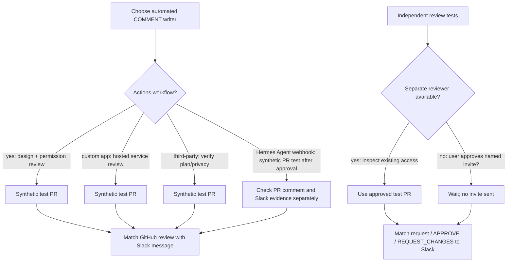

# 2026-11-23 Review automation and independent reviewer meeting
# 2026-11-23 리뷰 자동화와 독립 리뷰어 회의

## Purpose / 목적

Discuss who or what should write the required automated `COMMENT` review and how to obtain a reviewer who is separate from the pull request author for `APPROVE` and `REQUEST_CHANGES` tests.
필수 자동 `COMMENT` 리뷰를 어떤 자동화가 작성할지, `APPROVE`와 `REQUEST_CHANGES` 시험에서 PR 작성자와 다른 리뷰어를 어떻게 확보할지 논의합니다.

## Participants / 참석자

The Assistant organized the evidence and proposals. The role names below are analysis perspectives, not separate agents. Curtain is the actual decision maker. No decision or personal view is attributed to Curtain unless Curtain states it.
어시스턴트가 근거와 제안을 정리했습니다. 아래 역할명은 분석 관점이며 별도 에이전트가 아닙니다. 커튼 뒤가 실제 결정자입니다. 커튼 뒤가 직접 말하지 않은 결정이나 개인 의견을 대신 기록하지 않습니다.

## Agenda / 의제

1. Compare realistic sources for an automated `COMMENT` review.
   자동 `COMMENT` 리뷰를 작성할 현실적인 주체를 비교합니다.
2. Identify a safe way to obtain an independent reviewer.
   독립 리뷰어를 안전하게 확보하는 방법을 찾습니다.
3. Separate recommendations from decisions and identify required approvals.
   권고와 결정을 구분하고 필요한 승인을 정리합니다.
4. Compare free OpenRouter models and Hermes Agent by Nous Research, identified by Curtain's official product link.
   커튼 뒤가 공식 제품 링크로 지정한 Nous Research Hermes Agent와 OpenRouter 무료 모델을 비교합니다.

## Facts / 사실

- The tracked `.github/workflows/quality-check.yml` runs on `push`, `pull_request`, and manual dispatch. It has `contents: read`; it does not listen for review events or submit reviews.
  추적 중인 `.github/workflows/quality-check.yml`은 `push`, `pull_request`, 수동 실행에서 동작합니다. 권한은 `contents: read`이며 리뷰 이벤트를 듣거나 리뷰를 제출하지 않습니다.
- The 2026-11-20 candidate review shortlisted Gemini API plus a custom GitHub App for a synthetic-data test. It left hosting cost, app selection as a reviewer, review-request compatibility, Slack delivery, and private-code processing terms open. That was a shortlist, not an adopted design.
  2026-11-20 후보 검토는 합성 데이터 시험용으로 Gemini API와 자체 GitHub App 조합을 우선 후보로 두었습니다. 호스팅 비용·앱을 리뷰어로 지정할 수 있는지·리뷰 요청 호환성·Slack 전달·비공개 코드 처리 조건은 미결정이었습니다. 이는 후보 목록이며 채택된 설계가 아닙니다.
- The prior read-only collaborator check recorded only `cosohotmas`, who was also the PR author and repository admin. It found no separate reviewer at that time. No new access check was performed for this meeting.
  이전 조회 전용 협업자 확인에는 PR 작성자이자 저장소 관리자인 `cosohotmas`만 기록되어 있고 당시 별도 리뷰어는 발견되지 않았습니다. 이번 회의에서 접근 목록을 새로 조회하지 않았습니다.
- Curtain adopted all four review-related notifications as mandatory tests. Adoption does not implement the automation or supply a reviewer.
  커튼 뒤는 리뷰 관련 네 알림을 필수 시험으로 채택했습니다. 채택만으로 자동화가 구현되거나 리뷰어가 생기지는 않습니다.
- Curtain supplied an additional comparison image recommending Qwen3-Coder 30B when local hardware can run it, citing local code review without API fees. This is an input recommendation, not an adopted choice. The project workflow requires online operation, so local-only execution does not meet the operating requirement as-is.
  커튼 뒤가 로컬 장비에서 실행할 수 있다면 API 비용 없이 코드를 검토하는 Qwen3-Coder 30B를 추천한다는 비교 이미지를 추가로 제공했습니다. 이는 참고 권고이며 채택된 선택은 아닙니다. 프로젝트 workflow는 온라인 운영을 요구하므로 로컬 전용 실행은 현재 운영 요건을 충족하지 않습니다.
- Current official documentation says Copilot Free does not include Copilot code review; free Gemini API tier inputs may be used to improve Google's products; and Ollama lists Qwen3-Coder 30B as a 19 GB download. Model download size alone does not prove the user's device has enough working memory or acceptable review quality.
  현재 공식 문서에 따르면 Copilot Free에는 Copilot 코드 리뷰가 포함되지 않고, Gemini API 무료 요금제 입력은 Google 제품 개선에 사용될 수 있으며, Ollama의 Qwen3-Coder 30B 다운로드 크기는 19GB입니다. 모델 다운로드 크기만으로 사용자 장비의 실행 메모리나 리뷰 품질이 충분하다고 입증되지는 않습니다.
- Curtain supplied the official [Hermes Agent by Nous Research](https://hermes-agent.nousresearch.com/) product link and clarified that this is the candidate to include. The earlier `@Hermes` shown in `#hermes-lab` is visually consistent by name, but this screenshot alone does not prove that the installed Slack app is this official Hermes Agent deployment.
  커튼 뒤가 공식 [Nous Research Hermes Agent](https://hermes-agent.nousresearch.com/) 제품 링크를 제공하고 이 제품을 후보에 포함하라고 명확히 했습니다. 앞서 `#hermes-lab`에서 보인 `@Hermes`와 이름은 일치하지만, 캡처만으로 설치된 Slack 앱이 공식 Hermes Agent 배포본임을 입증하지는 않습니다.
- Hermes Agent's official guide describes a GitHub webhook route that receives pull-request events, fetches the PR diff with `gh`, and posts a comment using `gh pr comment`. It requires a running gateway, a publicly reachable endpoint, authenticated `gh` on that host, and repository admin access to configure the webhook. The guide warns about prompt injection in attacker-controlled PR text and recommends a sandboxed environment for an internet-facing gateway.
  Hermes Agent 공식 안내에는 PR webhook을 받아 `gh`로 diff를 가져오고 `gh pr comment`로 코멘트를 게시하는 경로가 설명되어 있습니다. 실행 중인 gateway·외부에서 접근 가능한 endpoint·해당 호스트의 인증된 `gh`·webhook 설정용 저장소 관리자 권한이 필요합니다. 인터넷에 노출된 gateway에서는 공격자가 작성한 PR 문구의 prompt injection 위험을 경고하며 격리 환경을 권합니다.
- The documented Hermes delivery is a PR conversation comment. The guide does not establish an Actions-submitted GitHub review with state `COMMENT`, nor review-request, `APPROVE`, or `REQUEST_CHANGES` Slack delivery. These remain separate required tests and are unverified for Hermes.
  문서에 설명된 Hermes 전달은 PR 대화 코멘트입니다. Actions가 제출한 GitHub 리뷰 상태 `COMMENT` 또는 리뷰 요청·`APPROVE`·`REQUEST_CHANGES`의 Slack 전달을 입증하지 않습니다. 이 이벤트들은 별도 필수 시험이며 Hermes에서는 미검증입니다.
- Hermes Agent is described as free/open-source MIT software, while model providers and optional hosted services have their own prices. Its official Slack setup uses Socket Mode and documents bot/app tokens and scopes; those requirements do not prove that the already visible `@Hermes` Slack app is connected to this product.
  Hermes Agent는 무료 오픈소스 MIT 소프트웨어로 소개되지만 모델 제공자와 선택형 호스팅 서비스 비용은 별도입니다. 공식 Slack 설정은 Socket Mode를 사용하고 bot/app 토큰 및 권한 범위를 안내합니다. 이 요구사항은 화면에 이미 보이는 `@Hermes` 앱이 이 제품에 연결되어 있다는 증거가 아닙니다.
- OpenRouter's November 2026 free-model catalog says its ranking is based on seven-day usage, not quality or benchmark results. Free token pricing does not guarantee production uptime or zero total service cost.
  OpenRouter의 2026년 11월 무료 모델 목록은 순위가 7일 사용량 기준이며 품질이나 벤치마크 결과가 아니라고 밝힙니다. 토큰 무료가 운영 가동률이나 전체 서비스 비용 0원을 보장하지 않습니다.
- OpenRouter states that each model provider has its own data handling, retention, and use terms. Do not send this private repository's code to a candidate until the exact provider terms are checked and accepted; use synthetic code for any initial comparison.
  OpenRouter는 모델 제공자마다 데이터 처리·보존·이용 조건이 다르다고 설명합니다. 정확한 제공자 조건을 확인하고 수락하기 전에는 이 비공개 저장소 코드를 후보 모델에 보내지 않습니다. 초기 비교에는 합성 코드를 사용합니다.

## Role-based discussion / 역할별 논의

| Who | What · 제안 | Why · 이유 | How · 방법 | Goal · 목표 | Conviction · 소신 |
|---|---|---|---|---|---|
| Tech Lead | Keep the review writer separate from the quality-check workflow until its role and permissions are designed. 역할과 권한을 설계할 때까지 리뷰 작성기를 품질 검사 workflow와 분리합니다. | The existing workflow only checks code and docs; it does not submit reviews. 기존 workflow는 코드·문서를 검사할 뿐 리뷰를 제출하지 않습니다. | Compare a purpose-built Actions workflow with a hosted GitHub App before implementation. 구현 전에 전용 Actions workflow와 호스팅 GitHub App을 비교합니다. | A review path that can be tested end to end. 종단 간 시험 가능한 리뷰 경로입니다. | A green CI result must not be mistaken for a review or Slack notification. 초록 CI 결과를 리뷰나 Slack 알림으로 오해하면 안 됩니다. |
| Full-stack | Keep test PRs separate from production changes and use synthetic diffs first. 시험 PR을 실제 변경과 분리하고 먼저 합성 diff를 사용합니다. | Model input and review submission create different risks. 모델 입력과 리뷰 제출에는 서로 다른 위험이 있습니다. | Trigger manually for the first test, restrict the target repository/PR, and prevent bot self-trigger loops. 첫 시험은 수동 실행하고 저장소/PR 대상을 제한하며 봇 재실행 루프를 막습니다. | Predictable, bounded test behavior. 예측 가능하고 범위가 제한된 시험 동작입니다. | Never let a bot review its own generated commit as an independent approval. 봇이 만든 커밋을 봇 스스로 독립 승인하게 하지 않습니다. |
| SecOps | Compare token scope, model data handling, and secret storage before selecting the writer. 작성 주체를 정하기 전에 토큰 범위·모델 데이터 처리·비밀값 저장을 비교합니다. | A private repository diff and write-capable token may leave GitHub or alter review state. 비공개 저장소 diff와 쓰기 토큰은 GitHub 밖으로 나가거나 리뷰 상태를 바꿀 수 있습니다. | Use least privilege, synthetic data, hosted secrets, and an explicit review of provider terms. 최소 권한·합성 데이터·호스팅 비밀 저장소·제공자 조건 확인을 적용합니다. | No surprise disclosure or broad write access. 예상하지 못한 정보 공개나 광범위한 쓰기 권한 방지입니다. | Do not add an app, secret, collaborator, or permission without separate approval. 별도 승인 없이 앱·비밀값·협업자·권한을 추가하지 않습니다. |
| QA | Treat `COMMENT`, review request, `APPROVE`, and `REQUEST_CHANGES` as four distinct events. `COMMENT`, 리뷰 요청, `APPROVE`, `REQUEST_CHANGES`를 서로 다른 네 이벤트로 다룹니다. | One Slack message cannot prove every event type. Slack 메시지 하나가 모든 이벤트 종류를 입증하지 않습니다. | Match each GitHub event, actor/reviewer, PR and source link with its own Slack message permalink and result. GitHub 이벤트·작성자/리뷰어·PR·원본 링크를 각각 Slack permalink·결과와 대조합니다. | One evidence row per required event. 필수 이벤트마다 근거 행 하나입니다. | Missing evidence stays unverified; do not infer it from CI checks. 근거가 없으면 미검증으로 두고 CI 검사에서 추정하지 않습니다. |
| Operations | Compare online hosting and ongoing cost for each automation option. 자동화 선택지마다 온라인 호스팅과 지속 비용을 비교합니다. | A local process cannot meet the online-first project rule; free trials may expire. 로컬 실행은 온라인 기반 원칙을 충족하지 않으며 무료 체험은 끝날 수 있습니다. | Verify hosted runtime, quotas, recurring cost and failure handling before adopting a provider. 제공자를 채택하기 전에 호스팅 실행 환경·한도·반복 비용·실패 처리를 확인합니다. | A sustainable online test path. 지속 가능한 온라인 시험 경로입니다. | “Free today” is not proof of a free ongoing service. “오늘 무료”가 계속 무료라는 증거는 아닙니다. |
| Researcher | Reuse the 2026-11-20 candidate findings as a starting point, then verify current official details before selection. 2026-11-20 후보 조사 결과를 출발점으로 삼고 선택 전에 공식 최신 정보를 확인합니다. | Pricing, plan features and data terms may change. 요금·요금제 기능·데이터 조건은 바뀔 수 있습니다. | Check official pricing, review API support, reviewer assignment, Slack event behavior and model data terms. 공식 요금·리뷰 API·리뷰어 지정·Slack 이벤트 동작·모델 데이터 조건을 확인합니다. | Evidence-backed option comparison. 근거에 따른 선택지 비교입니다. | Do not present an old shortlist as a current verified recommendation. 과거 후보를 현재 검증된 권고처럼 제시하지 않습니다. |
| End User | **Fact:** Curtain identified Hermes Agent by Nous Research with its official product link. **사실:** 커튼 뒤가 공식 제품 링크로 Nous Research Hermes Agent를 지정했습니다. | The Slack screenshot's `@Hermes` display name does not prove that workspace app is connected to this product. Slack 캡처의 `@Hermes` 표시 이름만으로 작업공간 앱이 이 제품에 연결됐다고 볼 수 없습니다. | Compare the official webhook guide and confirm the installed Slack app identity before any setup or code transfer. 설정이나 코드 전송 전에 공식 webhook 안내를 비교하고 설치된 Slack 앱의 정체를 확인합니다. | Evaluate the named Hermes product for the requested PR-comment automation. 요청된 PR 코멘트 자동화에 지정된 Hermes 제품을 평가합니다. | Documented PR conversation comments do not substitute for the required Actions-submitted `COMMENT` review and other reviewer events. 문서화된 PR 대화 코멘트는 필수 Actions 제출 `COMMENT` 리뷰나 다른 리뷰어 이벤트를 대신하지 않습니다. |
| Curtain / 커튼 뒤 | **Decision pending:** choose the automation direction and reviewer-acquisition route. **결정 대기:** 자동화 방향과 리뷰어 확보 방식을 선택합니다. | Not stated by Curtain. 커튼 뒤가 이유를 따로 밝히지 않았습니다. | Not stated by Curtain. 커튼 뒤가 방법을 따로 밝히지 않았습니다. | Not stated by Curtain. 커튼 뒤가 목표를 따로 밝히지 않았습니다. | Not stated by Curtain. 커튼 뒤가 소신을 따로 밝히지 않았습니다. |

## OpenRouter free-model shortlist / OpenRouter 무료 모델 후보 5개

The order below is an assistant recommendation for which candidates to evaluate first, based on the model descriptions and available interface features. It is not an independently measured quality ranking. OpenRouter's own popularity order measures recent usage, not review quality. These candidates are currently listed at $0 token pricing, subject to free capacity and changing availability.
아래 순서는 모델 설명과 제공 기능을 바탕으로 어시스턴트가 시험 우선순위를 권하는 것입니다. 독립적으로 품질을 측정한 순위가 아닙니다. OpenRouter의 자체 인기 순위는 최근 사용량이지 리뷰 품질이 아닙니다. 후보들은 현재 토큰 가격 0달러로 표시되지만 무료 용량과 이용 가능성은 바뀔 수 있습니다.

| Rank | Candidate / 후보 | Why consider / 검토 이유 | Key caveat / 주요 미확인 사항 |
|---:|---|---|---|
| 1 | [Particle-1 `particle-ai/particle-1:free`](https://openrouter.ai/particle-ai/particle-1:free) | Described specifically for agentic coding and software engineering; long context and tool/structured-output support are listed. 에이전트형 코딩과 소프트웨어 엔지니어링 용도로 소개되며 긴 문맥·도구/구조화 출력 지원이 표시됩니다. | Review accuracy, provider data terms, rate limits and service continuity are unverified. 리뷰 정확도·제공자 데이터 조건·요청 한도·서비스 지속성은 미검증입니다. |
| 2 | [Flint `recursive/flint-v1.0:free`](https://openrouter.ai/recursive/flint-v1.0:free) | Described for coding agents: codebase investigation, bug fixes, implementation and tests. 코드베이스 조사·버그 수정·구현·테스트 등 코딩 에이전트 용도로 소개됩니다. | Review quality and exact provider data terms are unverified; structured output is not strict schema validation. 리뷰 품질·정확한 제공자 데이터 조건은 미검증이며 구조화 출력은 엄격한 스키마 검증과 다릅니다. |
| 3 | [ERNIE 5.5 Flash Preview `baidu/ernie-5.5-flash-preview:free`](https://openrouter.ai/baidu/ernie-5.5-flash-preview:free) | OpenRouter describes coding and agentic improvements and a long context window. OpenRouter가 코딩·에이전트 기능 개선과 긴 문맥을 안내합니다. | Preview status, provider terms, review accuracy and continuing free capacity need checking. 미리보기 상태·제공자 조건·리뷰 정확도·무료 용량 지속 여부 확인이 필요합니다. |
| 4 | [Nemotron 3.5 Lightning `nvidia/nemotron-3.5-lightning:free`](https://openrouter.ai/nvidia/nemotron-3.5-lightning:free) | Described for high-throughput agentic workloads and lists tool calling. 고처리량 에이전트 작업 용도로 소개되며 도구 호출을 표시합니다. | General agentic candidate, not a proven code reviewer; provider terms and review quality are unverified. 코드 리뷰 전용으로 검증된 모델이 아니라 일반 에이전트 후보입니다. 제공자 조건과 리뷰 품질은 미검증입니다. |
| 5 | [Gemma 4 26B A4B `google/gemma-4-26b-a4b-it:free`](https://openrouter.ai/google/gemma-4-26b-a4b-it:free) | Lists tool/function calling, structured output and a 262K context window. 도구/함수 호출·구조화 출력·262K 문맥을 표시합니다. | The listing does not establish suitability or data terms for private-code review. 목록 정보만으로 비공개 코드 리뷰 적합성이나 데이터 조건을 입증할 수 없습니다. |

**Recommendation:** Begin a synthetic-PR comparison with Particle-1 and Flint, then add the other three if useful. Pin a model ID instead of the variable `openrouter/free` router so each result can be attributed to a known model. The free-model catalog documents request limits and changing availability; a $0 token price does not cover GitHub hosting, Slack or ongoing operations. Do not send private diffs until the exact provider's data terms are reviewed and accepted.
**권고:** 합성 PR로 Particle-1과 Flint를 먼저 비교하고 필요하면 나머지 세 후보를 추가합니다. 결과를 특정 모델에 귀속할 수 있도록 변동형 `openrouter/free` 라우터 대신 모델 ID를 고정합니다. 무료 모델 목록에는 요청 한도와 변동 가능한 이용 가능성이 안내되어 있습니다. 토큰 가격 0달러는 GitHub 호스팅·Slack·지속 운영 비용을 포함하지 않습니다. 해당 제공자의 데이터 조건을 검토·수락하기 전에는 비공개 diff를 보내지 않습니다.

## Hermes Agent by Nous Research / Nous Research Hermes Agent

The candidate is Hermes Agent by Nous Research, which Curtain identified with the official product link. The Slack screenshot separately shows a workspace app named `@Hermes`; confirm that it is the same product before relying on it as the integration.
후보는 커튼 뒤가 공식 제품 링크로 지정한 Nous Research Hermes Agent입니다. Slack 캡처에는 별도로 `@Hermes`라는 작업공간 앱이 보이므로 연동으로 사용하기 전에 같은 제품인지 확인해야 합니다.

The official GitHub webhook guide describes automatic PR conversation comments: GitHub sends a PR event to the Hermes gateway, Hermes obtains the diff with `gh`, and `gh pr comment` posts its response. This proves the product documents a PR-comment path. It does not by itself prove that the path meets this project's specific required event, Actions-submitted review `COMMENT`, or that it sends the matching Slack notification. The guide requires a running gateway and publicly reachable webhook URL, authenticated GitHub CLI on the host, and repository admin access to configure the webhook. It flags prompt-injection risk from PR-authored text and recommends sandboxing an internet-facing gateway.
공식 GitHub webhook 안내는 자동 PR 대화 코멘트를 설명합니다. GitHub가 PR 이벤트를 Hermes gateway에 보내고, Hermes가 `gh`로 diff를 가져와 `gh pr comment`로 응답을 게시합니다. 제품에 PR 코멘트 경로가 문서화된 사실은 확인됩니다. 하지만 이것만으로 프로젝트의 필수 이벤트인 Actions 제출 리뷰 `COMMENT`를 지원하거나 그에 대응하는 Slack 알림을 보낸다고 입증되지는 않습니다. 안내상 실행 중인 gateway·외부에서 접근 가능한 webhook URL·호스트의 인증된 GitHub CLI·webhook 설정용 저장소 관리자 권한이 필요합니다. PR 작성 텍스트를 통한 prompt injection 위험을 경고하며 외부 공개 gateway의 격리를 권합니다.

Hermes Agent is listed as free/open-source under MIT. Model inference and optional hosting are separately priced by their providers. The official Slack instructions use Socket Mode and call for Slack bot/app tokens plus granted scopes; inspect the existing workspace app and its scopes before considering a connection. Initial tests should use synthetic PR diffs and separately compare the five OpenRouter model candidates. No installation, webhook, token, permission change, private-code transfer or live test is authorized by this meeting.
Hermes supports OpenRouter. OpenRouter's current `:free` models cost $0 per token, limited to 20 requests/minute and 50/day without buying credits. ngrok Free lists a no-charge development domain, up to three online endpoints, and 20,000 HTTP requests/month. A short synthetic test may therefore cost $0 within those quotas. Nous Portal's Free plan does not include cloud hosting, so always-on hosting is not confirmed free. Model availability and provider data terms still apply.
Hermes는 OpenRouter를 지원합니다. OpenRouter의 현재 `:free` 모델은 토큰 비용 0원이며 크레딧을 사지 않으면 분당 20회·하루 50회로 제한됩니다. ngrok 무료 플랜은 사용료 없는 개발 도메인, 온라인 endpoint 최대 3개, 월 HTTP 요청 20,000회를 안내합니다. 따라서 한도 내 짧은 합성 시험은 0원일 수 있습니다. Nous Portal 무료 플랜에는 클라우드 호스팅이 포함되지 않아 상시 호스팅은 무료라고 확인되지 않았습니다. 모델 가용성과 제공자 데이터 조건은 적용됩니다.
Curtain directed the Assistant to proceed with Hermes as a synthetic-PR test candidate, conditional on cost verification. This adopts Hermes for test planning only; it does not select a model or authorize a live test, installation, webhook, token, or permission change.
커튼 뒤는 비용 확인을 조건으로 Hermes를 합성 PR 시험 후보로 진행하라고 했습니다. 이는 시험 계획에서 후보로 채택한 것이며 모델 선택이나 실제 시험·설치·webhook·토큰·권한 변경을 승인한 것은 아닙니다.
Hermes Agent는 MIT 라이선스의 무료 오픈소스로 안내됩니다. 모델 추론과 선택형 호스팅 비용은 각각 제공자에 따라 별도입니다. 공식 Slack 안내는 Socket Mode와 Slack bot/app 토큰 및 권한을 요구하므로 연결을 검토하기 전에 기존 작업공간 앱과 권한 범위를 확인해야 합니다. 초기 시험은 합성 PR diff로 하고 OpenRouter 모델 후보 5개는 별도로 비교합니다. 이 회의는 설치·webhook·토큰·권한 변경·비공개 코드 전송·실제 시험을 승인하지 않습니다.

## Options and recommendation / 선택지와 권고

### Automated `COMMENT` writer / 자동 `COMMENT` 작성 주체

1. **GitHub Actions workflow:** runs in GitHub-hosted infrastructure and lives with the repository. It needs a designed trigger, narrowly scoped PR-write permission, secret handling, safe treatment of untrusted PR diffs, and a loop guard. The existing quality workflow does none of this.
   **GitHub Actions workflow:** GitHub 호스팅 환경에서 실행되고 저장소 안에서 관리됩니다. 실행 조건·최소 PR 쓰기 권한·비밀값 처리·신뢰하지 않는 PR diff 보호·재실행 방지 설계가 필요합니다. 기존 품질 검사 workflow에는 이 기능이 없습니다.
2. **Custom GitHub App plus hosted service:** was shortlisted earlier for a synthetic-data test. It needs an online host, app installation and permissions, token management, provider-cost/data-term review, and proof that Slack receives each review type.
   **자체 GitHub App과 호스팅 서비스:** 이전에 합성 데이터 시험 후보로 선정됐습니다. 온라인 호스트·앱 설치와 권한·토큰 관리·제공자 비용/데이터 조건 검토·각 리뷰 종류의 Slack 수신 증거가 필요합니다.
3. **Existing third-party reviewer app:** may be considered only after confirming current private-repository support, all required review states, cost and data processing. The earlier candidate review did not establish those requirements.
   **기존 외부 리뷰 앱:** 비공개 저장소 지원·필수 리뷰 상태 전체·비용·데이터 처리를 확인한 뒤에만 검토할 수 있습니다. 이전 후보 조사는 이 요건을 확인하지 못했습니다.

**Recommendation:** First establish the operating requirement. If the reviewer must run online as this project requires, evaluate a hosted option; do not recommend local-only Qwen3-Coder as the complete service. If Curtain wants to relax the online requirement for a personal review helper, separately check the user's device memory and performance, but keep it distinct from the GitHub-to-Slack integration test. Do not send private diffs to a free model API unless its data terms are accepted. Copilot Free is not a no-cost GitHub PR-review option under current official documentation. No provider is selected by this recommendation.
**권고:** 먼저 운영 요건을 확정합니다. 이 프로젝트 규칙대로 리뷰어가 온라인에서 실행되어야 한다면 호스팅 선택지를 평가하고, 로컬 전용 Qwen3-Coder를 완전한 서비스로 추천하지 않습니다. 커튼 뒤가 개인용 보조 도구에 한해 온라인 요건을 완화하려면 사용자 기기의 메모리·속도를 별도로 확인하되 GitHub→Slack 연동 시험과 구분합니다. 데이터 조건을 수락하기 전에는 비공개 diff를 무료 모델 API로 보내지 않습니다. 현재 공식 안내상 Copilot Free는 GitHub PR 리뷰를 무료로 제공하는 선택지가 아닙니다. 이 권고로 제공자를 선택하지 않습니다.

### Independent reviewer / 독립 리뷰어

1. **Existing trusted collaborator:** ask Curtain to identify a real person who is not the PR author; then inspect that person's existing repository access read-only.
   **기존 신뢰 협업자:** 커튼 뒤가 PR 작성자가 아닌 실제 사람을 지정한 뒤 해당 사람의 기존 저장소 권한을 읽기 전용으로 확인합니다.
2. **New collaborator:** if no suitable person already has access, Curtain identifies and approves the person and access scope before an invitation. Do not send an invitation or change permissions as part of this meeting.
   **새 협업자:** 적합한 기존 권한자가 없으면 커튼 뒤가 대상자와 접근 범위를 정하고 초대 전에 승인합니다. 이 회의에서는 초대나 권한 변경을 하지 않습니다.
3. **No reviewer available:** leave review-request and independent decision cases required but unverified. Do not substitute the PR author or an automated bot for an independent human decision.
   **리뷰어 없음:** 리뷰 요청과 독립 판정 시험은 필수·미검증으로 둡니다. PR 작성자나 자동 봇을 독립된 사람의 판정으로 대신하지 않습니다.

**Recommendation:** Prefer an already trusted, eligible human collaborator if one exists. If not, Curtain decides whether to approve inviting a specific person with the minimum needed access. Until then, the four review-related tests remain blocked/unverified; no waiver is proposed.
**권고:** 적격한 신뢰 협업자가 이미 있다면 그 사람을 우선합니다. 없다면 커튼 뒤가 특정 인물의 최소 접근 권한 초대를 승인할지 결정합니다. 그때까지 리뷰 관련 네 시험은 차단/미검증 상태이며 면제를 제안하지 않습니다.

## Mermaid decision flow / Mermaid 결정 흐름

## Decisions and open questions / 결정과 미결정 질문

- **Decision:** Hermes Agent is adopted as the candidate runtime for a bounded synthetic-PR evaluation, with a $0 spending cap. Curtain then selected `particle-ai/particle-1:free` as the first model for that comparison after reviewing three additional synthetic cases. This selects the model for evaluation only; it does not approve connecting Hermes to GitHub/Slack, a live PR, or production use.
  **결정:** Hermes Agent를 지출 상한 0원의 범위 제한 합성 PR 평가 후보 실행 환경으로 채택합니다. 이후 커튼 뒤가 합성 사례 세 개의 추가 비교 결과를 검토하고 첫 평가 모델로 `particle-ai/particle-1:free`를 선택했습니다. 이는 평가용 모델 선택이며 Hermes의 GitHub/Slack 연결·실제 PR·운영 사용 승인은 아닙니다.
- The three-case comparison found the planted defect in all three cases with Particle-1. ERNIE found two; its retry-case response was empty/truncated and could not be scored. This small synthetic sample is directional only, not a broad quality benchmark.
  합성 사례 세 개 비교에서 Particle-1은 의도적으로 넣은 결함을 모두 찾았습니다. ERNIE는 두 개를 찾았고 재시도 사례 응답은 비어 있거나 잘려 채점할 수 없었습니다. 이 적은 합성 표본은 참고용이며 전반적인 품질 벤치마크가 아닙니다.
- Official cost sources: [Hermes plans](https://hermes-agent.nousresearch.com/ai-agent-hosting), [Hermes providers](https://hermes-agent.nousresearch.com/docs/integrations/providers), [OpenRouter free models and limits](https://openrouter.ai/collections/free-models/), [ngrok limits](https://ngrok.com/docs/pricing-limits). Do not buy credits or start paid hosting for this test.
  공식 비용 출처: [Hermes 요금제](https://hermes-agent.nousresearch.com/ai-agent-hosting), [Hermes 제공자](https://hermes-agent.nousresearch.com/docs/integrations/providers), [OpenRouter 무료 모델·한도](https://openrouter.ai/collections/free-models/), [ngrok 한도](https://ngrok.com/docs/pricing-limits). 이 시험을 위해 크레딧을 사거나 유료 호스팅을 시작하지 않습니다.
- Which `COMMENT` writer should be evaluated: GitHub Actions, custom GitHub App plus hosted service, or a verified third-party app?
  자동 `COMMENT` 작성 주체로 GitHub Actions, 자체 GitHub App과 호스팅 서비스, 검증된 외부 앱 중 무엇을 평가할까요?
- Must the writer meet a continuing zero-cost limit, and is synthetic-only processing required until data terms are accepted?
  지속 비용 0원을 필수로 할까요? 데이터 조건을 확인할 때까지 합성 데이터만 처리해야 할까요?
- Does Curtain have a trusted separate reviewer already, or should a specific new collaborator be considered? What minimum access is acceptable?
  커튼 뒤에게 이미 신뢰하는 별도 리뷰어가 있나요, 아니면 새 협업자를 검토할까요? 허용 가능한 최소 권한은 무엇인가요?
- Is the intended reviewer a human collaborator for independent decisions, while automation is limited to `COMMENT`? This boundary should be explicit.
  자동화는 `COMMENT`만 작성하고 독립 판정은 실제 사람 협업자가 맡는 것이 의도인가요? 이 경계를 명시해야 합니다.
- Must automated review run in an online host under the existing project rule, or does Curtain want to consider a local-only helper as a separate personal tool?
  자동 리뷰는 기존 프로젝트 규칙대로 온라인 호스트에서 실행해야 하나요, 아니면 커튼 뒤가 별도 개인용 도구로 로컬 실행을 검토하길 원하나요?
- Is the user-operated device able to run the 19 GB Qwen3-Coder 30B model with adequate working memory and review speed? This is unknown and has not been tested.
  사용자가 쓰는 장비가 19GB Qwen3-Coder 30B를 충분한 메모리와 속도로 실행할 수 있나요? 아직 알 수 없으며 시험하지 않았습니다.
- What product/vendor is the `@Hermes` app in `#hermes-lab`, and who can confirm its model, GitHub scopes, code handling, cost and webhook/event support?
  `#hermes-lab`의 `@Hermes` 앱은 어떤 제품/공급사이며, 모델·GitHub 권한·코드 처리·비용·webhook/이벤트 지원을 누가 확인해 줄 수 있나요?
- Should the first synthetic-data comparison use Particle-1 and Flint, or should another free model be evaluated first?
  첫 합성 데이터 비교에서 Particle-1과 Flint를 사용하면 될까요, 아니면 다른 무료 모델을 먼저 평가할까요?

## Sources / 출처

- Current repository workflow: [`.github/workflows/quality-check.yml`](../../../.github/workflows/quality-check.yml). It is the source for the current trigger and permission facts.
  현재 저장소 workflow: [`.github/workflows/quality-check.yml`](../../../.github/workflows/quality-check.yml). 현재 실행 조건·권한 사실의 출처입니다.
- Prior candidate comparison: [2026-11-20 online AI reviewer candidates](2026-11-20-online-ai-reviewer-candidates.md). Its shortlist is historical and needs current revalidation before adoption.
  기존 후보 비교: [2026-11-20 온라인 AI 리뷰어 후보](2026-11-20-online-ai-reviewer-candidates.md). 후보 목록은 과거 자료이며 채택 전에 최신 재확인이 필요합니다.
- Prior access and review facts: [2026-11-19 review notification planning](2026-11-19-review-notification-planning.md). The collaborator result is historical, not a current access query.
  기존 접근·리뷰 사실: [2026-11-19 리뷰 알림 계획](2026-11-19-review-notification-planning.md). 협업자 조회는 과거 결과이며 현재 권한 조회가 아닙니다.
- [GitHub Copilot plans](https://docs.github.com/en/copilot/get-started/plans) and [Copilot code review availability](https://docs.github.com/en/copilot/concepts/agent-capabilities/agent-powered-workflows-and-operations/code-review): current Free plan and code-review eligibility.
  [GitHub Copilot 요금제](https://docs.github.com/en/copilot/get-started/plans)와 [Copilot 코드 리뷰 이용 조건](https://docs.github.com/en/copilot/concepts/agent-capabilities/agent-powered-workflows-and-operations/code-review): 현재 무료 요금제와 코드 리뷰 이용 조건입니다.
- [Gemini API pricing and data-use table](https://ai.google.dev/gemini-api/docs/pricing): current free/paid data-use distinction; free-tier inputs may be used to improve Google products.
  [Gemini API 요금 및 데이터 이용 표](https://ai.google.dev/gemini-api/docs/pricing): 현재 무료/유료 데이터 이용 구분이며 무료 입력은 Google 제품 개선에 사용될 수 있습니다.
- [Ollama Qwen3-Coder model page](https://ollama.com/library/qwen3-coder): lists the 30B model and 19 GB download. It does not establish adequate hardware for this user.
  [Ollama Qwen3-Coder 모델 페이지](https://ollama.com/library/qwen3-coder): 30B 모델과 19GB 다운로드를 표시합니다. 사용자 장비에서 충분히 실행되는지는 입증하지 않습니다.
- [GitHub securely using pull_request_target](https://docs.github.com/en/actions/reference/security/securely-using-pull_request_target): warns against executing untrusted PR code with privileged secrets or write tokens.
  [GitHub pull_request_target 보안 사용 지침](https://docs.github.com/en/actions/reference/security/securely-using-pull_request_target): 신뢰하지 않는 PR 코드를 비밀값·쓰기 토큰이 있는 권한 환경에서 실행하지 말라고 안내합니다.
- [GitHub review API](https://docs.github.com/en/rest/pulls/reviews) documents `COMMENT`, `APPROVE`, and `REQUEST_CHANGES` review states. API capability does not establish that a selected automation or Slack integration supports them end to end.
  [GitHub 리뷰 API](https://docs.github.com/en/rest/pulls/reviews)는 `COMMENT`, `APPROVE`, `REQUEST_CHANGES` 리뷰 상태를 설명합니다. API 기능만으로 선택한 자동화나 Slack 연동의 종단 간 지원이 입증되지는 않습니다.
- [OpenRouter free-model catalog](https://openrouter.ai/collections/free-models): current candidate descriptions, token prices and the note that popularity ranking measures usage, not quality.
  [OpenRouter 무료 모델 목록](https://openrouter.ai/collections/free-models): 현재 후보 설명·토큰 가격 및 인기 순위가 품질이 아니라 사용량 기준이라는 안내입니다.
- [OpenRouter privacy policy](https://openrouter.ai/privacy): model providers have their own data handling, retention and use terms; verify the selected provider before sending private code.
  [OpenRouter 개인정보 처리방침](https://openrouter.ai/privacy): 모델 제공자마다 데이터 처리·보존·이용 조건이 있으므로 비공개 코드를 보내기 전에 선택한 제공자를 확인해야 합니다.
- [OpenRouter rate limits](https://openrouter.ai/docs/api_reference/limits): request limits vary; the free-model collection provides current free-tier details.
  [OpenRouter 요청 한도](https://openrouter.ai/docs/api_reference/limits): 요청 한도는 달라지며 무료 모델 목록에서 현재 무료 이용 조건을 안내합니다.
- Curtain-provided screenshot of `#hermes-lab` showing a Slack workspace app named `@Hermes` and prompts mentioning tools. It does not prove that this installed app is the Nous Research product linked later by Curtain.
  커튼 뒤가 제공한 `#hermes-lab` 화면에는 `@Hermes` Slack 앱과 도구를 언급하는 요청이 보입니다. 이 설치된 앱이 이후 커튼 뒤가 링크한 Nous Research 제품이라는 점은 입증하지 않습니다.
- [Hermes Agent by Nous Research](https://hermes-agent.nousresearch.com/): official product and pricing FAQ. It says the agent is free/open-source MIT software; model providers and optional hosted services have separate pricing.
  [Nous Research Hermes Agent](https://hermes-agent.nousresearch.com/): 공식 제품 및 요금 안내입니다. 에이전트는 무료 오픈소스 MIT이며 모델 제공자와 선택형 호스팅은 별도 비용이라고 설명합니다.
- [Automated GitHub PR comments with webhooks](https://hermes-agent.nousresearch.com/docs/guides/webhook-github-pr-review): official PR conversation-comment flow, prerequisites and prompt-injection warning. It does not establish the project's required Actions-submitted review state or Slack event delivery.
  [webhook으로 GitHub PR 코멘트 자동화](https://hermes-agent.nousresearch.com/docs/guides/webhook-github-pr-review): 공식 PR 대화 코멘트 흐름·필요 조건·prompt injection 경고입니다. 프로젝트 필수 Actions 제출 리뷰 상태나 Slack 이벤트 전달을 입증하지는 않습니다.
- [Hermes Slack setup](https://hermes-agent.nousresearch.com/docs/user-guide/messaging/slack): official Socket Mode setup, tokens, event subscriptions and permission scopes.
  [Hermes Slack 설정](https://hermes-agent.nousresearch.com/docs/user-guide/messaging/slack): 공식 Socket Mode 설정·토큰·이벤트 구독·권한 범위 안내입니다.

## Next actions / 다음 작업

1. Curtain adopts, revises or rejects the recommendations and answers the open questions.
   커튼 뒤가 권고를 채택·수정·반려하고 미결정 질문에 답합니다.
2. Assistant updates the owning Stage 1 guide and workflow with the decision. Provider and reviewer details stay marked open until decided.
   어시스턴트가 결정을 담당 1단계 지침과 workflow에 반영합니다. 제공자와 리뷰어 정보는 결정 전까지 미결정으로 둡니다.
3. Any app installation, collaborator invitation, permission change, live PR test, or Slack message requires separate explicit authorization.
   앱 설치·협업자 초대·권한 변경·실제 PR 시험·Slack 메시지는 각각 별도 명시적 승인이 필요합니다.

## Rollout status / 도입 단계

Stage 1, GitHub → Slack, remains partially verified. Hermes is the candidate runtime and `particle-ai/particle-1:free` is selected for further synthetic evaluation under a $0 test cap. No GitHub/Slack integration, live PR, or production use is approved. Next: complete synthetic evaluation and prepare a no-spend setup; request separate approval before any live GitHub/Slack configuration or test.
1단계 GitHub → Slack은 부분 검증입니다. Hermes를 후보 실행 환경으로 두고 `particle-ai/particle-1:free`를 추가 합성 평가용으로 선택했습니다. GitHub/Slack 연동·실제 PR·운영 사용은 승인되지 않았습니다. 다음은 합성 평가를 마치고 지출 없는 구성을 준비하는 것이며, 실제 GitHub/Slack 설정이나 시험 전에 별도 승인을 받아야 합니다.
