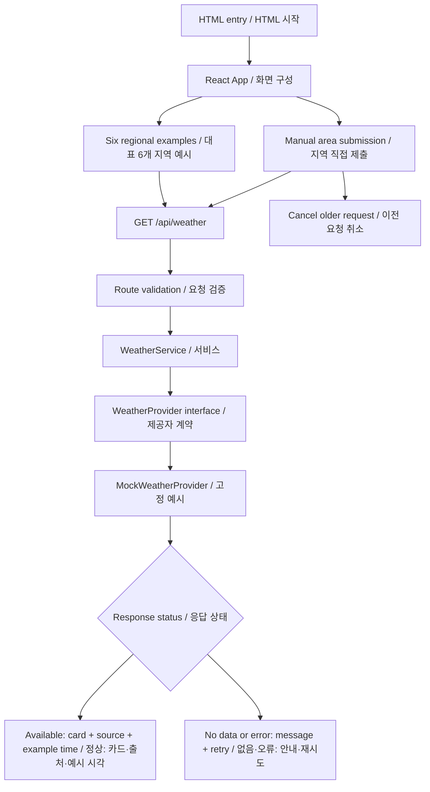

# Mock Weather Wiring Change Report
# Mock 날씨 연결 변경 보고서

## Official path, legacy archive, and worktree alignment / 공식 경로·legacy·worktree 정렬

| Path | Action | Purpose |
|---|---|---|
| `docs/office/README.md` | Edit / 수정 | Declare the official project path, legacy archive path, and feature-branch rule. / 공식 프로젝트 경로·legacy 보관 경로·feature branch 규칙을 명시 |
| `docs/office/meetings/2026-11-26-next-implementation-scope-second-meeting.md` | Edit / 수정 | Record Curtain's adoption of Candidate A. / 커튼 뒤의 A안 채택을 기록 |
| `CONVERSATION_LOG.md` | Edit / 수정 | Record the adopted documentation scope and its limits. / 채택된 문서 범위와 한계를 기록 |
| `docs/office/change-report.md` | Edit / 수정 | Explain the documentation alignment and verification. / 문서 정렬과 검증을 설명 |

Before: the official path and legacy archive were known in the workspace but were not stated together in the office index and current scope record.
이전: 공식 경로와 legacy 보관 위치는 작업공간에서 확인됐지만 사무실 문서 목차와 현재 범위 기록에 함께 명시되지 않았다.

After: the office index identifies `/Users/aspirinirony/project/cosohotmas/project/pixel_office` as the only active working path, identifies `/Users/aspirinirony/project/cosohotmas-legacy-20261125` as reference-only, and records the adopted Candidate A scope.
이후: 사무실 목차는 `/Users/aspirinirony/project/cosohotmas/project/pixel_office`를 유일한 활성 작업 경로로, `/Users/aspirinirony/project/cosohotmas-legacy-20261125`를 참고용으로 명시하고 A안 채택 범위를 기록한다.

Verification: inspect the official path, legacy path, branch, remote, and worktree facts; run `git diff --check`; verify document links and scan the diff for private paths or secrets. No code, workflow, external service, commit, Push, Pull Request, or merge is changed by this documentation update.
검증: 공식 경로·legacy 경로·브랜치·원격·worktree 사실을 확인하고 `git diff --check`를 실행하며 문서 링크와 diff의 개인 경로·비밀값을 검사한다. 이 문서 변경으로 코드·workflow·외부 서비스·커밋·Push·Pull Request·Merge는 변경하지 않는다.

## Trusted synthetic review verification / Trusted 합성 리뷰 검증

| Path | Action | Purpose |
|---|---|---|
| `.github/workflows/particle-review-synthetic.yml` | Create / 생성 | Provide a manually confirmed trusted workflow that tests a synthetic model failover and optional Slack receipt without running PR code. / PR 코드를 실행하지 않고 합성 모델 failover와 선택적 Slack 수신을 시험하는 수동 확인 trusted workflow 제공 |
| `scripts/particle_review_synthetic.py` | Create / 생성 | Call the trusted review parser against a bounded synthetic diff, record model failures, and send one bounded Slack result only after a successful model review. / 제한된 합성 diff로 trusted 리뷰 파서를 호출하고 모델 실패를 기록하며 모델 리뷰 성공 후에만 제한된 Slack 결과 하나를 전송 |
| `docs/office/change-report.md` | Edit / 수정 | Record the purpose, boundaries and local checks. / 목적·경계·로컬 검증 기록 |

Before: the PR review workflow checked out `main`, so a PR branch's changed failover code could not be proven before merge. After: a `workflow_dispatch` path is prepared for trusted `main`, requires an exact confirmation string, uses only a synthetic diff, never submits a GitHub review, and sends Slack only after a model succeeds. Implementation is local and not yet pushed.
이전: PR 리뷰 workflow가 `main`을 checkout하여 머지 전에 PR 브랜치의 failover 변경을 입증할 수 없었습니다. 이후: trusted `main`에서 실행되는 `workflow_dispatch` 경로를 준비하고 정확한 확인 문자열을 요구하며 합성 diff만 사용하고 GitHub 리뷰를 제출하지 않으며 모델 성공 후에만 Slack을 전송합니다. 구현은 로컬에만 있고 아직 Push하지 않았습니다.

Verification: Python syntax compilation and `git diff --check` passed. The confirmation gate was not used to call a model or send Slack. No secret value was read or printed, and no external service was changed.
검증: Python 문법 컴파일과 `git diff --check`를 통과했습니다. 확인 게이트를 사용해 모델을 호출하거나 Slack을 전송하지 않았습니다. 비밀값은 읽거나 출력하지 않았고 외부 서비스도 변경하지 않았습니다.

## Beginner-friendly user guidance / 초보자용 사용자 안내

| Path | Action | Purpose |
|---|---|---|
| `AGENTS.md` | Edit / 수정 | Define staged website/app guidance with official links, visible controls, cautions, completion phrase and secret-handling limits / 공식 링크·화면 버튼·주의점·완료 문구·비밀값 보호를 포함한 단계별 웹 안내 규칙 정의 |
| `CLAUDE.md`, `CLINE.md` | Edit / 수정 | Require the shared user-guidance rule / 공통 사용자 안내 규칙 적용 |
| `docs/office/workflow.md` | Edit / 수정 | Provide the operational guidance standard / 실제 단계별 안내 기준 제공 |
| `docs/office/README.md` | Edit / 수정 | Summarize the beginner guidance / 초보자용 안내 요약 |
| `CONVERSATION_LOG.md` | Edit / 수정 | Record the user-provided example and clarify its scope / 사용자 예시와 요청 범위 기록 |
| `docs/office/change-report.md` | Edit / 수정 | Record the change purpose and verification / 변경 목적·검증 기록 |

Before: instructions defined the ownership table but did not specify how to guide Curtain through a website or account setup. After: guidance covers one active stage at a time, official page links, numbered visible controls, cautions before action, later-stage preview, exact completion phrase, screenshot privacy, and never requesting secrets in chat. The sample screenshots did not authorize creating a Cloudflare account.
이전: 담당자 표 형식은 정했지만 웹사이트·계정 설정을 커튼 뒤에게 어떤 방식으로 안내할지 정하지 않았습니다. 이후: 현재 단계 하나씩 안내, 공식 페이지 링크, 화면 버튼을 사용한 번호 절차, 실행 전 주의점, 이후 단계 미리보기, 완료 문구, 화면 캡처 개인정보 보호, 채팅으로 비밀값을 요청하지 않는 원칙을 추가했습니다. 예시 화면은 Cloudflare 계정 생성을 허가하지 않았습니다.

Verification: confirmed the guidance rule in all five guidance documents, checked that the workflow/README references resolve, `git diff --check` passed, and all seven updated Markdown files match the user-facing workspace mirror. No account or external service was changed, and no application test was run. No external source material was added; license review is not applicable.
검증: 안내 규칙이 관련 문서 다섯 곳에 있고 workflow/README 링크 대상이 존재하며 `git diff --check`를 통과했고, 수정한 Markdown 7개 파일이 사용자 작업공간 사본과 일치함을 확인했습니다. 계정·외부 서비스는 변경하지 않았고 애플리케이션 테스트도 실행하지 않았습니다. 외부 자료를 추가하지 않아 라이선스 검토는 해당 없음입니다.

## Fixed task handoff table / 고정 작업 인계 표

| Path | Action | Purpose |
|---|---|---|
| `AGENTS.md` | Edit / 수정 | Require the exact three-column owner table in every task report / 모든 작업 보고에 고정 세 열 담당자 표 요구 |
| `CLAUDE.md`, `CLINE.md` | Edit / 수정 | Align other agent instructions with the shared format / 다른 에이전트 지침을 공통 형식에 맞춤 |
| `docs/office/workflow.md` | Edit / 수정 | Define step state, owner actions, verifier/evidence and next actor; provide a template / 단계 상태·담당 행동·확인자/근거·다음 실행자를 정의하고 양식 제공 |
| `docs/office/README.md` | Edit / 수정 | Summarize the fixed output standard / 고정 출력 기준 요약 |
| `CONVERSATION_LOG.md` | Edit / 수정 | Record Curtain's request and the adopted reporting format / 커튼 뒤 요청과 적용한 보고 형식 기록 |
| `docs/office/change-report.md` | Edit / 수정 | Describe this documentation change and its verification / 문서 변경·검증 기록 |

Before: task reports could use different layouts even though numbered owner handoffs were required. After: reports use exactly `순서 | 커튼 뒤가 할 일 | 제가 할 일`, mark each row 완료/현재/대기, state actions for both owners (or explicitly state no action), identify verification evidence, and name the next actor after the table. Existing approval boundaries are unchanged.
이전: 번호별 담당 인계는 요구했지만 보고 표 형식은 달라질 수 있었습니다. 이후: `순서 | 커튼 뒤가 할 일 | 제가 할 일` 세 열을 고정하고, 각 행에 완료·현재·대기와 두 담당자의 할 일(또는 할 일 없음), 확인 근거를 적으며 표 아래에 다음 실행자를 표시합니다. 기존 승인 범위는 그대로입니다.

Verification: confirmed the fixed headers and template appear in all five rule documents; `git diff --check` passed; and all seven updated Markdown files match the user-facing workspace mirror. No application tests or external actions were performed. No outside material was added; license review is not applicable.
검증: 다섯 규칙 문서 모두에 고정 표 머리글·양식이 반영됐고 `git diff --check`를 통과했으며, 수정한 Markdown 7개 파일이 사용자 작업공간 사본과 일치함을 확인했습니다. 애플리케이션 테스트나 외부 작업은 하지 않았습니다. 외부 자료를 추가하지 않아 라이선스 검토는 해당 없음입니다.

## Meeting record compliance correction / 회의록 규칙 준수 보완

| Path | Action | Purpose |
|---|---|---|
| `docs/office/meetings/2026-11-21-stage1-events-and-completion-criteria-review.md` | Edit / 수정 | Add explicit participants, agenda, facts/assumptions, and decision status with immediate Korean translations / 참석 역할·의제·사실/가정·결정 상태를 명시하고 바로 뒤에 한국어 번역 추가 |
| `CONVERSATION_LOG.md` | Edit / 수정 | Record the omission, cause and correction / 누락·원인·수정 기록 |
| `docs/office/change-report.md` | Edit / 수정 | Explain the file's role and correction checks / 파일 역할과 보완 검사 기록 |

Before: the meeting contained its purpose, evidence table, bilingual six-field role table, Mermaid, open questions and next actions, but it did not explicitly record participants, agenda, a facts/assumptions section, or decision status. After: those sections are explicit and bilingual; they state that the eight roles are analysis perspectives, Curtain is not a simulated speaker, no new policy was adopted, and Stage 1 remains partial.
이전: 회의 목적·근거 표·여섯 항목 이중 언어 역할 표·Mermaid·미결정 질문·다음 작업은 있었지만 참석자·의제·사실/가정·결정 상태가 명시적으로 기록되지 않았습니다. 이후: 이를 이중 언어 구역으로 추가해 여덟 역할은 분석 관점이며 커튼 뒤는 대신 발언하지 않고, 새 정책은 채택되지 않았으며 1단계는 부분 검증임을 밝혔습니다.

Verification: confirmed the meeting now has explicit participants, agenda, facts/assumptions, decision status, open questions, next actions and sources; eight role rows with six fields each; bilingual prose; a Mermaid diagram; and a link from the owning Stage 1 guide. `git diff --check` passed and the corrected meeting/log/report files match the workspace mirror. No application tests or external actions were performed. No external material was added; license review is not applicable.
검증: 회의록에 참석자·의제·사실/가정·결정 상태·미결정 질문·다음 작업·출처가 명시됐고, 여덟 역할 각각에 여섯 항목이 있으며, 이중 언어 본문·Mermaid·담당 1단계 가이드 링크가 있음을 확인했습니다. `git diff --check`를 통과했고 수정 회의록·대화 로그·변경 보고서가 작업공간 사본과 일치합니다. 애플리케이션 테스트나 외부 작업은 하지 않았습니다. 외부 자료가 없어 라이선스 검토는 해당 없음입니다.

## Rollout diagram color and event criteria / 도입 흐름 색상·이벤트 기준

| Path | Action | Purpose |
|---|---|---|
| `docs/office/workflow.md` | Edit / 수정 | Add a reusable overall rollout diagram and define cyan for the current rollout stage versus amber for the current task / 재사용 전체 도입 흐름을 추가하고 전체 단계 청록색·세부 작업 주황색을 구분 |
| `docs/office/README.md` | Edit / 수정 | Explain the meaning and limits of the two highlight colors / 두 강조 색상의 의미와 한계 설명 |
| `docs/office/meetings/2026-11-21-stage1-events-and-completion-criteria-review.md` | Edit / 수정 | Apply the requested non-error current-stage color / 오류처럼 보이지 않는 현재 단계 색상 적용 |
| `CONVERSATION_LOG.md` | Edit / 수정 | Record the request and clarification that event criteria remain pending adoption / 요청과 이벤트 기준 채택 대기 상태 기록 |
| `docs/office/change-report.md` | Edit / 수정 | Record the purpose and checks for these documentation changes / 문서 변경 목적·검사 기록 |

Before: the meeting's overall rollout diagram used the same amber border as the detailed task diagram, and the reusable workflow lacked a canonical overall rollout diagram/color key. After: the current rollout stage uses cyan `#22d3ee`, while the current task step keeps amber `#f59e0b`; color indicates focus only. The Stage 1 event matrix remains proposed, not adopted.
이전: 회의록의 전체 도입 흐름이 세부 작업 그림과 같은 주황색을 사용했고, workflow에는 표준 전체 도입 흐름/색 범례가 없었습니다. 이후: 현재 도입 단계는 청록색 `#22d3ee`, 세부 작업 단계는 주황색 `#f59e0b`으로 강조하며 색은 초점만 뜻합니다. 1단계 이벤트표는 제안 상태로 채택 전입니다.

Verification: Mermaid source and color references reviewed; `git diff --check` passed; the current-stage diagram uses cyan while the task-detail diagram uses amber; and all updated report documents were compared with the workspace mirror. Mermaid rendering and application tests were not run. No external settings, messages, or GitHub actions were changed. No external material was added, so license review is not applicable.
검증: Mermaid 소스·색상 참조, `git diff --check` 통과, 전체 도입 단계 청록색과 세부 작업 주황색 구분, 보고 문서와 작업공간 사본 일치를 확인했습니다. Mermaid 렌더링과 애플리케이션 테스트는 실행하지 않았습니다. 외부 설정·메시지·GitHub 작업은 변경하지 않았습니다. 외부 자료를 추가하지 않아 라이선스 검토는 해당 없음입니다.

## Numbered executor and verifier reporting / 번호별 실행자·확인자 보고

| Path | Action | Purpose |
|---|---|---|
| `AGENTS.md` | Edit / 수정 | Make numbered task reports identify the actor, action, verifier, proof, status and next actor in beginner-friendly language / 번호별 작업 보고에 쉬운 말로 실행자·할 일·확인자·근거·상태·다음 실행자를 명시 |
| `CLAUDE.md`, `CLINE.md` | Edit / 수정 | Apply the shared reporting rule consistently across agent entry points / 에이전트 지침 진입점 간 보고 규칙 통일 |
| `docs/office/workflow.md` | Edit / 수정 | Define the operational handoff and clarify that reporting is not external-action authorization / 단계별 인계를 정의하고 보고가 외부 실행 승인이 아님을 명시 |
| `docs/office/README.md` | Edit / 수정 | Give readers a short guide to executor/verifier reporting / 실행자·확인자 보고 안내 추가 |
| `CONVERSATION_LOG.md` | Edit / 수정 | Record the request, changes and next rollout action / 요청·변경·다음 도입 작업 기록 |

Before: the rules required numbered steps and actor labels but did not consistently say to explain in beginner-friendly language what each person does, what the check demonstrates, and which step is next. After: all three agent instruction files and the office workflow/README state the same handoff expectations. Existing authorization boundaries remain in place.
이전: 번호와 역할 표시는 요구했지만 각 사람이 무엇을 하는지, 확인으로 무엇을 알 수 있는지, 다음 단계가 무엇인지 쉬운 말로 일관되게 설명하라는 내용은 부족했습니다. 이후: 세 에이전트 지침과 사무실 업무 흐름·README에 같은 인계 요건을 적었습니다. 기존 승인 경계는 유지합니다.

Verification: reviewed the edited sections for consistent wording; `git diff --check` passed; confirmed that the workflow and README links point to the existing workflow document; and confirmed that all seven edited Markdown files match the user-facing workspace mirror. No application tests were added or run. No external settings, messages, Issues, commits, pushes, Pull Requests, or merges were changed. Sources are the user's instruction and repository rules; no external material was added, so license review is not applicable.
검증: 수정 구간의 문구 일치, `git diff --check` 통과, workflow 링크의 대상 존재, 수정한 Markdown 7개 파일과 사용자 작업공간 사본의 일치를 확인했습니다. 애플리케이션 테스트는 추가·실행하지 않았습니다. 외부 설정·메시지·Issue·커밋·Push·Pull Request·Merge는 변경하지 않았습니다. 출처는 사용자 지시와 저장소 규칙이며 외부 자료를 추가하지 않아 라이선스 검토는 해당 없음입니다.

## GitHub-to-Slack delivery recheck / GitHub→Slack 전달 재확인

| Path | Action | Purpose |
|---|---|---|
| docs/office/stage1-notifications.md | Edit | Add directly observed PR #26 Slack message links and clarify verified scope and limits. |
| CONVERSATION_LOG.md | Edit | Record the user's request and read-only verification result. |
| docs/office/change-report.md | Edit | Record purpose and checks for this documentation update. |

Before: PR #26 open/merge notifications were supported by the user's screenshot, which did not expose individual message permalinks. After: a read-only Slack channel inspection provides links and displayed KST times for the matching GitHub app messages. It confirms delivery for PR-open and PR-merged at least once, but not app permissions, all events, latency, or reliability. GitHub repository Settings returned 404 in the current signed-in browser session; this is recorded as an access limitation, not a disconnected integration verdict.
이전: PR #26 생성·병합 알림은 사용자 화면으로 확인했지만 개별 메시지 permalink는 보이지 않았습니다. 이후: Slack 채널 읽기 전용 확인으로 일치하는 GitHub 앱 메시지 링크와 KST 표시 시각을 기록합니다. PR 생성·병합 전달이 최소 한 번 됐음을 확인하지만 앱 권한·모든 이벤트·지연·신뢰성은 확인하지 못했습니다. 현재 로그인 브라우저에서 저장소 Settings가 404였으며, 이를 연동 해제 판정이 아닌 접근 한계로 기록합니다.

Verification: checked source event identifiers and Slack message content/permalinks; checked bilingual note, `git diff --check`, and workspace mirror equality. No messages, Issues, PRs, or settings were created or changed. No application tests or Mermaid rendering were run. No new external material/code/dependency was added; license review is not applicable. No commit, Push, or PR.
검증: 원본 이벤트 식별자와 Slack 메시지 내용·permalink를 대조하고 양언어 기록·`git diff --check`·작업 사본 일치를 확인합니다. 메시지·Issue·PR·설정을 생성하거나 변경하지 않았습니다. 앱 테스트와 Mermaid 렌더링은 하지 않았습니다. 외부 자료·코드·의존성을 추가하지 않아 라이선스 검토는 해당 없음입니다. 커밋·Push·PR 없음.

## Workspace folder-name review / 작업공간 폴더명 검토

| Path | Action | Purpose |
|---|---|---|
| docs/office/meetings/2026-11-21-pixel-office-folder-rename-review.md | Create and update | Record observed filesystem/Git facts, eight role perspectives, recommendation, execution result and three Mermaid views. |
| docs/office/README.md | Edit | Record adoption and verified directory move and Codex project-path update. |
| CONVERSATION_LOG.md | Edit | Preserve adoption, move verification, parent Git state and Codex path confirmation. |
| docs/office/change-report.md | Edit | Record file purpose and verification. |

Before: the user reported dissatisfaction with the misspelled workspace folder name; effects had not been reviewed. After: Curtain adopted the coordinated plan and the directory was moved to `pixel_office`. All 132 entries and 108 file hashes matched the pre-move manifest; no symlinks were present. Parent Git status, including its unrelated staged PDF and one-commit-ahead state, remained unchanged. The separate weather checkout stayed in place. The user then updated the Codex project entry; screenshots and a read-only project listing confirm its corrected name and path.
이전: 사용자가 작업공간 폴더명 오타를 지적했지만 영향 검토가 없었습니다. 이후: 커튼 뒤가 조정 계획을 채택해 폴더를 `pixel_office`로 옮겼습니다. 132개 항목과 파일 108개의 해시가 이동 전 목록과 일치했고 심볼릭 링크는 없었습니다. 무관한 stage PDF와 원격보다 1개 앞선 상태를 포함해 상위 Git 상태는 그대로입니다. 별도 날씨 checkout도 유지했습니다. 이후 사용자가 Codex 프로젝트 항목을 갱신했고 화면과 읽기 전용 프로젝트 목록에서 수정된 이름·경로를 확인했습니다.

Verification: confirmed the old path is absent and the new path exists; matched all 132 entries and 108 file SHA-256 hashes to the pre-move manifest; confirmed no symlinks; verified the Codex project listing now uses the corrected path and the parent Git status is unchanged. Checked bilingual role fields, three balanced Mermaid diagrams, `git diff --check`, private-path/credential scan, and workspace-mirror equality. Mermaid rendering and application tests were not run. No external material, code, dependency, or data was added; new-material license review is not applicable. No deletion, external configuration, commit, Push, or PR.
검증: 옛 경로가 없고 새 경로가 있음을 확인했습니다. 132개 항목과 파일 108개의 SHA-256을 이동 전 목록과 대조했고 심볼릭 링크가 없음을 확인했습니다. Codex 프로젝트 목록이 새 경로를 사용하고 상위 Git 상태가 그대로임을 검증했습니다. 역할별 양언어 항목·Mermaid 3개와 fence·`git diff --check`·개인 경로/자격 증명 검색·작업 사본 일치를 확인합니다. Mermaid 렌더링·앱 테스트는 실행하지 않았습니다. 외부 자료·코드·의존성·데이터 추가가 없어 신규 라이선스 검토는 해당 없음입니다. 삭제·외부 설정·커밋·Push·PR 없음.

## Bilingual meeting-record rule / 회의록 이중 언어 규칙

| Path | Action | Purpose |
|---|---|---|
| AGENTS.md | Edit | Add a repository-level English-plus-Korean rule for meeting-record prose. |
| docs/office/README.md | Edit | Explain how the bilingual rule applies to paragraphs, items, and role-table cells. |
| docs/office/meetings/2026-11-21-stage1-events-and-completion-criteria-review.md | Edit | Bring the current meeting report into line with the newly adopted writing rule. |
| CONVERSATION_LOG.md | Edit | Preserve the rule's evidence, scope, and non-retroactive application. |
| docs/office/change-report.md | Edit | Record the purpose and verification of these changes. |

Before: meeting-record rules required a location, agenda, role fields, and required sections, but did not specify English-only or bilingual writing. Source comments already had an English-then-Korean rule. After: meeting prose uses simple English followed immediately by Korean, and each role-table cell contains both languages. The rule applies going forward; historical records are not falsely described as compliant before this requirement existed.
이전: 회의록 규칙은 저장 위치·의제·역할 항목·필수 구성을 정했지만 영어 전용 또는 이중 언어 여부는 지정하지 않았습니다. 소스 주석에는 영어 다음 한국어 규칙이 있었습니다. 이후: 회의록 본문은 쉬운 영어 뒤에 바로 한국어를 쓰고 역할 표 각 칸에도 두 언어를 넣습니다. 앞으로 적용하며 규칙이 없던 과거 기록을 당시부터 준수했다고 표현하지 않습니다.

Verification: inspected `AGENTS.md`, `docs/office/README.md`, and the current meeting file; checked bilingual role-table cells, Mermaid fence balance, whitespace, credential/private-path scan, and workspace-mirror equality. Mermaid rendering and application tests were not run. No external material, code, dependency, or data was added; license review for new material is not applicable. No deletion, external configuration, commit, Push, or PR.
검증: `AGENTS.md`·`docs/office/README.md`·현재 회의록을 확인하고 역할 표의 양언어 입력, Mermaid fence 균형, 공백, 비밀값/개인 경로 검색, 작업 사본 일치를 검사합니다. Mermaid 렌더링·앱 테스트는 실행하지 않습니다. 외부 자료·코드·의존성·데이터 추가가 없어 신규 라이선스 검토는 해당 없음입니다. 삭제·외부 설정·커밋·Push·PR 없음.

## Stage 1 event coverage and completion criteria meeting / 1단계 이벤트 범위·완료 조건 회의

| Path | Action | Purpose |
|---|---|---|
| docs/office/meetings/2026-11-21-stage1-events-and-completion-criteria-review.md | Create | Record the eight-role analysis, event evidence matrix, candidate completion conditions, open questions and three Mermaid views. |
| docs/office/stage1-notifications.md | Edit | Link the pending recommendation from the Stage 1 owning guide without adopting it as policy. |
| CONVERSATION_LOG.md | Edit | Preserve the meeting outcome and pending adoption status. |
| docs/office/change-report.md | Edit | Record file purpose, behavior and verification for this change. |

Before: the Stage 1 guide contained event evidence but did not yet have a single role-based meeting that organized remaining events and completion criteria. After: the new minutes distinguish observed, accepted, deferred and unverified items; recommend that Curtain adopt the mandatory matrix and evidence threshold; and keep Stage 1 partial. The meeting link is explicitly recommendation-pending, not a policy change.
이전: 1단계 가이드에 이벤트 근거는 있었지만 남은 이벤트와 완료 조건을 역할별로 취합한 회의가 없었습니다. 이후: 회의록이 관찰·수락·보류·미검증을 구분하고 필수 이벤트 표 및 근거 기준을 커튼 뒤가 채택하도록 권고하며 1단계 부분 상태를 유지합니다. 담당 문서 링크는 권고·채택 대기임을 명시하며 정책 변경이 아닙니다.

Verification: reviewed `AGENTS.md`, `docs/office/README.md`, and the current meeting file; checked all eight bilingual role rows, three Mermaid diagrams with balanced fences, whitespace, credential/private-path scan, and workspace-mirror equality. Mermaid rendering and application tests were not run. Sources are repository rules, records and the user-provided screenshot; no external material, code, dependency, or data was added, so new-material license review is not applicable. No deletion, external test, permission change, commit, Push, or PR.
검증: `AGENTS.md`·`docs/office/README.md`·현재 회의록을 검토하고 8개 역할 표의 양언어 입력, Mermaid 그림 3개와 fence 균형, 공백, 비밀값/개인 경로 검색, 작업 사본 일치를 확인했습니다. Mermaid 렌더링·앱 테스트는 하지 않았습니다. 출처는 저장소 규칙·기록과 사용자 제공 화면이며 외부 자료·코드·의존성·데이터를 추가하지 않아 신규 자료 라이선스 검토는 해당 없음입니다. 삭제·외부 시험·권한 변경·커밋·Push·PR 없음.

## Service admin dashboard brainstorm / 서비스 관리자 대시보드 브레인스토밍

| Path | Action | Why this file changed |
|---|---|---|
| docs/office/meetings/2026-11-21-service-admin-dashboard-brainstorm.md | Create / 생성 | Record role-based brainstorming, open questions and Mermaid boundary proposal / 역할별 브레인스토밍·미결정 질문·Mermaid 경계 후보 기록 |
| CONVERSATION_LOG.md | Edit / 수정 | Record the meeting request, findings and pending adoption / 회의 요청·확인 내용·채택 대기 기록 |
| docs/office/change-report.md | Edit / 수정 | Explain this meeting record and validation / 회의록과 검증 설명 |

Before: the product PRD and brief did not define a service admin dashboard, while the Pixel Office dashboard was defined as agent/meeting status visualization. After: role-based brainstorming distinguished candidate purposes; Curtain then adopted the sequence that the service admin dashboard follows completion of the Pixel dashboard. Only sequence is adopted; completion criteria, feature scope and integration remain undecided. No product implementation, code or external service changed.
이전: 제품 PRD·기획서에는 서비스 관리자 대시보드 정의가 없고 픽셀 현황판은 에이전트/회의 상태 시각화로 정의돼 있었습니다. 이후: 역할별 브레인스토밍으로 후보 목적을 구분하고 커튼 뒤가 서비스 관리자 대시보드를 픽셀 현황판 완성 후 진행하기로 채택했습니다. 순서만 채택됐고 완료 기준·기능 범위·통합 여부는 미결정입니다. 제품 구현·코드·외부 서비스는 변경하지 않았습니다.

Verification: inspected PRD, product brief, office workflow and role definitions; confirmed eight populated six-field role rows, one balanced Mermaid block, fact/proposal/open-question separation, git diff --check, and the private-path/common-secret scan. Mermaid rendering and application tests were not run. Sources are repository documents and the user's meeting request; no external materials, code, assets or dependencies were added, so new-material license review is not applicable. No deletion, implementation, external write, commit, Push or PR.
검증: PRD·기획서·사무실 workflow·역할 정의 확인, 8개 역할 여섯 항목 표·Mermaid 블록 짝·사실/제안/미결정 구분·git diff --check·개인 경로/일반 비밀 패턴 검사를 통과했습니다. Mermaid 렌더링과 앱 테스트는 실행하지 않았습니다. 출처는 저장소 문서와 사용자 회의 요청이며 외부 자료·코드·자산·의존성을 추가하지 않아 신규 자료 라이선스 검토는 해당 없음입니다. 삭제·구현·외부 쓰기·커밋·Push·PR 없음.

Rollout stage: stage 1 partially verified, unchanged. Current task: record the adopted sequencing gate for service-admin work. Next rollout action: complete the Pixel dashboard stage before reopening service-admin scope; no service deployment stage advances here.
도입 단계: 1단계 부분 검증, 변경 없음. 현재 작업: 서비스 관리자 대시보드 진행 순서 게이트 기록. 다음 도입 작업: 서비스 관리자 범위 재논의 전 픽셀 현황판 단계를 완료하며, 이번 결정으로 운영 연동 단계가 진전하지 않습니다.

## Online-first scheduling principle / 온라인 기반 예약 실행 원칙

| Path | Action | Why this file changed |
|---|---|---|
| docs/office/meetings/2026-11-21-online-scheduling-runtime-meeting.md | Create / 생성 | Record eight-role discussion, accepted online-first rule and open scheduler choice / 8개 역할 논의·온라인 기반 채택 원칙·스케줄러 미결정 기록 |
| docs/office/workflow.md | Edit / 수정 | Add the adopted production scheduling boundary and meeting link / 채택된 운영 예약 경계와 회의록 링크 추가 |
| docs/office/README.md | Edit / 수정 | Surface the accepted rule in office documentation index / 사무실 문서 목차에서 채택 원칙 연결 |
| CONVERSATION_LOG.md | Edit / 수정 | Record the user's instruction and result acceptance / 사용자 지시와 결과 수락 기록 |
| docs/office/change-report.md | Edit / 수정 | Explain each file's purpose, change and verification / 파일별 목적·변경·검증 기록 |

Before: the project operating documents did not state whether scheduled work could depend on a local machine. After: the accepted rule says production schedules must run in the chosen hosted environment; local crontab/Codex automation is not treated as online service execution. Scheduler/provider selection, task schedule and external configuration remain undecided and unchanged.
이전: 프로젝트 운영 문서에 예약 작업이 로컬 컴퓨터에 의존해도 되는지 원칙이 없었습니다. 이후: 운영 예약은 선택된 호스팅 환경에서 실행하고 로컬 crontab/Codex 자동화를 온라인 서비스 실행으로 간주하지 않는다는 원칙을 채택했습니다. 스케줄러/제공자·작업 일정·외부 설정은 미결정이며 변경하지 않았습니다.

Verification: compare the recorded acceptance with the user's exact instruction; check role table columns, meeting Mermaid fence and workflow/README links; run whitespace and private-path/common-secret scans; synchronize the five edited/created documents to the user-facing workspace and compare. Documentation-only; no application tests or scheduler execution. Sources: user instruction, local-scope automation tool description and repository workflow. No external code/data/assets/dependencies were added, so new-material license review is not applicable. No deletion, commit, Push or PR.
검증: 사용자 지시와 결과 수락 기록 대조 → 역할 표 열·회의 Mermaid fence·workflow/README 링크 확인 → 공백·개인 경로/일반 비밀 패턴 검사 → 생성/수정 문서 5개를 사용자 화면 사본에 동기화·비교. 문서 전용이며 앱 테스트·스케줄 실행은 없습니다. 출처: 사용자 지시·로컬 범위 자동화 도구 설명·저장소 workflow. 외부 코드/데이터/자산/의존성 추가 없음으로 신규 자료 라이선스 검토 해당 없음. 삭제·커밋·Push·PR 없음.

Rollout stage: stage 1 partially verified, unchanged. Current task: document accepted online-first scheduling boundary. Next rollout action: when a scheduled product task is identified, define its hosted runtime and operational requirements before selecting a scheduler.
도입 단계: 1단계 부분 검증, 변경 없음. 현재 작업: 온라인 기반 예약 실행 경계 문서화. 다음 도입 작업: 제품 예약 작업이 정해지면 스케줄러 선택 전에 호스팅 실행 환경과 운영 요구사항을 정의합니다.

## PR #26 Slack receipt evidence / PR #26 Slack 수신 근거

| Path | Action | Why this file changed |
|---|---|---|
| docs/office/meetings/2026-11-21-pr26-slack-evidence-review.md | Create / 생성 | Record eight-role review, screenshot facts and evidence limits / 8개 역할 검토·스크린샷 사실·근거 한계 기록 |
| docs/office/stage1-notifications.md | Edit / 수정 | Add PR #26 open/merge receipt evidence while keeping stage 1 partial / 1단계를 부분 검증으로 두고 PR #26 생성·병합 수신 근거 추가 |
| CONVERSATION_LOG.md | Edit / 수정 | Record the evidence and current task state / 근거와 현재 작업 상태 기록 |
| docs/office/change-report.md | Edit / 수정 | Explain the documentation update and checks / 문서 변경 및 검사 기록 |

Before: the stage-1 guide had verified Issue #23 create/close and earlier PR #24 notification evidence, but did not include the user's new PR #26 screenshot. After: it records GitHub app Slack messages for PR #26 open and merged as observed once each, matching the PR number/title/repository. The screenshot does not expose exact event times or individual message permalinks; no latency claim is made. A role-based review record explicitly separates notification receipt from review/approval. Stage 1 remains partial because reviewer-dependent delivery and approval events remain unresolved.
이전: 1단계 지침에는 Issue #23 생성·종료 및 이전 PR #24 알림 근거가 있었지만 사용자가 새로 제공한 PR #26 스크린샷은 없었습니다. 이후: GitHub 앱 Slack 메시지에서 PR #26 생성·병합을 각각 1회 관찰로 기록하고 번호·제목·저장소 일치를 적었습니다. 스크린샷에 정확한 이벤트 시각과 개별 메시지 permalink가 없어 지연을 주장하지 않습니다. 역할별 검토 기록에서 알림 수신과 리뷰/승인을 구분했습니다. 리뷰어 의존 전달·승인 이벤트가 미해결이므로 1단계는 부분 검증입니다.

Verification order: compare the screenshot with the confirmed merged PR; check the six-column role table, Mermaid fence and relative link; run whitespace and private-path/common-secret scans; mirror the three edited records to the user-facing workspace and compare. This is documentation-only; application tests and independent Slack API inspection were not run. Source is the user-provided screenshot and repository PR state; no external code/data/assets/dependencies were added, so new-material license review is not applicable. No Issue, Slack message, access change, commit, Push or PR was created. Result review is pending.
검증 순서: 스크린샷을 확인된 병합 PR과 대조 → 6열 역할 표·Mermaid fence·상대 링크 검사 → 공백·개인 경로/일반 비밀 패턴 검사 → 수정 문서 3개를 사용자 화면 사본에 동기화·비교. 문서 작업이며 앱 테스트와 Slack API 독립 조회는 하지 않았습니다. 출처는 사용자가 제공한 스크린샷과 저장소 PR 상태이며 외부 코드/데이터/자산/의존성은 추가하지 않아 신규 자료 라이선스 검토는 해당 없음입니다. Issue·Slack 메시지·접근 변경·커밋·Push·PR 생성 없음. 결과 검토 대기.

Rollout stage: Stage 1 partially verified. Current task: record PR #26 Slack open/merge receipt evidence. Next rollout action: submit this evidence and the remaining event gaps for Curtain's review; do not infer phase completion.
도입 단계: 1단계 부분 검증. 현재 작업: PR #26 Slack 생성·병합 수신 근거 기록. 다음 도입 작업: 이 근거와 남은 이벤트 공백을 커튼 뒤에게 보고하며 단계 완료를 추정하지 않습니다.

## Mermaid diagram needs meeting / Mermaid 다이어그램 필요성 회의

| Path | Action | Why this file changed |
|---|---|---|
| docs/office/meetings/2026-11-21-mermaid-diagram-needs.md | Create / 생성 | Record role-based discussion on whether additional diagrams are needed / 추가 다이어그램 필요 여부에 대한 역할별 논의 기록 |
| docs/office/README.md | Edit / 수정 | Link the meeting from the office documentation index / 사무실 문서 목차에서 회의록 연결 |
| CONVERSATION_LOG.md | Edit / 수정 | Preserve meeting progress and pending adoption / 회의 진행·채택 대기 상태 기록 |

The meeting recommends retaining the rollout map, current task flow and target architecture as recurring views. Add a task-specific sequence diagram when event order matters. Add a data-flow view only if architecture does not show data/trust boundaries clearly. Reuse the existing approval flow. Adoption awaits Curtain, so standing instructions were not changed.
회의는 도입 지도·현재 작업 흐름·목표 아키텍처를 상시 사용하고, 이벤트 순서가 중요할 때 작업별 시퀀스를 추가하며, 아키텍처에서 데이터/신뢰 경계가 불명확할 때만 데이터 흐름을 추가하고 기존 승인 흐름을 재사용할 것을 권고합니다. 커튼 뒤 채택 대기이므로 상시 지침은 수정하지 않았습니다.

Execution order: read workflow, office README and roles; record role-based recommendations and Mermaid; link the meeting; update the conversation log; check relative links and whitespace. No app tests or Mermaid rendering were run. No external sources or code were used, so license review is not applicable. No deletion, commit or Push.
실행 순서: workflow·사무실 README·역할 정의 확인 → 역할별 권고와 Mermaid 기록 → 회의록 연결 → 대화 로그 갱신 → 상대 링크와 공백 확인. 앱 테스트·Mermaid 렌더링은 실행하지 않았습니다. 외부 출처·코드 사용이 없어 라이선스 검토는 해당 없음입니다. 삭제·커밋·Push 없음.

Restore correction: edited retryStorage.ts to reject overflowing flow sections independently and merge validated restrictions through policy logic; edited retryState.ts to preserve merged provenance; added regression cases in retryStorage.test.ts. Created the correction meeting and updated this report/log. Order: reproduce red tests, validate envelope, recover sections, merge restrictions, verify eligibility. Measured 63 frontend tests/typecheck/build passed; two original failures were observed before fixing. No commit or push.
복원 수정: retryStorage.ts의 초과 흐름 영역을 독립 거부하고 유효 제한은 정책 병합으로 복구했습니다. retryState.ts는 병합 근거 표시를 보존하고 retryStorage.test.ts에 회귀를 추가했습니다. 수정 회의록·보고서·로그 갱신. 순서: 실패 재현→전체 검증→영역 복구→제한 병합→허용 검증. 수정 전 원래 실패 2건 확인 후 Frontend 63개·타입·빌드 통과. 커밋·Push 없음.

## Retry state module implementation
## 재시도 상태 모듈 구현

| File / 파일 | Action / 작업 | Why and operation / 이유·작동 |
|---|---|---|
| frontend/src/state/retryState.ts | Create / 생성 | Pure dispatch/result/deadline/capacity/provider-merge calculations with injected time / 시간 주입 기반 발송·결과·대기·상한·제공자 병합 계산 |
| frontend/src/services/retryStorage.ts | Create / 생성 | Size and semantic validation, restore/prune, independent restriction recovery, memory fallback / 크기·의미 검증·복원·정리·독립 제한 복구·메모리 대체 |
| frontend/src/tests/retryState.test.ts | Create / 생성 | Boundary, cancellation, no_data, expiry, capacity, merging and clock checks / 경계·취소·no_data·만료·상한·병합·시계 검증 |
| frontend/src/tests/retryStorage.test.ts | Create / 생성 | Final shape roundtrip, corrupted entries, size/version/field rejection, quota fallback / 최종 형식 복원·손상·크기/버전/필드 거부·저장 실패 대체 |
| docs/office/meetings/2026-11-18-retry-implementation.md | Create / 생성 | Preserve role discussion, approval scope and Mermaid / 역할 논의·승인 범위·Mermaid 보존 |
| docs/specs/weather-retry-state-implementation.md | Edit / 수정 | Record actual shape, measurements and limitations / 실제 형식·실측·한계 기록 |
| docs/office/change-report.md and CONVERSATION_LOG.md | Edit / 수정 | Record purpose, behavior and verification / 목적·동작·검증 기록 |

Order: validate configuration/records, restore and prune, calculate transitions, save or memory-fallback, return outcomes. Before: design only. After: independently testable modules, no UI wiring. Source: adopted repository specs; no external code/assets added. Skill: add-educational-comments guided English/Korean execution comments. Verified 59 frontend tests, typecheck, build and whitespace. No deletions or commit yet.
순서: 설정·기록 검증→복원·정리→전이 계산→저장 또는 메모리→결과 반환. 이전은 설계만, 이후는 화면 미연결 독립 모듈입니다. 출처는 채택 명세이며 외부 코드·자산 추가는 없습니다. add-educational-comments로 영어·한글 실행 주석을 작성했습니다. Frontend 59개·타입·빌드·공백 검증. 삭제·커밋은 없습니다.

Final consistency correction: updated adopted status throughout implementation/design/meeting records and separated superseded candidate experiments from active rules. Preserved browser-test limitations and implementation approval boundary. Verified whitespace and workspace copies before the user-authorized documentation commit.
최종 일관성 수정: 명세·설계·회의록의 채택 상태를 갱신하고 폐기 후보 실험을 현행 규칙과 분리했습니다. 브라우저 검증 한계·구현 승인 경계는 유지하고 사용자 승인 문서 커밋 전 공백·작업 폴더를 확인합니다.

Finalized provider-scoped merging in the implementation specification and created its decision record; linked Mermaid and adoption summary. Superseded all-provider overflow blocking. Updated report/log; validate links, whitespace, and workspace reflection. No runtime changes.
구현 명세의 제공자 단위 병합을 확정하고 결정 회의록·Mermaid·채택 요약을 기록했습니다. 모든 제공자 전역 차단은 폐기했습니다. 보고서·로그·연결·공백·작업 폴더 반영을 확인하며 실행 변경은 없습니다.

Recorded the user's provider-count constraint in the implementation specification: validate configuration, reject overflow and duplicate IDs, and review capacity before supported-list expansion. Added proposed acceptance cases; updated this report/log. Documentation only; executable configuration validation is not implemented.
사용자의 제공자 수 제약을 구현 명세에 기록했습니다. 설정 검증·초과 및 중복 거부·지원 목록 확장 전 상한 검토와 완료 조건을 명시하고 보고서·로그를 갱신했습니다. 문서 변경이며 실행 설정 검증은 아직 구현하지 않았습니다.

Ran a temporary standalone Chromium storage probe to check candidate serialization, identifier bounds, reload persistence, real quota exception, and memory fallback. Recorded measured results/limits in the implementation spec and log. Removed the temporary probe after use; no existing user file was deleted. Application source remains unchanged. The experiment is not a substitute for future adapter/schema tests.
임시 Chromium 독립 실험으로 후보 직렬화·식별자 경계·새로고침 유지·실제 용량 예외·메모리 대체를 확인하고 명세·로그에 결과와 한계를 기록했습니다. 사용 후 임시 실험 파일만 제거했으며 기존 사용자 파일 삭제는 없습니다. 앱 소스 변경은 없고 향후 어댑터·스키마 테스트를 대체하지 않습니다.

Verification follow-up: reconciled the accepted 20-flow validation status; added a proposed restriction-overflow scalar and documented Node serialization/size boundaries. Updated this report/log. Candidate measurements reproduced; final schema and browser tests remain pending. Reflect files and check whitespace. No runtime source change.
검증 후속: 흐름 20개 검증 기준 채택 상태를 통일하고 제한 포화 단일 필드 제안·Node 직렬화 및 크기 경계 결과를 기록했습니다. 보고서·로그를 갱신했습니다. 후보 측정은 재현됐으나 최종 스키마·브라우저는 미검증입니다. 폴더 반영·공백을 확인하며 실행 소스 변경은 없습니다.

Recorded accepted input bounds and a four-case JSON size experiment in the implementation proposal; proposed, but did not adopt, a 96-KiB envelope cap. Updated this report/log. Measurement used candidate fixtures, not runtime schema validation. Browser quota and JavaScript serialization remain untested. No runtime code change.
구현 명세에 채택한 입력 상한·JSON 크기 4종 실험을 기록하고 전체 96KiB는 채택 전 제안으로 두었습니다. 이 보고서·로그를 갱신했습니다. 후보 자료 측정이며 실행 스키마 검증은 아닙니다. 브라우저 용량·JavaScript 직렬화는 미검증입니다. 실행 코드 변경은 없습니다.

Supplemented the implementation proposal with independent restriction fields/validation and capacity outcomes/recovery. Existing entries remain usable under their limits; capacity differs from storage failure. Updated this report/log. Check whitespace, section placement, and workspace equality. All new details remain proposals; no code or deletion.
구현 제안에 독립 제한 필드·검증과 상한 결과·복구를 보완했습니다. 기존 항목은 자기 제한 안에서 사용하며 상한·저장 실패를 구분합니다. 이 보고서·로그를 갱신하고 공백·절 배치·폴더 일치를 확인합니다. 신규 세부는 제안이며 코드·삭제는 없습니다.

Documented the adopted adjustable 30-minute assumption in retry-state design/meeting. Created weather-retry-state-implementation.md to make proposed modules, storage format, bounds and tests reviewable; updated this report/log. Read adopted assumptions before proposed implementation. Validate local links, whitespace and workspace equality. No source implementation or deletions.
상태 설계·회의록에 조정 가능한 30분 가정을 반영했습니다. 모듈·저장 형식·상한·검증 제안을 검토 가능하게 하려고 구현 명세를 생성하고 이 보고서·로그를 갱신했습니다. 채택 가정 후 구현 제안 순서로 읽습니다. 로컬 링크·공백·폴더 일치를 검증합니다. 소스 구현·삭제는 없습니다.

Created retry-state design and meeting records to preserve scope, cancellation accounting, unknown-result deadlines, and Mermaid. Linked the parent policy and updated this report/log. Read meeting, design, then remaining implementation decisions. Verified documentation whitespace, local targets and workspace equality. No runtime changes or deletions.
범위·취소 집계·결과 불명 허용 시각·Mermaid를 보존하려고 상태 설계·회의록을 생성하고 상위 정책·이 보고서·로그를 연결했습니다. 회의록·설계·남은 구현 결정 순서로 읽습니다. 공백·로컬 대상·폴더 일치를 검증합니다. 실행 변경·삭제는 없습니다.

Corrected the original adoption meeting's outdated proposal status and linked the subsequent adoption record. This aligns meeting history with the current policy while preserving unresolved implementation details. Updated this report and conversation log; checked whitespace, link target, and workspace equality.
최초 회의록의 오래된 제안 상태를 후속 채택 완료로 정정하고 결정 기록을 연결했습니다. 구현 미결정은 유지하며 회의 이력과 현재 정책을 일치시켰습니다. 이 보고서·대화 로그를 갱신하고 공백·링크 대상·폴더 일치를 확인합니다.

Created the supplement-review meeting to preserve detailed role reasoning and adoption; updated retry/cache policy from proposal to adopted status and linked the record. Updated this report/log. Read the meeting, then policy and unresolved implementation gates. Verify whitespace, links and workspace equality. Numeric values unchanged; no code or deletion.
상세 역할 근거·채택을 보존하려고 보완 재검토 회의록을 생성하고 정책을 제안에서 채택으로 갱신·연결했습니다. 이 보고서·로그를 수정했습니다. 회의록·정책·구현 미결정 순서로 읽습니다. 공백·연결·폴더 일치를 검증합니다. 숫자 변경·코드·삭제는 없습니다.

Review supplement: edited retry/cache policy to propose same-key retry persistence and explicit no_data handling, and added Mermaid branches. Updated the adoption record without rewriting the original adopted numbers, plus this report/log. Validate whitespace and workspace equality. No runtime change or deletion.
검토 보완: 재시도·캐시 정책에 동일 키 제한 유지·no_data 처리를 제안하고 Mermaid 분기를 추가했습니다. 원래 채택 숫자를 바꾸지 않고 회의록·이 보고서·로그에 후속을 기록했습니다. 공백·작업 폴더 일치를 검증합니다. 실행 변경·삭제는 없습니다.

## Retry/cache policy adoption
## 재시도·캐시 정책 채택

Created the adoption meeting record to preserve role reasoning and user scope; created weather-retry-cache-policy.md to own values, exceptions, Mermaid, and implementation gates. Linked it from provider policy and updated this report/log. Read meeting, policy, then prepare an implementation plan. Validate relative links, whitespace, and workspace equality. Sources are user decisions, not provider guarantees. No code or deletion.
역할 근거·사용자 승인 범위를 보존하는 채택 회의록과 값·예외·Mermaid·구현 조건을 담당하는 재시도 캐시 정책을 생성했습니다. Provider 정책에서 연결하고 이 보고서·로그를 갱신했습니다. 회의록·정책 후 구현 계획 순서로 읽습니다. 상대 링크·공백·작업 폴더 일치를 검증합니다. 출처는 사용자 결정이며 제공자 보장값이 아닙니다. 코드 변경·삭제는 없습니다.

Review corrections: limited source/time display to successful weather responses, aligned failure rules, and updated evidence sources and remaining work to the current attachment verification state. Moved the initial parsing failure into research history. Updated this report/log; verify whitespace and workspace equality. No runtime change.
검토 수정: 출처·시각 표시를 정상 날씨 응답으로 한정하고 실패 규칙을 연결했으며 출처·남은 작업을 현재 첨부 검증 상태로 갱신했습니다. 최초 읽기 실패는 조사 이력으로 옮겼습니다. 이 보고서·로그를 갱신하고 공백·폴더 일치를 검증합니다. 실행 변경은 없습니다.

## Adopted error display documentation
## 채택 오류 표시 문서화

Created the error-display meeting record to preserve eight detailed role statements, the user's adoption, Mermaid, and unresolved items. Updated provider policy to own the rules, API contract to link them, and this report/log to explain the change. Read the meeting, policy, then contract. Validate local links, whitespace, and workspace equality. No runtime edits or deletions.
역할 8개의 상세 발언·사용자 채택·Mermaid·미결정을 보존하려고 오류 표시 회의록을 생성했습니다. 정책에 원칙을 두고 API 계약에서 연결하며 이 보고서·로그에 변경 이유를 기록합니다. 회의록·정책·계약 순서로 읽습니다. 로컬 링크·공백·작업 폴더 일치를 검증합니다. 실행 변경과 삭제는 없습니다.

Updated the timestamp evidence document after inspecting both guide DOCX files and the coordinate XLSX. The new section supersedes the earlier attachment limitation while preserving research history. Verified workbook headers and timestamp passages; updated the log and reflected both files in the workspace. No runtime changes.
가이드 DOCX 두 개와 좌표 XLSX를 확인한 뒤 시각 근거 문서를 갱신했습니다. 새 절은 조사 이력을 보존하면서 이전 첨부 미확인 상태를 갱신합니다. 표 머리글·시각 본문을 확인하고 로그를 수정해 두 파일과 이 보고서를 작업 폴더에 반영합니다. 실행 변경은 없습니다.

## Timestamp evidence research
## 시각 근거 조사

Created `docs/specs/weather-time-evidence.md` to make official sources, mappings, conflicts, limitations, and Mermaid reviewable. Readers follow sources to mappings and unresolved gates. Linked it from the investigation meeting and updated this report/log. Public pages were read; the guide attachment was not parsed. Runtime code unchanged. Verify local links, whitespace, and reflected workspace files.
공식 출처·매핑·충돌·한계·Mermaid를 검토 가능하게 하려고 근거 문서를 생성했습니다. 출처부터 매핑·미해결 조건 순서로 읽습니다. 조사 회의록에서 연결하고 이 보고서·로그를 갱신했습니다. 공개 페이지는 확인했지만 가이드 첨부 본문은 읽지 못했습니다. 실행 코드 변경은 없으며 로컬 링크·공백·작업 폴더 일치를 확인합니다.

## Investigation scope meeting record
## 조사 범위 회의록 작성

Created `docs/office/meetings/2026-11-18-investigation-scope.md` to preserve the eight role statements, observer report, investigation sequence, and Mermaid. Readers start with purpose, read Who/What/Why/How/Goal/conviction, then review unresolved questions. Updated this report and the conversation log to track the work. Validation covers local links, whitespace, and workspace equality. No deletions or runtime changes.
역할 8개의 발언·커튼 뒤 보고·조사 순서·Mermaid를 보존하려고 회의록을 생성했습니다. 목적부터 읽고 각 역할의 Who·What·Why·How·Goal·소신과 미결정을 확인합니다. 변경 추적을 위해 이 보고서와 대화 로그를 수정했습니다. 로컬 링크·공백·작업 폴더 일치를 검증합니다. 삭제와 실행 코드 변경은 없습니다.

## Detailed meeting statements
## 상세 회의 발언 기록

Created `docs/office/meetings/2026-11-18-provider-readiness-discussion.md` to preserve eight role perspectives using Who, What, Why, How, Goal, and conviction. Read the agenda, review each statement, then follow the Mermaid to the observer's unresolved decisions. Linked it from the source meeting; updated this report and the conversation log. Validation: relative links, whitespace, and workspace equality. No files deleted.
역할 8개의 관점을 Who·What·Why·How·Goal·소신으로 보존하려고 회의록을 생성했습니다. 의제를 읽고 각 발언을 검토한 뒤 Mermaid를 따라 관찰자의 미결정 사항을 확인합니다. 출처 회의록에서 연결하고 이 보고서와 대화 로그를 갱신했습니다. 상대 링크·공백·작업 폴더 일치를 검증합니다. 삭제 파일은 없습니다.

## Workspace reflection and review corrections
## 작업 폴더 반영과 검토 수정

The provider matrix and new source entries now include English followed by Korean. The provider diagram requires approval of terms and integration, and stops live requests when approval is absent. The eight changed documentation files are reflected in the user workspace and compared byte-for-byte. No runtime code changed.
Provider 비교표와 신규 출처 항목에 영어 다음 한글을 추가했습니다. Provider 흐름도는 이용 조건·연동 승인을 요구하며 미승인 시 실시간 요청을 중단합니다. 변경 문서 8개를 사용자 작업 폴더에 반영하고 바이트 단위로 비교합니다. 실행 코드는 변경하지 않았습니다.

## 2026-11-18 — API source meeting records and provider policy
## 2026-11-18 — API 출처 회의록과 제공자 정책

<!-- Record why each file exists, how it works, and how it was checked. -->
<!-- 각 파일의 존재 이유·작동 방식·검증 방법을 기록합니다. -->

| File / 파일 | Action / 작업 | Why and operation / 이유와 작동 |
|---|---|---|
| `AGENTS.md` | Edit / 수정 | Require one Markdown record per formal meeting and a Mermaid diagram for flows or relationships. 공식 회의별 Markdown 회의록과 흐름·관계에 대한 Mermaid 작성을 의무화합니다. |
| `docs/office/README.md` | Edit / 수정 | Define where meeting records live and what each record contains. 회의록 위치와 필수 내용을 정의합니다. |
| `docs/office/meetings/2026-11-18-api-source-review.md` | Create / 생성 | Record the API source meeting, role discussion, evidence, decision flow, and next actions. API 출처 회의의 역할별 논의·근거·결정 흐름·다음 작업을 기록합니다. |
| `docs/specs/weather-provider-policy.md` | Create / 생성 | Make regional provider selection and licensing rules explicit. 지역별 Provider 선택과 라이선스 규칙을 명시합니다. |
| `docs/SOURCES_AND_LICENSES.md` | Edit / 수정 | Add KMA, Open-Meteo, and NOAA/NWS source candidates and review status. 기상청·Open-Meteo·NOAA/NWS 후보 출처와 검토 상태를 추가합니다. |
| `docs/specs/weather-api-contract.md` | Edit / 수정 | Link the internal contract to the provider policy. 내부 계약을 Provider 정책과 연결합니다. |
| `CONVERSATION_LOG.md` | Edit / 수정 | Preserve the meeting decision and approval trail. 회의 결정과 승인 흐름을 기록합니다. |

### Execution order / 실행 순서

1. Read `AGENTS.md` and the office workflow before recording a meeting. 회의를 기록하기 전에 `AGENTS.md`와 사무실 업무 흐름을 읽습니다.
2. Save the meeting discussion and Mermaid flow under `docs/office/meetings/`. 회의 논의와 Mermaid 흐름을 `docs/office/meetings/` 아래에 저장합니다.
3. Copy approved decisions into the owning provider policy and source registry. 승인된 결정을 Provider 정책과 출처 목록에 옮깁니다.
4. Validate Markdown links, whitespace, secret patterns, and existing tests. Markdown 링크·공백·비밀값 패턴·기존 테스트를 확인합니다.

### Sources and skills / 출처와 스킬

- Sources: KMA data.go.kr listing, Open-Meteo official about/pricing pages, and NOAA/NWS official API documentation. 출처: 기상청 공공데이터포털, Open-Meteo 공식 소개·가격 문서, NOAA/NWS 공식 API 문서입니다.
- Skills: `code-review` and `add-educational-comments` were applied; Mermaid and bilingual documentation rules were followed. 스킬: `code-review`와 `add-educational-comments`를 적용했으며 Mermaid·영어 우선 한글 번역 규칙을 따랐습니다.
- License status: Provider-specific live integration and commercial-use terms remain `needs-review`. 라이선스 상태: Provider별 실시간 연동·상업적 사용 조건은 `needs-review`입니다.

## 2026-11-18 — Review corrections
## 2026-11-18 — 검토 수정

<!-- Clarify review corrections without changing runtime behavior. -->
<!-- 실행 동작은 바꾸지 않고 검토 지적만 명확하게 수정합니다. -->

| File / 파일 | Action / 작업 | Before → after / 이전 → 이후 |
|---|---|---|
| `docs/SOURCES_AND_LICENSES.md` | Edit / 수정 | Duplicate `needs-review` definitions → one complete definition. 중복된 `needs-review` 정의 → 하나의 완전한 정의로 통합했습니다. |
| `docs/specs/weather-provider-policy.md` | Edit / 수정 | No meeting link and ambiguous fallback → linked decision record and explicit no-unlabeled-switch rule. 회의록 링크 없음·모호한 fallback → 결정 기록 링크와 출처 없는 자동 전환 금지로 수정했습니다. |
| `docs/office/meetings/2026-11-18-api-source-review.md` | Edit / 수정 | Completed actions looked pending → completed and pending actions separated. 완료된 작업이 대기 작업처럼 보임 → 완료·대기 작업을 분리했습니다. |

Verification: Review findings were rechecked with `rg` and `git diff --check`; runtime code was not changed. 검증: `rg`와 `git diff --check`로 검토 지적을 다시 확인했으며 실행 코드는 변경하지 않았습니다.

## 2026-11-18 — Weather provider contract
## 2026-11-18 — 날씨 제공자 계약

<!-- Record each new or edited file before committing the work. -->
<!-- 커밋 전에 새 파일과 수정 파일을 모두 기록합니다. -->

| File / 파일 | Action / 작업 | Why, purpose, and operation / 이유·목적·작동 |
|---|---|---|
| `docs/specs/weather-api-contract.md` | Create / 생성 | Define the stable provider boundary, field rules, Mermaid flow, and live-source gate. 안정적인 제공자 경계·필드 규칙·Mermaid 흐름·실시간 출처 확인 조건을 정의합니다. |
| `backend/tests/test_provider_contract.py` | Create / 생성 | Verify the Mock provider satisfies the shared protocol and validated response shape. Mock 제공자가 공통 프로토콜과 검증된 응답 형식을 만족하는지 확인합니다. |
| `docs/specs/current-weather.md` | Edit / 수정 | Link the current-weather MVP to the provider contract. 현재 날씨 MVP를 제공자 계약 문서와 연결합니다. |
| `README.md` | Edit / 수정 | Explain that the provider boundary is Mock-only until source and license checks pass. 출처·라이선스 확인 전까지 제공자 경계가 Mock 전용임을 설명합니다. |
| `docs/office/change-report.md` | Edit / 수정 | Record why these files exist and how they work. 이 파일들이 필요한 이유와 작동 방식을 기록합니다. |

### Execution order / 실행 순서

1. The route sends an area to the service; the service uses the provider protocol. Route가 지역을 서비스에 전달하고 서비스가 제공자 프로토콜을 사용합니다.
2. The Mock provider returns deterministic data; `WeatherResponse` validates it. Mock 제공자가 결정적 데이터를 반환하고 `WeatherResponse`가 검증합니다.
3. Tests verify the contract without network access; the UI receives the same JSON shape. 테스트가 네트워크 없이 계약을 검증하고 화면은 같은 JSON 형식을 받습니다.

### Sources, skills, and verification / 출처·스킬·검증

- Sources checked: repository weather specs and the official KMA source/license items already listed in `docs/SOURCES_AND_LICENSES.md`. 확인한 출처: 저장소 날씨 Spec과 `docs/SOURCES_AND_LICENSES.md`에 기록된 기상청 공식 출처·라이선스 항목입니다.
- License status: Live KMA terms remain unverified; no live integration was added. 라이선스 상태: 실시간 기상청 이용 조건은 미확인 상태이며 실시간 연동은 추가하지 않았습니다.
- Skills used: `code-review` and `add-educational-comments`. 사용한 스킬: `code-review`와 `add-educational-comments`입니다.
- Verification: `pytest`, `ruff check`, and repository whitespace/secret checks are required before commit. 검증: 커밋 전에 `pytest`, `ruff check`, 저장소 공백·비밀값 검사를 실행합니다.

## Approved scope and file inventory
## 승인 범위와 파일 목록

The approved task documents and implements the Mock screen-to-API pipeline and validates it locally.
승인된 작업은 Mock 화면→API 파이프라인의 문서화·구현·로컬 검증입니다.

| File / 파일 | Action / 작업 | Purpose and output / 목적과 결과 |
|---|---|---|
| `backend/app/schemas/weather.py` | Edit / 수정 | Validate successful and unavailable responses without invented facts. 정상·실패 응답을 검증하고 만들어낸 날씨 값을 막습니다. |
| `backend/app/providers/base.py` | Edit / 수정 | Define the interchangeable provider interface. 교체 가능한 제공자 인터페이스를 정의합니다. |
| `backend/app/providers/mock_weather.py` | Edit / 수정 | Return fixed examples or no-data for unsupported areas. 고정 예시 또는 미지원 지역의 데이터 없음을 반환합니다. |
| `backend/app/services/weather_service.py` | Edit / 수정 | Normalize input and translate provider outages into safe responses. 입력을 정리하고 제공자 장애를 안전한 응답으로 변환합니다. |
| `backend/app/routes/weather.py` | Edit / 수정 | Bind HTTP validation, dependency injection, and 503 responses. HTTP 검증·의존성 주입·503 응답을 연결합니다. |
| `backend/requirements.txt` | Edit / 수정 | Pin directly used Python tools and server dependencies. 직접 사용하는 Python 도구와 서버 의존성 버전을 고정합니다. |
| `backend/tests/test_mock_provider.py` | Edit / 수정 | Verify fixed time, missing data, and schema invariants. 고정 시각·데이터 없음·응답 형식 제약을 검증합니다. |
| `backend/tests/test_weather_service.py` | Edit / 수정 | Test normalization, injected providers, and sanitized outages. 입력 정리·제공자 주입·안전한 장애 처리를 검증합니다. |
| `backend/tests/test_weather_route.py` | Edit / 수정 | Check HTTP success, validation errors, and provider outages. HTTP 성공·입력 오류·제공자 장애를 검증합니다. |
| `frontend/package.json` | Edit / 수정 | Define runtime dependencies and development, testing, and build commands. 실행 의존성과 개발·테스트·빌드 명령을 정의합니다. |
| `frontend/package-lock.json` | Create / 생성 | Record the dependency tree for reproducible npm ci installs. npm ci로 재현할 수 있도록 의존성 트리를 기록합니다. |
| `frontend/index.html` | Create / 생성 | Provide the HTML root and load the module entry. HTML 루트를 제공하고 모듈 진입점을 불러옵니다. |
| `frontend/src/main.tsx` | Create / 생성 | Mount React and render App. React를 연결하고 App을 표시합니다. |
| `frontend/tsconfig.json` | Create / 생성 | Check application, configuration, and test types. 앱·설정·테스트의 타입을 검사합니다. |
| `frontend/vite.config.ts` | Create / 생성 | Configure JSX, the API proxy, and component tests. JSX·API 프록시·컴포넌트 테스트를 설정합니다. |
| `frontend/src/types/weather.ts` | Edit / 수정 | Define status-specific frontend API types. 상태별 Frontend API 타입을 정의합니다. |
| `frontend/src/state/weatherState.ts` | Edit / 수정 | Separate request states from location permission. 요청 상태와 위치 권한을 분리합니다. |
| `frontend/src/services/weatherApi.ts` | Edit / 수정 | Encode requests, enforce timeout/cancellation, and validate JSON. 요청 인코딩·시간 제한·취소·JSON 검증을 수행합니다. |
| `frontend/src/app/App.tsx` | Edit / 수정 | Load representative regions and coordinate selection, retries, and stale-request handling. 대표 지역 조회·지역 선택·재시도·이전 요청 처리를 조정합니다. |
| `frontend/src/components/AreaSelector.tsx` | Edit / 수정 | Submit a nonempty area without requesting on every keystroke. 글자마다 요청하지 않고 비어 있지 않은 지역을 제출합니다. |
| `frontend/src/components/WeatherStatus.tsx` | Edit / 수정 | Announce loading, unavailable data, and errors accessibly. 로딩·데이터 없음·오류를 접근성 안내로 전달합니다. |
| `frontend/src/components/WeatherCard.tsx` | Edit / 수정 | Render successful examples with readable condition labels. 성공 예시를 읽을 수 있는 날씨 상태와 함께 표시합니다. |
| `frontend/src/components/SourceNotice.tsx` | Edit / 수정 | Explain mock provenance and the fixed example timestamp. Mock 출처와 고정된 예시 기준 시각을 설명합니다. |
| `frontend/src/tests/weather-flow.test.ts` | Edit / 수정 | Test the HTTP adapter and reject invalid response bodies. HTTP 어댑터를 테스트하고 잘못된 응답을 거부합니다. |
| `frontend/src/tests/App.test.tsx` | Create / 생성 | Test denial fallback, manual lookup, missing data, retries, and races. 위치 거부 대체 흐름·수동 조회·데이터 없음·재시도·요청 경합을 테스트합니다. |
| `frontend/playwright.config.ts` | Create / 생성 | Start and stop both servers for repeatable browser tests. 반복 가능한 브라우저 검증을 위해 두 서버를 시작하고 종료합니다. |
| `frontend/e2e/weather.spec.ts` | Create / 생성 | Verify Chromium uses the real Vite-to-FastAPI pipeline. Chromium이 실제 Vite→FastAPI 파이프라인을 사용하는지 검증합니다. |
| `.github/workflows/quality-check.yml` | Edit / 수정 | Add application checks while retaining existing repository checks. 기존 저장소 검사를 유지하면서 앱 검증을 추가합니다. |
| `.gitignore` | Edit / 수정 | Exclude environments, secrets, and generated test artifacts. 환경·비밀값·생성된 테스트 산출물을 제외합니다. |
| `docs/specs/current-weather.md` | Edit / 수정 | Record approved scope, contracts, Mermaid flow, file plan, and acceptance criteria. 승인 범위·계약·Mermaid 흐름·파일 계획·완료 조건을 기록합니다. |
| `README.md` | Edit / 수정 | Explain actual startup, structure, implemented behavior, and remaining work. 실제 실행법·구조·구현 동작·남은 작업을 설명합니다. |
| `docs/office/change-report.md` | Edit / 수정 | Report every changed file, behavior, sources, and measured verification. 변경 파일별 동작·출처·실측 검증을 보고합니다. |
| `CONVERSATION_LOG.md` | Edit / 수정 | Record approved work, measured results, limitations, and the next approval stage. 승인 작업·실측 결과·한계·다음 승인 단계를 기록합니다. |

## Before, after, and operation
## 변경 전후와 작동 방식

Before this change, App displayed a heading only, package.json had no runtime dependencies, the service depended directly on the mock class, and the frontend test compared a constant.
변경 전에는 App이 제목만 표시했고 실행 의존성이 없었으며 서비스가 Mock 클래스에 직접 의존하고 Frontend 테스트는 상수만 비교했습니다.

After this change, the HTML entry mounts React, App requests six regional examples, area submission calls the API, schemas validate the response, and the UI shows only valid example data or an unavailable state.
변경 후에는 HTML 진입점이 React를 연결하고 App이 대표 6개 지역 예시를 요청하며 지역 제출이 API를 호출하고 응답 검증 후 유효한 예시 또는 데이터 없음 상태를 표시합니다.

### Per-file behavior and verification
### 파일별 동작과 검증

- `backend/app/schemas/weather.py`
  - Before: Earlier scaffold or documentation did not cover the connected flow.
    - 변경 전: 기존 골격 또는 문서는 연결된 전체 흐름을 다루지 못했습니다.
  - After / operation: Validate successful and unavailable responses without invented facts.
    - 변경 후 / 작동: 정상·실패 응답을 검증하고 만들어낸 날씨 값을 막습니다.
  - Verification / 검증: Python tests and static checks / Python 테스트와 정적 검사.
- `backend/app/providers/base.py`
  - Before: Earlier scaffold or documentation did not cover the connected flow.
    - 변경 전: 기존 골격 또는 문서는 연결된 전체 흐름을 다루지 못했습니다.
  - After / operation: Define the interchangeable provider interface.
    - 변경 후 / 작동: 교체 가능한 제공자 인터페이스를 정의합니다.
  - Verification / 검증: Python tests and static checks / Python 테스트와 정적 검사.
- `backend/app/providers/mock_weather.py`
  - Before: Earlier scaffold or documentation did not cover the connected flow.
    - 변경 전: 기존 골격 또는 문서는 연결된 전체 흐름을 다루지 못했습니다.
  - After / operation: Return fixed examples or no-data for unsupported areas.
    - 변경 후 / 작동: 고정 예시 또는 미지원 지역의 데이터 없음을 반환합니다.
  - Verification / 검증: Python tests and static checks / Python 테스트와 정적 검사.
- `backend/app/services/weather_service.py`
  - Before: Earlier scaffold or documentation did not cover the connected flow.
    - 변경 전: 기존 골격 또는 문서는 연결된 전체 흐름을 다루지 못했습니다.
  - After / operation: Normalize input and translate provider outages into safe responses.
    - 변경 후 / 작동: 입력을 정리하고 제공자 장애를 안전한 응답으로 변환합니다.
  - Verification / 검증: Python tests and static checks / Python 테스트와 정적 검사.
- `backend/app/routes/weather.py`
  - Before: Earlier scaffold or documentation did not cover the connected flow.
    - 변경 전: 기존 골격 또는 문서는 연결된 전체 흐름을 다루지 못했습니다.
  - After / operation: Bind HTTP validation, dependency injection, and 503 responses.
    - 변경 후 / 작동: HTTP 검증·의존성 주입·503 응답을 연결합니다.
  - Verification / 검증: Python tests and static checks / Python 테스트와 정적 검사.
- `backend/requirements.txt`
  - Before: Earlier scaffold or documentation did not cover the connected flow.
    - 변경 전: 기존 골격 또는 문서는 연결된 전체 흐름을 다루지 못했습니다.
  - After / operation: Pin directly used Python tools and server dependencies.
    - 변경 후 / 작동: 직접 사용하는 Python 도구와 서버 의존성 버전을 고정합니다.
  - Verification / 검증: Python tests and static checks / Python 테스트와 정적 검사.
- `backend/tests/test_mock_provider.py`
  - Before: Earlier scaffold or documentation did not cover the connected flow.
    - 변경 전: 기존 골격 또는 문서는 연결된 전체 흐름을 다루지 못했습니다.
  - After / operation: Verify fixed time, missing data, and schema invariants.
    - 변경 후 / 작동: 고정 시각·데이터 없음·응답 형식 제약을 검증합니다.
  - Verification / 검증: Python tests and static checks / Python 테스트와 정적 검사.
- `backend/tests/test_weather_service.py`
  - Before: Earlier scaffold or documentation did not cover the connected flow.
    - 변경 전: 기존 골격 또는 문서는 연결된 전체 흐름을 다루지 못했습니다.
  - After / operation: Test normalization, injected providers, and sanitized outages.
    - 변경 후 / 작동: 입력 정리·제공자 주입·안전한 장애 처리를 검증합니다.
  - Verification / 검증: Python tests and static checks / Python 테스트와 정적 검사.
- `backend/tests/test_weather_route.py`
  - Before: Earlier scaffold or documentation did not cover the connected flow.
    - 변경 전: 기존 골격 또는 문서는 연결된 전체 흐름을 다루지 못했습니다.
  - After / operation: Check HTTP success, validation errors, and provider outages.
    - 변경 후 / 작동: HTTP 성공·입력 오류·제공자 장애를 검증합니다.
  - Verification / 검증: Python tests and static checks / Python 테스트와 정적 검사.
- `frontend/package.json`
  - Before: Earlier scaffold or documentation did not cover the connected flow.
    - 변경 전: 기존 골격 또는 문서는 연결된 전체 흐름을 다루지 못했습니다.
  - After / operation: Define runtime dependencies and development, testing, and build commands.
    - 변경 후 / 작동: 실행 의존성과 개발·테스트·빌드 명령을 정의합니다.
  - Verification / 검증: Type checking, frontend tests, build, and Chromium integration / 타입 검사·Frontend 테스트·빌드·Chromium 통합.
- `frontend/package-lock.json`
  - Before: File absent.
    - 변경 전: 파일 없음.
  - After / operation: Record the dependency tree for reproducible npm ci installs.
    - 변경 후 / 작동: npm ci로 재현할 수 있도록 의존성 트리를 기록합니다.
  - Verification / 검증: Type checking, frontend tests, build, and Chromium integration / 타입 검사·Frontend 테스트·빌드·Chromium 통합.
- `frontend/index.html`
  - Before: File absent.
    - 변경 전: 파일 없음.
  - After / operation: Provide the HTML root and load the module entry.
    - 변경 후 / 작동: HTML 루트를 제공하고 모듈 진입점을 불러옵니다.
  - Verification / 검증: Type checking, frontend tests, build, and Chromium integration / 타입 검사·Frontend 테스트·빌드·Chromium 통합.
- `frontend/src/main.tsx`
  - Before: File absent.
    - 변경 전: 파일 없음.
  - After / operation: Mount React and render App.
    - 변경 후 / 작동: React를 연결하고 App을 표시합니다.
  - Verification / 검증: Type checking, frontend tests, build, and Chromium integration / 타입 검사·Frontend 테스트·빌드·Chromium 통합.
- `frontend/tsconfig.json`
  - Before: File absent.
    - 변경 전: 파일 없음.
  - After / operation: Check application, configuration, and test types.
    - 변경 후 / 작동: 앱·설정·테스트의 타입을 검사합니다.
  - Verification / 검증: Type checking, frontend tests, build, and Chromium integration / 타입 검사·Frontend 테스트·빌드·Chromium 통합.
- `frontend/vite.config.ts`
  - Before: File absent.
    - 변경 전: 파일 없음.
  - After / operation: Configure JSX, the API proxy, and component tests.
    - 변경 후 / 작동: JSX·API 프록시·컴포넌트 테스트를 설정합니다.
  - Verification / 검증: Type checking, frontend tests, build, and Chromium integration / 타입 검사·Frontend 테스트·빌드·Chromium 통합.
- `frontend/src/types/weather.ts`
  - Before: Earlier scaffold or documentation did not cover the connected flow.
    - 변경 전: 기존 골격 또는 문서는 연결된 전체 흐름을 다루지 못했습니다.
  - After / operation: Define status-specific frontend API types.
    - 변경 후 / 작동: 상태별 Frontend API 타입을 정의합니다.
  - Verification / 검증: Type checking, frontend tests, build, and Chromium integration / 타입 검사·Frontend 테스트·빌드·Chromium 통합.
- `frontend/src/state/weatherState.ts`
  - Before: Earlier scaffold or documentation did not cover the connected flow.
    - 변경 전: 기존 골격 또는 문서는 연결된 전체 흐름을 다루지 못했습니다.
  - After / operation: Separate request states from location permission.
    - 변경 후 / 작동: 요청 상태와 위치 권한을 분리합니다.
  - Verification / 검증: Type checking, frontend tests, build, and Chromium integration / 타입 검사·Frontend 테스트·빌드·Chromium 통합.
- `frontend/src/services/weatherApi.ts`
  - Before: Earlier scaffold or documentation did not cover the connected flow.
    - 변경 전: 기존 골격 또는 문서는 연결된 전체 흐름을 다루지 못했습니다.
  - After / operation: Encode requests, enforce timeout/cancellation, and validate JSON.
    - 변경 후 / 작동: 요청 인코딩·시간 제한·취소·JSON 검증을 수행합니다.
  - Verification / 검증: Type checking, frontend tests, build, and Chromium integration / 타입 검사·Frontend 테스트·빌드·Chromium 통합.
- `frontend/src/app/App.tsx`
  - Before: Earlier scaffold or documentation did not cover the connected flow.
    - 변경 전: 기존 골격 또는 문서는 연결된 전체 흐름을 다루지 못했습니다.
  - After / operation: Load representative regions and coordinate selection, retries, and stale-request handling.
    - 변경 후 / 작동: 대표 지역 조회·지역 선택·재시도·이전 요청 처리를 조정합니다.
  - Verification / 검증: Type checking, frontend tests, build, and Chromium integration / 타입 검사·Frontend 테스트·빌드·Chromium 통합.
- `frontend/src/components/AreaSelector.tsx`
  - Before: Earlier scaffold or documentation did not cover the connected flow.
    - 변경 전: 기존 골격 또는 문서는 연결된 전체 흐름을 다루지 못했습니다.
  - After / operation: Submit a nonempty area without requesting on every keystroke.
    - 변경 후 / 작동: 글자마다 요청하지 않고 비어 있지 않은 지역을 제출합니다.
  - Verification / 검증: Type checking, frontend tests, build, and Chromium integration / 타입 검사·Frontend 테스트·빌드·Chromium 통합.
- `frontend/src/components/WeatherStatus.tsx`
  - Before: Earlier scaffold or documentation did not cover the connected flow.
    - 변경 전: 기존 골격 또는 문서는 연결된 전체 흐름을 다루지 못했습니다.
  - After / operation: Announce loading, unavailable data, and errors accessibly.
    - 변경 후 / 작동: 로딩·데이터 없음·오류를 접근성 안내로 전달합니다.
  - Verification / 검증: Type checking, frontend tests, build, and Chromium integration / 타입 검사·Frontend 테스트·빌드·Chromium 통합.
- `frontend/src/components/WeatherCard.tsx`
  - Before: Earlier scaffold or documentation did not cover the connected flow.
    - 변경 전: 기존 골격 또는 문서는 연결된 전체 흐름을 다루지 못했습니다.
  - After / operation: Render successful examples with readable condition labels.
    - 변경 후 / 작동: 성공 예시를 읽을 수 있는 날씨 상태와 함께 표시합니다.
  - Verification / 검증: Type checking, frontend tests, build, and Chromium integration / 타입 검사·Frontend 테스트·빌드·Chromium 통합.
- `frontend/src/components/SourceNotice.tsx`
  - Before: Earlier scaffold or documentation did not cover the connected flow.
    - 변경 전: 기존 골격 또는 문서는 연결된 전체 흐름을 다루지 못했습니다.
  - After / operation: Explain mock provenance and the fixed example timestamp.
    - 변경 후 / 작동: Mock 출처와 고정된 예시 기준 시각을 설명합니다.
  - Verification / 검증: Type checking, frontend tests, build, and Chromium integration / 타입 검사·Frontend 테스트·빌드·Chromium 통합.
- `frontend/src/tests/weather-flow.test.ts`
  - Before: Earlier scaffold or documentation did not cover the connected flow.
    - 변경 전: 기존 골격 또는 문서는 연결된 전체 흐름을 다루지 못했습니다.
  - After / operation: Test the HTTP adapter and reject invalid response bodies.
    - 변경 후 / 작동: HTTP 어댑터를 테스트하고 잘못된 응답을 거부합니다.
  - Verification / 검증: Type checking, frontend tests, build, and Chromium integration / 타입 검사·Frontend 테스트·빌드·Chromium 통합.
- `frontend/src/tests/App.test.tsx`
  - Before: File absent.
    - 변경 전: 파일 없음.
  - After / operation: Test denial fallback, manual lookup, missing data, retries, and races.
    - 변경 후 / 작동: 위치 거부 대체 흐름·수동 조회·데이터 없음·재시도·요청 경합을 테스트합니다.
  - Verification / 검증: Type checking, frontend tests, build, and Chromium integration / 타입 검사·Frontend 테스트·빌드·Chromium 통합.
- `frontend/playwright.config.ts`
  - Before: File absent.
    - 변경 전: 파일 없음.
  - After / operation: Start and stop both servers for repeatable browser tests.
    - 변경 후 / 작동: 반복 가능한 브라우저 검증을 위해 두 서버를 시작하고 종료합니다.
  - Verification / 검증: Chromium integration / Chromium 통합.
- `frontend/e2e/weather.spec.ts`
  - Before: File absent.
    - 변경 전: 파일 없음.
  - After / operation: Verify Chromium uses the real Vite-to-FastAPI pipeline.
    - 변경 후 / 작동: Chromium이 실제 Vite→FastAPI 파이프라인을 사용하는지 검증합니다.
  - Verification / 검증: Chromium integration / Chromium 통합.
- `.github/workflows/quality-check.yml`
  - Before: Earlier scaffold or documentation did not cover the connected flow.
    - 변경 전: 기존 골격 또는 문서는 연결된 전체 흐름을 다루지 못했습니다.
  - After / operation: Add application checks while retaining existing repository checks.
    - 변경 후 / 작동: 기존 저장소 검사를 유지하면서 앱 검증을 추가합니다.
  - Verification / 검증: Commands verified locally; hosted execution pending / 명령 로컬 검증, 원격 실행 대기.
- `.gitignore`
  - Before: Earlier scaffold or documentation did not cover the connected flow.
    - 변경 전: 기존 골격 또는 문서는 연결된 전체 흐름을 다루지 못했습니다.
  - After / operation: Exclude environments, secrets, and generated test artifacts.
    - 변경 후 / 작동: 환경·비밀값·생성된 테스트 산출물을 제외합니다.
  - Verification / 검증: Content, paths, diff whitespace, and changed-file inventory review / 내용·경로·diff 공백·변경 파일 목록 검토.
- `docs/specs/current-weather.md`
  - Before: Earlier scaffold or documentation did not cover the connected flow.
    - 변경 전: 기존 골격 또는 문서는 연결된 전체 흐름을 다루지 못했습니다.
  - After / operation: Record approved scope, contracts, Mermaid flow, file plan, and acceptance criteria.
    - 변경 후 / 작동: 승인 범위·계약·Mermaid 흐름·파일 계획·완료 조건을 기록합니다.
  - Verification / 검증: Content, paths, diff whitespace, and changed-file inventory review / 내용·경로·diff 공백·변경 파일 목록 검토.
- `README.md`
  - Before: Earlier scaffold or documentation did not cover the connected flow.
    - 변경 전: 기존 골격 또는 문서는 연결된 전체 흐름을 다루지 못했습니다.
  - After / operation: Explain actual startup, structure, implemented behavior, and remaining work.
    - 변경 후 / 작동: 실제 실행법·구조·구현 동작·남은 작업을 설명합니다.
  - Verification / 검증: Content, paths, diff whitespace, and changed-file inventory review / 내용·경로·diff 공백·변경 파일 목록 검토.
- `docs/office/change-report.md`
  - Before: Earlier scaffold or documentation did not cover the connected flow.
    - 변경 전: 기존 골격 또는 문서는 연결된 전체 흐름을 다루지 못했습니다.
  - After / operation: Report every changed file, behavior, sources, and measured verification.
    - 변경 후 / 작동: 변경 파일별 동작·출처·실측 검증을 보고합니다.
  - Verification / 검증: Content, paths, diff whitespace, and changed-file inventory review / 내용·경로·diff 공백·변경 파일 목록 검토.
- `CONVERSATION_LOG.md`
  - Before: Earlier scaffold or documentation did not cover the connected flow.
    - 변경 전: 기존 골격 또는 문서는 연결된 전체 흐름을 다루지 못했습니다.
  - After / operation: Record approved work, measured results, limitations, and the next approval stage.
    - 변경 후 / 작동: 승인 작업·실측 결과·한계·다음 승인 단계를 기록합니다.
  - Verification / 검증: Content, paths, diff whitespace, and changed-file inventory review / 내용·경로·diff 공백·변경 파일 목록 검토.

## Sources, licenses, and skill
## 출처·라이선스·스킬

- Mock values are self-authored examples; no KMA observations or map data were copied.
  - Mock 값은 자체 제작 예시이며 기상청 관측값이나 지도 데이터를 복사하지 않았습니다.
- References: [Vite guide](https://vite.dev/guide/), [FastAPI dependency overrides](https://fastapi.tiangolo.com/advanced/testing-dependencies/), [Vitest guide](https://vitest.dev/guide/).
  - 참고: Vite 실행 안내, FastAPI 의존성 교체, Vitest 테스트 안내 공식 문서.
- Installed direct package metadata was inspected: React, React DOM, Vite, Vitest, jsdom, Testing Library, type packages, FastAPI, Pydantic, pytest, and Ruff declare MIT; TypeScript and Playwright declare Apache-2.0; uvicorn and httpx declare BSD-3-Clause.
  - 설치된 직접 의존성 메타데이터 확인: React·React DOM·Vite·Vitest·jsdom·Testing Library·타입 패키지·FastAPI·Pydantic·pytest·Ruff는 MIT, TypeScript·Playwright는 Apache-2.0, uvicorn·httpx는 BSD-3-Clause를 선언합니다.
- This metadata check is not a complete review of transitive dependencies, browser binaries, or future distribution obligations.
  - 이 메타데이터 확인은 전이 의존성·브라우저 바이너리·향후 배포 의무의 전체 검토가 아닙니다.
- The add-educational-comments skill informed beginner-oriented execution comments. User-required English/Korean pairs override its ASCII-only guideline.
  - add-educational-comments 스킬을 참고해 초보자용 실행 설명을 작성했습니다. 사용자의 영어·한글 병기 규칙을 스킬의 ASCII 전용 지침보다 우선했습니다.
- Python direct versions and the npm dependency tree are pinned; transitive Python versions are not fully locked.
  - Python 직접 의존성 버전과 npm 의존성 트리를 고정했습니다. Python 전이 의존성 전체는 잠그지 않았습니다.

## Measured results and limitations
## 실측 결과와 한계

- Whitespace check and workflow YAML parsing passed. All 33 changed files are reported; the private-path/common-secret pattern scan returned no matches.
  - 공백 검사와 workflow YAML 파싱이 통과했습니다. 변경 파일 33개가 모두 보고되었으며 개인 경로·일반 비밀값 패턴은 발견되지 않았습니다.

- Python: 18 tests passed; Ruff passed with isolated defaults.
  - Python: 테스트 18개 통과, Ruff 독립 기본 설정 검사 통과.
- Frontend after review fixes: 42 tests passed; TypeScript checking and production build passed.
  - 검토 수정 후 Frontend: 테스트 42개·TypeScript 검사·배포용 빌드 통과.
- Chromium: real local HTTP pipeline passed (regional list, manual selection, source/time, no-data).
  - Chromium: 실제 로컬 HTTP 흐름 통과(대표 목록·지역 선택·출처/시각·데이터 없음).
- One upstream warning remains: Starlette deprecates its httpx TestClient integration. Tests still pass; future migration is not claimed complete.
  - 상위 라이브러리 경고 1개가 남습니다: Starlette가 httpx TestClient 연동을 폐기 예정으로 알립니다. 테스트는 통과하며 후속 전환을 완료했다고 주장하지 않습니다.
- GitHub-hosted execution, public deployment, live KMA integration, real geolocation, and a complete transitive-license audit are unverified.
  - GitHub 실행·공개 배포·실제 기상청 연동·실제 위치 탐지·전체 전이 의존성 라이선스 감사는 미검증입니다.

## Deletion and publication
## 삭제와 공개

No source files were deleted. Generated caches and test output are ignored. No commit, push, PR, or deployment is included in this task.
소스 파일 삭제는 없습니다. 생성된 캐시·테스트 결과는 제외합니다. 이번 작업에는 커밋·Push·PR·배포를 포함하지 않습니다.

## 2026-11-17 — Review corrections
## 2026-11-17 — 검토 지적 수정

The user authorized the next step after review. These edits close the two reported findings within the existing Mock HTTP scope; no files are added or deleted in this correction.
사용자가 검토 후 다음 단계를 승인했습니다. 기존 Mock HTTP 범위에서 지적 두 건을 수정하며, 이번 보정에서는 파일을 추가하거나 삭제하지 않습니다.

| File / 파일 | Action / 작업 | Why and purpose / 이유와 용도 | Before → after and operation / 이전 → 이후와 작동 | Verification / 검증 |
|---|---|---|---|---|
| `frontend/src/services/weatherApi.ts` | Edit / 수정 | Prevent malformed weather facts from reaching the UI. 잘못된 날씨 값이 화면에 도달하지 않게 합니다. | String coercion and permissive date parsing → check condition type, ISO shape, leap years, calendar days, time and timezone ranges before returning data. 문자열 강제 변환·느슨한 날짜 해석 → 상태 타입·ISO 형식·윤년·날짜·시각·시간대 범위를 검사한 뒤 데이터를 반환합니다. | Invalid-type/date rejection and valid-date preservation tests. 잘못된 타입·날짜 거부와 정상 날짜 보존 테스트. |
| `frontend/src/app/App.tsx` | Edit / 수정 | Let each regional value be checked against its own source and example time. 대표 지역 값마다 해당 출처·예시 시각을 확인할 수 있게 합니다. | Temperature and Mock label only → reuse SourceNotice per successful row; omit the unit for a null temperature. 기온·Mock 표시만 제공 → 정상 행마다 SourceNotice 재사용, 기온이 없으면 단위 생략. | Component tests and real Chromium overview assertions. 컴포넌트 테스트와 실제 Chromium 요약 화면 검증. |
| `frontend/src/tests/weather-flow.test.ts` | Edit / 수정 | Catch recurrence at the network boundary. 네트워크 경계에서 같은 오류의 재발을 탐지합니다. | Basic malformed fields → add non-string conditions, impossible dates, valid leap days, offsets and microseconds. 기본 필드 오류 → 비문자열 상태·불가능한 날짜·정상 윤일·시간대·마이크로초 사례 추가. | Vitest passed. Vitest 통과. |
| `frontend/src/tests/App.test.tsx` | Edit / 수정 | Verify provenance before any selection. 지역 선택 전에도 근거가 보이는지 검증합니다. | Selected-detail checks → inspect all six initial rows with distinct response times and a missing temperature; narrow the success fixture type. 선택 상세 검사 → 서로 다른 응답 시각·없는 기온으로 최초 6개 행 검사, 정상 데이터 도우미 타입 구체화. | Vitest and TypeScript passed. Vitest·TypeScript 통과. |
| `frontend/e2e/weather.spec.ts` | Edit / 수정 | Confirm the real API-to-browser result includes provenance. 실제 API→브라우저 결과에 근거가 포함되는지 확인합니다. | Overview temperature only → check each row's source and visible time before selection. 요약 기온만 검사 → 선택 전에 각 행의 출처·보이는 시각 검사. | One Chromium integration test passed. Chromium 통합 테스트 1개 통과. |
| `docs/office/change-report.md` | Edit / 수정 | Keep the review corrections and evidence reviewable. 검토 수정과 근거를 다시 확인할 수 있도록 남깁니다. | Initial implementation report → add this file-by-file correction report and current frontend count. 최초 구현 보고 → 파일별 수정 보고와 최신 Frontend 테스트 수 추가. | File inventory and whitespace check. 파일 목록·공백 검사. |
| `CONVERSATION_LOG.md` | Edit / 수정 | Preserve the review, authorization, outcome and next approval step. 검토·승인·결과·다음 승인 단계를 보존합니다. | Initial implementation entry → append correction results without changing historical counts. 최초 구현 기록 → 이전 실측 수치를 바꾸지 않고 보정 결과 추가. | Compare commands and measured results. 실행 명령·실측 결과 대조. |

Execution remains: HTTP JSON → strict field validation → regional row → source and example time. The existing Mermaid pipeline remains accurate. Timestamps accept the API's ISO format with a four-digit positive year, seconds, optional 1–6 fractional digits, and Z or a numeric timezone offset.
실행은 HTTP JSON → 엄격한 필드 검증 → 대표 지역 행 → 출처·예시 시각 순서입니다. 기존 Mermaid 파이프라인은 여전히 유효합니다. 시각은 API의 ISO 형식으로 양수 네 자리 연도·초·선택적인 소수 1~6자리·Z 또는 숫자 시간대 오프셋을 허용합니다.

- Verification: `npm test` (42 passed), `npm run typecheck`, `npm run build`, and `npm run test:e2e` (1 passed). The browser test used temporary local servers after sandbox port restrictions blocked the initial attempt.
  - 검증: `npm test` 42개 통과, `npm run typecheck`·`npm run build` 통과, `npm run test:e2e` 1개 통과. 최초 시도는 샌드박스 포트 제한으로 차단되어 허가 후 임시 로컬 서버로 브라우저 검증을 수행했습니다.
- A test fixture initially used the whole response union; type checking caught this and passed after narrowing it to AvailableWeather.
  - 테스트 도우미가 처음에는 전체 응답 유니온을 사용했으며, 타입 검사에서 발견한 뒤 AvailableWeather로 구체화하여 통과했습니다.
- Sources: existing repository contracts and local regression evidence. No external data, copied code, or new dependency/license was added. The add-educational-comments skill guided English comments followed by Korean translations.
  - 출처: 기존 저장소 계약과 로컬 회귀 검증 근거입니다. 외부 데이터·복사 코드·새 의존성/라이선스 추가는 없습니다. add-educational-comments 스킬을 참고해 영어 주석 뒤에 한글 번역을 붙였습니다.
- Backend tests were not rerun for these frontend-only corrections; the previously recorded 18 passing tests remain historical evidence. GitHub CI, deployment, live weather and actual geolocation remain unverified.
  - Frontend 보정만 수행하여 Backend 테스트는 재실행하지 않았으며 기존 18개 통과는 이전 실측입니다. GitHub CI·배포·실제 날씨·실제 위치 탐지는 미검증입니다.

## 2026-11-17 — Mock location permission flow
## 2026-11-17 — Mock 위치 권한 흐름

The user approved a new branch stage for permission-state modeling. The implementation keeps coordinates local to the mock contract and preserves manual area selection after denial or error.
사용자가 새 브랜치의 위치 권한 상태 모델링 단계를 승인했습니다. 구현은 좌표를 Mock 계약 안에만 두고 거부·오류 뒤에도 지역 직접 선택을 유지합니다.

| File / 파일 | Action / 작업 | Why and purpose / 이유와 용도 | Execution and behavior / 실행과 작동 | Verification / 검증 |
|---|---|---|---|---|
| `frontend/src/services/locationProvider.ts` | Create / 생성 | Define a replaceable permission provider without real GPS. 실제 GPS 없이 교체 가능한 권한 제공자를 정의합니다. | `App` calls `requestLocation`; the Mock returns granted, denied, or error and never sends coordinates. `App`이 `requestLocation`을 호출하고 Mock은 허용·거부·오류를 반환하며 좌표를 보내지 않습니다. | Location flow tests and TypeScript check. 위치 흐름 테스트·TypeScript 검사. |
| `frontend/src/state/weatherState.ts` | Edit / 수정 | Make permission progress and failure explicit. 권한 진행·실패 상태를 명확히 합니다. | Add `requesting`, `granted`, and `error` beside existing `not_requested` and `denied` states. 기존 미요청·거부에 요청 중·허용·오류를 추가합니다. | TypeScript and UI tests. TypeScript·화면 테스트. |
| `frontend/src/app/App.tsx` | Edit / 수정 | Connect permission state to the approved weather flow. 권한 상태를 승인된 날씨 흐름에 연결합니다. | Button → provider → state; granted selects the returned area, denied/error show text and keep manual selection. 버튼 → 제공자 → 상태 순서이며 허용은 반환 지역을 선택하고 거부·오류는 안내 후 직접 선택을 유지합니다. | 46 frontend tests and browser verification. Frontend 테스트 46개·브라우저 검증. |
| `frontend/src/tests/location-flow.test.tsx` | Create / 생성 | Regression-test granted, denied, error, and injected initial denial states. 허용·거부·오류·초기 거부 상태를 회귀 테스트합니다. | Tests inject a provider and assert no automatic retry after denial. 제공자를 주입하고 거부 뒤 자동 재요청이 없는지 확인합니다. | Vitest passed. Vitest 통과. |
| `frontend/src/tests/location-flow.test.ts` | Delete / 삭제 | Remove a JSX test file with the wrong extension after recreating it as TSX. JSX 테스트가 잘못된 확장자로 생성되어 TSX로 다시 만든 뒤 삭제합니다. | The test content moved to `location-flow.test.tsx`; no test behavior was removed. 테스트 내용은 `location-flow.test.tsx`로 이동했으며 테스트 동작은 삭제되지 않았습니다. | Parser error resolved; 46 tests passed. 파서 오류 해결·테스트 46개 통과. |
| `docs/specs/current-weather.md` | Edit / 수정 | Record the permission contract and Mermaid flow. 권한 계약과 Mermaid 흐름을 기록합니다. | Add facts, assumption, limits, and state transitions. 사실·가설·한계·상태 전환을 추가합니다. | Documentation review and whitespace check. 문서 검토·공백 검사. |
| `README.md` | Edit / 수정 | Explain how a user exercises the Mock permission flow. 사용자가 Mock 권한 흐름을 실행하는 방법을 설명합니다. | Document the button, injected scenarios, and no-coordinate boundary. 버튼·주입 시나리오·좌표 미전송 범위를 기록합니다. | Content and path review. 내용·경로 검토. |
| `docs/office/change-report.md` | Edit / 수정 | Preserve per-file purpose, behavior, deletion safety, and evidence. 파일별 목적·작동·삭제 안전성·근거를 보존합니다. | Append this bilingual file-change report. 영어 설명과 한글 번역의 파일 변경 보고를 추가합니다. | Changed-file inventory and diff check. 변경 파일 목록·diff 검사. |
| `CONVERSATION_LOG.md` | Edit / 수정 | Record the approved meeting and next workflow stage. 승인된 회의와 다음 작업 단계를 기록합니다. | Append the decision, limits, test results, and approval gate. 결정·한계·테스트 결과·승인 게이트를 추가합니다. | Log review. 로그 검토. |

Sources and licenses: No external data, new dependency, or copied code was added. The mock contract is self-authored and the existing frontend licenses remain applicable.
출처·라이선스: 외부 데이터·새 의존성·복사 코드는 추가하지 않았습니다. Mock 계약은 자체 작성이며 기존 Frontend 라이선스가 계속 적용됩니다.

Verification: Frontend tests 46 passed, TypeScript passed, and production build passed. Actual browser geolocation, coordinate conversion, live weather, deployment, and GitHub-hosted CI remain unverified.
검증: Frontend 테스트 46개·TypeScript·배포용 빌드가 통과했습니다. 실제 브라우저 위치·좌표 변환·실제 날씨·배포·GitHub CI는 미검증입니다.

## 2026-11-17 — Review correction: cancel location requests
## 2026-11-17 — 검토 수정: 위치 요청 취소

The review found that the provider accepted an AbortSignal but App did not pass or cancel one. The correction adds a location-specific controller, aborts it on unmount or a newer request, ignores late results, and adds a regression test.
검토에서 제공자가 AbortSignal을 받을 수 있지만 App이 전달하거나 취소하지 않는 문제를 발견했습니다. 위치 전용 컨트롤러를 추가하고 컴포넌트 종료·새 요청 시 취소하며 늦은 결과를 무시하고 회귀 테스트를 추가했습니다.

| File / 파일 | Action / 작업 | Why and purpose / 이유와 용도 | Execution and behavior / 실행과 작동 | Verification / 검증 |
|---|---|---|---|---|
| `frontend/src/app/App.tsx` | Edit / 수정 | Prevent a late location result from updating an obsolete screen. 늦게 도착한 위치 결과가 이전 화면을 갱신하지 않게 합니다. | Create a location AbortController, pass its signal to the provider, abort during cleanup or a newer request, and ignore cancellation results. 위치 AbortController를 만들고 제공자에 신호를 전달하며 정리·새 요청 시 취소하고 취소 결과를 무시합니다. | TypeScript, Vitest, and browser flow checks. TypeScript·Vitest·브라우저 흐름 검사. |
| `frontend/src/tests/location-flow.test.tsx` | Edit / 수정 | Detect missing cancellation wiring in future provider replacements. 향후 제공자 교체에서 취소 연결 누락을 탐지합니다. | Hold a location response, unmount App, assert the signal is aborted, then resolve the late result. 위치 응답을 보류하고 App을 종료한 뒤 신호 취소를 확인하고 늦은 결과를 완료합니다. | Regression test passed. 회귀 테스트 통과. |

No external data, dependency, or license changed. This correction is local to the approved Mock permission boundary; real browser geolocation remains unverified.
외부 데이터·의존성·라이선스는 바뀌지 않았습니다. 이번 수정은 승인된 Mock 권한 범위에 한정되며 실제 브라우저 위치는 미검증입니다.

The follow-up review also found a race between a pending location request and manual area selection. `selectArea` now cancels the pending location request before loading the manually selected area, and the granted path releases its own controller before selecting its returned area.
후속 검토에서 대기 중인 위치 요청과 수동 지역 선택 사이의 경합도 발견했습니다. 이제 `selectArea`가 수동 지역을 불러오기 전에 대기 중인 위치 요청을 취소하며, 허용 경로는 반환 지역을 선택하기 전에 자신의 컨트롤러를 해제합니다.

## 2026-11-18 — Retry UI integration
## 2026-11-18 — 재시도 UI 연결

User implementation approval applies to this change. No files were deleted. The hook and regression test are new; all remaining rows are focused edits to existing responsibilities.
사용자 구현 승인을 받은 변경입니다. 삭제 파일은 없습니다. 훅·회귀 테스트·회의 기록은 새 파일이며 나머지는 기존 책임 범위 수정입니다.

| Path / 경로 | Action / 작업 | Why and purpose / 이유·용도 | How and execution / 작동·실행 |
|---|---|---|---|
| frontend/src/hooks/useWeatherRequest.ts | Create / 생성 | Coordinate retry state and storage / 재시도 상태·저장 조정 | Restore → normalize → gate → persist pending → load → settle → render; cancel obsolete work / 복원→정규화→허용 검사→진행 저장→조회→결과 반영→화면; 이전 작업 취소 |
| frontend/src/services/weatherApi.ts | Edit / 수정 | Replace undifferentiated network errors / 구분 없는 통신 오류 개선 | Classify HTTP/network/timeout, validate future Retry-After; reject malformed 503 success bodies / HTTP·네트워크·시간 초과 분류·미래 Retry-After 검증·잘못된 503 성공 본문 거부 |
| frontend/src/app/App.tsx | Edit / 수정 | Apply one coordinator to every individual entry point / 모든 개별 진입점에 같은 조정자 적용 | Previously direct parallel overview and immediate retry; now sequential overview, shared limits and disabled countdown retry / 이전 병렬 목록·즉시 재시도에서 순차 목록·제한 공유·대기 중 비활성 재시도로 변경 |
| frontend/src/components/WeatherStatus.tsx | Edit / 수정 | Avoid immediate-retry instruction / 즉시 재시도 지시 방지 | Show neutral provider-error text alongside controlled retry UI / 제어되는 재시도 화면과 중립 제공자 오류 안내 |
| frontend/src/tests/App.test.tsx | Edit / 수정 | Align UI assertions with adopted policy / 화면 검증을 채택 정책에 맞춤 | Check no-data completion, virtual-time retry and overview rate-limit stop / 자료 없음 종료·가상 시간 재시도·대표 목록 제한 정지 검증 |
| frontend/src/tests/retry-ui.test.tsx | Create / 생성 | Detect integration regressions / 연동 회귀 탐지 | Drive stage boundaries, timeout, duplicate dispatch, restore, memory fallback, scope isolation and HTTP classifications / 단계 경계·시간 초과·중복 발송·복원·메모리 대체·범위 분리·HTTP 분류 실행 |
| frontend/e2e/weather.spec.ts | Edit / 수정 | Verify browser storage through actual reload / 실제 재진입으로 브라우저 저장 확인 | Retain original Mock pipeline check and add intercepted 429 reload scenario / 기존 Mock 파이프라인 검증 유지·429 재진입 시나리오 추가 |
| docs/office/meetings/2026-11-18-retry-ui-integration.md | Create / 생성 | Preserve approved scope and role review / 승인 범위·역할 검토 보존 | Record Who/What/Why/How/Goal/position, observer report, Mermaid and limits; identified as a summary / 담당·내용·이유·방법·목표·소신·관찰 보고·Mermaid·한계를 요약 기록으로 명시 |
| docs/specs/weather-retry-state-implementation.md | Edit / 수정 | Distinguish previous module-only scope from UI wiring / 이전 모듈 전용 범위와 화면 연결 구분 | Append current error, area-key and storage contracts and meeting link / 현재 오류·지역 키·저장 계약·회의 링크 추가 |
| README.md | Edit / 수정 | Explain current runnable behavior / 현재 실행 동작 설명 | Append retry waits, storage limits, overview behavior and live-data boundary / 재시도 대기·저장 한계·목록 동작·실제 자료 경계 추가 |
| docs/office/change-report.md | Edit / 수정 | Account for every changed file / 모든 변경 파일 설명 | Append this inventory, execution order and measured evidence / 파일 목록·실행 순서·실측 근거 추가 |
| CONVERSATION_LOG.md | Edit / 수정 | Preserve continuity and approval status / 작업 연속성과 승인 상태 보존 | Append approved work, evidence, limits and next approval gate / 승인 작업·근거·한계·다음 승인 단계 추가 |

Execution order: mount restores validated records → explicit user input normalizes a key → policy checks eligibility → pending dispatch is saved → HTTP runs → current request settles → snapshot and display update. Overview requests share only the restriction gate, not individual retry accounting. Countdown never dispatches.
실행 순서: 화면 시작 시 검증 기록 복원→명시적 입력 키 정규화→허용 검사→진행 발송 저장→HTTP→현재 요청 결과 반영→저장·화면 갱신입니다. 대표 목록은 개별 재시도 집계 없이 제한 검사를 공유합니다. 초 표시는 요청하지 않습니다.

Measured locally: 72 frontend tests passed, TypeScript passed, production build passed, two Chromium browser scenarios passed. The new browser scenario intercepts only the test area's 429 response; the original scenario traverses Vite and FastAPI. No backend source was changed.
로컬 실측: Frontend 테스트 72개·TypeScript·배포 빌드·Chromium 브라우저 시나리오 2개 통과입니다. 새 브라우저 시나리오는 테스트 지역의 429만 가로채며 기존 시나리오는 Vite·FastAPI를 통과합니다. Backend 소스는 바꾸지 않았습니다.

Sources and licenses: existing retry modules, approved repository policy and self-authored Mock fixtures. No new dependency, external dataset or copied third-party code. Live provider terms were not revalidated because no live integration was added. Skill: add-educational-comments, applied to English-first execution explanations with Korean translations.
출처·라이선스: 기존 재시도 모듈·승인된 저장소 정책·자체 Mock 자료입니다. 새 의존성·외부 데이터·외부 복사 코드는 없습니다. 실제 연동을 추가하지 않아 실제 제공자 조건을 재검증하지 않았습니다. 사용 스킬: add-educational-comments로 영어 실행 설명 뒤 한글 번역을 적용했습니다.

Limitations: client-only waits are bypassable and wall-clock changes across reload are not fully detectable; session storage is not guaranteed. Live weather, hosted CI and deployment remain unverified. Next: user review and separate commit approval, then Push and complete PR draft approvals.
한계: 클라이언트 대기는 우회 가능하고 재진입 사이 시계 변경을 완전히 탐지하지 못하며 세션 저장을 보장하지 않습니다. 실제 날씨·원격 CI·배포는 미검증입니다. 다음: 사용자 검토·별도 커밋 승인 후 Push·PR 전체 초안 승인입니다.

## 2026-11-18 — Retry UI result-review documentation
## 2026-11-18 — 재시도 UI 결과 검토 문서화

The user requested a result-review meeting. Source files are unchanged; no deletion, commit, Push or PR was performed.
사용자가 결과 검토 회의를 요청했습니다. 소스는 변경하지 않았으며 삭제·커밋·Push·PR은 수행하지 않았습니다.

| Path / 경로 | Action / 작업 | Why and purpose / 이유·용도 | Execution and verification / 작동·검증 |
|---|---|---|---|
| docs/office/meetings/2026-11-18-retry-ui-result-review.md | Create / 생성 | Preserve role opinions and a reproducible verdict / 역할 의견·재현 가능한 판정 보존 | Source review → two in-memory reproductions → P2 findings → correction gates and Mermaid / 소스 검토→메모리 재현 2건→P2 지적→보완 단계·Mermaid |
| docs/office/change-report.md | Edit / 수정 | Account for this documentation-only change / 문서 전용 변경 설명 | Append this inventory; source implementation remains pending corrections / 이번 목록 추가·소스 구현은 보완 대기 |
| CONVERSATION_LOG.md | Edit / 수정 | Preserve the next action and avoid premature approval / 다음 작업 보존·성급한 승인 방지 | Append Request Changes, reproduction outputs and the separate commit gate / 보완 요청·재현 출력·별도 커밋 단계 추가 |

Measured in this review: 30-second Retry-After became 3,630 seconds after a one-hour forward wall-clock change within the page lifetime; interrupted body reading returned invalid instead of network. The reproductions used current TypeScript source transformed in memory with installed Vite. No complete test rerun; previous 72-test and browser pass evidence remains scoped to covered cases.
이번 검토 실측: 화면 생존 중 벽시계를 1시간 앞으로 바꾸면 30초 Retry-After가 3,630초로 계산됐고 본문 읽기 중단은 network 대신 invalid로 반환됐습니다. 설치된 Vite로 현재 TypeScript를 메모리 변환해 재현했습니다. 전체 테스트는 재실행하지 않았고 기존 72개·브라우저 통과 근거는 해당 범위로 유지합니다.

Sources: current local source, adopted policy, existing tests. Skill: code-review for error and clock-boundary analysis. No external dataset, new dependency or licensing change. Next: obtain correction direction, implement focused fixes and regression cases, then re-review before commit approval.
출처: 현재 로컬 소스·채택 정책·기존 테스트. 스킬: code-review로 오류·시계 경계 분석. 외부 데이터·새 의존성·라이선스 변경 없음. 다음: 보완 방향 확인→한정된 수정·회귀 사례 추가→커밋 승인 전 재검토.

## 2026-11-18 — P2 correction, regression and re-review
## 2026-11-18 — P2 보완·회귀 검증·재검토

Authorized scope: the user's instruction to correct the two reviewed P2 issues, run regression tests and re-review. No file deletion; no commit, Push or PR.
승인 범위: 사용자의 검토 P2 두 건 보완·회귀 검증·재검토 지시입니다. 파일 삭제·커밋·Push·PR은 없습니다.

| Path / 경로 | Action / 작업 | Why and purpose / 이유·용도 | Execution / 실행 |
|---|---|---|---|
| frontend/src/services/weatherApi.ts | Edit / 수정 | Fix clock and body-error boundaries / 시계·본문 오류 경계 보완 | Use caller clock at header receipt; read text before JSON/schema; preserve cancellation / 호출자 시계로 수신 기록·본문 읽기 후 검증·취소 보존 |
| frontend/src/hooks/useWeatherRequest.ts | Edit / 수정 | Keep imported deadlines in the page epoch / 전달된 마감값 기준 일치 | Pass now to both loader paths and store actual receivedAt / 두 로더 경로에 now 전달·실제 수신 시각 저장 |
| frontend/src/tests/weather-recovery-regression.test.tsx | Create / 생성 | Detect the original P2 failures / 원래 P2 결함 탐지 | 11 cases for clock jumps, receipt, stream recovery, timeout, cancellation and invalid data / 시계 변경·수신·스트림 복구·시간 초과·취소·잘못된 자료 11개 사례 |
| frontend/src/tests/location-flow.test.tsx | Edit / 수정 | Keep location integration assertion compatible with shared clock / 위치 연동 검증에 공유 시계 반영 | Expect area, AbortSignal and clock callback; preserve existing scenario / 지역·취소 신호·시계 콜백 검증·기존 시나리오 유지 |
| frontend/e2e/weather.spec.ts | Edit / 수정 | Verify real browser error recovery / 실제 브라우저 오류 복구 검증 | Add forward/backward wall-clock and injected body interruption scenarios / 벽시계 전진·후진·주입 본문 중단 시나리오 추가 |
| docs/specs/weather-retry-state-implementation.md | Edit / 수정 | Document the corrected loader contract / 보완된 로더 계약 설명 | Append shared epoch, receipt timing and body error classification / 공유 기준·수신 시각·본문 오류 분류 추가 |
| docs/office/meetings/2026-11-18-retry-ui-result-review.md | Edit / 수정 | Mark old findings as resolved history / 기존 지적의 해결 이력 명시 | Link current re-review; retain original reproduction evidence / 최신 재검토 연결·원래 재현 근거 보존 |
| docs/office/meetings/2026-11-18-retry-ui-corrections-review.md | Create / 생성 | Record evidence and technical verdict / 근거·기술 판정 기록 | Role-based Who/What/Why/How/Goal/position, Mermaid and residual limits / 역할별 담당·내용·이유·방법·목표·소신·Mermaid·남은 한계 |
| docs/office/change-report.md | Edit / 수정 | Account for each correction-stage file / 보완 단계 파일별 설명 | Append this inventory, execution and checks / 파일 목록·실행·검증 추가 |
| CONVERSATION_LOG.md | Edit / 수정 | Preserve review continuity and approval gates / 재검토 연속성·승인 단계 보존 | Record resolved P2 findings and separate commit gate / P2 해결·별도 커밋 단계 기록 |

Before: HTTP seconds used a fresh wall-clock deadline while the UI used its earlier epoch anchor; all body-reading failures became invalid. After: the HTTP adapter receives the coordinator clock, records header receipt and uses that epoch for both Retry-After formats; text transport errors are separated from JSON/schema errors. The stored schema and 5/15/60-second policy are unchanged.
이전: HTTP 초 단위 제한은 새 벽시계 마감값·화면은 이전 시각 기준을 사용했고 모든 본문 읽기 실패는 invalid였습니다. 이후: HTTP 어댑터가 조정자 시계를 받고 헤더 수신 시각을 기록하며 Retry-After 두 형식을 같은 기준으로 처리합니다. 본문 통신 오류와 JSON·스키마 오류를 분리합니다. 저장 형식·5/15/60초 정책은 유지합니다.

Execution: explicit user action → coordinator clock → HTTP header receipt → restriction, or body text read → transport classification → JSON/schema validation → settle/store/display. Waiting never dispatches. Correction tests first reproduced failures, then passed after source changes.
실행: 명시적 행동→조정자 시계→HTTP 헤더 수신→제한 처리 또는 본문 읽기→통신 분류→JSON·스키마 검증→결과 반영·저장·표시입니다. 대기 종료로 발송하지 않습니다. 보완 테스트는 먼저 실패를 재현한 뒤 소스 수정 후 통과했습니다.

Measured: initial 8 regression cases had 6 failures and 2 passes. Final regression file has 11 cases; all 83 frontend tests passed. npm run typecheck and npm run build passed. Five Chromium E2E scenarios passed, including real Mock pipeline, reload, same-page wall-clock changes and injected broken stream recovery. git diff --check passed. Backend source is unchanged; backend unit checks were not rerun.
실측: 최초 회귀 8개 중 6개 실패·2개 통과. 최종 회귀 파일 11개·전체 Frontend 83개 통과. npm run typecheck·npm run build 통과. 실제 Mock 파이프라인·재진입·화면 내 벽시계 변경·주입 스트림 복구를 포함한 Chromium E2E 5개 통과. git diff --check 통과. Backend 소스는 유지하며 Backend 단위 검사는 재실행하지 않았습니다.

Sources/licenses/skills: approved repository policy, current source and self-authored fixtures; code-review and add-educational-comments. Existing dependencies only; no new external material or licensing conclusion. Verdict: both P2 findings resolved; technical Approve. Nonblocking 80/64 input mismatch, initial clock accuracy, cross-reload clock changes, live providers, deployment and hosted CI remain outside this verification.
출처·라이선스·스킬: 승인 저장소 정책·현재 소스·자체 자료·code-review·add-educational-comments. 기존 의존성만 사용하며 새 외부 자료·라이선스 결론 없음. 판정: P2 두 건 해결·기술 Approve. 비차단 80/64 입력 불일치·초기 시계 정확성·재진입 시계 변경·실제 제공자·배포·원격 CI는 이번 검증 범위 밖입니다.

## 2026-11-18 — PR source-citation and license-labeling checks
## 2026-11-18 — PR 자료 출처 명시·라이선스 표기 확인

The user authorized adding two explicit checks before the next meeting. Existing rules and templates were edited; no file was created or deleted.
사용자가 다음 회의 전에 두 확인 항목 추가를 지시했습니다. 기존 규칙·템플릿을 수정했으며 생성·삭제 파일은 없습니다.

| Path / 경로 | Action / 작업 | Why and purpose / 이유·용도 | Before → after and operation / 이전→이후·작동 |
|---|---|---|---|
| AGENTS.md | Edit / 수정 | Define the common PR checks / 공통 PR 확인 기준 정의 | Generic source status → separate source-citation and license-labeling checkboxes with evidence rules / 일반 출처 상태→근거 규칙이 있는 출처 명시·라이선스 표기 개별 체크 |
| CLAUDE.md | Edit / 수정 | Apply the shared checks to Claude / Claude에 공통 확인 적용 | Source summary → reference AGENTS checks; remove obsolete fixed check count / 출처 요약→AGENTS 확인 규칙 연결·낡은 고정 항목 수 제거 |
| CLINE.md | Edit / 수정 | Apply the shared checks to Cline / Cline에 공통 확인 적용 | Source summary → reference separate checks and evidence rules / 출처 요약→개별 확인·근거 규칙 연결 |
| docs/office/workflow.md | Edit / 수정 | Make the office PR example usable / 사무실 PR 예시 구체화 | Generic status lines → Checks section with both items and shared-rule link / 일반 상태 행→두 항목·공통 규칙 링크가 있는 Checks |
| docs/office/change-report.md | Edit / 수정 | Explain every touched file / 변경 파일별 설명 | Append this inventory and verification scope / 목록·검증 범위 추가 |
| CONVERSATION_LOG.md | Edit / 수정 | Preserve the user's rule change / 사용자 규칙 변경 보존 | Append decision and next approval boundary / 결정·다음 승인 경계 기록 |

Execution: prepare the complete PR draft → name/link data sources → name/link licenses and required attribution → mark each check from evidence → request approval. Unverified items remain unchecked with a reason; no external material means an explicit Not applicable explanation rather than a license-verification claim.
실행: 전체 PR 초안 준비→자료 출처 이름·링크→라이선스 이름·링크·필수 출처 표시→근거에 따라 개별 체크→승인 요청입니다. 미확인은 사유와 미체크를 유지하며 외부 자료가 없으면 라이선스 확인 완료 주장이 아닌 해당 없음 근거를 기록합니다.

Verification: documentation consistency and repository-relative links reviewed; git diff --check passed. Runtime code is unchanged, so application tests were not rerun. Source: the user's instruction and existing repository PR rules. Skill: agents-md for concise common rules and references. No external material, dependency or license added. No commit, Push or PR update.
검증: 문서 간 일치·저장소 상대 링크 검토·git diff --check 통과. 실행 코드를 바꾸지 않아 앱 테스트는 재실행하지 않았습니다. 출처: 사용자 지시·기존 저장소 PR 규칙. 스킬: agents-md로 간결한 공통 규칙·참조 적용. 외부 자료·의존성·라이선스 추가 없음. 커밋·Push·PR 수정 없음.

## 2026-11-18 — Area-input boundary meeting record
## 2026-11-18 — 지역 입력 경계 회의 기록

The user requested this meeting and grouping its record with the pending PR-check rule change in the eventual commit. Runtime implementation is still pending adoption and its plan.
사용자가 이번 회의와 대기 중인 PR 확인 규칙 변경을 추후 같은 커밋으로 묶도록 요청했습니다. 실행 구현은 채택·계획 전입니다.

| Path / 경로 | Action / 작업 | Why and purpose / 이유·용도 | Execution and checks / 작동·검증 |
|---|---|---|---|
| docs/office/meetings/2026-11-18-area-input-limit-discussion.md | Create / 생성 | Compare 80/64 correction options before implementation / 구현 전 80/64 보완 대안 비교 | Current source → local length measurements → role opinions → proposed A → Mermaid and pending adoption / 현재 소스→길이 실측→역할 의견→권고 A→Mermaid·채택 대기 |
| docs/office/change-report.md | Edit / 수정 | Explain the new meeting and changed records / 새 회의·기록 변경 설명 | Append this inventory; preserve preceding PR-rule inventory / 이번 목록 추가·앞선 PR 규칙 목록 유지 |
| CONVERSATION_LOG.md | Edit / 수정 | Preserve discussion status and combined-commit intent / 논의 상태·묶음 커밋 의도 보존 | Append evidence, pending decision and next stage / 근거·미결정·다음 단계 추가 |

Before: the nonblocking 80/64 mismatch was recorded without alternatives. After: the meeting compares frontend-only 64, frontend 80 expansion and API-wide 64, with a recommendation pending adoption. Source measurements: JavaScript 가 length=1, supplementary character length=2; 32/33 such characters occupy 64/66 units; Python supplementary-character len=1.
이전: 비차단 80/64 불일치만 기록돼 있었습니다. 이후: Frontend 전용 64·Frontend 80 확대·API 포함 64 대안과 채택 전 권고를 회의에 기록했습니다. 소스 실측: JavaScript 가 length=1·보충 문자 length=2·해당 문자 32/33개는 64/66단위·Python 보충 문자 len=1.

Verified existing code and local length fixtures, meeting links and git diff --check. Application behavior was not changed or tested in this discussion. Sources: current repository and self-authored fixtures; no new external material, dependency or license. Existing agents-md guidance informed the preceding PR-rule edits; this meeting adds no skill-driven source implementation. No file deleted, commit, Push or PR update performed.
기존 코드·로컬 길이 자료·회의 링크·git diff --check를 확인했습니다. 논의 단계에서 앱 동작 변경·검증은 하지 않았습니다. 출처: 현재 저장소·자체 자료이며 외부 자료·의존성·라이선스 추가 없음. 앞선 PR 규칙 수정은 agents-md를 참고했고 이번 회의는 스킬 기반 소스 구현을 추가하지 않습니다. 파일 삭제·커밋·Push·PR 수정 없음.

## 2026-11-18 — Second area-input meeting
## 2026-11-18 — 지역 입력 2차 회의

User requested another discussion. This stage creates a second record and updates its trace links; proposed implementation files are not created.
사용자가 후속 논의를 요청했습니다. 이번 단계는 두 번째 기록과 추적 링크를 갱신하며 제안 구현 파일은 생성하지 않습니다.

| Path / 경로 | Action / 작업 | Why and purpose / 이유·용도 | Behavior and verification / 작동·검증 |
|---|---|---|---|
| docs/office/meetings/2026-11-18-area-input-limit-second-discussion.md | Create / 생성 | Resolve ambiguity in raw/normalized caps before adoption / 채택 전 원문·정규 상한 모호성 논의 | Local fixtures → R/N alternatives → eight role views → observer recommendation → proposed paths/AC/Mermaid / 로컬 자료→R/N→8역할→관찰 권고→제안 경로·완료 조건·Mermaid |
| docs/office/meetings/2026-11-18-area-input-limit-discussion.md | Edit / 수정 | Keep the first meeting connected to the revised proposal / 1차 기록에서 보완 제안 연결 | Add second-meeting link and pending-adoption status / 2차 링크·채택 대기 추가 |
| CONVERSATION_LOG.md | Edit / 수정 | Preserve unresolved choices and combined-commit request / 미결정·묶음 커밋 요청 보존 | Append evidence and next adoption/implementation gates / 근거·채택/구현 단계 추가 |
| docs/office/change-report.md | Edit / 수정 | Explain these documentation changes / 문서 변경 설명 | Append current inventory without overwriting prior records / 기존 기록 유지·현재 목록 추가 |

Before: the first proposal shared a number but did not resolve raw text versus trimmed text. After: alternatives explicitly show that 64 core units plus spaces are raw 66 and that a native raw cap cannot claim the same acceptance as a post-trim cap. R is recommended, not adopted; the shared policy module and pre-trim control rejection are proposals.
이전: 1차 제안은 숫자를 공유했지만 원문·공백 제거 후 기준을 정하지 않았습니다. 이후: 64단위 본문에 공백을 더하면 원문 66이며 기본 원문 상한이 trim 후 상한과 같은 수용 결과를 보장하지 못함을 대안으로 명시했습니다. R은 채택 전 권고이며 공유 정책 모듈·trim 전 제어문자 거부도 제안입니다.

Verification: read current input/hook/config code; local Node measured raw/trimmed 64/64, 66/64 and alias text 7/5; reviewed relative links and git diff --check. No application test or runtime edit. Source is repository code and self-authored fixtures; external data/new dependency/license not applicable because none was introduced. No deletion, commit, Push or PR. Existing pending PR rule edits remain in the same work bundle.
검증: 현재 입력·훅·설정 코드 확인·로컬 Node 원문/제거 후 64/64·66/64·별칭 문자열 7/5 실측·상대 링크·git diff --check. 앱 테스트·실행 수정 없음. 출처는 저장소 코드·자체 자료이며 외부 자료/새 의존성/라이선스는 추가하지 않아 해당 없음. 삭제·커밋·Push·PR 없음. 기존 PR 규칙 수정은 같은 작업 묶음으로 유지합니다.

## Reconvened meeting and observer-role correction
## 재회의와 관찰자 역할 정정

The user's latest clarification controls the meeting process: the observer is the recipient, not a simulated speaker. Correct the responsibility documents and retain earlier meeting evidence with explicit correction links.
사용자의 최신 지시가 회의 절차의 기준입니다. 관찰자는 수신자이며 대신 발언시키는 역할이 아닙니다. 책임 문서를 정정하고 기존 회의 근거에는 명시적 정정 링크를 유지합니다.

| Path / 경로 | Action / 작업 | Why and purpose / 이유·용도 | Before → after / 이전→이후 |
|---|---|---|---|
| docs/office/roles.md | Edit / 수정 | Correct role count and responsibility / 역할 수·책임 정정 | Nine-worker wording and observer reporting → eight workers, assistant compilation, user receipt/decision / 작업자 9개 표현·관찰자 보고→작업자 8개·어시스턴트 취합·사용자 수신/결정 |
| docs/office/workflow.md | Edit / 수정 | Make reporting direction explicit / 보고 방향 명시 | Ambiguous observer report → assistant report submission and actual user decision / 모호한 관찰자 보고→어시스턴트 제출·실제 사용자 결정 |
| docs/office/meetings/2026-11-18-area-input-reconvened.md | Create / 생성 | Conduct the requested corrected meeting / 요청한 수정 회의 수행 | Current facts → eight role positions → disagreement/AC table → report to user; no observer voice / 현재 사실→8역할→충돌/수용 표→사용자 보고·관찰자 발언 없음 |
| docs/office/meetings/2026-11-18-area-input-limit-discussion.md | Edit / 수정 | Prevent prior summary being read as user approval / 이전 취합을 사용자 승인으로 오해 방지 | Report title clarified and correction linked / 보고 제목 명확화·정정 연결 |
| docs/office/meetings/2026-11-18-area-input-limit-second-discussion.md | Edit / 수정 | Preserve prior R recommendation as unadopted history / 이전 R 권고를 미채택 이력으로 보존 | Explicit assistant attribution and unresolved R/N follow-up / 어시스턴트 취합 명시·미결정 R/N 후속 연결 |
| CONVERSATION_LOG.md | Edit / 수정 | Preserve actual user correction and pending status / 실제 사용자 정정·대기 상태 보존 | Append recipient correction, disagreements and next stage / 수신 역할 정정·충돌·다음 단계 추가 |
| docs/office/change-report.md | Edit / 수정 | Account for every changed document / 변경 문서별 설명 | Append inventory and verification scope / 목록·검증 범위 추가 |

No runtime code was changed and this task deleted no file. Direct checks passed for seven matching workspace documents, report direction, all six speaking fields for eight roles, relative links and whitespace. Git diff checking could not complete because the temporary Git working copy developed an object-read error and unrelated existing documents appeared deleted; the inspected originals remain present in the user's project folder. No repository repair was performed. Sources are the user's instruction and current repository source/meeting records; no new external material, dependency or license. No application tests rerun. No commit, Push or PR; keep the existing combined-change request.
실행 코드 변경·이번 작업의 파일 삭제 없음. 작업 폴더와 일치하는 문서 7개·보고 방향·8개 역할의 6개 발언 항목·상대 링크·공백은 직접 검사로 통과했습니다. 임시 Git 작업 복제본에 객체 읽기 오류·무관한 기존 문서 삭제 표시가 발생하여 Git diff 검사는 완료하지 못했으며 확인한 원본은 사용자 프로젝트 폴더에 남아 있습니다. 저장소 복구는 수행하지 않았습니다. 출처는 사용자 지시·현재 저장소 소스/회의 기록이며 새 외부 자료·의존성·라이선스 없음. 앱 테스트 재실행 없음. 커밋·Push·PR 없음. 기존 묶음 변경 요청 유지.

## 2026-11-19 — Stage 1: preserve and recover Git working copy
## 2026-11-19 — 1단계: Git 작업 복제본 보존·복구

The user authorized staged progression starting with recovery. The damaged working copy and pending documentation were preserved. No Git reset, cleanup or deletion was applied to the damaged copy. Recovery uses a separate fresh clone at the same base commit and restores the exact pending documents. The underlying loss cause remains unverified.
사용자가 복구부터 단계별 진행을 지시했습니다. 손상 복제본·대기 문서를 보존했습니다. 손상 복제본에 Git reset·정리·삭제를 적용하지 않았습니다. 같은 기준 커밋의 별도 새 복제본에 정확한 대기 문서를 옮기는 방식으로 복구했으며 누락의 최초 원인은 미확인입니다.

| Item / 항목 | Action / 작업 | Why and purpose / 이유·용도 | Execution and verification / 실행·검증 |
|---|---|---|---|
| Temporary Git working copy / 임시 Git 작업 복제본 | Recover separately / 별도 복구 | Restore reliable history without losing edits / 수정 손실 없이 정상 이력 확보 | Remote clone at 633dbe5 → task branch → preserved files; fsck passed / 633dbe5 복제→작업 브랜치→보존 파일·fsck 통과 |
| Pending 10 documents / 대기 문서 10개 | Back up and transfer / 백업·이관 | Preserve rule and meeting changes / 규칙·회의 변경 보존 | AGENTS.md, CLAUDE.md, CLINE.md, CONVERSATION_LOG.md, change-report.md, roles.md, workflow.md and three area-input meeting records; all 10 matched the workspace / 규칙·로그·보고·역할·절차·지역 입력 회의 3개 등 10개 작업 폴더 일치 |
| Seven missing baseline documents / 누락된 기준 문서 7개 | Restore from baseline / 기준 복원 | Remove accidental deletion status without changing content / 내용 변경 없이 예기치 않은 삭제 표시 해소 | REVIEW_CHECKLIST, product brief and five weather-service documents restored; all seven matched workspace originals / 체크리스트·기획서·weather-service 문서 5개 복원·7개 원본 일치 |
| CONVERSATION_LOG.md | Edit / 수정 | Preserve recovery evidence and next decision gate / 복구 근거·다음 결정 단계 보존 | Append completed stage, limits and pending R/N adoption / 완료 단계·한계·R/N 채택 대기 기록 |
| docs/office/change-report.md | Edit / 수정 | Document recovery purpose, mechanism and checks / 복구 목적·작동·검증 문서화 | Append this record; earlier object-error report remains historical / 이번 기록 추가·앞선 객체 오류 기록은 이력 유지 |

Measured: preserved edits 10/10 and restored originals 7/7 matched the user workspace; fresh fsck and diff whitespace checks passed. No application test rerun because runtime code is unchanged. Source: authenticated remote repository at the known merge base, preserved user-workspace documents and local Git integrity output. No external dataset, new dependency or license. No repository content deletion, commit, Push or PR in this stage. Next: receive the observer's actual R/N decision before implementation planning.
실측: 보존 수정 10/10·복원 원본 7/7 작업 폴더 일치·새 fsck·diff 공백 검사 통과. 실행 코드는 그대로이므로 앱 테스트를 재실행하지 않았습니다. 출처: 알려진 Merge 기준의 인증된 원격 저장소·보존 사용자 문서·로컬 Git 무결성 결과. 외부 데이터·새 의존성·라이선스 없음. 이번 단계 저장소 내용 삭제·커밋·Push·PR 없음. 다음: 구현 계획 전에 관찰자의 실제 R/N 결정 수신.

## 2026-11-19 — Stage-2 policy selection meeting
## 2026-11-19 — 2단계 정책 선택 회의

The user requested discussion of stage 2. New record, trace link and progress documentation only; no application source is created or changed.
사용자가 2단계 논의를 요청했습니다. 새 기록·추적 링크·진행 문서만 작성하며 앱 소스를 생성·수정하지 않습니다.

| Path / 경로 | Action / 작업 | Why and purpose / 이유·용도 | Operation / 작동 |
|---|---|---|---|
| docs/office/meetings/2026-11-19-stage2-area-policy-selection.md | Create / 생성 | Turn unspecified N into a concrete R/N80 comparison / 미정 N을 구체적 R/N80 비교로 전환 | Current source → 9 candidate calculations → 8 complete role statements → tradeoff report to user → pending choice/Mermaid / 현재 소스→후보 계산 9개→8역할 전체 발언→사용자 대가 보고→선택 대기·Mermaid |
| docs/office/meetings/2026-11-18-area-input-reconvened.md | Edit / 수정 | Connect the previous open decision to this meeting / 이전 미결정을 이번 회의에 연결 | Append follow-up link without rewriting historical opinions / 과거 의견 유지·후속 링크 추가 |
| CONVERSATION_LOG.md | Edit / 수정 | Preserve recommendation versus actual adoption / 권고·실제 채택 구분 보존 | Append N80 conditions and stage-3 gate / N80 조건·3단계 경계 추가 |
| docs/office/change-report.md | Edit / 수정 | Explain all discussion-stage file changes / 논의 단계 파일별 변경 설명 | Append purpose, before/after and checks / 목적·이전/이후·검증 추가 |

Before: normalized64 alternative lacked a fixed raw cap. After: N80 proposes raw80 plus existing trim/alias and normalized64; raw81/normalized64 is explicitly rejected, so it is not identical to all prior hook behavior. R remains the raw64 alternative. No option is adopted by the user and no earlier recommendation is rewritten as approval.
이전: 정규 64 대안의 원문 상한이 미정이었습니다. 이후: N80은 원문 80·기존 trim/별칭·정규 64를 제안하며 원문 81·정규 64는 명시적 거부이므로 과거 모든 훅 동작과 같지는 않습니다. R은 원문 64 대안으로 유지합니다. 사용자 채택은 없고 이전 권고를 승인으로 바꾸지 않습니다.

Verification: local Node candidate-expression comparison of 9 fixtures, not application regression tests; 8 roles retain Who/What/Why/How/Goal/Position; links and whitespace checked. Sources are current local source, existing meeting records and self-authored fixtures. External data/new dependencies/licenses: Not applicable because none were introduced. Application tests not run; no runtime edit, deletion, commit, Push or PR. Existing combined-commit instruction remains in effect.
검증: 로컬 Node 후보식 9개 비교이며 앱 회귀 테스트는 아닙니다. 8역할 Who/What/Why/How/Goal/소신·링크·공백 확인. 출처는 현재 로컬 소스·기존 회의 기록·자체 자료입니다. 외부 자료/새 의존성/라이선스는 추가하지 않아 해당 없음. 앱 테스트 미실행·실행 수정/삭제/커밋/Push/PR 없음. 기존 묶음 커밋 지시 유지.

## 2026-11-19 — N80 adoption and concrete implementation plan
## 2026-11-19 — N80 채택·구체적 구현 계획

The user said "권고 진행" after receiving N80. Recorded the actual adoption and prepared stage 3 under the agreed staged workflow. Runtime implementation remains behind its approval gate.
N80 보고 후 사용자 실제 응답 "권고 진행"에 따라 채택을 기록하고 합의된 단계별 절차의 3단계를 준비했습니다. 실행 구현은 구현 승인 전입니다.

| Path / 경로 | Action / 작업 | Why and purpose / 이유·용도 | Before → after and execution / 이전→이후·실행 |
|---|---|---|---|
| docs/office/meetings/2026-11-19-stage2-area-policy-selection.md | Edit / 수정 | Preserve actual observer response / 실제 관찰자 응답 보존 | Pending recommendation → quoted user response, adopted N80, owning-spec link / 권고 대기→사용자 실제 응답·N80 채택·담당 명세 연결 |
| docs/specs/weather-retry-state-implementation.md | Edit / 수정 | Define reviewable implementation before source creation / 소스 생성 전 검토 가능한 구현 정의 | General input discussion → raw80/name64 contract, exact 14-path implementation plan, execution, AC and Mermaid / 일반 입력 논의→원문 80·이름 64·정확한 14경로 계획·실행·완료 조건·Mermaid |
| CONVERSATION_LOG.md | Edit / 수정 | Separate adoption from implementation approval / 채택·구현 승인 구분 | Append actual response, plan link and next gate / 실제 응답·계획 링크·다음 경계 추가 |
| docs/office/change-report.md | Edit / 수정 | Account for this documentation stage / 문서화 단계 설명 | Append four-file inventory and verification scope / 4파일 목록·검증 범위 추가 |

Plan operation: shared pure evaluator → raw80 → existing trim/alias → canonical1–64/control check → key/retry gate → canonical loader value. Field validation passes the original input onward; storage validates without rewriting. The future new source/test files are explicitly pending and not created here.
계획 작동: 공유 순수 평가→원문 80→기존 trim/별칭→정규 1~64/제어 검사→키/재시도 검사→정규 로더 값. 입력창 검증은 원문을 전달하고 저장은 재작성 없이 검증합니다. 향후 새 소스·테스트는 명시적 대기이며 여기서 생성하지 않았습니다.

Verification: existing target paths and proposed-new-file absence checked; documentation links, workspace matching and git diff --check checked. No application tests because runtime is unchanged. Source is user instruction, current repository and prior self-authored fixtures. No external dataset, new dependency or license; external-license verification is not applicable to this documentation change. No file deletion, commit, Push or PR.
검증: 기존 대상 경로·제안 새 파일 미생성 확인·문서 링크·작업 폴더 일치·git diff --check 확인. 실행 미변경으로 앱 테스트 없음. 출처: 사용자 지시·현재 저장소·앞선 자체 자료. 외부 데이터·새 의존성·라이선스 없음·이번 문서 변경에 외부 라이선스 검증은 해당 없음. 삭제·커밋·Push·PR 없음.

## 2026-11-19 — Approved N80 implementation and local verification
## 2026-11-19 — 승인된 N80 구현·로컬 검증

The actual user response to the concrete stage-3 plan was "승인". This stage implements that plan. Two files were created, twelve existing files edited and no file deleted. Earlier PR-rule/meeting edits remain part of the requested combined work bundle.
구체적 3단계 계획에 대한 실제 사용자 응답은 "승인"입니다. 이번 단계는 해당 계획을 구현합니다. 파일 2개 생성·기존 12개 수정·삭제 없음. 앞선 PR 규칙/회의 수정은 요청한 작업 묶음으로 유지합니다.

| Path / 경로 | Action / 작업 | Why and purpose / 이유·용도 | Execution and verification / 실행·검증 |
|---|---|---|---|
| frontend/src/services/areaInput.ts | Create / 생성 | Centralize N80 input semantics / N80 입력 의미 집중 | Pure raw80 → trim/alias → canonical1–64/control result and messages / 순수 원문 80→trim/별칭→정규 1~64/제어 판정·메시지 |
| frontend/src/components/AreaSelector.tsx | Edit / 수정 | Avoid unsupported submission and explain both limits / 처리 불가 제출 방지·두 상한 설명 | Shared native80, associated help/error, preserve text, validate and forward raw only on explicit valid submit / 공유 기본 80·도움말/오류 연결·원문 유지·명시적 유효 제출 때만 원문 전달 |
| frontend/src/hooks/useWeatherRequest.ts | Edit / 수정 | Validate every individual entry before state changes / 상태 변경 전 모든 개별 진입 검증 | Shared evaluator before keys/retry; canonical loader name; restore bound without normalization / 키/재시도 전 공유 평가·정규 조회·정규화 없는 복원 상한 |
| frontend/src/state/retryState.ts | Edit / 수정 | Keep area limits independent of other identifiers / 지역 상한과 다른 식별자 분리 | Area allowlist imports name constant; provider/kind/ID caps unchanged / 지역 허용 목록에 이름 상수·제공자/종류/ID 상한 유지 |
| frontend/src/tests/areaInput.test.ts | Create / 생성 | Pin raw/name boundaries and legacy normalization / 원문/이름 경계·기존 정규화 고정 | 18 cases for 63/64/65,79/80/81, alias, controls, whitespace, supplementary characters and no broad normalization / 경계·별칭·제어·공백·보충 문자·광범위 정규화 없음 18개 |
| frontend/src/tests/App.test.tsx | Edit / 수정 | Check form side effects and raw handoff / 폼 부수 효과·원문 전달 확인 | Two cases: invalid-name no-dispatch/no-storage mutation and callback raw80/synthetic raw81 / 이름 오류 미발송/저장 무변경·콜백 원문 80/합성 81 두 사례 |
| frontend/src/tests/location-flow.test.tsx | Edit / 수정 | Protect field-bypassing Mock values / 입력창 우회 Mock 값 검증 | Five injected-location cases, canonical-only loads and invalid unchanged storage; clear storage per test / 주입 위치 5개·정규 조회·오류 저장 유지·테스트별 저장 정리 |
| frontend/src/tests/retryState.test.ts | Edit / 수정 | Preserve area config bounds / 지역 설정 경계 보존 | Three area63/64/65 transition/config cases / 지역 63/64/65 전이/설정 3개 |
| frontend/src/tests/retryStorage.test.ts | Edit / 수정 | Preserve exact old keys and independent restrictions / 기존 키·독립 제한 정확 보존 | One legacy 64-unit key case, unchanged deadlines/counts and corrupt-flow isolation / 기존 64단위 키·마감/횟수 유지·손상 흐름 분리 1개 |
| frontend/e2e/weather.spec.ts | Edit / 수정 | Verify native field behavior and real request payload / 기본 입력 동작·실제 요청 값 검증 | One N80 scenario added: invalid65, raw80→canonical64, retained value, insertText/keyboard80 and no edit-triggered request / N80 1개 추가·오류 65·원문80→정규64·입력 유지·삽입/키80·편집 자동 요청 없음 |
| README.md | Edit / 수정 | Explain the runnable feature and limits / 실행 기능·한계 설명 | Append current N80 rules, evidence and IME/clipboard limitations / 현재 규칙·근거·입력기/클립보드 한계 추가 |
| docs/specs/weather-retry-state-implementation.md | Edit / 수정 | Record actual implementation versus the prior plan / 이전 계획과 실제 구현 구분 | Append actual user approval, implementation result and technical self-review / 실제 사용자 승인·구현 결과·기술 자체 검토 추가 |
| docs/office/change-report.md | Edit / 수정 | Account for all implementation-stage files / 구현 단계 전체 파일 설명 | Append this inventory and exact validation evidence / 이번 목록·정확한 검증 근거 추가 |
| CONVERSATION_LOG.md | Edit / 수정 | Preserve completion and next approval gate / 완료·다음 승인 단계 보존 | Append implementation approval, measured results and pending user review/commit / 구현 승인·실측·사용자 검토/커밋 대기 추가 |

Before: the field's raw80 budget and hook's normalized64 check were separate, field values were trimmed before handoff, and invalid names had no field-level explanation. After: one pure evaluator defines raw80/normalized64 and current trim/alias/control semantics; both callers share it, the field forwards original valid raw input, hook dispatch/storage use canonical text only, and old stored keys are never normalized again.
이전: 입력창 원문 80과 훅 정규 64 검사가 분리되고 전달 전에 trim되며 이름 오류의 입력창 설명이 없었습니다. 이후: 순수 평가 하나가 원문 80/정규 64·현재 trim/별칭/제어 의미를 정의하고 두 호출자가 공유합니다. 입력창은 유효 원문을 전달하고 훅 발송/저장은 정규 값만 사용하며 기존 저장 키는 재정규화하지 않습니다.

Local measurements: existing locked dependencies restored using offline npm ci; 112 frontend tests passed, including 29 new cases over the prior 83. npm run typecheck and npm run build passed. Six Chromium scenarios passed through the existing local setup; the added N80 browser scenario uses the real Mock backend for the canonical-name request. git fsck --full and git diff --check passed in the recovered working copy.
로컬 실측: offline npm ci로 기존 잠금 의존성 복원·이전 83개에 신규 29개를 추가한 Frontend 112개 통과. npm run typecheck·npm run build 통과. 기존 로컬 환경의 Chromium 6개 통과이며 새 N80 브라우저 사례의 정규 이름 요청은 실제 Mock Backend를 사용합니다. 복구 작업 복제본 git fsck --full·git diff --check 통과.

Technical self-review checked validation before key/state mutation, raw/canonical distinction, no app slicing, existing control order, field error/help association and stored-key preservation. No blocking finding identified in scope; this is not observer approval. Native text insertion and keyboard limits were tested, not system-clipboard paste or every real OS IME/browser.
기술 자체 검토는 키/상태 변경 전 검증·원문/정규 구분·앱 임의 절단 없음·기존 제어 순서·오류/도움말 연결·저장 키 보존을 확인했습니다. 범위 내 차단 지적을 발견하지 않았으며 관찰자 승인은 아닙니다. 기본 텍스트 삽입·키 제한을 검증했지만 시스템 클립보드 붙여넣기·실제 모든 OS 입력기/브라우저는 아닙니다.

Sources/licenses/skills: approved N80 contract, existing local code and self-authored fixtures; add-educational-comments for English comments followed by Korean translations and code-review for boundary/side-effect review. No copied third-party code, external dataset, new dependency or new license; the lockfile is unchanged. Live-provider licensing remains unverified and is not inferred from Mock tests. Backend source/unit tests were unchanged/not rerun; browser tests exercised the existing backend. No commit, Push or PR.
출처/라이선스/스킬: 승인 N80 계약·기존 로컬 코드·자체 자료·영어 뒤 한글 주석용 add-educational-comments·경계/부수 효과 검토용 code-review. 외부 복사 코드·데이터·새 의존성·새 라이선스 없음·잠금 파일 유지. 실제 제공자 라이선스는 미확인이며 Mock 테스트로 추정하지 않습니다. Backend 소스/단위 테스트는 변경/재실행하지 않았고 브라우저 테스트가 기존 Backend를 사용했습니다. 커밋·Push·PR 없음.

## 2026-11-19 — User-facing N80 result-review report
## 2026-11-19 — 사용자 제출용 N80 결과 검토 보고

The user requested result review. This stage inspects current code and existing evidence and records findings for the observer to receive; it does not supply the observer's decision.
사용자가 결과 검토를 요청했습니다. 현재 코드·기존 근거를 확인하고 관찰자에게 제출할 지적을 기록하며 관찰자의 결정을 대신하지 않습니다.

| Path / 경로 | Action / 작업 | Why and purpose / 이유·용도 | Operation / 작동 |
|---|---|---|---|
| docs/office/meetings/2026-11-19-n80-result-review.md | Create / 생성 | Give the user a complete evidence-backed review / 사용자에게 완전한 근거 검토 제공 | Approved scope → source/test evidence → eight full role perspectives → technical findings/limits submitted / 승인 범위→소스/테스트 근거→8역할 전체 관점→기술 지적/한계 제출 |
| docs/specs/weather-retry-state-implementation.md | Edit / 수정 | Link result review without claiming user acceptance / 사용자 수락 주장 없이 결과 검토 연결 | Append review link and pending user-decision status / 검토 링크·사용자 결정 대기 추가 |
| CONVERSATION_LOG.md | Edit / 수정 | Preserve review request and actual approval boundary / 검토 요청·실제 승인 경계 보존 | Append requested review, technical result and no commit / 검토 요청·기술 결과·커밋 없음 추가 |
| docs/office/change-report.md | Edit / 수정 | Account for this review documentation / 이번 검토 문서화 설명 | Append inventory, evidence scope and limits / 목록·근거 범위·한계 추가 |

Before: implementation and test evidence were recorded, but a separate user-facing result-review report was not present. After: the report compares approved behavior and evidence, identifies no blocking finding and explicitly leaves user acceptance/commit approval pending. Runtime source is unchanged; no files deleted.
이전: 구현·테스트 근거는 기록했으나 별도 사용자 결과 검토 보고는 없었습니다. 이후: 승인 동작·근거 비교·차단 지적 발견 없음·사용자 수락/커밋 승인 대기를 명시했습니다. 실행 소스 유지·파일 삭제 없음.

Verification: current source/test inspection, complete six fields for eight role statements, relative links, workspace matching and git diff --check. The existing 112 frontend tests, typecheck/build and six Chromium passes were not rerun; they remain prior implementation evidence. No new external data/code/dependency/license; source is the local approved contract, implementation and existing execution records. Skill: code-review. No runtime edit, new application test, commit, Push or PR.
검증: 현재 소스/테스트 확인·8역할 6항목·상대 링크·작업 폴더 일치·git diff --check. 기존 Frontend 112개·타입 검사/빌드·Chromium 6개는 재실행하지 않았으며 앞선 구현 근거입니다. 새 외부 자료/코드/의존성/라이선스 없음·출처는 로컬 승인 계약/구현/기존 실행 기록. 스킬 code-review. 실행 수정·새 앱 테스트·커밋·Push·PR 없음.

## 2026-11-19 — Workflow alignment and visual status report
## 2026-11-19 — 업무 흐름 일치·진행 시각 보고

User requested checking workflow.md and showing current progress visually. Reconciled the document with existing higher-priority AGENTS rules and the already established user approval gates, rather than introducing new publication authority.
사용자가 workflow.md 확인·현재 진행 시각화를 요청했습니다. 새 공개 권한을 만들지 않고 기존 상위 AGENTS 규칙·이미 정한 사용자 승인 단계와 문서를 일치시켰습니다.

| Path / 경로 | Action / 작업 | Why and purpose / 이유·용도 | Before → after / 이전→이후 |
|---|---|---|---|
| docs/office/workflow.md | Edit / 수정 | Make the documented order match actual required approvals / 문서 순서와 실제 필수 승인 일치 | Branch-after-check and missing commit/draft gates → branch-first, plan/result/commit/PR-draft gates, reusable Mermaid / 확인 후 브랜치·커밋/초안 단계 누락→브랜치 우선·계획/결과/커밋/PR 초안 단계·재사용 Mermaid |
| CONVERSATION_LOG.md | Edit / 수정 | Preserve a dated evidence-based status snapshot / 날짜별 근거 있는 상태 보존 | Append N80 completed/awaiting/not-started table and separate rollout scope / N80 완료/대기/미시작 표·별도 운영 범위 추가 |
| docs/office/change-report.md | Edit / 수정 | Explain this documentation-only update / 문서 전용 변경 설명 | Append inventory and validation / 목록·검증 추가 |

Execution: read workflow and AGENTS → compare actual branch/approval/result records → correct reusable sequence → show current N80 status separately. Current point is submitted technical review with actual observer acceptance/commit approval pending; no current-work commit, Push or PR. The four platform rollout stages are not silently treated as implementation of N80.
실행: workflow·AGENTS 확인→실제 브랜치/승인/결과 대조→재사용 절차 정정→현재 N80 상태 별도 표시입니다. 현재는 기술 검토 제출 후 실제 관찰자 수락/커밋 승인 대기이며 이번 작업 커밋·Push·PR 없음. 운영 도입 4단계를 N80 구현과 혼동하지 않습니다.

Verification: workspace workflow matched before editing; actual branch and HEAD inspected, runtime dependency/backend paths unchanged, reusable Mermaid/link/whitespace and final workspace matching checked. Existing 112/6 evidence was not rerun. Sources: current AGENTS/workflow/log/source paths and local Git state; no external dataset, dependency or license added. No source implementation, deletion, commit, Push or PR.
검증: 수정 전 작업 폴더 절차 일치·실제 브랜치/HEAD 확인·실행 의존성/Backend 경로 유지·재사용 Mermaid/링크/공백·최종 작업 폴더 일치 확인. 기존 112/6 근거는 재실행하지 않았습니다. 출처: 현재 AGENTS/절차/로그/소스 경로·로컬 Git 상태. 외부 데이터·의존성·라이선스 추가 없음. 소스 구현·삭제·커밋·Push·PR 없음.

## 2026-11-19 — Required rollout-stage reporting
## 2026-11-19 — 도입 단계 보고 의무화

Rollout stage: Preparation — before stage 1. Evidence: no verified GitHub-to-Slack end-to-end result in current records; external configuration not inspected. Current task: add the user's reporting rule. Next rollout action: stage-1 notification planning, not automatic execution.
도입 단계: 준비 — 1단계 착수 전. 근거: 현재 기록에 GitHub→Slack 전체 전달 검증 없음·외부 설정 미확인. 현재 작업: 사용자 보고 규칙 추가. 다음 도입 작업: 1단계 알림 계획이며 자동 실행은 아닙니다.

When using this file for subsequent work, include the four rollout-report fields defined in [workflow.md](workflow.md), even when the stage is unchanged. Keep dated status in the work record rather than hard-coding a permanent stage in the reusable instructions.
후속 작업에서 이 형식을 사용할 때는 단계가 그대로여도 [workflow.md](workflow.md)의 도입 보고 4항목을 포함합니다. 재사용 지침에 영구 현재 단계를 고정하지 말고 작업 기록에 날짜별 상태를 남깁니다.

| Path / 경로 | Action / 작업 | Why and purpose / 이유·용도 | Operation / 작동 |
|---|---|---|---|
| AGENTS.md | Edit / 수정 | Establish the common reporting obligation / 공통 보고 의무 정의 | Require rollout stage, evidence, task and next action at start/updates/final / 시작·중간·최종에 도입 단계/근거/작업/다음 행동 요구 |
| CLAUDE.md | Edit / 수정 | Apply the shared reporting rule / 공통 보고 규칙 적용 | Reference AGENTS/workflow without redefining rollout stages / 도입 단계 재정의 없이 AGENTS/절차 참조 |
| CLINE.md | Edit / 수정 | Apply the shared reporting rule / 공통 보고 규칙 적용 | Reference the same fields and timing / 같은 항목·보고 시점 참조 |
| docs/office/workflow.md | Edit / 수정 | Define stage-status semantics and report format / 단계 상태 의미·보고 형식 정의 | Separate preparation/progress/unverified/verified from feature milestones / 준비/진행/미검증/검증을 기능 진행과 분리 |
| docs/office/change-report.md | Edit / 수정 | Include rollout status in change documentation / 변경 문서에 도입 상태 포함 | Add four current fields, future-use reference and file inventory / 현재 4항목·후속 사용 참조·파일 목록 추가 |
| CONVERSATION_LOG.md | Edit / 수정 | Preserve the actual request and current stage / 실제 요청·현재 단계 보존 | Record the new rule and unchanged preparation state / 새 규칙·준비 상태 유지 기록 |

Before: rollout progress could be omitted or confused with N80 development progress. After: every task start, meaningful update and final report states stage/evidence/task/next-rollout; unknown integration status is not marked complete and next-action reporting does not authorize execution.
이전: 도입 진행을 생략하거나 N80 기능 진행과 혼동할 수 있었습니다. 이후: 매 작업 시작·의미 있는 중간 진행·최종 보고에 단계/근거/작업/다음 도입을 표시하며 모르는 연동 상태를 완료로 표시하거나 다음 행동 보고를 실행 허가로 간주하지 않습니다.

Verification: rule/reference/template consistency, relative links, workspace matching and git diff --check. Documentation-only; no runtime test rerun. Sources: user's instruction, existing four-stage workflow and current work records; agents-md guidance for common rules and references. No external material, new dependency or license, file creation/deletion, commit, Push or PR.
검증: 규칙/참조/형식 일치·상대 링크·작업 폴더 일치·git diff --check. 문서 전용·실행 테스트 재실행 없음. 출처: 사용자 지시·기존 도입 4단계·현재 작업 기록·공통 규칙/참조용 agents-md 지침. 외부 자료·새 의존성·라이선스·파일 생성/삭제·커밋·Push·PR 없음.

## 2026-11-19 — Record result acceptance before the approved commit
## 2026-11-19 — 승인 커밋 전 결과 수락 기록

Rollout stage: Preparation — before stage 1. Evidence: no verified GitHub-to-Slack delivery. Current task: record the user's actual acceptance/commit approval and prepare the exact combined change. Next rollout action: stage-1 notification planning; no integration execution in this step.
도입 단계: 준비 — 1단계 착수 전. 근거: GitHub→Slack 전달 검증 없음. 현재 작업: 사용자 실제 결과 수락/커밋 승인 기록·정확한 묶음 변경 준비. 다음 도입 작업: 1단계 알림 계획·이번 단계 연동 실행 없음.

| Path / 경로 | Action / 작업 | Why and purpose / 이유·용도 | Operation / 작동 |
|---|---|---|---|
| docs/office/meetings/2026-11-19-n80-result-review.md | Edit / 수정 | Preserve actual observer response / 실제 관찰자 응답 보존 | Append exact acceptance/commit instruction; retain prior review as history / 정확한 수락/커밋 지시 추가·이전 검토 이력 유지 |
| docs/specs/weather-retry-state-implementation.md | Edit / 수정 | Resolve pending acceptance status / 수락 대기 상태 갱신 | Link actual approval scope without implying Push/PR permission / 실제 승인 범위 기록·Push/PR 허가로 확대하지 않음 |
| CONVERSATION_LOG.md | Edit / 수정 | Record rollout status and authorized next step / 도입 상태·승인된 다음 단계 기록 | Append user response, combined scope and next Push gate / 사용자 응답·묶음 범위·다음 Push 경계 추가 |
| docs/office/change-report.md | Edit / 수정 | Explain commit-preparation documentation / 커밋 준비 문서 설명 | Append inventory and verification boundaries / 목록·검증 경계 추가 |

Before: result/commit approval pending. After: actual user response "결과 수락, 커밋 승인" recorded; combined N80/rules/meetings commit authorized. No source or dependency change, new file or deletion in this approval-recording step.
이전: 결과/커밋 승인 대기. 이후: 실제 사용자 응답 "결과 수락, 커밋 승인" 기록·N80/규칙/회의 묶음 커밋 승인. 이번 승인 기록 단계의 소스/의존성 변경·신규 파일·삭제 없음.

Verification scope: exact approved changed-file inventory, document matching/links, staged whitespace/common private-path and secret-pattern checks, Git integrity. No application-test rerun because runtime is unchanged since the 112-test/six-browser verification. Source: actual user instruction and existing repository evidence; no new external data/dependency/license. Push and PR remain unapproved.
검증 범위: 정확한 승인 변경 목록·문서 일치/링크·스테이징 공백/일반 개인 경로/비밀값 패턴 검사·Git 무결성. 112개/브라우저 6개 검증 이후 실행 변경이 없어 앱 테스트 재실행 없음. 출처: 실제 사용자 지시·기존 저장소 근거·새 외부 자료/의존성/라이선스 없음. Push·PR 미승인 유지.

## 2026-11-19 — Stage 1 notification meeting records and guide
## 2026-11-19 — 1단계 알림 회의록·지침

User instruction: “다음 도입 작업 진행”. Rollout: preparation before stage 1; external setup and delivery unverified. Current task: document meetings, event verification and recovery. Next: confirm channel/installer and external test scope.
사용자 지시: “다음 도입 작업 진행”. 도입: 1단계 착수 전 준비·외부 설정/전달 미검증. 현재: 회의·이벤트 검증·복구 문서화. 다음: 채널/설치자·외부 테스트 범위 확인.

| Path / 경로 | Action / 작업 | Why, purpose and behavior / 이유·용도·동작 |
|---|---|---|
| docs/office/meetings/2026-11-19-stage1-notification-planning.md | Create / 생성 | Preserve first role analysis and recommendation / 1차 역할 분석·권고 보존 |
| docs/office/meetings/2026-11-19-stage1-notification-second-planning.md | Create / 생성 | Preserve second discussion, conflicts and open decisions / 2차 토론·충돌·미결정 보존 |
| docs/office/stage1-notifications.md | Create / 생성 | Permission review then configuration, event comparison and recovery guide / 권한 확인→설정→이벤트 대조·복구 지침 |
| docs/office/README.md | Edit / 수정 | Before: general index; after: linked meetings and guide / 이전: 일반 목록·이후: 회의/지침 연결 |
| docs/office/workflow.md | Edit / 수정 | Before: overview only; after: execution reference and visual reporting requirement / 이전: 개괄·이후: 실행 지침 연결·시각 보고 요구 |
| CONVERSATION_LOG.md | Edit / 수정 | Preserve actual instruction and unverified rollout status / 실제 지시·도입 미검증 상태 보존 |
| docs/office/change-report.md | Edit / 수정 | Preserve file inventory and check boundaries / 파일 목록·검증 경계 보존 |

Execution: read office rules and prior discussion, record eight analytical roles using six speech fields, link procedure, verify local documents, then submit results. Output is reviewable Markdown with Mermaid; no runtime code or external configuration. No file deletion.
실행: 운영 규칙·기존 토론 확인→8역할 6항목 기록→절차 연결→로컬 문서 검증→결과 제출. 결과는 Mermaid 포함 검토 가능한 Markdown이며 실행 코드·외부 설정 변경 없음. 파일 삭제 없음.

Sources: official GitHub setup, notification and permission documents linked in the guide; no copied external code/assets or new dependencies. Redistribution licensing: not applicable to newly introduced code/data because none is imported; service terms/consent remain unverified. No blanket license clearance.
출처: 지침에 연결한 GitHub 공식 설정/알림/권한 문서. 외부 코드/자산 복사·새 의존성 없음. 새 코드/데이터 도입이 없어 재배포 라이선스 해당 없음·서비스 조건/동의 미검증·포괄적 라이선스 승인 주장 없음.

Skill assessment: authoring-documentation was inspected but targets an unrelated Eleventy/component repository with absent project-specific guidelines; its project-specific frontmatter and build requirements were not applied here. Existing repository Markdown/meeting rules govern this change.
스킬 검토: authoring-documentation을 확인했으나 이 저장소에 없는 Eleventy/컴포넌트 전용 지침을 전제로 하므로 해당 프로젝트의 frontmatter/빌드 요구를 적용하지 않았습니다. 이 저장소 Markdown·회의 규칙을 따릅니다.

Local verification: whitespace, new relative links, role-field completeness, Mermaid fence pairing, private-path/common-secret scan, and matching workspace copies. Results are reported after running these checks. Application tests are not rerun for documentation-only edits; remote CI, Slack delivery, installation, terms and latency remain unverified. No commit/Push/PR.
로컬 검증: 공백·신규 상대 링크·역할 필드 완전성·Mermaid fence 짝·개인 경로/일반 비밀값 패턴·작업 폴더 일치. 실행 후 결과 보고. 문서 전용으로 앱 테스트 재실행 없음·원격 CI/Slack 전달/설치/조건/지연 미검증. 커밋/Push/PR 없음.

## 2026-11-19 — Adopted Issue test and delivery evidence
## 2026-11-19 — 채택된 Issue 시험·전달 근거

Before editing, the purpose was to preserve the adopted eight-role discussion and replace unverified setup snapshots with dated evidence while retaining history. Authorization: “회의회의 내용 채택, 문서화·테스트 승인”.
수정 전 목적: 채택된 8역할 논의 보존·미검증 설정의 날짜별 근거 보완·이력 유지. 승인: “회의회의 내용 채택, 문서화·테스트 승인”.

| Path / 경로 | Action / 작업 | Purpose and change / 목적·변경 |
|---|---|---|
| docs/office/meetings/2026-11-19-stage1-issue-notification-test.md | Create / 생성 | Six fields per role, actual adoption, test sequence and Mermaid / 역할 6항목·실제 채택·시험 순서·Mermaid |
| docs/office/stage1-notifications.md | Edit / 수정 | Before: setup/delivery unverified; after: dated actual scopes, setup and Issue evidence; other events remain unverified / 이전: 설정/전달 미검증·이후: 실제 권한/설정/Issue 날짜별 근거·다른 이벤트 미검증 |
| docs/office/README.md | Edit / 수정 | Link adopted test meeting and evidence / 채택 회의·근거 연결 |
| CONVERSATION_LOG.md | Edit / 수정 | Actual approval, external actions and next gate / 실제 승인·외부 작업·다음 경계 |
| docs/office/change-report.md | Edit / 수정 | File purpose, sequence, verification and limits / 목적·순서·검증·한계 |

Order: record adoption, create one Issue, inspect Slack creation, close after successful matching, inspect Slack closure, compare API state/timestamps, record evidence, check local documents and mirror. Output: reviewable meeting and evidence; no file deletion or application source changes.
순서: 채택 기록→Issue 하나 생성→Slack 생성 대조→일치 확인 후 종료→Slack 종료 대조→API 상태/시각 비교→근거 기록→로컬 문서 검사·작업 폴더 반영. 결과: 검토 가능한 회의·근거. 파일 삭제·앱 소스 변경 없음.

External mutations: approved test Issue #23 creation and closure only in this test. Slack inspection was read-only. Existing earlier approved channel/app/account/subscription changes are recorded as setup history. No credentials or signed OAuth URLs are recorded.
외부 변경: 이번 시험은 승인된 Issue #23 생성·종료만 수행. Slack 확인은 읽기. 앞서 승인된 채널/앱/계정/구독 변경은 설정 이력으로 기록. 인증 정보·서명 OAuth URL 보존 없음.

Sources: actual user discussion, GitHub Issue API and observed Slack messages linked from the guide, plus its official references. No external code/assets/data licensing introduced; service consent is not a full license/terms audit. Relevant meeting/document rules applied; no new skill invocation.
출처: 실제 사용자 토론·GitHub Issue API·지침에 연결한 Slack 관찰 메시지·기존 공식 참조. 외부 코드/자산/데이터 라이선스 도입 없음·서비스 동의는 포괄적 조건 검증 아님. 기존 회의/문서 규칙 적용·새 스킬 실행 없음.

Verification: document links, six role fields, whitespace, fences, private-path/common-secret pattern scan and workspace equality. Documentation-only application tests not rerun. Issue create/close passed once; PR/reviews/approval-waiting, reliability and exact transport latency remain unverified. Rollout stage 1 partial; result acceptance pending; no commit/Push/PR.
검증: 링크·역할 6항목·공백·fence·개인 경로/일반 비밀값 패턴·작업 폴더 일치. 문서 전용으로 앱 테스트 재실행 없음. Issue 생성/종료 단일 통과·PR/리뷰/승인 대기·신뢰성·정확한 전송 지연 미검증. 도입 1단계 부분 검증·결과 수락 대기·커밋/Push/PR 없음.

## 2026-11-19 — User result acceptance
## 2026-11-19 — 사용자 결과 수락

Actual user response: “결과 수락”. The user accepted the single-run Issue #23 create/close notification result. This supersedes the earlier acceptance-pending snapshot; it does not accept untested PR/review/approval-waiting coverage or authorize commit, Push or PR creation.
실제 사용자 응답: “결과 수락”. Issue #23 생성/종료 알림 단일 시험 결과를 수락했습니다. 앞선 수락 대기 상태를 갱신하며 미검증 PR/리뷰/승인 대기 결과 수락이나 커밋·Push·PR 허가로 확대하지 않습니다.

Rollout stage: stage 1 partially verified. Current task: record actual acceptance. Next rollout action: plan remaining notification verification; no external actions in this step.
도입 단계: 1단계 부분 검증. 현재 작업: 실제 수락 기록. 다음 도입 작업: 나머지 알림 검증 계획·이번 단계 외부 실행 없음.

Changed existing files: test meeting, stage1-notifications.md, CONVERSATION_LOG.md and this report. Purpose: replace pending acceptance with dated actual response while preserving history. Order: read state, append acceptance, verify whitespace/private-path patterns and matching workspace copies. No creation/deletion, runtime change or new external source/dependency/license. Application tests not rerun for documentation-only recording.
수정 파일: 테스트 회의록·stage1-notifications.md·CONVERSATION_LOG.md·이 보고서. 목적: 이력을 유지하며 실제 응답으로 수락 대기 상태 갱신. 순서: 상태 확인→수락 추가→공백/개인 경로 패턴·작업 폴더 일치 검증. 생성/삭제·실행 변경·새 외부 출처/의존성/라이선스 없음. 문서 기록만으로 앱 테스트 재실행 없음.

## 2026-11-19 — Commit authorization / 커밋 승인

Actual user response: “커밋 승인”. Authorizes committing the eight pending stage-1 documentation files after local checks. Push and PR creation remain separate. Rollout: stage 1 partially verified, Issue create/close accepted; remaining event verification pending.
실제 사용자 응답: “커밋 승인”. 로컬 검사 후 대기 중인 1단계 문서 8개 커밋 승인. Push·PR 생성은 별도입니다. 도입: 1단계 부분 검증·Issue 생성/종료 수락·나머지 이벤트 검증 대기.

Purpose of this edit: preserve commit authorization in this report and CONVERSATION_LOG.md; before: result accepted, commit not authorized; after: actual commit permission recorded. Read current state, append response, check all eight files, then commit. No new source, license, dependency, file creation/deletion or runtime change in this authorization update.
이번 수정 목적: 이 보고서와 CONVERSATION_LOG.md에 커밋 승인 보존. 이전: 결과 수락·커밋 미승인. 이후: 실제 커밋 승인 기록. 상태 확인→응답 추가→8개 파일 검사→커밋. 이번 승인 갱신의 새 출처/라이선스/의존성·파일 생성/삭제·실행 변경 없음.

## 2026-11-19 — Meeting 2/3 and current-state reconciliation
## 2026-11-19 — 2/3차 회의·현재 상태 일치

Purpose: preserve formal discussion, report to Curtain / 커튼 뒤 as requested, and remove ambiguity between historical preparation and current partial verification. No new Issue-use policy or external test is adopted by the document edit.
목적: 공식 토론 보존·요청한 커튼 뒤 표기·과거 준비와 현행 부분 검증 혼동 제거. 문서 수정으로 새 Issue 사용 정책·외부 시험을 채택하지 않습니다.

| File / 파일 | Action / 작업 | Before → after and purpose / 이전→이후·목적 |
|---|---|---|
| docs/office/meetings/2026-11-19-issue-use-second-meeting.md | Create / 생성 | Unsaved discussion → eight-role record with six fields and Mermaid / 미저장 토론→8역할 6항목·Mermaid 기록 |
| docs/office/meetings/2026-11-19-issue-use-third-meeting.md | Create / 생성 | Unsaved discussion → independent positions, conflicts and recommendation / 미저장 토론→소신·충돌·권고 보존 |
| AGENTS.md | Edit / 수정 | Ambiguous two-approver language → Curtain is the actual user / 두 승인자 혼동→커튼 뒤는 실제 사용자 |
| CLAUDE.md | Edit / 수정 | Same approval wording correction / 같은 승인 문구 수정 |
| CLINE.md | Edit / 수정 | Same recipient naming / 같은 보고 대상 표기 |
| docs/office/roles.md | Edit / 수정 | Observer wording → requested Curtain naming, no simulated recipient speech / 관찰자 표현→커튼 뒤·대신 발언 금지 유지 |
| docs/office/workflow.md | Edit / 수정 | Align recipient references / 보고 대상 참조 일치 |
| docs/office/stage1-notifications.md | Edit / 수정 | Historical preparation at top → current partial matrix first; prior chronology retained / 과거 준비 선두→현행 부분 검증표 우선·이력 보존 |
| docs/office/README.md | Edit / 수정 | Link two new meetings / 신규 두 회의 연결 |
| CONVERSATION_LOG.md | Edit / 수정 | Preserve actual instruction and scope / 실제 지시·범위 기록 |
| docs/office/change-report.md | Edit / 수정 | Inventory and verification / 목록·검증 기록 |

Order: inspect rules and guide, record discussion, reconcile recipient and current status, check local links/role fields/fences/whitespace/private paths/common secret patterns, mirror and report. New records produce reviewable Markdown, not external automation. No deletion or runtime changes.
순서: 규칙/지침 확인→토론 기록→보고 대상/현행 상태 일치→링크/역할 항목/fence/공백/개인 경로/일반 비밀값 패턴 검사→작업 폴더 반영·보고. 신규 기록 결과는 검토 가능한 Markdown이며 외부 자동화 아님. 삭제·실행 소스 변경 없음.

Sources: actual user conversation, existing Issue evidence, official GitHub self-review restriction linked in the guide. No external code/data/assets/dependency introduced; new-material redistribution licensing not applicable. Terms/retention and future plan availability remain not comprehensively audited. agents-md reference-backed shared instruction approach retained. App tests not rerun for documentation only; Mermaid syntax blocks checked, visual rendering not verified.
출처: 실제 사용자 대화·기존 Issue 근거·지침에 연결한 공식 GitHub 자기 리뷰 제한. 외부 코드/데이터/자산/의존성 도입 없음·새 자료 재배포 라이선스 해당 없음. 서비스 조건/보존/향후 요금제는 포괄 검증 아님. agents-md의 공통 지침 참조 방식 유지. 문서 전용·앱 테스트 재실행 없음·Mermaid 코드 블록 검사·시각 렌더링 미검증.

Rollout: stage 1 partial. Current: records and review; next: submit for commit approval, then Push and full PR draft gates. No new Issue/PR/review/permission/subscription actions or commit/Push.
도입: 1단계 부분 검증. 현재: 기록·검토. 다음: 커밋 승인 보고 후 Push·전체 PR 초안 승인. 새 Issue/PR/리뷰/권한/구독 실행·커밋/Push 없음.

## 2026-11-19 — Revised documentation commit approval
## 2026-11-19 — 수정 문서 커밋 승인

Actual instruction: “수정 커밋 승인”. Authorizes the eleven reviewed documentation changes: meeting records, Curtain recipient wording, current/historical status reconciliation and review limitations. This entry updates this report and the conversation log to preserve the approval; no runtime behavior changes. Stage 1 remains partially verified; Push and PR creation are separate gates.
실제 지시: “수정 커밋 승인”. 검토한 문서 11개 변경·회의록·커튼 뒤 표기·현행/과거 상태 정리·리뷰 한계의 커밋 승인입니다. 승인 보존을 위해 이 보고서와 대화 로그를 갱신하며 실행 동작 변경 없음. 도입 1단계 부분 검증 유지·Push·PR 생성 별도 승인.

Checks: approved file inventory, links, role fields, fences, whitespace, private-path/common-secret patterns and workspace equality. No new external source/dependency/license in this approval entry; documentation-only, no application-test rerun. Commit reference #23 points to the existing test Issue and does not create or modify an Issue.
검사: 승인 파일 목록·링크·역할 항목·fence·공백·개인 경로/일반 비밀값 패턴·작업 폴더 일치. 승인 기록의 새 외부 출처/의존성/라이선스 없음·문서 전용·앱 테스트 재실행 없음. 커밋 참조 #23은 기존 테스트 Issue 연결이며 Issue 생성·수정 아님.

## 2026-11-19 — PR creation notification evidence
## 2026-11-19 — PR 생성 알림 근거

The user approved the complete PR draft with “승인”. Created [PR #24](https://github.com/cosohotmas/weather-conversation-app/pull/24) at 2026-11-19 00:21:32 UTC / 09:21:32 KST from e879abe. Observed [Slack notification](https://aihumanlearninglab.slack.com/archives/C0CJJLU6SK1/p1795047695266869) displaying 09:21:35 KST and “Pull request opened”; PR #24, approved title, repository and link matched. The title includes #23 as the historical test-Issue reference; actual PR number is #24. No new Issue was needed or changed.
사용자가 전체 PR 초안에 “승인” 응답. e879abe로 PR #24 생성·2026-11-19 00:21:32 UTC/09:21:32 KST. 위 Slack 메시지 09:21:35 KST·Pull request opened·실제 PR #24·승인 제목·저장소·링크 일치 관찰. 제목 #23은 과거 테스트 Issue 참조이며 실제 PR은 #24. 새 Issue 생성/변경 없음.

Verdict: PR-open delivery passed once; user result acceptance for this new verification is pending. Displayed-second timestamp difference is about 3 seconds, not exact network latency or an SLA. Reviews, review requests, Merge and user-approval-waiting remain unverified. Stage 1 remains partially verified. At the inspection, documentation/security CI succeeded and application CI was still running; this is a dated snapshot, not a final CI claim.
판정: PR 생성 전달 단일 통과·이번 새 검증의 사용자 결과 수락 대기. 표시 초 단위 차이 약 3초·정확한 네트워크 지연/SLA 아님. 리뷰·리뷰 요청·Merge·사용자 승인 대기 미검증. 1단계 부분 검증 유지. 확인 시 문서/보안 CI 성공·앱 CI 진행 중·최종 CI 판정 아님.

This post-creation evidence was saved locally after PR creation; it is not part of the approved/pushed e879abe diff. No PR body update, new commit, Push, Merge or review was performed for this evidence entry. Report to Curtain, then obtain separate publication approval if needed.
생성 후 근거는 PR 생성 뒤 로컬 저장·승인/Push된 e879abe diff에 미포함. 이번 근거 기록의 PR 본문 변경·새 커밋·Push·Merge·리뷰 수행 없음. 커튼 뒤 보고 후 필요시 별도 공개 승인.

Purpose: append post-creation evidence to the guide, log and this report. Before: PR delivery unverified; after: dated PR-open pass supersedes earlier snapshots only for this event. No new files, external source material, dependencies or runtime changes. Checked whitespace, evidence links and workspace equality; no app-test rerun for documentation.
목적: 지침·로그·보고서에 생성 후 근거 추가. 이전: PR 전달 미검증·이후: 날짜별 PR 생성 통과·해당 이벤트만 이전 상태 갱신. 신규 파일·외부 자료·의존성·실행 변경 없음. 공백·근거 링크·작업 폴더 일치 확인·문서만으로 앱 테스트 재실행 없음.

## 2026-11-19 — PR #24 merge confirmed
## 2026-11-19 — PR #24 병합 확인

The user said “#23 merge 완료”. Read-only verification resolved the number: actual PR #24, with #23 in its title as the test-Issue reference, is MERGED at 2026-11-19 00:23:33 UTC / 09:23:33 KST; merge commit d8d24f9d680f1c4bf2204c68cdcff8e6c67e8685. Both documentation/security and application CI succeeded. No Issue mutation performed.
사용자 응답 “#23 merge 완료”. 조회 결과 실제 PR은 #24·제목의 #23은 테스트 Issue 참조. 2026-11-19 00:23:33 UTC/09:23:33 KST 병합·커밋 d8d24f9d680f1c4bf2204c68cdcff8e6c67e8685. 문서/보안·앱 CI 모두 성공. Issue 변경 없음.

Observed [Slack Merge notification](https://aihumanlearninglab.slack.com/archives/C0CJJLU6SK1/p1795047816154779) at displayed 09:23:36 KST in the original PR thread: “Pull request merged”, matching PR #24/title/repository/link. Displayed timestamp difference approximately 3 seconds; not exact transport latency. PR-open and Merge delivery passed once; new result acceptance remains pending. Review requests/reviews and user approval waiting remain unverified; stage 1 remains partial.
기존 PR 스레드의 위 Slack Merge 알림 09:23:36 KST·Pull request merged·PR #24/제목/저장소/링크 일치 관찰. 표시 시각 차이 약 3초·정확한 전송 지연 아님. PR 생성/Merge 단일 전달 통과·새 결과 수락 대기. 리뷰 요청/리뷰/사용자 승인 대기 미검증·1단계 부분 검증 유지.

Preserved three local post-creation evidence edits, updated local main to the verified merge, cleaned the merged local/remote branch and created codex/stage1-review-notification-plan; restored pending evidence without loss. This entry edits guide/log/report to preserve the evidence and branch handoff; no new file/deletion, source change, commit, PR update or push of evidence. Checked local whitespace and matching workspace copies. New external-material licensing not applicable; sources are actual GitHub/Slack evidence and user response.
생성 후 로컬 근거 3개 보존→main 병합 반영→병합 로컬/원격 브랜치 정리→codex/stage1-review-notification-plan 생성→대기 근거 복원. 지침/로그/보고서에 근거·브랜치 인계 기록·신규 파일/삭제/소스 변경/커밋/PR 갱신/근거 Push 없음. 로컬 공백·작업 폴더 일치 확인. 새 외부 자료 라이선스 해당 없음·출처 실제 GitHub/Slack 근거·사용자 응답.

## 2026-11-19 — Remaining-notification meeting and read-only research
## 2026-11-19 — 남은 알림 회의·읽기 전용 조사

Purpose before editing: preserve the approved formal meeting and distinguish reviewer access, submitted-review comments, review requests and execution approval. Authorization: “회의록 저장·리뷰 담당자와 지원 범위 조사 진해”.
수정 전 목적: 승인한 공식 회의 보존·리뷰어 접근/제출 댓글/리뷰 요청/실행 승인 구분. 승인: “회의록 저장·리뷰 담당자와 지원 범위 조사 진해”.

| Path / 경로 | Action / 작업 | Purpose and behavior / 목적·동작 |
|---|---|---|
| docs/office/meetings/2026-11-19-review-notification-planning.md | Create / 생성 | Eight roles, six fields, actual authorization, facts/proposals/open decisions and Mermaid / 8역할 6항목·실제 승인·사실/권고/미결정·Mermaid |
| docs/office/stage1-notifications.md | Edit / 수정 | Before: broad reviews-unverified snapshot; after: COMMENTED observed, other outcomes/request/approval waiting separated; current section first / 이전: 리뷰 전반 미검증·이후: COMMENTED 관찰·다른 판정/요청/승인 대기 구분·현행 선두 |
| docs/office/README.md | Edit / 수정 | Link research meeting and evidence / 조사 회의·근거 연결 |
| CONVERSATION_LOG.md | Edit / 수정 | Actual authorization and read-only findings / 실제 승인·조회 결과 |
| docs/office/change-report.md | Edit / 수정 | File purpose, sources, operations and validation / 목적·출처·작업·검증 |

Order: inspect current rules/working tree, query existing collaborator roles/private status/reviews, read official sources, inspect existing Slack PR thread, record results and limits, check local documents, mirror, submit to Curtain. Output: reviewable meeting/evidence, not a new review or access grant. No file deletion/runtime edits.
순서: 현행 규칙/작업 상태→기존 협업자 역할/비공개/리뷰 조회→공식 자료→기존 Slack PR 스레드→결과·한계 기록→로컬 검사→작업 폴더 반영→커튼 뒤 보고. 결과: 검토 가능한 회의/근거·새 리뷰/접근 부여 아님. 파일 삭제/실행 변경 없음.

Sources and license: official GitHub notification/review docs, existing collaborator metadata and PR/Slack evidence linked in the guide. No external code/assets/dataset/dependency imported; new-material redistribution licensing not applicable. Service terms/retention not comprehensively audited. Existing meeting/document rules applied; no unrelated skill invoked.
출처·라이선스: 지침의 공식 GitHub 알림/리뷰 문서·기존 협업자 메타데이터·PR/Slack 근거. 외부 코드/자산/데이터셋/의존성 도입 없음·새 자료 재배포 라이선스 해당 없음. 서비스 조건/보존 포괄 검증 아님. 기존 회의/문서 규칙 적용·무관 스킬 실행 없음.

Verification: six fields for eight roles, relative links, fences, whitespace, private-path/common-secret scan, exact workspace reflection. App tests not rerun for documentation; Mermaid rendering unverified. Confirmed existing COMMENTED notification only; no separate reviewer found, Approve/Request changes/review requested/execution-approval waiting remain unverified. Stage 1 partial, new result acceptance pending. No external writes, commit/Push/PR.
검증: 8역할 6항목·상대 링크·fence·공백·개인 경로/일반 비밀값 검사·작업 폴더 정확 일치. 문서 전용·앱 테스트 재실행 없음·Mermaid 렌더링 미검증. 기존 COMMENTED 알림만 확인·별도 리뷰어 없음·Approve/Request changes/리뷰 요청/실행 승인 대기 미검증. 1단계 부분 검증·새 결과 수락 대기. 외부 쓰기·커밋/Push/PR 없음.

## 2026-11-19 — Reviewer hold and execution-approval discussion
## 2026-11-19 — 리뷰어 검증 보류·실행 승인 토론

Before editing, explain why: preserve the requested deferral and formal discussion without turning proposals into an automatic approval system. Preserve private-channel access and past evidence.
수정 전 이유: 요청된 보류·공식 토론 보존·제안을 자동 승인 시스템으로 바꾸지 않음. 비공개 접근·과거 근거 유지.

| Path / 경로 | Action / 작업 | Purpose and operation / 목적·작동 |
|---|---|---|
| docs/office/meetings/2026-11-19-execution-approval-waiting-discussion.md | Create / 생성 | Eight roles/six fields, facts, conflicts, open choices and Mermaid proposal / 8역할 6항목·사실·충돌·미결정·Mermaid 제안 |
| docs/office/stage1-notifications.md | Edit / 수정 | Previous unverified reviewer rows → explicitly deferred; link approval design / 미검증 리뷰어 행→명시적 보류·승인 설계 연결 |
| docs/office/README.md | Edit / 수정 | Discover discussion and hold / 토론·보류 발견 경로 |
| CONVERSATION_LOG.md | Edit / 수정 | Actual instruction, unchanged visibility and proposal-only scope / 실제 지시·공개 유지·제안 범위 |
| docs/office/change-report.md | Edit / 수정 | Inventory, reasons and validation boundaries / 목록·이유·검증 경계 |

Order: inspect status/evidence, interpret supplied lock with prior private setup, record reviewer hold, discuss kinds/recipient/origin/durable record, validate and mirror, report to Curtain. New meeting produces a reviewable record, not messages or execution. No deletion/runtime edits, configuration, external writes, commit/Push/PR.
순서: 상태/근거 확인→기존 비공개 설정과 자물쇠 해석→리뷰어 보류→종류/수신자/응답 원본/영구 기록 토론→검증·반영→커튼 뒤 보고. 새 회의 결과는 검토 기록·메시지/실행 아님. 삭제/실행 수정/설정/외부 쓰기/커밋/Push/PR 없음.

Sources: actual user instruction/screenshot and existing roles/workflow/notification evidence. No new external source/code/asset/dataset/dependency; new-material redistribution license not applicable. Existing repository meeting rules applied; no unrelated skill invoked. Checked role completeness, relative links, fences, whitespace, private-path/common-secret patterns and exact workspace matching. No app-test rerun for documentation; Mermaid rendering and new approval-waiting delivery unverified.
출처: 실제 사용자 지시/스크린샷·기존 역할/절차/알림 근거. 새 외부 출처/코드/자산/데이터셋/의존성 없음·새 자료 재배포 라이선스 해당 없음. 기존 회의 규칙 적용·무관 스킬 실행 없음. 역할 완전성·상대 링크·fence·공백·개인 경로/일반 비밀값·작업 폴더 일치 검사. 문서 전용·앱 테스트 재실행 없음·Mermaid 렌더링/새 승인 대기 전달 미검증.

Rollout: stage 1 partial. Current: documented deferral and design proposal. Next: Curtain review, not automatic implementation or stage advancement.
도입: 1단계 부분 검증. 현재: 보류·설계 제안 기록. 다음: 커튼 뒤 검토·자동 구현/단계 진전 아님.

## 2026-11-19 — Manual baseline adoption and frozen request
## 2026-11-19 — 수동 기준 채택·요청 고정

Purpose: preserve actual adoption, record the formal eight-role meeting, bind the first result request to reviewed document bytes, and submit exact Slack text before sending. No self-approved send.
목적: 실제 채택·정식 8역할 회의 보존·첫 결과 요청을 검토 문서 바이트에 연결·발송 전 정확 Slack 본문 제출. 자체 발송 승인 없음.

| Path / 경로 | Action / 작업 | Before → after / 이전→이후·용도 |
|---|---|---|
| docs/office/meetings/2026-11-19-manual-approval-notification-adoption.md | Create / 생성 | Unsaved meeting → six fields/eight roles, adoption and Mermaid / 미저장 회의→8역할 6항목·채택·Mermaid |
| docs/office/stage1-notifications.md | Edit / 수정 | Proposal-only → manual baseline adopted, sending still pending / 제안→수동 기준 채택·발송은 대기 |
| docs/office/README.md | Edit / 수정 | Discover adopted meeting / 채택 회의 연결 |
| CONVERSATION_LOG.md | Edit / 수정 | Actual response, request v1, SHA-256 fingerprints, exact final text / 실제 응답·요청 v1·SHA-256 지문·최종 본문 |
| docs/office/change-report.md | Edit / 수정 | File purpose/behavior and verification boundary / 목적·동작·검증 경계 |

Order: inspect existing state, save meeting, compute two review-document fingerprints, record request v1 and exact message separately, validate links/role fields/fences/whitespace/private paths/common-secret patterns, mirror and report. Fingerprinted files are not modified afterward; rolling log/guide are not the frozen scope. No deletions, source changes, new app access or external writes.
순서: 상태 확인→회의 저장→검토 문서 두 개 지문 계산→요청 v1·최종 본문 별도 기록→링크/역할/fence/공백/개인 경로/일반 비밀값 검사→반영·보고. 지문 문서는 이후 수정하지 않음·로그/지침 전체가 고정 대상은 아님. 삭제·실행 수정·새 앱 접근·외부 쓰기 없음.

Sources: actual user adoption and existing meeting evidence; no new external code/assets/data/dependencies, redistribution license not applicable. Existing repository meeting/document rules applied. No app-test rerun for documentation, Mermaid render/Slack send/response pipeline unverified. Stage 1 partial; exact-text sending approval next, not automatic delivery or stage completion. No commit/Push/PR.
출처: 실제 채택·기존 회의 근거·새 외부 코드/자산/데이터/의존성 없음·재배포 라이선스 해당 없음. 기존 회의/문서 규칙 적용. 문서 전용 앱 테스트 재실행 없음·Mermaid 렌더링/Slack 발송/응답 흐름 미검증. 1단계 부분 검증·다음은 정확 본문 발송 승인·자동 전달/단계 완료 아님. 커밋/Push/PR 없음.

## 2026-11-19 — Manual approval request sent once
## 2026-11-19 — 수동 승인 요청 1회 발송

Actual user response to the exact final message: “승인”. Scope: sending S1-APPROVAL-20261119-01 v1 only, not accepting its results or authorizing commit/Push/PR. Both frozen review-document SHA-256 fingerprints were checked unchanged before sending.
정확 최종 본문에 대한 실제 사용자 응답: “승인”. 범위: S1-APPROVAL-20261119-01 v1 발송만·대상 결과 수락이나 커밋/Push/PR 허가 아님. 발송 전 고정 검토 문서 두 개 SHA-256 불변 확인.

Sent the approved exact text once to the existing private weather-conversation-app channel using the current code0alice Slack session. [Message permalink](https://aihumanlearninglab.slack.com/archives/C0CJJLU6SK1/p1795068116069869), displayed 2026-11-19 15:01:56 KST. Observed the posted message's request ID, v1, recipient, body and scope notices matching the approved text. No extra recipient/mention, app permission or subscription changes. This is a manual user-session post, not a GitHub app or automatic trigger message.
현재 code0alice Slack 세션으로 기존 비공개 weather-conversation-app에 승인 본문 그대로 1회 발송. 위 메시지 링크·표시 2026-11-19 15:01:56 KST. 요청 ID/v1/수신자/본문/범위 안내가 승인 본문과 일치 확인. 추가 수신자/멘션/앱 권한/구독 변경 없음. 사용자 세션 수동 포스트이며 GitHub 앱/자동 트리거 메시지 아님.

Verified: manual send and channel display. Not verified: human reading, device push arrival, automatic approval-waiting delivery or completed response/execution pipeline. Request state: awaiting actual matching result-acceptance response in the current Codex chat. No response or approval is inferred from posting, viewing or reactions. No repeat send.
확인: 수동 발송·채널 표시. 미검증: 실제 사람 읽음·기기 푸시 도착·자동 승인 대기 전달·응답/실행 전체 흐름. 요청 상태: 현재 Codex 채팅의 일치하는 실제 결과 수락 응답 대기. 포스트/조회/반응으로 응답·승인 추정 없음. 재발송 없음.

Documentation operation: append exact send authorization and permalink to the guide, conversation log and change report; before: not sent, after: sent/displayed and result response pending. Frozen documents unchanged. No new file/deletion/source/dependency/external material. Sources are actual approval and observed Slack post; new-material redistribution licensing not applicable. Checked whitespace, fingerprint continuity and workspace equality; app tests not rerun for documentation. Stage 1 partial; no commit/Push/PR.
문서 작업: 지침/대화 로그/변경 보고서에 실제 발송 승인·permalink 추가. 이전 미발송→발송/표시 확인·결과 응답 대기. 고정 문서 유지. 신규 파일/삭제/소스/의존성/외부 자료 없음. 출처 실제 승인·관찰 Slack 포스트·새 자료 재배포 라이선스 해당 없음. 공백/고정 지문 연속성/작업 폴더 일치 검사·문서 전용 앱 테스트 재실행 없음. 1단계 부분 검증·커밋/Push/PR 없음.

## S1-APPROVAL-20261119-01 v1 result accepted / 결과 수락

On 2026-11-20 KST, Curtain replied “이 결과 수락” in the current Codex chat. The acceptance covers the reviewer investigation and manual approval-waiting design in the [original Slack request](https://aihumanlearninglab.slack.com/archives/C0CJJLU6SK1/p1795068116069869). The manual flow now has a linked Slack notification, Codex response and repository record.
2026-11-20 KST에 커튼 뒤가 현재 Codex 채팅에서 “이 결과 수락”이라고 응답했습니다. 수락 범위는 [Slack 원문 요청](https://aihumanlearninglab.slack.com/archives/C0CJJLU6SK1/p1795068116069869)의 리뷰어 조사와 수동 승인 대기 설계입니다. Slack 알림·Codex 응답·저장소 기록이 연결됐습니다.

Stage 1 remains partially verified. Separate-reviewer events remain deferred. Automatic delivery, device push and recipient read status remain unverified. Commit, Push and PR creation require separate authorization.
1단계는 부분 검증 상태입니다. 별도 리뷰어 이벤트는 보류이며 자동 발송·기기 푸시·수신자 읽음은 미검증입니다. 커밋·Push·PR 생성에는 별도 승인이 필요합니다.

| Path | Action | Why this file changed |
|---|---|---|
| docs/office/stage1-notifications.md | Edit / 수정 | Update the current operating status from pending to accepted / 운영 지침의 현재 상태를 수락 대기에서 수락으로 갱신 |
| CONVERSATION_LOG.md | Edit / 수정 | Preserve the exact chat response with the request version and Slack link / 실제 채팅 응답을 요청 버전·Slack 링크와 함께 기록 |
| docs/office/change-report.md | Edit / 수정 | Explain the document updates and their checks / 문서 수정 목적·작동 방식·검증 방법 기록 |

Execution order: match the chat response to v1, update the guide and append the records, then compare both copies and check frozen-document fingerprints and whitespace.
실행 순서: 채팅 응답을 v1과 대조하고 지침·기록에 반영한 뒤 작업 사본 일치·고정 문서 지문·공백을 검사합니다.

Source: the actual Codex response and the existing Slack message linked above. No new third-party material was used, so licensing is not applicable. No skill was used for this record-only update. No files were created or deleted. App tests were not rerun.
출처는 실제 Codex 응답과 위에 연결한 기존 Slack 메시지입니다. 새 외부 자료 사용이 없어 라이선스 확인은 해당 없음입니다. 이번 기록 갱신에 사용한 스킬은 없습니다. 생성·삭제 파일은 없으며 앱 테스트는 재실행하지 않았습니다.

## Online AI reviewer candidate meeting / 온라인 AI 리뷰어 후보 회의

| Path | Action | Why this file changed |
|---|---|---|
| docs/office/meetings/2026-11-20-online-ai-reviewer-candidates.md | Create / 생성 | Record candidate evidence, roles and proposed test / 후보 근거·역할별 판단·시험 제안 기록 |
| docs/office/stage1-notifications.md | Edit / 수정 | Add a meeting link to the existing stage status / 기존 단계 상태에 회의록 링크 추가 |
| docs/office/change-report.md | Edit / 수정 | Add file purposes and verification scope / 파일 목적과 검증 범위 기록 |

Execution: review official sources, record the meeting and link it from the guide, then check whitespace, links and mirror equality.
실행 순서: 공식 출처 확인 → 회의록 작성과 지침 연결 → 공백·링크·사본 일치 검사.

Sources are linked from the meeting. Licensing is not applicable to this summary of linked references without copied material or new dependencies. No skill applied and no file deleted. Slack delivery, app settings and Mermaid rendering were not tested.
공식 출처는 회의록에 연결했습니다. 출처를 링크하고 요약했으며 자료 복제나 새 의존성이 없어 라이선스 확인은 해당 없음입니다. 사용한 스킬과 삭제 파일은 없습니다. Slack 수신·앱 설정·Mermaid 렌더링은 시험하지 않았습니다.

## Numbered work handoffs / 번호를 붙인 작업 인계

| Path | Action | Why this file changed |
|---|---|---|
| AGENTS.md | Edit / 수정 | Define the repository-wide numbering and ownership rule / 저장소 공통 번호·담당 규칙 정의 |
| CLAUDE.md | Edit / 수정 | Apply the rule to Claude reports / Claude 작업 보고에 규칙 적용 |
| CLINE.md | Edit / 수정 | Apply the rule to Cline reports / Cline 작업 보고에 규칙 적용 |
| docs/office/change-report.md | Edit / 수정 | Record purpose, behavior and checks / 변경 목적·작동 방식·검사 기록 |

Previously, reporting stated the rollout status and next action. Each numbered step now identifies who executes, who verifies, and what each person does. The report identifies the current step and the next actor.
기존에는 도입 상태와 다음 작업을 표시했습니다. 이제 각 번호에 실행자·확인자와 각자의 할 일을 적고, 현재 단계와 다음 실행자를 표시합니다.

1. Agent checks the three instruction files and records the change.
   에이전트가 세 지침을 대조하고 변경을 기록합니다.
2. Agent verifies wording parity, workspace copies and whitespace.
   에이전트가 공통 문구, 작업 사본 일치, 공백을 검사합니다.

Source is Curtain’s instruction. The agents-md skill informed the shared rule and references to AGENTS.md. External licensing is not applicable. No files were created or deleted. App tests were not rerun for the documentation-only update.
출처는 커튼 뒤의 요청입니다. agents-md 스킬을 공통 규칙 작성과 AGENTS.md 참조에 활용했습니다. 외부 라이선스 확인은 해당 없음입니다. 파일 생성·삭제는 없으며 문서 수정이므로 앱 테스트는 재실행하지 않았습니다.

## Explicit role-meeting fields correction / 역할별 회의 항목 명시 보완

| Path | Action | Why this file changed |
|---|---|---|
| AGENTS.md | Edit / 수정 | Require the six role fields in an explicit table for every formal meeting / 공식 회의마다 역할별 여섯 항목 표를 요구 |
| docs/office/README.md | Edit / 수정 | Make the meeting template rule visible in the office documentation index / 사무실 문서의 회의 양식 규칙 명시 |
| docs/office/roles.md | Edit / 수정 | Align the field name with the user's Conviction (소신) wording / 사용자 표현인 Conviction(소신)에 맞춤 |
| docs/office/meetings/2026-11-21-mermaid-diagram-needs-second-review.md | Edit / 수정 | Add a complete six-column table for all eight roles / 8개 역할의 여섯 열 표를 보완 |
| CONVERSATION_LOG.md | Edit / 수정 | Record the correction and its scope / 지적·수정 범위 기록 |
| docs/office/change-report.md | Edit / 수정 | Record purposes, behavior and verification for this correction / 이번 보완의 목적·동작·검증 기록 |

Before: the roles document named the six fields, but the central meeting rules did not consistently require a populated table, and the second review meeting relied on prose. After: AGENTS.md and the office guide require a six-column table for every working role; the roles guide consistently names Conviction (소신); the second review has populated rows for all eight roles. The role table reports analysis only and does not claim independent agent execution or consensus.
이전: 역할 문서에는 여섯 항목이 있었지만 중앙 회의 규칙은 완성된 표를 일관되게 요구하지 않았고 2차 회의록은 서술형에 의존했습니다. 이후: AGENTS.md와 사무실 지침이 모든 작업 역할의 여섯 열 표를 요구하며 역할 지침의 Conviction(소신) 표현을 일치시켰고 2차 회의에 8개 역할 표가 모두 채워졌습니다. 역할 표는 분석을 기록하며 독립 에이전트 실행이나 합의를 주장하지 않습니다.

Verification: compare the rule in AGENTS.md, docs/office/README.md and docs/office/roles.md; confirm all eight role rows include all six table columns; check relative meeting links, mirror equality and git diff --check. No app tests or Mermaid rendering were run for this documentation-only change. Source: Curtain's correction and existing repository role/meeting guidance. No external material, code, dependency, or license was added; license review is not applicable. No deletion, commit, Push or PR.
검증: AGENTS.md·docs/office/README.md·docs/office/roles.md 규칙 대조, 8개 역할 행과 여섯 열 확인, 상대 회의 링크·작업 사본 일치·git diff --check. 문서 전용 수정이므로 앱 테스트와 Mermaid 렌더링은 하지 않았습니다. 출처는 커튼 뒤의 지적과 기존 저장소 역할·회의 지침입니다. 외부 자료·코드·의존성·라이선스 추가 없음, 라이선스 검토 해당 없음. 삭제·커밋·Push·PR 없음.

## Adopted Mermaid items 1–5 / Mermaid 1~5번 채택 반영

| Path | Action | Why this file changed |
|---|---|---|
| docs/office/workflow.md | Edit / 수정 | Add rollout exit criteria/human gates, task-specific sequence, and verified/planned/undecided edge rules / 도입 완료 조건·사람 승인 게이트·작업별 시퀀스·검증/계획/미결정 연결 원칙 추가 |
| docs/office/meetings/2026-11-21-mermaid-priorities-third-review.md | Edit / 수정 | Record Curtain's explicit adoption and implementation outcome / 커튼 뒤의 명시적 채택과 반영 결과 기록 |
| docs/office/README.md | Edit / 수정 | Link the adopted decision to the governing workflow / 채택 결정을 운영 workflow에 연결 |
| CONVERSATION_LOG.md | Edit / 수정 | Preserve the user's adoption and document update summary / 사용자 채택과 문서 갱신 내역 기록 |
| docs/office/change-report.md | Edit / 수정 | Explain this update and its checks / 수정과 검증 기록 |

Before: the workflow had no stage exit criteria, the target architecture legend could treat documented intent as verified, and the test sequence lived only as an unadopted meeting draft. After: each rollout stage has an exit condition; stage 1 separates observed GitHub→Slack notifications from the unverified Actions→Gemini→COMMENT path; the task view and temporal sequence have separate purposes; the architecture uses solid=verified active, dashed=planned/unverified, question=undecided; GitHub→Supabase remains an unconnected open question until stage 3; and a quota/retrigger sequence is documented with all unverified paths labeled. Items 1–5 were adopted. Local Mermaid CLI installation and external tests were not included.
이전: workflow에는 단계 완료 조건이 없었고 목표 구조 범례는 문서상 의도를 검증 관계로 오해시킬 수 있었으며 시험 시퀀스는 미채택 회의 초안에만 있었습니다. 이후: 단계별 완료 조건을 추가하고 1단계의 관찰된 GitHub→Slack 알림과 미검증 Actions→Gemini→COMMENT 경로를 분리했습니다. 작업 그림과 시간순 시퀀스의 목적을 분리하고 구조 범례를 실선=검증 활성, 점선=계획/미검증, 질문=미결정으로 정했습니다. GitHub→Supabase는 3단계까지 미결정 질문으로 남기고 데이터 경로 선을 그리지 않으며, 한도/재트리거 시퀀스는 미검증 표시와 함께 기록했습니다. 1~5번을 채택했습니다. 로컬 Mermaid CLI 설치와 외부 시험은 범위에 없습니다.

Verification: check Mermaid code fences are balanced, all three recurring report views are present, rollout stage gates and legend are present, README and meeting links resolve, workspace mirror matches and git diff --check passes. GitHub rendering has not yet been performed; local `mmdc` is not configured. Application tests were not run for this documentation change. Sources are the user's explicit adoption and repository evidence; no external material/code/dependency/license was added (license review not applicable). No deletion, commit, Push or PR.
검증: Mermaid 코드 fence 균형, 상시 보고 세 그림 존재, 도입 게이트·범례, README·회의 링크, 작업 사본 일치, git diff --check를 확인합니다. GitHub 렌더는 아직 수행하지 않았고 로컬 `mmdc` 설정도 없습니다. 문서 수정이므로 앱 테스트는 실행하지 않았습니다. 출처는 사용자의 명시적 채택과 저장소 근거이며 외부 자료/코드/의존성/라이선스 추가 없음(라이선스 검토 해당 없음). 삭제·커밋·Push·PR 없음.

Result acceptance: Curtain accepted the documentation result on 2026-11-21 KST. This is not commit, Push or PR approval; the changes remain uncommitted pending separate commit authorization.
결과 수락: 2026-11-21 KST 커튼 뒤가 문서 수정 결과를 수락했습니다. 이는 커밋·Push·PR 승인이 아니며 변경은 별도 커밋 승인 대기 상태로 미커밋입니다.

## PR #26 path-scan correction / PR #26 경로 검사 보완

| Path | Action | Why this file changed |
|---|---|---|
| CONVERSATION_LOG.md | Edit / 수정 | Record the CI finding and its current status / CI 발견 내용과 현재 상태 기록 |
| docs/office/meetings/2026-11-21-mermaid-priorities-third-review.md | Edit / 수정 | Remove machine-specific absolute paths while retaining checkout/mirror distinction / checkout·사본 구분을 유지하며 장치별 절대 경로 삭제 |
| docs/office/change-report.md | Edit / 수정 | Explain the corrective edit and verification / 보완 수정과 검증 설명 |

Before: the PR quality workflow's private-path scan matched exact local workspace paths included as context in two meeting/log records. After: records identify the recovered checkout and user-facing mirror without exposing literal absolute paths. The scan did not report any credential/token match. The approved PR title/body no longer fully describes this additional cleanup, so an updated complete body must be shown and approved before PR update.
이전: PR 품질 workflow의 개인 경로 검사가 회의/로그에 적힌 실제 로컬 작업 경로를 탐지했습니다. 이후: 절대 경로를 노출하지 않고 복구 checkout과 사용자 화면 사본의 차이를 기록합니다. 자격 증명/토큰 탐지는 보고되지 않았습니다. 승인된 PR 제목/본문은 이 추가 정리를 설명하지 않으므로 PR 갱신 전에 수정된 본문 전체를 보여주고 승인받아야 합니다.

Verification: rerun the workflow's exact path/secret regex against the current tracked worktree; confirm it has no matches; run `git diff --check`; review the three-file diff. GitHub CI has not rerun against this correction; the application browser pipeline status is pending. No external data/code/dependency/license was added. No commit, Push or PR update yet.
검증: workflow와 동일한 경로/비밀 정규식을 현재 작업 트리에 적용해 일치 없음 확인, `git diff --check`, 세 파일 변경 검토. 이 수정에 대한 GitHub CI는 아직 재실행되지 않았고 앱 브라우저 파이프라인 상태는 대기 중입니다. 외부 데이터/코드/의존성/라이선스 추가 없음. 커밋·Push·PR 갱신 전입니다.

## Mermaid evidence comparison meeting / Mermaid 근거 대조 회의

| Path | Action | Why this file changed |
|---|---|---|
| docs/office/meetings/2026-11-21-mermaid-diagram-evidence-review.md | Create / 생성 | Compare five diagram observations with adopted workflow facts and submit role-based findings / 다섯 그림 지적을 채택된 업무 사실과 대조하고 역할별 취합 기록 |
| docs/office/README.md | Edit / 수정 | Link the meeting and state its pending/unverified status / 회의 연결 및 채택 대기·미검증 상태 명시 |
| CONVERSATION_LOG.md | Edit / 수정 | Preserve the findings submitted to Curtain / 커튼 뒤에게 제출한 취합 결과 기록 |
| docs/office/change-report.md | Edit / 수정 | Record purpose, behavior and verification / 목적·동작·검증 기록 |

Before: the prior meeting recommended diagram improvements, but the current workflow still showed four unannotated stages and the architecture in the report implied an active Supabase-to-dashboard path. After: the meeting records the omission, recommends evidence/completion and human-gate annotations, defines the proposed solid/dashed legend, leaves GitHub→Supabase synchronization explicitly undecided, separates task ownership from sequence timing/failure paths, and proposes a test sequence with Gemini quota and bot-retrigger branches labeled unverified. Recommendations remain pending Curtain's adoption.
이전: 앞선 회의는 그림 보강을 권했지만 workflow의 도입 그림은 주석 없는 4단계였고 보고 아키텍처는 Supabase→현황판을 활성 경로처럼 보이게 했습니다. 이후: 회의록에 누락을 기록하고 근거/완료·사람 게이트 표시, 실선/점선 범례를 권고하며 GitHub→Supabase 동기화는 명시적 미결정, 작업 담당과 시퀀스의 시간/오류는 구분, Gemini 한도·봇 재트리거 분기는 미검증으로 표시한 시험 시퀀스를 제안합니다. 권고는 커튼 뒤 채택 대기입니다.

Execution order: compare the five observations with workflow and prior meeting records; write the role-by-role six-field table and decision flow; link the meeting; inspect available repository Mermaid tooling; validate headings, links, diagram fences, all eight roles, workspace mirror equality and whitespace. No renderer was found in the repository, so rendering remains unverified; no app tests were run. Source: Curtain's observations and repository documents; no external material/code/dependency/license was added (license review not applicable). No deletion, commit, Push or PR.
실행 순서: 다섯 지적을 workflow·이전 회의록과 대조 → 역할별 여섯 항목 표와 결정 흐름 작성 → 회의록 연결 → 저장소 Mermaid 도구 확인 → 제목·링크·다이어그램 fence·8개 역할·작업 사본 일치·공백 검사. 저장소에서 렌더러를 찾지 못해 렌더링은 미검증이며 앱 테스트는 하지 않았습니다. 출처는 커튼 뒤 지적과 저장소 문서입니다. 외부 자료/코드/의존성/라이선스 추가 없음(라이선스 검토 해당 없음). 삭제·커밋·Push·PR 없음.

## Mermaid priority review / Mermaid 우선순위 검토

| Path | Action | Why this file changed |
|---|---|---|
| docs/office/meetings/2026-11-21-mermaid-priorities-third-review.md | Create / 생성 | Review the user's ordered recommendations against observed delivery evidence and adopted workflow facts / 사용자 권고 순서를 실제 전달 근거·운영 규칙과 대조 |
| docs/office/README.md | Edit / 수정 | Link the new meeting and state decision status / 새 회의 연결 및 결정 상태 표시 |
| CONVERSATION_LOG.md | Edit / 수정 | Record the third review and its conclusions / 3차 검토와 결론 기록 |
| docs/office/change-report.md | Edit / 수정 | Describe file purpose, behavior and checks / 파일 목적·작동·검사 기록 |

Before: the evidence-review meeting recorded recommended diagram changes but left the proposed priority/order and rendering method open. After: the third review recommends 6→5→2→1→4 and defers item 3 to stage 3; clarifies the legend as solid=verified active relation and dashed=planned/unverified; distinguishes observed GitHub→Slack notifications from unverified Actions/Gemini/COMMENT; marks Slack→Supabase and Supabase→dashboard dashed; marks GitHub→Supabase explicitly undecided; and provides a sequence draft with quota/retrigger branches. The meeting does not adopt policy on Curtain's behalf or modify the underlying workflow diagrams.
이전: 근거 대조 회의는 그림 보강 권고를 기록했으나 우선순위·렌더 방식은 미결정이었습니다. 이후: 3차 검토는 6→5→2→1→4 순서와 3번의 3단계 보류를 권고하고, 실선=검증된 활성 관계·점선=계획/미검증으로 범례를 통일합니다. 관찰된 GitHub→Slack 알림과 미검증 Actions/Gemini/COMMENT를 구분하고 Slack→Supabase·Supabase→현황판은 점선, GitHub→Supabase는 명시적 미결정으로 둡니다. 한도/재트리거 분기 시퀀스 초안을 포함하며 커튼 뒤 대신 정책을 채택하거나 기존 workflow 그림을 수정하지 않습니다.

Execution order: inspect the active checkout and user-facing mirror; compare current evidence; write the eight-role meeting and sequence draft; link it; inspect repository Mermaid tooling; validate six-column roles, Mermaid fences, links, mirror equality and whitespace. GitHub native rendering is the recommended future verification path after adoption; local `mmdc` was absent and not installed. Mermaid rendering and app tests remain unverified/not run. Sources are the user's proposal and repository records; no external code/data/dependency/license added, so license review is not applicable. No deletions, implementation, commit, Push or PR.
실행 순서: 활성 checkout·사용자 화면 사본 확인 → 현행 근거 대조 → 8개 역할 회의·시퀀스 초안 작성 → 링크 → Mermaid 도구 확인 → 여섯 열 역할·Mermaid fence·링크·사본 일치·공백 검사. 채택 후 GitHub 기본 렌더를 검증 경로로 권고하며 없는 `mmdc`는 설치하지 않았습니다. 렌더링·앱 테스트는 미검증/미실행입니다. 출처는 사용자 제안·저장소 기록이며 외부 코드/데이터/의존성/라이선스 추가가 없어 라이선스 검토 해당 없음. 삭제·구현·커밋·Push·PR 없음.

## Mermaid diagram needs second meeting / Mermaid 다이어그램 필요성 2차 회의

| Path | Action | Why this file changed |
|---|---|---|
| docs/office/meetings/2026-11-21-mermaid-diagram-needs-second-review.md | Create / 생성 | Evaluate seven proposed diagrams by rollout stage with role perspectives / 사용자 제안 그림 7종을 단계별·역할별 검토 |
| docs/office/README.md | Edit / 수정 | Link the second meeting and its pending status / 2차 회의와 채택 대기 상태 연결 |
| CONVERSATION_LOG.md | Edit / 수정 | Preserve the corrected agenda and meeting finding / 수정된 의제와 회의 취합 결과 기록 |
| docs/office/change-report.md | Edit / 수정 | Record each file purpose, behavior and verification / 파일별 목적·작동·검증 기록 |

Before: the first meeting discussed whether additions were needed in general. After: the second meeting assesses the user's seven specific diagram proposals and sequences them by stage. The sequence is test/security boundary for stage 1, data flow before stages 2–3, state machine before stage 3, and LangGraph/failure views before stage 4. Approval-flow diagram duplication is avoided by reusing the existing workflow view. Adoption and exact permission/schema/retry decisions remain open.
이전: 1차 회의는 추가 그림 필요성을 일반적으로 논의했습니다. 이후: 2차 회의는 사용자 제안 7종을 구체 검토하고 단계별 순서를 제시합니다. 1단계는 시험 시퀀스·보안 경계, 2~3단계 전 데이터 흐름, 3단계 전 상태 머신, 4단계 전 LangGraph·장애 그림입니다. 기존 workflow 승인 그림을 재사용해 중복을 피합니다. 채택과 정확한 권한·스키마·재시도 결정은 미결정입니다.

Execution order: read the first meeting and owning docs; assess proposals against stage facts; write the second role-based record with Mermaid; link it in README and the conversation log; run whitespace, link, structure and mirror checks. Mermaid rendering and app tests were not run. Sources are the user's proposal and repository documents. No external code/data, so license review is not applicable. No deletion, commit, Push or PR.
실행 순서: 1차 회의와 담당 문서 확인 → 제안을 단계별 사실과 대조 → 역할별 2차 회의록과 Mermaid 작성 → README·대화 로그 연결 → 공백·링크·구조·작업 사본 검사. Mermaid 렌더링·앱 테스트는 하지 않았습니다. 출처는 사용자 제안과 저장소 문서입니다. 외부 코드/데이터 사용이 없어 라이선스 검토는 해당 없음입니다. 삭제·커밋·Push·PR 없음.

## Adopted Stage 1 event scope / 1단계 이벤트 범위 채택

| Path | Action | Why this file changed |
|---|---|---|
| docs/office/meetings/2026-11-21-stage1-events-and-completion-criteria-review.md | Edit / 수정 | Record Curtain's 2026-11-22 adoption and the next owners / 2026-11-22 커튼 뒤의 채택과 다음 담당자 기록 |
| docs/office/stage1-notifications.md | Edit / 수정 | Define the mandatory event matrix and evidence fields / 필수 이벤트 표와 근거 필드 정의 |
| docs/office/workflow.md | Edit / 수정 | Make Stage 1 exit criteria match the adopted scope / 1단계 완료 조건을 채택 범위와 일치 |
| docs/office/README.md | Edit / 수정 | Link the decision to its owning documents / 결정을 담당 문서에 연결 |
| CONVERSATION_LOG.md | Edit / 수정 | Preserve the user's explicit adoption / 사용자의 명시적 채택 기록 |
| docs/office/change-report.md | Edit / 수정 | Explain this documentation update and verification / 문서 변경·검증 설명 |

Before: the four event rows and evidence threshold were a recommendation waiting for the user's decision. After: Curtain adopted Issue opened/closed and PR opened/merged as the mandatory baseline; reviewer-request and independent review-decision events are deferred; manual user-approval notices are separate. Each row records the source-to-Slack match, timestamps/timezone, permalink, duplicate count and verdict. One match records one delivery, not reliability; no numeric latency or repetition target was added. Stage 1 remains partial pending evidence reconciliation and result acceptance.
이전: 네 이벤트와 근거 기준은 사용자 결정 대기 권고였습니다. 이후: 커튼 뒤가 Issue 생성/종료와 PR 생성/병합을 필수 기본 범위로 채택했고 리뷰 요청·독립 리뷰 판정은 보류, 수동 사용자 승인 알림은 분리했습니다. 각 행은 원본-Slack 대조, 시각/시간대, permalink, 중복 수, 판정을 기록합니다. 한 번의 일치는 단일 전달 근거이지 신뢰성 입증이 아니며 숫자 지연·반복 기준은 추가하지 않았습니다. 근거 대조와 결과 수락 전까지 1단계는 부분 검증입니다.

Verification: checked the adopted event list and limits across the meeting, guide, workflow, README and conversation log; checked relative links and `git diff --check`; synced the approved documentation changes to the user-facing workspace mirror and compared copies. Application tests and external event tests were not run. Mermaid rendering was not tested. Sources are Curtain's explicit adoption and existing repository evidence; no external material, code, dependency or data was added, so new-material license review is not applicable. No permission/configuration change, deletion, commit, Push or PR was made. No skill was needed for this documentation-only update.
검증: 회의록·지침·workflow·README·대화 로그의 채택 이벤트/한계를 대조하고 상대 링크와 `git diff --check`를 확인했으며 승인된 문서 변경을 사용자 작업공간 사본에 동기화하고 사본을 비교합니다. 앱·외부 이벤트 시험은 하지 않았고 Mermaid 렌더도 검사하지 않았습니다. 출처는 커튼 뒤의 명시적 채택과 기존 저장소 근거입니다. 외부 자료·코드·의존성·데이터를 추가하지 않아 신규 자료 라이선스 검토는 해당 없음입니다. 권한/설정 변경·삭제·커밋·Push·PR은 없습니다. 문서 전용 변경에 필요한 스킬은 없었습니다.

## Merged PR title numbering alignment / 병합 PR 제목 번호 정렬

| Path | Action | Why this file changed |
|---|---|---|
| docs/office/stage1-notifications.md | Edit / 수정 | Correct the historical title explanation and record approved GitHub title edits / 과거 제목 설명을 바로잡고 승인된 GitHub 제목 수정 기록 |
| CONVERSATION_LOG.md | Edit / 수정 | Preserve Curtain's approval and the exact before/after title mapping / 커튼 뒤 승인과 변경 전후 제목 대응 기록 |
| docs/office/change-report.md | Edit / 수정 | Describe the metadata changes and verification / 메타데이터 변경과 검증 설명 |

Before: merged PR #24 and #25 had misleading prefixes; PR #26 had no prefix. After Curtain's approvals, the current titles start with their actual numbers: PR #24 `#24 docs: document Slack notification setup and verification`, PR #25 `#25 docs: record stage 1 review verification and work handoffs`, PR #26 `#26 docs: improve Mermaid workflow diagrams and reporting`. PR #26 was updated after a separate approval. Existing Slack messages preserve the historical title text. The merged code, branches and merge commits were not changed.
이전: 병합 PR #24·#25에는 오해할 수 있는 접두사가 있었고 PR #26에는 접두사가 없었습니다. 커튼 뒤의 승인 후 현재 제목은 실제 번호로 시작합니다: PR #24 `#24 docs: document Slack notification setup and verification`, PR #25 `#25 docs: record stage 1 review verification and work handoffs`, PR #26 `#26 docs: improve Mermaid workflow diagrams and reporting`. PR #26은 별도 승인을 받은 뒤 수정했습니다. 기존 Slack 메시지에는 과거 제목이 남아 있습니다. 병합 코드·브랜치·병합 커밋은 변경하지 않았습니다.

Verification: read-only GitHub queries confirmed the approved title updates to PR #24 and #25; Curtain's screenshot confirms PR #26's approved `#26` prefix. The separate Issue #23 query returned “[연동 테스트] GitHub → Slack 알림 전달 확인”; PR #23 was absent from the queried PR list. No app tests or event tests were run. `git diff --check` passed and the three prior title-record documents were synced to and compared with the user-facing workspace mirror. No commit, Push or PR creation.
검증: 읽기 전용 GitHub 조회에서 승인된 PR #24·#25 제목을 확인했고, 커튼 뒤 캡처에서 승인된 PR #26 `#26` 접두사를 확인했습니다. Issue #23 조회 결과는 “[연동 테스트] GitHub → Slack 알림 전달 확인”이며 조회한 PR 목록에는 PR #23이 없었습니다. 앱·이벤트 시험은 하지 않았습니다. `git diff --check`를 통과했고 이전 제목 기록 문서 세 개를 사용자 작업공간 사본에 동기화해 비교했습니다. 커밋·Push·PR 생성은 없습니다.

## 2026-11-22 — Mandatory review notification scope adopted / 리뷰 알림 필수 범위 채택

| Path | Action | Why this file changed |
|---|---|---|
| docs/office/meetings/2026-11-22-review-notification-scope-adoption.md | Add / 추가 | Record Curtain's exact selection, scope, evidence rule, and next owners / 커튼 뒤의 선택·범위·근거 기준·다음 담당 기록 |
| docs/office/stage1-notifications.md | Edit / 수정 | Expand the evidence matrix and add a beginner-friendly test plan / 근거 표 확장 및 초보자용 시험 계획 추가 |
| docs/office/workflow.md | Edit / 수정 | Align Stage 1 completion gate with the adopted eight-event scope / 1단계 완료 조건을 채택된 여덟 이벤트와 정렬 |
| docs/office/README.md | Edit / 수정 | Link the current adopted scope and identify the older scope as history / 현재 채택 범위를 연결하고 이전 범위를 과거 이력으로 표시 |
| CONVERSATION_LOG.md | Edit / 수정 | Preserve the user's exact scope selection / 사용자의 정확한 범위 선택 기록 |
| docs/office/change-report.md | Edit / 수정 | Explain file purpose, old/new behavior, and verification / 파일 목적·이전/새 동작·검증 설명 |

Before: mandatory Stage 1 scope included four basic events; reviewer-related events were deferred. After Curtain's explicit selection, eight events are mandatory: Issue opened/closed, PR opened/merged, Actions-submitted `COMMENT`, review requested, independent `APPROVE`, and independent `REQUEST_CHANGES`. Each event needs a GitHub-to-Slack evidence match. Missing evidence remains unverified; one match proves one observed delivery only. The 2026-11-21 meeting remains historical and is superseded for current scope by the new 2026-11-22 record. No external event was triggered.
이전: 1단계 필수 범위는 기본 네 이벤트였고 리뷰 관련 이벤트는 보류했습니다. 커튼 뒤의 명시적 선택에 따라 필수 이벤트를 여덟 개로 확대했습니다: Issue 생성/종료, PR 생성/병합, Actions 제출 `COMMENT`, 리뷰 요청, 독립 `APPROVE`, 독립 `REQUEST_CHANGES`. 각 이벤트는 GitHub와 Slack 근거를 대조해야 합니다. 근거가 없으면 미검증이며, 한 번의 대조는 관찰된 전달 한 번만 증명합니다. 2026-11-21 회의록은 과거 이력으로 보존하고 현재 범위는 2026-11-22 새 기록으로 대체합니다. 외부 이벤트는 발생시키지 않았습니다.

Verification: reviewed the screenshots and explicit user selection; audited the plan for event coverage, evidence fields, and external side effects; updated the owning guide, workflow, README, meeting record, and conversation/change logs; inspected `.github/workflows/quality-check.yml` and found no review-event listener or review-submission step; checked local links and ran `git diff --check`. The plan is ready for user review, but live execution is not approved. No application tests or live GitHub/Slack event tests were run. No external material, code, dependency, or data was added, so new-material license review is not applicable. No invitation, access/configuration change, commit, Push, or PR was made. No skill was needed for this documentation-only change.
검증: 화면 캡처와 사용자의 명시적 선택을 확인하고 이벤트 범위·근거 항목·외부 영향을 기준으로 계획을 점검했습니다. 담당 지침·workflow·README·회의록·대화/변경 로그를 갱신하고 `.github/workflows/quality-check.yml`에 리뷰 이벤트 감지나 리뷰 제출 단계가 없음을 확인했습니다. 로컬 링크와 `git diff --check`도 확인했습니다. 계획은 사용자 검토에 올릴 준비가 됐지만 실제 실행은 승인되지 않았습니다. 앱 테스트나 실제 GitHub/Slack 이벤트 시험은 하지 않았습니다. 외부 자료·코드·의존성·데이터를 추가하지 않아 신규 자료 라이선스 검토는 해당 없음입니다. 초대·접근/설정 변경·커밋·Push·PR은 하지 않았습니다. 문서 전용 작업에 필요한 스킬은 없었습니다.

## 2026-11-23 — Review automation, OpenRouter and Hermes discussion / 리뷰 자동화·OpenRouter·Hermes 논의

| Path | Action | Why this file changed |
|---|---|---|
| docs/office/meetings/2026-11-23-review-automation-and-independent-reviewer-meeting.md | Add and update / 추가·수정 | Add the OpenRouter top five and, after Curtain supplied the official link, record Hermes Agent by Nous Research with documented webhook behavior and its event/security gaps / OpenRouter Top 5 및 커튼 뒤 공식 링크에 따라 Nous Research Hermes Agent의 webhook 기능과 이벤트/보안 미확인 사항 기록 |
| docs/office/stage1-notifications.md | Edit / 수정 | Link the expanded candidate comparison and distinguish documented PR comments from required review events / 후보 비교를 연결하고 문서화된 PR 코멘트와 필수 리뷰 이벤트를 구분 |
| docs/office/README.md | Edit / 수정 | Link the Hermes Agent proposal without treating it as an adopted integration / Hermes Agent 제안을 채택된 연동으로 취급하지 않고 연결 |
| CONVERSATION_LOG.md | Edit / 수정 | Record the screenshot ambiguity, Curtain's official Hermes link and verified product-doc facts / 화면 식별 불확실성·커튼 뒤 공식 Hermes 링크·제품 문서 사실 기록 |
| docs/office/change-report.md | Edit / 수정 | Explain file purpose, prior/current behavior and verification / 파일 목적·이전/현재 상태·검증 설명 |

The tracked workflow still has no review trigger/submission step. The meeting ranks five OpenRouter free-model candidates for synthetic-data comparison; this is a proposal based on official model descriptions, not a benchmark or adoption. After Curtain supplied the official Hermes Agent link, checked Nous Research documentation confirms that Hermes can receive a GitHub PR webhook, fetch a diff with the authenticated `gh` CLI, and post a PR conversation comment. Its guide requires an online reachable webhook endpoint and repository admin setup, and warns about prompt injection from untrusted PR text. This documented comment is not proof of an Actions-submitted review `COMMENT` or Slack delivery. The existing `@Hermes` workspace app is not verified as the same deployment. The product page says the agent is free/open-source MIT; model providers and optional hosting are separately priced. No private code was sent, and no provider, app, model, reviewer, or implementation was selected.
추적 workflow에는 여전히 리뷰 실행 조건이나 제출 단계가 없습니다. 회의록은 OpenRouter 무료 모델 5개를 합성 데이터 비교 후보로 순위화했으며, 공식 모델 설명을 바탕으로 한 제안이지 벤치마크나 채택이 아닙니다. 커튼 뒤가 공식 Hermes Agent 링크를 제공한 뒤 Nous Research 문서를 확인한 결과, Hermes는 GitHub PR webhook을 받고 인증된 `gh` CLI로 diff를 가져와 PR 대화 코멘트를 게시할 수 있습니다. 안내에는 외부 접근 가능한 webhook endpoint와 저장소 관리자 설정이 필요하며 신뢰하지 않는 PR 텍스트의 prompt injection 위험이 있습니다. 문서화된 코멘트는 Actions 제출 리뷰 `COMMENT`나 Slack 전달의 증거가 아닙니다. 기존 `@Hermes` 작업공간 앱이 같은 배포본인지는 확인되지 않았습니다. 제품 페이지는 에이전트 자체가 무료 오픈소스 MIT이며 모델 제공자와 선택형 호스팅은 별도 비용이라고 설명합니다. 비공개 코드는 전송하지 않았고 제공자·앱·모델·리뷰어·구현을 선택하지 않았습니다.

Verification: reviewed Curtain's screenshot and official product link; checked the official Hermes product page, GitHub webhook guide and Slack setup, plus OpenRouter's free-model catalog, privacy policy and limits; updated the meeting, Stage 1 guide, README, conversation log and this report; ran `git diff --check`. No quality benchmark, model call, GitHub/Slack event test, app installation, permission change, webhook, or private-code transfer occurred. No provider, model, app deployment, or reviewer was adopted. Official documentation was linked, not copied; no third-party code or assets were added, so redistribution license review is not applicable. No commit, Push or PR was made.
검증: 커튼 뒤가 제공한 화면과 공식 제품 링크를 확인하고 Hermes 공식 제품 페이지·GitHub webhook 안내·Slack 설정, OpenRouter 무료 모델 목록·개인정보 처리방침·한도를 확인했습니다. 회의록·1단계 지침·README·대화 로그·변경 보고서를 갱신하고 `git diff --check`를 실행했습니다. 품질 벤치마크·모델 호출·GitHub/Slack 이벤트 시험·앱 설치·권한 변경·webhook·비공개 코드 전송은 하지 않았습니다. 제공자·모델·앱 배포본·리뷰어는 채택하지 않았습니다. 공식 문서는 복사하지 않고 링크했으며 제3자 코드나 자산을 추가하지 않아 재배포 라이선스 검토는 해당 없음입니다. 커밋·Push·PR은 하지 않았습니다.

## 2026-11-23 — Hermes zero-cost synthetic test candidate / Hermes 무료 합성 시험 후보

| Path | Action | Purpose |
|---|---|---|
| docs/office/meetings/2026-11-23-review-automation-and-independent-reviewer-meeting.md | Edit | Record Curtain's adoption of Hermes for test planning only, the $0 cost ceiling, current free quotas, and the distinction between one-off and always-on hosting. |
| docs/office/stage1-notifications.md | Edit | Link the adopted candidate and keep live event delivery marked unverified. |
| docs/office/README.md | Edit | Summarize candidate status and cost boundary. |
| CONVERSATION_LOG.md | Edit | Record request, official cost check, limits, and non-execution. |
| docs/office/change-report.md | Edit | Explain this update and its verification. |

Before: Hermes was an unselected candidate and its cost was unverified. After: Curtain adopted it as the candidate for one synthetic PR test with a $0 spending cap, not as an implementation or live-test approval. Official documentation supports a possible free one-off path using an OpenRouter `:free` model and ngrok Free within published limits. Hermes's free hosted plan does not include cloud hosting, so a continuously available service is not established as free. No model was selected and no external action occurred.
이전: Hermes는 선택되지 않은 후보였고 비용도 미확인이었습니다. 이후: 커튼 뒤는 지출 상한 0원의 합성 PR 시험 후보로 채택했으며 구현이나 실제 시험 승인으로 보지 않습니다. 공식 문서상 OpenRouter `:free` 모델과 ngrok 무료 플랜의 공개 한도 내에서 일회성 무료 경로가 가능할 수 있습니다. Hermes 무료 호스팅 요금제에는 클라우드 호스팅이 없어 상시 서비스의 무료 운영은 입증되지 않았습니다. 모델 선택이나 외부 작업은 없었습니다.

Verification: checked official Hermes provider and plan pages, OpenRouter model pricing/limits, ngrok free limits, and existing repository rollout status; updated the meeting, Stage 1 guide, README, conversation log and change report. No model call, test PR, webhook, app installation, token, permission change, or private-code transfer occurred. No tests were run. No commit, Push or PR was made.
검증: Hermes 공식 제공자·요금제 문서, OpenRouter 모델 요금/한도, ngrok 무료 한도와 저장소의 기존 도입 상태를 확인하고 회의록·1단계 지침·README·대화 로그·변경 보고서를 갱신했습니다. 모델 호출·시험 PR·webhook·앱 설치·토큰·권한 변경·비공개 코드 전송은 없었습니다. 테스트는 실행하지 않았습니다. 커밋·Push·PR은 하지 않았습니다.

## 2026-11-23 — Particle-1 selected after synthetic comparison / 합성 비교 후 Particle-1 선택

| Path | Action | Purpose |
|---|---|---|
| docs/office/meetings/2026-11-23-review-automation-and-independent-reviewer-meeting.md | Edit | Record Curtain's Particle-1 model selection, three-case comparison and its limits. |
| docs/office/stage1-notifications.md | Edit | Reflect the selected synthetic-evaluation model while keeping integration unverified. |
| docs/office/README.md | Edit | Summarize selection and scope boundary. |
| CONVERSATION_LOG.md | Edit | Record model call results, rate/response limitations and non-execution of any live integration. |
| docs/office/change-report.md | Edit | Explain this decision update and verification. |

Before: Hermes was a $0-capped synthetic-test candidate, but no OpenRouter model had been selected. After: Curtain selected `particle-ai/particle-1:free` for further synthetic evaluation. Particle-1 found the planted issue in all three extra cases; ERNIE found two, while its retry answer could not be evaluated due to empty/truncated responses. Some free endpoint calls were rate-limited or truncated. No paid fallback was used. The result is a small directional sample, not a quality benchmark. No repository code was sent and no GitHub/Slack setup or live PR was changed.
이전: Hermes는 지출 상한 0원의 합성 시험 후보였지만 OpenRouter 모델은 정해지지 않았습니다. 이후: 커튼 뒤가 추가 합성 평가에 `particle-ai/particle-1:free`를 선택했습니다. Particle-1은 추가 사례 세 개의 의도된 결함을 모두 찾았고, ERNIE는 두 개를 찾았으나 재시도 답변은 비거나 잘려 평가하지 못했습니다. 무료 endpoint 요청 중 호출 제한·응답 잘림이 있었습니다. 유료 모델로 대체하지 않았습니다. 소수 표본의 참고 결과이며 품질 벤치마크가 아닙니다. 저장소 코드는 보내지 않았고 GitHub/Slack 설정이나 실제 PR을 변경하지 않았습니다.

Verification: inspected the three synthetic responses and finish/error states; verified the selected model ID ends in `:free`; ran `git diff --check`. No live service test, model integration, app installation, webhook, permission change, or private-code transfer occurred. No tests were added to the repository. No commit, Push or PR was made.
검증: 합성 사례 세 개의 응답과 종료/오류 상태를 검토하고 선택 모델 ID가 `:free`로 끝나는지 확인했으며 `git diff --check`를 실행했습니다. 실제 서비스 시험·모델 연동·앱 설치·webhook·권한 변경·비공개 코드 전송은 없었습니다. 저장소에 테스트를 추가하지 않았습니다. 커밋·Push·PR은 하지 않았습니다.

## 2026-11-23 — Stage 1 live integration test go/no-go meeting / 1단계 실제 연동 시험 진행 여부 회의

| Path | Action | Purpose |
|---|---|---|
| docs/office/meetings/2026-11-23-stage1-live-integration-test-go-no-go.md | Create | Record eight role perspectives, verified rollout criteria, open dependencies, and a recommendation to prepare read-only but await separate approval for live execution. |
| docs/office/workflow.md | Edit | Link the recommendation-pending meeting without changing rollout completion criteria. |
| docs/office/stage1-notifications.md | Edit | Link the live-test recommendation and state its pending approval status. |
| docs/office/README.md | Edit | Make the draft meeting discoverable and preserve its non-approved status. |
| CONVERSATION_LOG.md | Edit | Record the request, findings and absence of external actions. |
| docs/office/change-report.md | Edit | Explain this meeting draft and validation. |

Before: Stage 1 was partially verified, with eight required event types and a separate proposed AI review flow. After: the new meeting recommends read-only preflight and preparation, but no live event until Curtain approves the exact run sheet and side effects. It identifies the missing Actions-submitted review `COMMENT` writer, independent reviewer and confirmed target/channel as unresolved. Hermes's documented PR conversation comment is explicitly distinguished from the required review event. No event, record, setting, message, webhook, permission or PR was changed.
이전: 1단계는 부분 검증 상태였고 여덟 필수 이벤트와 별도 AI 리뷰 제안 흐름이 있었습니다. 이후: 새 회의는 읽기 전용 사전 점검·준비를 권고하되 커튼 뒤가 정확한 실행표와 외부 영향을 승인하기 전에는 실제 이벤트를 실행하지 않도록 했습니다. Actions 제출 리뷰 `COMMENT` 작성 주체·독립 리뷰어·확정된 대상/채널이 미결정임을 확인했습니다. Hermes의 문서화된 PR 대화 댓글은 필수 리뷰 이벤트와 구분했습니다. 이벤트·기록·설정·메시지·webhook·권한·PR은 변경하지 않았습니다.

Verification: reviewed the repository's eight-event completion criteria, current workflow and existing AI-review sequence; checked the pending recommendation is linked from owning docs and `git diff --check` passes. No application tests or live integration were run. No external source/code/dependency was added. No commit, Push or PR was made.
검증: 저장소의 여덟 이벤트 완료 기준·현재 workflow·기존 AI 리뷰 시퀀스를 검토했고 담당 문서에서 권고 대기 회의로 연결됐으며 `git diff --check` 통과를 확인합니다. 앱 테스트나 실제 연동 시험은 실행하지 않았습니다. 외부 자료·코드·의존성을 추가하지 않았습니다. 커밋·Push·PR은 하지 않았습니다.

## 2026-11-23 — Particle-1 review and Slack test plan meeting / Particle-1 리뷰와 Slack 시험 계획 회의

| Path | Action | Purpose |
|---|---|---|
| docs/office/meetings/2026-11-23-particle-review-test-plan-meeting.md | Create | Record the proposed test channel, Particle-1 model role, eight event steps, boundaries and decision gate. |
| docs/office/workflow.md | Edit | Link the test-plan meeting and clarify Particle-1 is not a human independent reviewer under the current rule. |
| docs/office/stage1-notifications.md | Edit | Link the event-by-event test plan and preserve unverified/pending status. |
| docs/office/README.md | Edit | Make the new meeting discoverable with its decision status. |
| CONVERSATION_LOG.md | Edit | Record Curtain's proposal, the distinction between an AI model and a human reviewer, and the absence of live actions. |
| docs/office/change-report.md | Edit | Explain the purpose and verification of this update. |

Before: the previous go/no-go meeting listed the test destination and reviewer as unresolved and did not provide a complete simple-language event run sheet. After: Particle-1 is recorded as an automated-review model candidate; `#weather-conversation-app` is the proposed destination shown in Curtain's screenshot. The new plan lists read-only checks and the possible Issue, PR, `COMMENT`, review-request, independent-decision, merge and Slack-evidence steps. The existing adopted criterion requires a human separate from the PR author for independent `APPROVE` and `REQUEST_CHANGES`; Particle-1 does not satisfy that criterion unless Curtain changes it. No live test or external write was authorized or executed.
이전: 앞선 진행 여부 회의에는 시험 대상과 리뷰어가 미결정으로 남아 있었고 쉬운 말로 된 전체 이벤트 실행표가 없었습니다. 이후: Particle-1을 자동 리뷰 모델 후보로, `#weather-conversation-app`을 커튼 뒤 화면에 나온 제안 수신 채널로 기록했습니다. 새 계획은 읽기 전용 확인과 Issue·PR·`COMMENT`·리뷰 요청·독립 판정·병합·Slack 근거 확인 단계를 나열합니다. 현재 채택 기준은 독립 `APPROVE`·`REQUEST_CHANGES`에 PR 작성자와 다른 사람을 요구하므로, 커튼 뒤가 기준을 바꾸지 않는 한 Particle-1은 그 조건을 충족하지 않습니다. 실제 시험·외부 쓰기는 승인하거나 실행하지 않았습니다.

Verification: checked the meeting's eight bilingual role rows, event checklist, three-column table, Mermaid fence, relative links and `git diff --check`. No application tests, model call, GitHub/Slack event, app-setting change, permission change or private-code transfer occurred. The only referenced external material is Curtain's screenshot; no third-party material, code or dependency was added. No commit, Push or PR.
검증: 회의록의 8개 양언어 역할 행·이벤트 체크리스트·세 열 표·Mermaid fence·상대 링크·`git diff --check`를 확인했습니다. 앱 테스트·모델 호출·GitHub/Slack 이벤트·앱 설정 변경·권한 변경·비공개 코드 전송은 없었습니다. 참조한 외부 자료는 커튼 뒤의 화면뿐이며 제3자 자료·코드·의존성은 추가하지 않았습니다. 커밋·Push·PR 없음.

Rollout stage: Stage 1 partially verified, unchanged. Current task: present the concrete event plan for review. Next rollout action: Curtain reviews the test plan, clarifies the human-reviewer requirement, and only then decides whether to separately authorize live execution.
도입 단계: 1단계 부분 검증, 변경 없음. 현재 작업: 구체적인 이벤트 시험 계획 제출. 다음 도입 작업: 커튼 뒤가 시험 계획을 검토하고 사람 리뷰어 조건을 정리한 뒤 실제 실행을 별도로 승인할지 결정합니다.

## 2026-11-23 — Test approval and GitHub auth preflight / 시험 승인 및 GitHub 인증 사전 확인

| Path | Action | Purpose |
|---|---|---|
| docs/office/meetings/2026-11-23-particle-review-test-plan-meeting.md | Edit | Record Curtain's explicit test approval and the blocked read-only preflight result. |
| docs/office/workflow.md | Edit | Update the Stage 1 test status without advancing the rollout stage. |
| docs/office/stage1-notifications.md | Edit | Show that the test is approved but blocked by invalid GitHub CLI authentication. |
| docs/office/README.md | Edit | Keep the meeting index consistent with the approval/blocker. |
| CONVERSATION_LOG.md | Edit | Record approval, safe credential handling, failed GitHub read access and no external events. |
| docs/office/change-report.md | Edit | Describe the record update and verification. |

Before: the event-by-event test plan awaited Curtain's decision. After: Curtain's “시험 승인” is recorded. Read-only preflight found both configured `gh` accounts have invalid tokens; GitHub API reads failed. The shared `.env` contains an `OPENROUTER_API_KEY` entry, but its secret value was not read or printed. No model request, GitHub/Slack event, record, setting, permission, issue or PR was created or changed. Execution remains blocked until valid GitHub CLI access is restored; independent human-review states also remain unavailable without a separate person.
이전: 이벤트별 시험 계획이 커튼 뒤 결정을 기다렸습니다. 이후: 커튼 뒤의 “시험 승인”을 기록했습니다. 읽기 전용 사전 확인 결과 설정된 `gh` 계정 두 개의 토큰이 유효하지 않았고 GitHub API 조회도 실패했습니다. 공유 `.env`에 `OPENROUTER_API_KEY` 항목이 있지만 비밀값은 읽거나 출력하지 않았습니다. 모델 요청·GitHub/Slack 이벤트·기록·설정·권한·Issue·PR은 만들거나 변경하지 않았습니다. 유효한 GitHub CLI 접근을 복구할 때까지 실행은 막혀 있으며, 별도 사람이 없으면 독립 리뷰 상태도 실행할 수 없습니다.

Verification: inspected `gh auth status` without exposing token values, confirmed GitHub API reads fail, checked only the presence (not contents) of the OpenRouter key name, and ran `git diff --check`. No application tests or external event actions were run. Stage 1 remains partially verified and unchanged. No commit, Push or PR.
검증: 토큰 값은 노출하지 않고 `gh auth status`를 확인했으며 GitHub API 조회 실패를 확인했습니다. OpenRouter 키는 이름의 존재만 확인하고 내용은 읽지 않았습니다. `git diff --check`를 실행했습니다. 앱 테스트나 외부 이벤트 작업은 하지 않았습니다. 1단계는 부분 검증 그대로이며 변경 없습니다. 커밋·Push·PR 없음.

Rollout stage: Stage 1 partially verified, unchanged. Current task: live test approved, preflight blocked. Next rollout action: restore GitHub CLI authentication, then repeat read-only checks before creating any approved synthetic event.
도입 단계: 1단계 부분 검증, 변경 없음. 현재 작업: 실제 시험 승인, 사전 확인 차단. 다음 도입 작업: 승인된 합성 이벤트를 만들기 전에 GitHub CLI 인증을 복구하고 읽기 전용 확인을 반복합니다.
