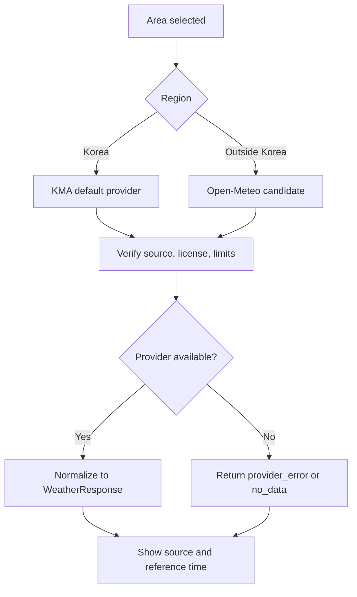

# API Source Review Meeting
# API 출처 검토 회의

Follow-up: [Provider readiness discussion](2026-11-18-provider-readiness-discussion.md) records detailed statements and four unresolved integration decisions.
후속: [제공자 연동 준비 재검토 회의](2026-11-18-provider-readiness-discussion.md)에 상세 발언과 미결정 4건을 기록합니다.

## Meeting purpose
## 회의 목적

<!-- Compare official Korean weather data with free international providers before live integration. -->
<!-- 실시간 연동 전에 한국 공식 날씨 데이터와 해외 무료 제공자를 비교합니다. -->

Decide how the service should select and label weather providers by region.
지역별로 날씨 제공자를 선택하고 표시하는 기준을 결정합니다.

## Participants and roles
## 참석 역할

- Product: protect the factual MVP boundary.
  - 제품: 사실 기반 MVP 범위를 지킵니다.
- Backend: define provider selection and normalization.
  - Backend: 제공자 선택과 정규화를 정의합니다.
- Frontend: display source and observation time.
  - Frontend: 출처와 기준 시각을 표시합니다.
- Data and licensing: verify source terms and attribution.
  - 데이터·라이선스: 출처 조건과 표시 의무를 확인합니다.
- Security: keep credentials server-side and out of logs.
  - 보안: 인증 정보를 Backend에만 두고 로그에서 제외합니다.
- Curtain observer: separate facts, assumptions, and approvals.
  - 커튼 뒤 관찰자: 사실·가정·승인 사항을 분리합니다.

## Agenda
## 의제

1. Korea Meteorological Administration API.
   - 국내 기상청 API
2. Free international weather APIs.
   - 해외 무료 기상 API
3. Provider fallback and source labeling.
   - 제공자 대체와 출처 표시
4. License and commercial-use gate.
   - 라이선스와 상업적 사용 확인

## Evidence reviewed
## 확인한 근거

- KMA short-term forecast API: free, attribution type 1, and a development traffic figure of 10,000 requests on the data.go.kr listing.
  - 기상청 단기예보 API: 공공데이터포털에 무료·출처표시 제1유형·개발계정 10,000건으로 안내되어 있습니다.
- Open-Meteo: no API key for its free non-commercial use, with separate commercial terms and rate limits.
  - Open-Meteo: 무료 비상업 사용은 API 키가 필요 없지만 상업 사용과 요청 제한은 별도 조건입니다.
- NOAA/NWS: open data intended to be free for any purpose, but its service is focused on United States weather.
  - NOAA/NWS: 모든 목적에 무료인 공개 데이터로 안내되지만 미국 중심 서비스입니다.

Sources:

- https://www.data.go.kr/data/15084084/openapi.do
- https://open-meteo.com/en/about
- https://open-meteo.com/en/pricing
- https://www.weather.gov/documentation/services-web-api

## Role-based discussion
## 역할별 논의

- Product: KMA should be the default factual source for Korean areas.
  - 제품: 한국 지역의 기본 사실 출처는 기상청이어야 합니다.
- Backend: KMA and Open-Meteo must be separate providers behind one internal response contract.
  - Backend: 기상청과 Open-Meteo는 하나의 내부 응답 계약 뒤에서 별도 Provider로 둬야 합니다.
- Frontend: never merge values from different providers into one unlabeled result.
  - Frontend: 서로 다른 제공자의 값을 출처 없이 하나의 결과로 합치지 않습니다.
- Licensing: free access does not automatically mean commercial redistribution is allowed.
  - 라이선스: 무료 접근이 자동으로 상업적 재배포 허용을 의미하지는 않습니다.
- Security: provider keys, if required, remain on the server.
  - 보안: 필요한 Provider 키는 서버에만 둡니다.

## Decision
## 결정

1. Korea uses KMA as the default provider.
   - 한국 지역은 기상청을 기본 제공자로 사용합니다.
2. Overseas areas may use Open-Meteo as a separate provider under verified terms.
   - 해외 지역은 조건 확인 후 Open-Meteo를 별도 제공자로 사용할 수 있습니다.
3. Provider failures do not silently mix values from another provider.
   - 제공자 장애 시 다른 제공자의 값을 조용히 섞지 않습니다.
4. Every response displays its source and observation or reference time.
   - 모든 응답은 출처와 관측 또는 기준 시각을 표시합니다.
5. Provider license and request limits are recorded separately.
   - 제공자별 라이선스와 요청 제한을 따로 기록합니다.
6. Providers are normalized into `WeatherResponse` before reaching the frontend.
   - Frontend에 전달하기 전에 모든 Provider를 `WeatherResponse`로 변환합니다.
7. Live integration waits for official terms and commercial-use verification.
   - 실제 연동은 공식 이용 조건과 상업적 사용 가능성 확인 후 진행합니다.

## Decision flow
## 결정 흐름

## Facts, assumptions, and open questions
## 사실·가정·미결정

- Fact: The current application is Mock-only.
  - 사실: 현재 애플리케이션은 Mock 전용입니다.
- Fact: The listed KMA and Open-Meteo terms require provider-specific review.
  - 사실: 기상청과 Open-Meteo의 이용 조건은 Provider별 검토가 필요합니다.
- Assumption: A region policy can select a provider without changing frontend types.
  - 가정: 지역 정책이 Frontend 타입을 바꾸지 않고 Provider를 선택할 수 있습니다.
- Open: Coordinate conversion, cache duration, quota monitoring, and commercial launch terms.
  - 미결정: 좌표 변환·캐시 기간·할당량 모니터링·상업 출시 조건입니다.

## Next actions
## 다음 작업

- Completed: Added the policy to `docs/specs/weather-provider-policy.md`.
  - 완료: `docs/specs/weather-provider-policy.md`에 정책을 추가했습니다.
- Completed: Updated the source and license registry with provider-specific statuses.
  - 완료: 출처·라이선스 목록에 Provider별 상태를 갱신했습니다.
- Pending: Keep live API implementation out of scope until the license gate is approved.
  - 대기: 라이선스 확인이 승인될 때까지 실시간 API 구현은 범위에서 제외합니다.
