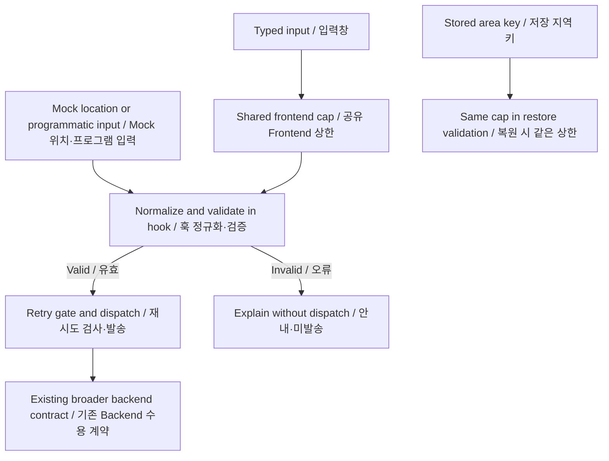

# Area-input boundary meeting
# 지역 입력 경계 회의

The user requested keeping the PR source/license rule update together with this meeting in the eventual commit. This meeting discusses the remaining 80/64 input mismatch. It records one assistant's role-based deliberation, not independent agent executions. The recommendation below is pending user adoption; no runtime change is authorized by this meeting record alone.
사용자가 PR 출처·라이선스 규칙 변경과 이번 회의를 같은 커밋에 묶도록 요청했습니다. 이번 회의는 남은 80/64 입력 불일치를 논의합니다. 하나의 어시스턴트가 역할 관점별로 검토한 기록이며 독립 에이전트 실행은 아닙니다. 아래 권고안은 사용자 채택 전이며 이 회의록만으로 실행 코드 변경을 승인하지 않습니다.

## Facts and local evidence
## 사실과 로컬 근거

- AreaSelector uses maxLength=80. useWeatherRequest rejects normalized names over 64 UTF-16 units and restores stored names only up to 64. retryState configuration identifiers also cap at 64.
  - AreaSelector는 maxLength=80입니다. useWeatherRequest는 정규화 이름이 UTF-16 64단위를 넘으면 거부하고 저장 이름도 64단위까지만 복원합니다. retryState 설정 식별자 역시 64 상한입니다.
- Backend query/response fields cap at 80, and WeatherService rejects trimmed Python strings over len=80. That is an existing API contract, not a requirement that the frontend accept all 80-character values.
  - Backend 쿼리·응답 필드는 80 상한이며 WeatherService는 공백 제거 후 Python len=80 초과를 거부합니다. 이는 기존 API 계약이며 Frontend가 80자 값을 모두 받아야 한다는 요구사항은 아닙니다.
- Local measurement: JavaScript length of 가 is 1 and of 😀 is 2; Python len of 😀 is 1. 32 repeated emoji occupy 64 UTF-16 units and 33 occupy 66. This measures representation length, not supported geographic names or live-provider coverage.
  - 로컬 실측: JavaScript에서 가의 length는 1, 😀는 2이며 Python의 😀 len은 1입니다. 이모지 32개는 UTF-16 64단위·33개는 66단위입니다. 표현 길이를 측정했으며 지원 지명·실제 제공자 범위를 검증한 것이 아닙니다.

## Alternatives
## 대안

| Option / 안 | Scope / 범위 | Consequence / 영향 |
|---|---|---|
| A — frontend 64, backend unchanged / Frontend 64·Backend 유지 | Share the existing frontend area limit across input, lookup and restoration / 입력·조회·복원에서 기존 Frontend 지역 상한 공유 | Corrects UI mismatch without expanding persistence bounds or altering API compatibility / 저장 상한 확대·API 호환성 변경 없이 화면 불일치 보완 |
| B — raise frontend to 80 / Frontend 80 확대 | Change input, hook, retry identifier validation and stored-record coverage / 입력·훅·재시도 식별자·저장 검증 변경 | Requires capacity and restoration revalidation; benefits are unmeasured / 상한·복원 재검증 필요·이점 미실측 |
| C — use 64 across frontend/backend / Frontend·Backend 모두 64 | Change API query, schemas, service and tests too / API 쿼리·스키마·서비스·테스트도 변경 | Narrows an existing API contract; needs an explicit Unicode counting rule / 기존 API 계약 축소·명시적 Unicode 계산 기준 필요 |

## Role-based discussion
## 역할별 논의

### Tech Lead
Who: boundary owner. What: recommend A. Why: the reported defect is the frontend accepting text its own coordinator rejects; expanding storage or narrowing an API is not necessary to fix that defect. How: export a clearly named area-specific 64-unit limit from the existing retryState module and consume it in area validation, input and restore checks. Goal: one frontend area contract. Position: do not reuse the request-ID limit merely because its number is also 64.
담당: 경계 구조. 내용: A 권고. 이유: 지적된 결함은 화면이 자신의 조정자에서 거부할 텍스트를 허용하는 문제이며 저장 확대·API 축소는 해결에 필요하지 않습니다. 방법: 기존 retryState 모듈에서 지역 전용 64단위 상수를 제공하고 지역 검증·입력·복원에서 사용합니다. 목표: Frontend 지역 계약 하나. 소신: 숫자가 같다는 이유로 요청 ID 상한을 재사용하지 않습니다.

### Full-stack
Who: implementation owner. What: align all frontend area entry points while retaining the hook as the authoritative rejection boundary. Why: maxLength alone does not protect programmatic submissions or injected Mock location values. How: input uses the shared cap; hook rejects oversized values without application-level truncation; restoration uses the same cap. Goal: consistent behavior through manual, button and location paths. Position: keep backend 80 as a documented broader acceptance contract.
담당: 구현. 내용: 훅의 최종 거부 경계를 유지하며 Frontend 지역 진입점을 맞춥니다. 이유: maxLength만으로 프로그램 제출·주입 Mock 위치 값을 막지 못합니다. 방법: 입력은 공유 상한·훅은 앱에서 임의 절단하지 않고 초과 거부·복원은 같은 상한 사용. 목표: 직접 입력·버튼·위치 경로의 일관성. 소신: Backend 80은 더 넓은 수용 계약으로 문서화해 유지합니다.

### SecOps
Who: persistence reviewer. What: preserve the 64-unit identifier and all existing storage/key limits. Why: raising a UI cap must not silently change accepted stored identities. How: test 63/64/65-unit values, controls and stored-record rejection. Goal: no new bypass or silent eviction. Position: use explicit rejection rather than slicing two different names into the same retry key.
담당: 저장 검토. 내용: 64단위 식별자와 기존 저장·키 상한 유지. 이유: 화면 상한 조정으로 저장 식별자 수용 범위가 조용히 바뀌면 안 됩니다. 방법: 63/64/65단위·제어문자·저장 기록 거부 검증. 목표: 새 우회·조용한 제거 방지. 소신: 서로 다른 이름을 잘라 같은 재시도 키로 만드는 대신 명시적으로 거부합니다.

### Art Director
Who: interaction reviewer. What: align visible guidance and the actual input cap. Why: allowing typing and rejecting only on submit is avoidable friction. How: explain the maximum near the input, connect help text accessibly and preserve clear error feedback for programmatic over-limit requests. Goal: users understand how to correct input. Position: do not label a UTF-16 cap as a universal count of visible characters.
담당: 상호작용. 내용: 안내와 실제 입력 상한 일치. 이유: 입력 허용 후 제출 시에만 거부하는 불편은 피할 수 있습니다. 방법: 입력 근처 최대 길이 안내·접근 가능한 도움말 연결·프로그램 초과 요청 오류 유지. 목표: 수정 방법 이해. 소신: UTF-16 상한을 모든 보이는 글자 개수와 같다고 표현하지 않습니다.

### Researcher
Who: evidence reviewer. What: distinguish observed code limits from product assumptions. Why: there is no measured need here for 80-unit frontend geography names. How: record current code and the small JavaScript/Python length experiment; test full paths after implementation approval. Goal: avoid inventing a provider requirement. Position: 64 remains an inherited technical design value, not a proven universal maximum place-name length.
담당: 근거. 내용: 코드 실측과 제품 가정 구분. 이유: Frontend 지명 80단위가 필요하다는 측정은 없습니다. 방법: 현재 코드·JavaScript/Python 길이 실험 기록·구현 승인 후 전체 경로 검증. 목표: 제공자 요구사항 추정 방지. 소신: 64는 기존 기술 설계값이며 전 세계 지명의 최대 길이를 증명한 값이 아닙니다.

### Trend Analyst
Who: extension reviewer. What: keep future geographic IDs separate from this small correction. Why: overseas names, search and coordinate mapping would need a separate contract. How: document B/C as alternatives and revisit them only with a concrete need and capacity review. Goal: prevent scope creep. Position: choose A for this MVP correction.
담당: 확장 검토. 내용: 미래 지역 ID 설계와 이번 소규모 보완 분리. 이유: 해외 이름·검색·좌표 변환은 별도 계약이 필요합니다. 방법: B/C는 대안으로 기록하고 실제 필요·상한 검토 후 재논의. 목표: 범위 확대 방지. 소신: 이번 MVP 보완은 A 선택 권고.

### Legal
Who: provenance reviewer. What: use the newly requested PR source and license check items for the eventual combined change. Why: an internal technical discussion is not external weather-data license verification. How: cite repository source and self-authored length fixtures; state no new external material/license introduced and keep unverified live-provider terms separate. Goal: accurate disclosure. Position: do not mark a nonexistent third-party licensing review as completed.
담당: 출처 검토. 내용: 최종 묶음 변경의 PR에 새 출처·라이선스 확인 적용. 이유: 내부 기술 회의는 외부 날씨 자료 라이선스 검증이 아닙니다. 방법: 저장소 소스·자체 길이 자료 명시·외부 자료/라이선스 추가 없음 기록·실 제공자 조건 미확인 분리. 목표: 정확한 공개. 소신: 수행하지 않은 외부 라이선스 검토를 완료로 체크하지 않습니다.

### End User
Who: usability reviewer. What: avoid accepting text that lookup cannot process. Why: the user should know the boundary before waiting for a rejected lookup. How: consistent field limit, nearby guidance and a clear message when bypassing the field. Goal: predictable manual selection. Position: do not auto-truncate or auto-request weather after an invalid value.
담당: 사용성. 내용: 조회할 수 없는 텍스트를 입력창에서 허용하는 불일치 제거. 이유: 거부될 조회를 기다리기 전에 경계를 알아야 합니다. 방법: 일치하는 입력 상한·가까운 안내·입력창 우회 시 명확한 오류. 목표: 예상 가능한 직접 선택. 소신: 잘못된 값을 자동으로 잘라서 조회하거나 자동 발송하지 않습니다.

## Report submitted to the curtain observer
## 커튼 뒤 관찰자에게 제출하는 보고

Reporting-role correction: this section is the assistant's compilation for the user, not an observer speech or approval. See the [reconvened meeting](2026-11-18-area-input-reconvened.md) for the unresolved R/N discussion.
보고 역할 정정: 이 절은 사용자에게 제출하는 어시스턴트 취합 내용이며 관찰자 발언·승인이 아닙니다. 미결정 R/N 논의는 [재회의](2026-11-18-area-input-reconvened.md)를 참조합니다.

Recommendation: A — frontend input/lookup/restore share the existing 64 UTF-16-unit area cap; backend remains at its current 80-character contract. This is a proposal pending user adoption, not a completed implementation. Do not change retry timings, stored schema, provider selection or weather data.
권고: A — Frontend 입력·조회·복원이 기존 UTF-16 64단위 지역 상한을 공유하고 Backend는 현재 80자 계약을 유지합니다. 사용자 채택 전 제안이며 구현 완료가 아닙니다. 재시도 시간·저장 형식·제공자 선택·날씨 자료는 바꾸지 않습니다.

Open choices: adopt A or request B/C; approve the exact shared-constant location and user-facing length guidance in the implementation plan. The user's instruction groups the PR-check rules and this meeting in one eventual commit; no commit or publication is performed during this meeting.
미결정: A 채택 또는 B/C 재논의·구현 계획에서 공유 상수 위치와 사용자 길이 안내 확정. 사용자 지시에 따라 PR 확인 규칙과 이번 회의는 추후 같은 커밋으로 묶으며 이번 회의 중 커밋·공개는 수행하지 않습니다.

## Proposed file-change plan after adoption
## 채택 후 제안 파일 변경 계획

- Edit retryState.ts, useWeatherRequest.ts and AreaSelector.tsx for one area constant and consistent validation/help text.
  - 지역 상수·일치 검증·안내를 위해 retryState.ts·useWeatherRequest.ts·AreaSelector.tsx 수정.
- Edit relevant component/state/storage tests and browser scenarios for boundaries, normalization and no-dispatch on invalid input.
  - 경계·정규화·잘못된 입력 미발송을 위해 관련 컴포넌트·상태·저장 테스트·브라우저 시나리오 수정.
- Update the owning specification, change report and log with exact final paths before implementation.
  - 구현 전에 담당 명세·변경 보고·로그에 정확한 최종 경로 기록.
- Verification proposal: 63/64/65 UTF-16 units, 32/33 supplementary characters, whitespace/control rejection, old valid stored keys, no automatic request, typecheck/build and browser checks.
  - 검증 제안: UTF-16 63/64/65단위·보충 문자 32/33개·공백/제어문자 거부·기존 유효 저장 키·자동 요청 없음·타입 검사/빌드·브라우저 검사.

Sources: frontend AreaSelector.tsx, useWeatherRequest.ts and retryState.ts; backend routes/weather.py, schemas/weather.py and services/weather_service.py. The length experiment used local JavaScript/Python only. No external data, copied content or dependency/license was added. Application tests were not run because this stage only discusses and documents a proposal.
출처: Frontend AreaSelector.tsx·useWeatherRequest.ts·retryState.ts와 Backend routes/weather.py·schemas/weather.py·services/weather_service.py. 길이 실험은 로컬 JavaScript/Python만 사용했습니다. 외부 자료·복사 내용·의존성/라이선스 추가 없음. 이번 단계는 제안 논의·문서화만 수행하여 앱 테스트는 실행하지 않았습니다.

## Second discussion
## 2차 논의

The [second meeting](2026-11-18-area-input-limit-second-discussion.md) identifies raw versus normalized length as a separate decision and revises the shared-module proposal. Neither meeting is adopted yet.
[2차 회의](2026-11-18-area-input-limit-second-discussion.md)에서 원문·정규화 길이를 별도 결정으로 구분하고 공유 모듈 제안을 보완했습니다. 두 회의 모두 아직 채택 전입니다.
