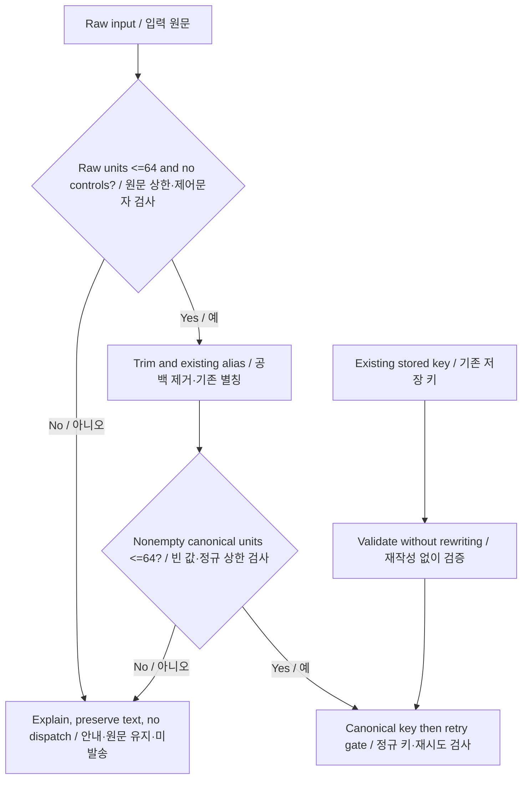

# Area-input boundary — second meeting
# 지역 입력 경계 — 2차 회의

This continues [the first meeting](2026-11-18-area-input-limit-discussion.md). The user requested a second discussion, not runtime implementation. This is one assistant's role-based deliberation. All recommendations remain pending user adoption; keep these records with the pending PR source/license rules for the eventual combined commit.
[1차 회의](2026-11-18-area-input-limit-discussion.md)의 후속입니다. 사용자는 2차 논의를 요청했으며 실행 구현은 요청하지 않았습니다. 하나의 어시스턴트가 역할별 관점으로 진행한 논의입니다. 권고는 모두 사용자 채택 전이며 추후 묶음 커밋을 위해 PR 출처·라이선스 규칙 변경과 회의 기록을 함께 유지합니다.

## Agenda and new evidence
## 의제와 추가 근거

The remaining question is not only 64 versus 80: the field caps raw text while the hook trims text before applying its cap. Local JavaScript measurements: 64 repeated Korean characters are raw/trimmed 64/64 units; surrounding spaces make 66/64 units. The string " seoul " is 7 raw units and 5 after trim, before alias mapping. Thirty-two supplementary characters occupy 64 UTF-16 units. These are technical fixtures, not geographic-name coverage.
남은 질문은 64 대 80만이 아닙니다. 입력창은 원문 길이를 제한하고 훅은 공백 제거 후 상한을 적용합니다. 로컬 JavaScript 실측: 한글 64개는 원문/제거 후 64/64단위이고 앞뒤 공백을 붙이면 66/64단위입니다. " seoul "은 원문 7·공백 제거 후 5단위이며 별칭 변환 전입니다. 보충 문자 32개는 UTF-16 64단위입니다. 기술 검증 자료이며 지명 지원 범위가 아닙니다.

Current trim-before-control-check can remove leading/trailing control whitespace before rejection. Checking raw controls first is therefore an intentional proposed validation tightening, not a description of current behavior.
현재 공백 제거 후 제어문자 검사 방식에서는 앞뒤 제어 공백이 거부 전에 제거될 수 있습니다. 원문 제어문자 우선 검사는 의도적으로 제안하는 검증 강화이며 현재 동작 설명이 아닙니다.

## Boundary alternatives
## 경계 대안

| Option / 안 | Meaning / 의미 | Tradeoff / 대가 |
|---|---|---|
| R — raw 64, then normalization / 원문 64 후 정규화 | Field and hook both cap raw text at 64; canonical key also stays within 64 / 입력창·훅 모두 원문 64·정규 키도 64 이내 | Native input cap and hook match; 64 units plus outer spaces are rejected / 기본 입력 상한·훅 일치·64단위에 외부 공백 추가 시 거부 |
| N — normalized 64 / 정규화 후 64 | Trim/alias first, then cap; field cannot simply use raw maxLength=64 / 공백 제거·별칭 후 상한·단순 원문 maxLength=64로 구현 불가 | Accepts padded names but needs separate bounded raw-input and composition UX design / 공백 붙은 이름 허용·별도 원문 상한·입력 조합 UX 설계 필요 |

Second-meeting recommendation: R, retaining backend 80 and existing stored limits. It is chosen for a smaller, explicit correction, not because 64 has been measured as an optimal geographic-name bound. N remains an alternative if accepting padded boundary-length names is a product requirement.
2차 권고: R이며 Backend 80·기존 저장 상한은 유지합니다. 64가 지명의 최적 상한으로 측정돼서가 아니라 작고 명확한 보완을 위해 권고합니다. 경계 길이 이름에 공백을 붙여도 허용해야 한다면 N을 대안으로 유지합니다.

## Role discussion — Who / What / Why / How / Goal / Position
## 역할 논의 — 담당 / 내용 / 이유 / 방법 / 목표 / 소신

### Tech Lead
Who: contract owner. What: recommend one pure area-input policy module. Why: a number shared without an order of operations still allows divergent acceptance. How: propose frontend/src/services/areaInput.ts for an area-specific limit and pure validation/normalization; input/hook share it, retry configuration imports only the area limit. Goal: one acceptance rule without coupling the field to a React hook. Position: revise the first meeting's constant-in-retryState proposal because input policy now includes normalization and user guidance.
담당: 계약. 내용: 순수 지역 입력 정책 모듈 하나 권고. 이유: 처리 순서 없이 숫자만 공유하면 수용 결과가 달라집니다. 방법: frontend/src/services/areaInput.ts에 지역 상수·순수 검증/정규화를 두고 입력·훅이 공유하며 재시도 설정은 지역 상수만 사용합니다. 목표: 입력창을 React 훅에 결합하지 않는 단일 규칙. 소신: 정규화·안내까지 포함하게 되어 1차의 retryState 내 상수 제안을 수정합니다.

### Full-stack
Who: pipeline owner. What: define R's exact sequence. Why: button, location and programmatic requests must not disagree. How: reject raw control characters and raw length over 64; trim outer spaces; map seoul case-insensitively to 서울; reject empty or oversized canonical text; then derive the retry key. Goal: invalid input never dispatches or increments retry accounting. Position: do not slice, broadly lowercase foreign names or add Unicode normalization in this correction.
담당: 처리 흐름. 내용: R의 정확한 순서 정의. 이유: 버튼·위치·프로그램 요청이 다른 결과를 내면 안 됩니다. 방법: 원문 제어문자·64단위 초과 거부→앞뒤 공백 제거→seoul 대소문자 무관 서울 변환→빈 값·정규 값 초과 거부→재시도 키. 목표: 잘못된 입력의 발송·재시도 집계 없음. 소신: 임의 절단·해외 이름 전체 소문자화·Unicode 정규화는 추가하지 않습니다.

### SecOps
Who: stored-key integrity reviewer. What: keep restoration validation separate from input normalization. Why: trimming or aliasing stored keys can merge identities and reset accounting. How: validate stored keys with existing schema and shared limit, never rewrite them; preserve valid restrictions when unrelated corrupt flows are removed. Goal: no migration-induced bypass. Position: leave provider, kind, request-ID and byte limits independent from the area limit.
담당: 저장 키 무결성. 내용: 복원 검증과 입력 정규화 분리. 이유: 저장 키의 공백 제거·별칭 변환은 식별자를 합치거나 집계를 초기화할 수 있습니다. 방법: 기존 형식·공유 상한으로 검증하되 키를 다시 쓰지 않고 손상 흐름 제거 시 무관한 유효 제한 보존. 목표: 이전 처리로 인한 우회 방지. 소신: 제공자·종류·요청 ID·바이트 상한은 지역 상한과 독립 유지.

### Art Director
Who: field interaction reviewer. What: explain the raw boundary before submission. Why: native truncation and composition behavior should not be mistaken for application validation. How: use the shared field cap, nearby help linked with aria-describedby, and clear feedback for bypassed invalid values; verify actual Korean composition/paste behavior during implementation. Goal: comprehensible editing. Position: do not slice input during composition or announce a counter on every keystroke.
담당: 입력 상호작용. 내용: 제출 전 원문 경계 안내. 이유: 브라우저 입력 제한·조합 동작을 앱 검증과 혼동하면 안 됩니다. 방법: 공유 입력 상한·aria-describedby 도움말·우회 값 오류 안내·구현 단계 실제 한글 조합/붙여넣기 검증. 목표: 이해 가능한 수정. 소신: 조합 중 문자열 임의 절단·글자마다 카운터 낭독은 피합니다.

### Researcher
Who: test-evidence owner. What: distinguish proposed cases from measured results. Why: the first discussion did not establish equivalent normalization behavior. How: test 63/64/65 raw units, 32/33 supplementary characters, padded boundary names, empty input, controls, seoul alias and unchanged stored keys. Goal: prove the chosen R behavior, not simply the presence of maxLength. Position: browser automation alone does not prove every operating-system IME.
담당: 검증 근거. 내용: 제안 사례·실측 구분. 이유: 1차 논의만으로 정규화 동등성이 확정되지 않았습니다. 방법: 원문 63/64/65·보충 문자 32/33·경계 이름 공백·빈 값·제어문자·seoul·저장 키 유지 검증. 목표: maxLength 존재가 아닌 선택한 R 동작 증명. 소신: 브라우저 자동화만으로 모든 운영체제 입력기를 증명하지 않습니다.

### Trend Analyst
Who: scope reviewer. What: defer visible-grapheme counting, search and new region-ID schemes. Why: those change storage keys and product behavior beyond this defect. How: keep R as the small correction and N as a documented alternative. Goal: reviewable work. Position: a new small policy module is justified by shared consumers; no new library is justified.
담당: 범위. 내용: 보이는 글자 묶음 계산·검색·새 지역 ID 후순위. 이유: 저장 키·제품 동작을 이번 결함보다 크게 바꿉니다. 방법: 작은 보완 R·문서화 대안 N 유지. 목표: 검토 가능한 작업. 소신: 공유 소비자 때문에 작은 정책 모듈은 필요하지만 새 라이브러리는 불필요합니다.

### Legal
Who: source/license disclosure reviewer. What: apply the pending PR checklist to the combined documentation change. Why: internal sources and self-authored fixtures do not establish live API licensing. How: link this meeting and source paths, state no external material or license introduced, and use reasoned Not applicable where appropriate. Goal: evidence-backed checks. Position: keep any unverified external-license item unchecked.
담당: 출처·라이선스 공개. 내용: 묶음 문서 변경에 대기 중인 PR 확인 항목 적용. 이유: 내부 소스·자체 자료는 실제 API 라이선스 검증이 아닙니다. 방법: 회의·소스 경로 연결·외부 자료/라이선스 추가 없음·해당 없음 근거 기록. 목표: 근거 있는 확인. 소신: 미검증 외부 라이선스 항목은 미체크 유지.

### End User
Who: usability reviewer. What: expose R's whitespace tradeoff. Why: a 64-unit name plus spaces will be rejected although trimming would produce a valid name. How: explain that spaces count toward the input cap and preserve editable text on invalid submission. Goal: users can correct the input without losing it. Position: recommend R only with that explanation; do not silently reinterpret or query a shortened name.
담당: 사용성. 내용: R의 공백 대가 명시. 이유: 공백 제거 후 유효해도 64단위 이름에 공백을 더하면 거부됩니다. 방법: 공백도 상한 포함 안내·오류 제출 시 수정할 원문 유지. 목표: 입력을 잃지 않고 수정. 소신: 이 설명을 포함할 때 R 권고·짧게 잘라 조용히 조회하지 않음.

## Report submitted to the curtain observer
## 커튼 뒤 관찰자에게 제출하는 보고

Reporting-role correction: the R recommendation below belongs to the assistant's prior compilation, not the user's adoption. The [reconvened meeting](2026-11-18-area-input-reconvened.md) records the competing R/N positions without manufacturing consensus.
보고 역할 정정: 아래 R 권고는 어시스턴트의 이전 취합 내용이며 사용자 채택이 아닙니다. [재회의](2026-11-18-area-input-reconvened.md)에서 합의를 만들어 내지 않고 R/N 충돌을 기록했습니다.

Proposed R contract: raw text at most 64 UTF-16 units including spaces; reject C0/DEL controls before trimming; keep existing trim and seoul alias; canonical value at most 64; no new key normalization or stored-key migration. Keep backend's separate 80-character acceptance contract. Proposed help: "입력 길이는 공백 포함 최대 64단위입니다. 이모지 등 일부 문자는 여러 단위로 계산됩니다." This is user-facing wording proposed for review, not shipped text.
제안 R 계약: 공백 포함 원문 UTF-16 최대 64단위·공백 제거 전에 C0/DEL 제어문자 거부·기존 trim/seoul 별칭 유지·정규 값 최대 64·새 키 정규화/저장 키 이전 없음. Backend의 별도 80자 수용 계약 유지. 안내 제안: "입력 길이는 공백 포함 최대 64단위입니다. 이모지 등 일부 문자는 여러 단위로 계산됩니다." 검토용 문구 제안이며 반영된 화면이 아닙니다.

Pending adoption: R versus N, shared policy-module location, help text, and the intentional raw-control rejection tightening. The meeting recommendation is not approval to create implementation files.
채택 대기: R/N 선택·공유 정책 모듈 위치·안내 문구·의도적 원문 제어문자 거부 강화. 회의 권고는 구현 파일 생성 승인이 아닙니다.

## Proposed concrete implementation files
## 구체적 구현 파일 제안

| Path / 경로 | Proposed action / 제안 작업 | Why and behavior / 이유·작동 |
|---|---|---|
| frontend/src/services/areaInput.ts | Create after approval / 승인 후 생성 | Pure limit/validation/normalization shared by field and hook / 입력창·훅이 공유하는 순수 상한·검증·정규화 |
| frontend/src/components/AreaSelector.tsx | Edit after approval / 승인 후 수정 | Shared raw cap and linked help; no application slicing / 공유 원문 상한·도움말 연결·앱 임의 절단 없음 |
| frontend/src/hooks/useWeatherRequest.ts | Edit after approval / 승인 후 수정 | Shared validation before retry state; retain restore checks without rewriting keys / 재시도 상태 전 공유 검증·키 재작성 없는 복원 검사 |
| frontend/src/state/retryState.ts | Edit after approval / 승인 후 수정 | Area-specific constant for area configuration only / 지역 설정에만 지역 상수 사용 |
| frontend/src/tests/areaInput.test.ts | Create after approval / 승인 후 생성 | Boundary/order tests for the pure policy / 순수 정책의 경계·순서 검증 |
| frontend/src/tests/App.test.tsx; frontend/src/tests/location-flow.test.tsx; frontend/src/tests/retryState.test.ts; frontend/src/tests/retryStorage.test.ts | Edit relevant cases after approval / 승인 후 관련 사례 수정 | No-dispatch checks, injected-location boundary and stored-key compatibility / 미발송·주입 위치 경계·저장 키 호환성 |
| frontend/e2e/weather.spec.ts | Edit after approval / 승인 후 수정 | Real field cap/help and submission behavior / 실제 입력 상한·안내·제출 동작 |
| docs/specs/weather-retry-state-implementation.md; docs/office/change-report.md; CONVERSATION_LOG.md | Edit after adoption / 채택 후 수정 | Approved contract, complete inventory and actual verification evidence / 승인 계약·전체 변경 목록·실제 검증 근거 |

Acceptance proposal: 64 raw units pass length validation and 65 fail without slicing; 64 core units plus two spaces fail R; " seoul " resolves to 서울; whitespace-only/control input does not dispatch; 32 supplementary characters fit the unit bound and 33 do not. Valid existing saved keys/restrictions retain their deadlines and counts. Browser checks distinguish native field limiting from hook rejection.
완료 조건 제안: 원문 64단위 길이 통과·65단위는 절단 없이 거부, 64단위 본문에 공백 두 개를 더하면 R에서 거부, " seoul "은 서울, 공백만/제어문자는 미발송, 보충 문자 32개는 단위 상한 내·33개는 초과. 기존 유효 저장 키·제한의 마감/횟수 유지. 브라우저 검증은 기본 입력 제한과 훅 거부를 구분합니다.

Sources: current repository input/hook/retry modules and the first meeting's backend source review; local Node length fixtures. No external research, copied material, dependency or new license. No application tests or implementation were performed in this discussion. Documentation links and whitespace were checked. Commit/Push/PR remain unperformed in this stage.
출처: 현재 저장소 입력·훅·재시도 모듈·1차 Backend 소스 검토·로컬 Node 길이 자료. 외부 조사·복사 자료·의존성·새 라이선스 없음. 이번 논의에서 앱 테스트·구현은 수행하지 않았습니다. 문서 링크·공백을 확인했습니다. 이번 단계의 커밋·Push·PR은 수행하지 않았습니다.
