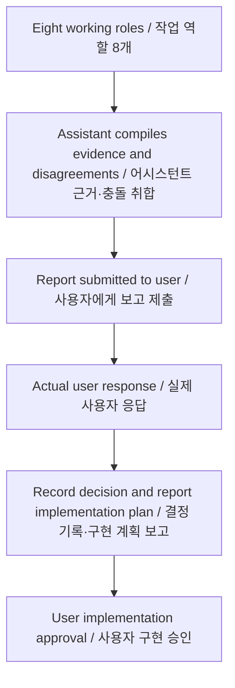

# Reconvened area-input meeting — report to the observer
# 지역 입력 재회의 — 관찰자에게 제출하는 보고

The user corrected the meeting process: the curtain observer is the user receiving the report, not a working-role speaker. This record contains eight role perspectives synthesized by one assistant. There is no observer speech, conviction, adoption or approval in this record. Recommendations in the previous two records remain unadopted.
사용자가 회의 절차를 바로잡았습니다. 커튼 뒤 관찰자는 보고를 받는 사용자이며 작업 발언자가 아닙니다. 이 기록은 하나의 어시스턴트가 8개 역할 관점으로 정리한 논의입니다. 관찰자의 발언·소신·채택·승인은 작성하지 않습니다. 앞선 두 기록의 권고도 미채택 상태입니다.

## Agenda 1 — correct responsibility and reporting direction
## 의제 1 — 책임과 보고 방향 바로잡기

Confirmed user instruction: eight working roles discuss; the assistant facilitates, records facts/assumptions/questions/proposals and submits a compiled report; the observer receives it and supplies the actual decision. The prior roles.md both listed eight working roles and incorrectly referred to nine; it also assigned reporting to the observer. Corrected roles.md and workflow.md to reflect the user's instruction.
사용자 지시 확인: 8개 작업 역할이 논의하고 어시스턴트가 진행·기록·사실/가정/질문/제안 취합 후 보고서를 제출하며 관찰자는 이를 받고 실제 결정을 전달합니다. 기존 roles.md는 작업 역할 8개를 나열하면서 9개로 잘못 적었고 관찰자에게 보고 업무도 배정했습니다. 사용자 지시에 맞춰 roles.md·workflow.md를 보완했습니다.

Report submitted for agenda 1: responsibility errors are documented and corrected locally. No observer approval is recorded; no commit or publication has occurred.
의제 1 제출 보고: 역할 오류를 기록하고 로컬 문서에서 보완했습니다. 관찰자 승인은 기록하지 않았으며 커밋·공개하지 않았습니다.

## Agenda 2 — raw versus normalized length
## 의제 2 — 원문 길이와 정규화 길이

Facts: the field currently accepts at most 80 raw UTF-16 units and trims before calling onSelect. The hook trims/maps the seoul alias before checking the 64-unit normalized value. Storage config caps area identifiers at 64. Backend has a separate 80-character contract. These facts explain why a raw-64 change is a behavior change, not merely replacing a number.
사실: 입력창은 현재 원문 UTF-16 최대 80단위이며 onSelect 호출 전에 공백을 제거합니다. 훅은 공백 제거·seoul 별칭 변환 후 정규 값 64단위를 검사합니다. 저장 설정 지역 식별자 상한은 64입니다. Backend는 별도 80자 계약입니다. 따라서 원문 64 변경은 숫자 교체뿐 아니라 동작 변경입니다.

Known local fixture: 64 Korean characters with surrounding spaces have raw length 66 and trimmed length 64. R rejects that raw input; N can accept it. No new runtime behavior or test is implemented during this meeting.
기존 로컬 자료: 한글 64개에 앞뒤 공백을 붙이면 원문 66·공백 제거 후 64입니다. R은 원문을 거부하고 N은 허용할 수 있습니다. 이번 회의에서 새 실행 동작·테스트를 구현하지 않습니다.

### Tech Lead — proposal
### Tech Lead — 제안

Who: architecture owner. What: separate a shared area policy from UI and retry accounting; retain R as the smallest field-cap change. Why: a consistent boundary needs both one limit and one processing order. How: define raw/normalized rules before choosing the module implementation; keep backend and persisted schema stable. Goal: an explainable, reviewable contract. Position: prefer R for simplicity, but do not call it consensus while usability objections remain.
담당: 구조. 내용: UI·재시도 집계와 공유 지역 정책을 분리하고 입력 상한 변경이 작은 R을 후보로 유지. 이유: 일관된 경계에는 상수·처리 순서가 모두 필요. 방법: 모듈 구현보다 원문/정규 규칙을 먼저 정하고 Backend·저장 형식 유지. 목표: 설명·검토 가능한 계약. 소신: 단순성 때문에 R을 선호하나 사용성 반론이 남으면 합의라고 부르지 않음.

### Full-stack — fact and proposal
### Full-stack — 사실·제안

Who: request-pipeline owner. What: compare both end-to-end implementations and prefer preserving normalized-64 behavior with N. Why: AreaSelector already trims before forwarding, so R cannot be implemented correctly by changing maxLength alone. How: share validation between the field and hook; for N, explicitly define a bounded raw-input rule, potentially the existing 80-unit cap, independently of backend; check normalized 64 before dispatch. Goal: all entry points agree and invalid requests consume no retry. Position: preserve current trim semantics unless the user deliberately chooses R's stricter behavior.
담당: 요청 흐름. 내용: 두 안의 전체 구현 비교·정규화 후 64를 보존하는 N 선호. 이유: AreaSelector가 전달 전에 이미 trim하므로 maxLength만 바꾸면 R을 정확히 구현할 수 없음. 방법: 입력창·훅 검증 공유·N에는 기존 원문 80 등을 별도 상한 후보로 명시·Backend와 독립·발송 전 정규 64 검사. 목표: 진입점 일치·잘못된 요청 재시도 미소모. 소신: 사용자가 R의 강화 동작을 선택하기 전에는 기존 trim 의미 보존.

### SecOps — proposal and question
### SecOps — 제안·질문

Who: key and storage-integrity reviewer. What: require bounded raw input and unchanged canonical stored identities in either option. Why: a display fix must not silently merge keys, remove restrictions or broaden identifier capacity. How: validate without slicing; restoration validates existing records without re-normalization; test valid restriction retention. Goal: no state-accounting bypass. Position: no security basis here establishes R over N; raw-control rejection before trim is a separate behavior decision requiring explicit documentation.
담당: 키·저장 무결성. 내용: 어느 안이든 원문 상한·기존 정규 저장 식별자 유지 요구. 이유: 화면 수정이 키 병합·제한 제거·식별자 상한 확대를 조용히 일으키면 안 됨. 방법: 절단 없는 검증·복원 시 재정규화 없이 기존 기록 검사·유효 제한 보존 검증. 목표: 상태 집계 우회 없음. 소신: 여기서 R이 N보다 안전하다고 단정할 근거는 없으며 trim 전 원문 제어문자 거부는 별도 동작 결정으로 문서화해야 함.

### Art Director — usability hypothesis and proposal
### Art Director — 사용성 가설·제안

Who: editing and error-display reviewer. What: prefer N with immediate length guidance rather than rejecting a valid name solely for surrounding spaces. Why: a raw field cap and an effective-name cap serve different purposes and can be explained separately. How: show meaningful help, validate at submission through the shared policy, preserve text and verify composition/paste. Goal: correct input without surprise. Position: do not present 64 raw units as an obvious usability improvement; user testing has not established that.
담당: 편집·오류 표시. 내용: 외부 공백만으로 유효 이름을 거부하기보다 즉시 길이 안내를 둔 N 선호. 이유: 원문 입력 상한과 실제 이름 상한은 목적이 다르며 별도 설명 가능. 방법: 도움말·공유 정책 제출 검증·원문 보존·조합/붙여넣기 확인. 목표: 예기치 않은 거부 없이 입력 수정. 소신: 사용자 검증 없이 원문 64를 당연한 사용성 개선으로 제시하지 않음.

### Researcher — fact, question and verification proposal
### Researcher — 사실·질문·검증 제안

Who: evidence owner. What: establish acceptance tables for R and N before numeric agreement. Why: equal constants do not prove equal accepted inputs. How: compare raw/normalized 63/64/65, padded 64, whitespace-only, controls, alias, supplementary characters, field bypass and restored keys. Goal: distinguish product choice from measured behavior. Position: existing length fixtures prove representation differences only; neither optimal place-name length nor full IME compatibility has been measured.
담당: 근거. 내용: 숫자 합의 전에 R/N 수용 표 작성. 이유: 같은 상수가 같은 허용 입력을 증명하지 않음. 방법: 원문/정규 63/64/65·64에 공백·공백만·제어문자·별칭·보충 문자·입력창 우회·저장 키 비교. 목표: 제품 선택·실측 구분. 소신: 기존 자료는 표현 길이 차이만 증명하며 최적 지명 길이·전체 입력기 호환성은 미측정.

### Trend Analyst — scope proposal
### Trend Analyst — 범위 제안

Who: scope and extension reviewer. What: keep backend 80 and defer new geographic IDs and grapheme segmentation. Why: these are broader compatibility changes than the current frontend defect. How: estimate R/N implementation after the acceptance table; use existing dependencies only. Goal: a bounded corrective change. Position: implementation cost is relevant but cannot by itself dismiss N's preservation of current behavior.
담당: 범위·확장. 내용: Backend 80 유지·새 지역 ID/글자 묶음 계산 후순위. 이유: 현재 Frontend 결함보다 큰 호환성 변경. 방법: 수용 표 뒤 R/N 구현 비교·기존 의존성만 사용. 목표: 한정된 보완. 소신: 구현 비용은 중요하지만 그것만으로 기존 동작을 보존하는 N을 배제할 수 없음.

### Legal — disclosure proposal
### Legal — 공개 제안

Who: source/license reviewer. What: identify internal source evidence and keep external-license claims separate. Why: a Unicode length experiment does not verify a weather-data license. How: cite local source paths and fixtures in the eventual PR, disclose no new external material and state reasoned Not applicable where appropriate. Goal: evidence-backed source/license checks. Position: do not check an unverified item or invent observer approval.
담당: 출처·라이선스. 내용: 내부 소스 근거 명시·외부 라이선스 주장 분리. 이유: 길이 실험은 날씨 자료 라이선스 검증이 아님. 방법: 최종 PR에 로컬 소스·자료 연결·새 외부 자료 없음·해당 없음 근거 기록. 목표: 근거 있는 출처·라이선스 확인. 소신: 미검증 항목 체크·관찰자 승인 생성 금지.

### End User — usability hypothesis and proposal
### End User — 사용성 가설·제안

Who: manual-lookup user perspective. What: prefer N so accidental outer spaces can be removed before checking the effective name. Why: R rejects padded boundary-length names currently accepted by normalization. How: preserve entered text, explain the relevant limit and require an explicit corrected submission when invalid. Goal: predictable recovery without losing input. Position: do not accept R merely because all code would show the number 64; the behavior matters more.
담당: 직접 조회 사용자 관점. 내용: 실수로 붙은 외부 공백 제거 후 이름을 검사하는 N 선호. 이유: R은 현재 정규화가 허용하는 경계 길이 이름+공백을 거부. 방법: 입력 보존·관련 상한 안내·오류 시 명시적 수정 제출. 목표: 입력 손실 없는 예상 가능한 복구. 소신: 코드에 64가 통일된다는 이유만으로 R을 채택하지 않으며 실제 동작이 우선.

## Report submitted to the curtain observer — not an observer speech
## 커튼 뒤 관찰자에게 제출하는 보고 — 관찰자 발언 아님

Prepared by the assistant as facilitator/recorder. Recipient: the user. No decision or approval is attributed to the recipient.
작성: 진행·기록 담당 어시스턴트. 수신: 사용자. 수신자의 결정·승인을 대신 기록하지 않습니다.

Agenda 2 compiled findings:
의제 2 취합 내용:

- Common proposed direction: one explicit frontend area policy; retain current normalized identifier bound and backend contract; no automatic request, slicing or stored-key rewriting. These are working-role proposals, not user-adopted decisions.
  - 공통 제안 방향: 명시적 Frontend 지역 정책 하나·현재 정규 식별자 상한/Backend 계약 유지·자동 요청/임의 절단/저장 키 재작성 없음. 작업 역할의 제안이며 사용자 채택 결정은 아닙니다.
- Disagreement: Tech Lead prefers R's raw-64 simplicity; Full-stack, Art Director and End User prefer preserving trim semantics with N. SecOps does not establish either as inherently safer. No unanimous recommendation is recorded.
  - 충돌: Tech Lead는 R의 원문 64 단순성 선호·Full-stack/Art Director/End User는 trim 의미를 보존하는 N 선호. SecOps는 어느 안이 본질적으로 더 안전하다고 결론 내리지 않음. 만장일치 권고로 기록하지 않습니다.
- Open decisions: R or N, N's raw-input cap if selected, control rejection order and user-facing wording. Earlier R recommendations are not treated as observer adoption.
  - 미결정: R/N·N 선택 시 원문 상한·제어문자 거부 순서·사용자 문구. 이전 R 권고를 관찰자 채택으로 취급하지 않습니다.

| Case / 사례 | R proposal / R 제안 | N proposal / N 제안 |
|---|---|---|
| 64 core units / 본문 64단위 | Pass length check / 길이 통과 | Pass length check / 길이 통과 |
| 65 core units / 본문 65단위 | Reject / 거부 | Reject normalized length / 정규 길이 거부 |
| 64 core + two outer spaces / 본문 64+외부 공백 2 | Reject raw 66 / 원문 66 거부 | Accept if raw cap permits 66 / 원문 상한이 66을 허용하면 수용 |
| " seoul " | Map to 서울 / 서울 변환 | Map to 서울 / 서울 변환 |
| Whitespace-only / 공백만 | Reject empty result / 빈 값 거부 | Reject empty result / 빈 값 거부 |
| Raw control whitespace / 원문 제어 공백 | Depends on explicitly adopted order / 채택할 검사 순서에 따름 | Depends on explicitly adopted order / 채택할 검사 순서에 따름 |
| Existing stored key / 기존 저장 키 | Validate, do not rewrite / 검증·재작성 없음 | Validate, do not rewrite / 검증·재작성 없음 |

## Agenda 3 — next work submitted for decision
## 의제 3 — 결정받을 다음 작업 보고

After the observer supplies the actual choice, record it, link it from the owning specification, report exact file purposes/actions and obtain implementation approval. Do not create the proposed area-policy source file during this meeting. Keep the pending PR checklist and all meeting records in the user's requested eventual commit bundle. Commit, Push and PR still follow their approval stages.
관찰자의 실제 선택을 받은 뒤 기록·담당 명세 연결·정확한 파일 목적/작업 보고·구현 승인 순서로 진행합니다. 이번 회의에서는 제안된 지역 정책 소스를 생성하지 않습니다. 대기 중인 PR 확인 규칙·전체 회의 기록은 사용자가 요청한 추후 커밋 묶음으로 유지합니다. 커밋·Push·PR은 각 승인 단계를 따릅니다.

Sources: current local AreaSelector, useWeatherRequest, retryState and earlier backend source inspection/Node fixtures. No new external material, copied code, dependency or license. Documentation-only correction; no runtime tests or implementation. Link and whitespace checks performed. Observer response: not received at the time of this record.
출처: 현재 로컬 AreaSelector·useWeatherRequest·retryState·앞선 Backend 소스 확인/Node 자료. 새 외부 자료·복사 코드·의존성·라이선스 없음. 문서 전용 보완이며 실행 테스트·구현 없음. 링크·공백 확인. 이 기록 시점 관찰자 응답: 미수신.

## Stage-2 follow-up
## 2단계 후속

The [stage-2 meeting](2026-11-19-stage2-area-policy-selection.md) specifies N80 as raw80 plus normalized64 and records its new bound on programmatic raw inputs. Its recommendation remains pending the observer's actual choice.
[2단계 회의](2026-11-19-stage2-area-policy-selection.md)에서 N80을 원문 80·정규 64로 구체화하고 프로그램 원문 입력의 새 경계도 기록했습니다. 권고는 관찰자의 실제 선택 전입니다.
