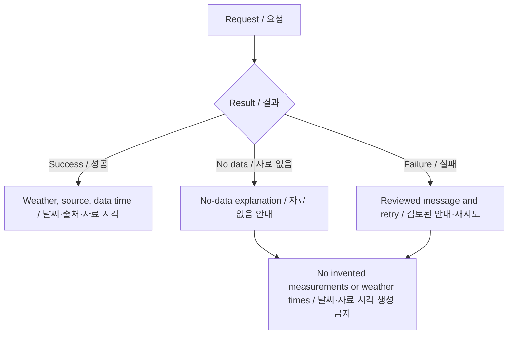

# Error Display Principles Meeting
# 오류 표시 원칙 회의

Date: 2026-11-18, Asia/Seoul. User adopted the display principles in this conversation. This records simulated role perspectives, not independent agent approvals.
날짜: 2026-11-18 한국 시각. 사용자가 대화에서 표시 원칙을 채택했습니다. 독립 에이전트 승인이 아닌 역할별 모의 관점을 기록합니다.

<!-- Read roles, adopted rules, and unresolved items in that order. -->
<!-- 역할별 발언·채택 원칙·미결정을 순서대로 읽습니다. -->

Agenda: source and timestamp display when weather retrieval fails.
의제: 날씨 조회 실패 시 출처·시각 표시 기준입니다.

## Tech Lead

**Who**

Own contract and scope.
계약·범위를 책임집니다.

**What**

Separate failed requests from previous weather.
실패 요청과 이전 날씨를 분리합니다.

**Why**

Old values could look like a successful refresh.
이전 값이 새 조회 성공처럼 보일 수 있습니다.

**How**

Return failure and explanation; design cached data separately.
실패·설명을 반환하고 캐시는 별도 설계합니다.

**Goal**

Align response and display states.
응답·화면 상태를 일치시킵니다.

**Conviction / 소신**

Finish empty failure responses before adding caches.
캐시보다 자료 없는 실패 응답을 먼저 정의합니다.

## Full-stack

**Who**

Connect backend errors and UI.
Backend 오류와 화면을 연결합니다.

**What**

Keep weather values and weather timestamps absent on failure.
실패 시 날씨 값·자료 시각을 비웁니다.

**Why**

Failure time is not observation time.
실패 시각은 관측 시각이 아닙니다.

**How**

Provide status and explanation; identify only a known selected provider.
상태·설명을 제공하고 확인된 조회 제공자만 식별합니다.

**Goal**

Avoid fabricated weather facts.
날씨 사실 생성을 막습니다.

**Conviction / 소신**

Never substitute current time for observed_at.
observed_at을 현재 시각으로 채우지 않습니다.

## Researcher

**Who**

Review provenance.
출처를 검토합니다.

**What**

Distinguish attempted provider from displayed data source.
조회 대상과 표시 자료 출처를 구분합니다.

**Why**

Failed lookup does not establish provenance of other content.
조회 실패가 다른 내용의 출처를 증명하지 않습니다.

**How**

Use lookup-failed wording; preserve provenance of any future previous data.
조회 실패 문구를 쓰고 향후 이전 자료 출처를 보존합니다.

**Goal**

Make requests and data traceable.
요청·자료를 추적 가능하게 합니다.

**Conviction / 소신**

Provider labels on errors are not data-source claims.
오류의 제공자 표시는 자료 출처 주장이 아닙니다.

## SecOps

**Who**

Own error disclosure and logs.
오류 공개·로그를 책임집니다.

**What**

Do not expose raw upstream errors.
원본 외부 오류를 노출하지 않습니다.

**Why**

Raw errors may contain credentials or request details.
원본 오류에는 인증·요청 정보가 포함될 수 있습니다.

**How**

Use reviewed messages and redact secrets and precise user coordinates in diagnostics.
검토된 문구를 쓰고 진단에서 비밀값·정확한 사용자 좌표를 제외합니다.

**Goal**

Provide useful explanations safely.
필요한 설명을 안전하게 제공합니다.

**Conviction / 소신**

More raw detail is not better user explanation.
원본 상세가 좋은 사용자 설명은 아닙니다.

## Art Director

**Who**

Own understandable error display.
이해 가능한 오류 표시를 책임집니다.

**What**

Distinguish missing data from failed retrieval.
자료 없음과 조회 실패를 구분합니다.

**Why**

A generic empty label hides the reason.
일반적인 없음 표시는 이유를 가립니다.

**How**

Use separate messages and retry; label previous data if later supported.
별도 문구·재시도를 제공하고 향후 이전 자료를 표시합니다.

**Goal**

Explain status and next action.
상태·다음 행동을 설명합니다.

**Conviction / 소신**

Do not emphasize meaningless current timestamps.
의미 없는 현재 시각을 강조하지 않습니다.

## Legal

**Who**

Review accuracy of explanations.
설명의 정확성을 검토합니다.

**What**

Do not attribute unverified failure to KMA.
미확인 실패를 기상청 책임으로 단정하지 않습니다.

**Why**

Network, authentication, or our server may cause failure.
네트워크·인증·우리 서버가 원인일 수 있습니다.

**How**

Say retrieval failed unless cause is established.
원인 확인 전에는 조회 실패라고 설명합니다.

**Goal**

Stay within established facts.
확인된 사실 범위를 지킵니다.

**Conviction / 소신**

provider_error is not a blame assignment.
provider_error는 책임 판정이 아닙니다.

## Trend Analyst

**Who**

Review expansion.
확장을 검토합니다.

**What**

Keep automatic switching for the next agenda.
자동 전환은 다음 의제로 남깁니다.

**Why**

Error-display decisions should not imply routing decisions.
오류 표시 결정으로 라우팅을 확정하면 안 됩니다.

**How**

Define error meaning now; compare switching semantics separately.
오류 의미를 정하고 전환 의미는 별도 비교합니다.

**Goal**

Keep decision boundaries clear.
결정 경계를 명확히 합니다.

**Conviction / 소신**

Do not hide failure with an immediate substitute.
즉시 대체 값으로 실패를 숨기는 데 신중해야 합니다.

## End User

**Who**

Represent the person reading errors.
오류를 읽는 사용자를 대표합니다.

**What**

Know whether displayed data is usable and retry is available.
자료 의미와 재시도 가능 여부를 알고 싶습니다.

**Why**

An error next to a card can obscure its age.
카드 옆 오류는 자료 나이를 혼동시킵니다.

**How**

Show failure and retry; label previous data near its original time if added.
실패·재시도를 표시하고 향후 이전 자료에는 원래 시각 옆에 표시합니다.

**Goal**

Make failure understandable.
실패를 이해 가능하게 합니다.

**Conviction / 소신**

Previous data must never appear newly retrieved.
이전 자료가 새 조회 자료처럼 보이면 안 됩니다.

## Adopted principles and observer report
## 채택 원칙과 커튼 뒤 보고

1. Do not invent weather values or observation/forecast times on failure.
   - 실패 시 날씨 값·관측·예보 시각을 만들지 않습니다.
2. Never substitute failure time for weather reference time.
   - 실패 시각을 날씨 기준 시각으로 대체하지 않습니다.
3. Identify a known provider as the attempted provider, not the source of nonexistent data.
   - 확인된 제공자는 조회 대상으로 표시하며 없는 자료의 출처처럼 표시하지 않습니다.
4. Do not assert provider outage before confirming cause.
   - 원인 확인 전 제공자 장애로 단정하지 않습니다.
5. Use reviewed user messages and retry.
   - 검토된 사용자 문구·재시도를 제공합니다.
6. Previous data/cache and automatic provider switching remain separate agenda items.
   - 이전 자료·캐시·자동 제공자 전환은 별도 의제로 유지합니다.

Failure timestamp fields remain undecided. No runtime implementation or new schema is authorized by this record alone.
실패 시각 필드는 미결정입니다. 이 기록만으로 실행 구현이나 새 스키마를 승인하지 않습니다.

Next: link adopted principles to provider policy and API contract; review documentation before commit approval. Source: the user's adoption in this conversation; no external factual research added.
다음: 채택 원칙을 Provider 정책·API 계약에 연결하고 커밋 승인 전 문서를 검토합니다. 출처는 이 대화의 사용자 채택이며 외부 사실 조사는 추가하지 않았습니다.
