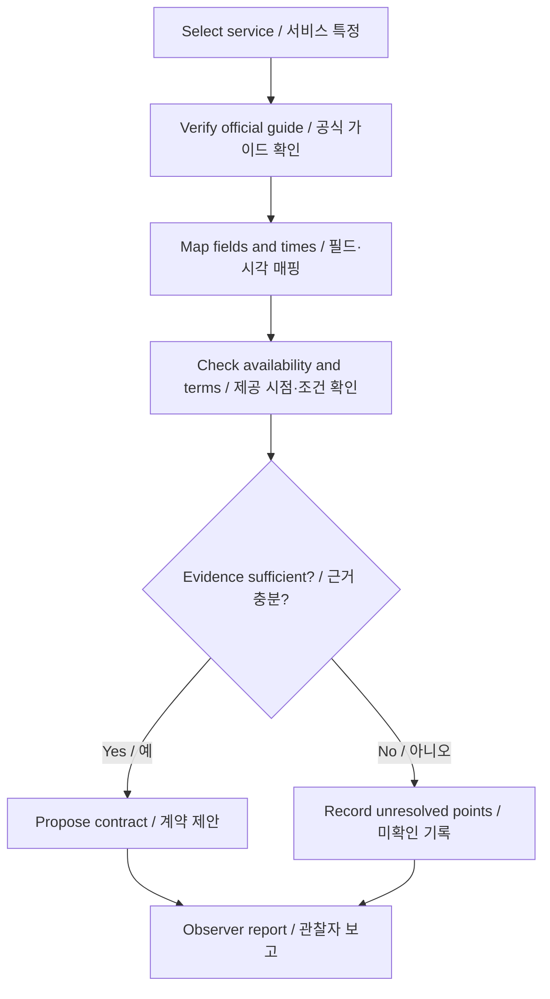

# Investigation Scope Meeting
# 후속 조사 범위 회의

Research result: [timestamp evidence](../../specs/weather-time-evidence.md). Partial investigation; attachment/version, timezone, and availability gaps remain open.
조사 결과: [시각 근거 조사](../../specs/weather-time-evidence.md). 부분 조사이며 첨부·버전·시간대·제공 시점은 남은 확인 사항입니다.

Date: 2026-11-18, Asia/Seoul.
날짜: 2026-11-18, 한국 시각.

<!-- Preserve discussion before research changes the contract. -->
<!-- 조사로 계약을 변경하기 전에 논의를 보존합니다. -->

Purpose: define the next official-document investigation into timestamps and data availability. This is a simulated role discussion, not independent agent approval. The user requested recording the meeting; technical proposals remain proposals.
목적: 시각과 자료 제공 시점에 관한 후속 공식 문서 조사 범위를 정합니다. 독립 에이전트 승인이 아닌 역할별 모의 논의입니다. 사용자는 회의록 작성을 요청했으며 기술 제안은 제안 상태입니다.

## Tech Lead

**Who**

Own scope and priorities.
조사 범위와 우선순위를 책임집니다.

**What**

Focus on VilageFcstInfoService_2.0.
해당 서비스를 첫 조사 대상으로 좁힙니다.

**Why**

Different API products may use different time rules.
상품마다 시간 규칙이 다를 수 있습니다.

**How**

Review getUltraSrtNcst and getUltraSrtFcst separately; expand only if needed.
초단기실황과 초단기예보를 별도로 검토하고 필요할 때 확장합니다.

**Goal**

Produce one evidence-based mapping.
근거 있는 매핑표를 만듭니다.

**Conviction / 소신**

Understand one integration target precisely first.
첫 연동 대상 하나를 정확히 이해하는 것이 먼저입니다.

## Researcher

**Who**

Own official evidence and versions.
공식 근거와 버전을 확인합니다.

**What**

Review the service page, latest guide, and notices.
서비스 페이지·최신 가이드·변경 공지를 검토합니다.

**Why**

A real-time label does not specify availability.
실시간 표기만으로 제공 시점을 알 수 없습니다.

**How**

Record document version/date, base and forecast time definitions, timezone, update and availability times, and revisions.
문서 버전·날짜·기준 및 예보 시각 정의·시간대·갱신 및 제공 시점·수정 버전을 기록합니다.

**Goal**

Make conclusions traceable.
결론을 추적 가능하게 합니다.

**Conviction / 소신**

Record official-document conflicts; do not resolve them with unsupported assumptions.
공식 문서 충돌은 기록하고 근거 없는 추정으로 해소하지 않습니다.

## Full-stack

**Who**

Own field conversion.
필드 변환을 책임집니다.

**What**

Check weather variables alongside timestamps.
시각과 함께 날씨 변수도 확인합니다.

**Why**

The chosen endpoint may not supply every UI field.
선택 endpoint가 화면의 모든 필드를 제공하지 않을 수 있습니다.

**How**

Map meaning, units, times, missing values, and transformations; preserve provenance when combining products.
의미·단위·시각·결측·변환을 매핑하고 상품 조합 시 출처를 보존합니다.

**Goal**

Produce an implementable contract.
구현 가능한 계약을 만듭니다.

**Conviction / 소신**

Never present values from different times as simultaneous.
다른 시각의 값을 같은 시각처럼 표시하지 않습니다.

## SecOps

**Who**

Own credentials and location handling.
인증·위치 처리를 책임집니다.

**What**

Separate public-document research from authenticated calls.
공개 문서 조사와 인증 호출을 구분합니다.

**Why**

Public research needs no user location or secret.
공개 조사에는 실제 위치나 비밀값이 필요하지 않습니다.

**How**

Research first; later approved calls use fixed representative areas and redact credentials.
먼저 조사하고 이후 승인 호출에서는 대표 지역과 인증정보 비공개 원칙을 적용합니다.

**Goal**

Collect evidence safely.
안전하게 근거를 확보합니다.

**Conviction / 소신**

Report concrete requirements before key issuance or live calls.
키 발급·실호출 전 구체적인 필요 작업을 보고합니다.

## Art Director

**Who**

Own understandable presentation.
이해 가능한 표현을 책임집니다.

**What**

Include display wording examples.
표시 문구 예시를 포함합니다.

**Why**

Calling all data current weather hides its meaning.
모든 자료를 현재 날씨로 부르면 의미가 가려집니다.

**How**

Draft distinct observation, forecast, and model-data labels after confirming semantics.
의미 확인 후 관측·예보·모델 자료 문구를 구분합니다.

**Goal**

Align documentation and display.
문서와 화면을 일치시킵니다.

**Conviction / 소신**

Do not finalize labels before timestamp semantics.
시각 의미보다 먼저 화면 문구를 확정하지 않습니다.

## Legal

**Who**

Own product-specific use conditions.
상품별 이용 조건을 검토합니다.

**What**

Check license scope and attribution for the chosen product.
선택 상품의 이용 범위·출처표시를 확인합니다.

**Why**

One institution does not imply identical terms for every product.
같은 기관이어도 모든 상품 조건이 같지는 않습니다.

**How**

Record official and third-party rights; distinguish Open-Meteo data license from API service terms.
공식·제3자 권리를 기록하고 Open-Meteo 데이터 라이선스와 서비스 조건을 구분합니다.

**Goal**

Assess both technical and permitted use.
기술 가능성과 이용 가능성을 함께 판단합니다.

**Conviction / 소신**

Free is not a complete license review.
무료라는 이유로 검토 완료 처리하지 않습니다.

## Trend Analyst

**Who**

Own expansion and research cost.
확장과 조사 비용을 검토합니다.

**What**

Limit Open-Meteo to a comparison candidate.
Open-Meteo를 제한된 비교 후보로 둡니다.

**Why**

Full model freshness research expands scope substantially.
모델별 최신성 조사 전체는 범위가 큽니다.

**How**

Record current.time, interval, timezone, and model nature; defer full model freshness work until overseas scope is decided.
current.time·interval·시간대·모델 성격을 기록하고 전체 최신성 조사는 해외 범위 결정 후 진행합니다.

**Goal**

Keep expansion compatible with current priorities.
확장과 현재 우선순위를 조화시킵니다.

**Conviction / 소신**

Do not research every model before deciding overseas support.
해외 지원 결정 전에 모든 모델을 조사할 필요는 없습니다.

## End User

**Who**

Represent the reader of weather information.
날씨 정보를 읽는 사용자를 대표합니다.

**What**

Ask what the research enables on screen.
조사로 무엇을 표시할 수 있는지 확인합니다.

**Why**

Field research alone obscures the user outcome.
필드 조사만으로 사용자 결과가 보이지 않습니다.

**How**

End the report with supported, unverified, and unavailable fields plus wording examples.
보고서에 표시 가능·미확인·불가 항목과 문구 예시를 붙입니다.

**Goal**

Make the next implementation understandable.
다음 구현을 이해 가능하게 합니다.

**Conviction / 소신**

Show exact time while freshness remains undefined.
최신성 미정 동안 정확한 시각을 표시합니다.

## Observer report and proposed sequence
## 커튼 뒤 보고와 조사 순서 제안

1. Identify the chosen service's latest official guide and change notices.
   - 선택 서비스의 최신 공식 가이드와 변경 공지를 특정합니다.
2. Map observation and forecast fields, units, timestamps, and missing values.
   - 실황·예보 필드와 단위·시각·결측을 매핑합니다.
3. Record generation, update, and availability times; preserve contradictions.
   - 생성·갱신·제공 시점을 기록하고 충돌을 보존합니다.
4. Check product-specific terms and attribution.
   - 상품별 조건과 출처표시를 확인합니다.
5. Compare Open-Meteo within the limited scope above.
   - 위 제한 범위에서 Open-Meteo를 비교합니다.
6. Report supported fields and contract proposals.
   - 표시 가능한 필드와 계약 제안을 보고합니다.

## Open questions and evidence boundary
## 미결정과 근거 범위

Exact observation time, endpoint-specific timezone, availability delay, staleness thresholds, and final field requirements remain unresolved. No new external research or live API test was performed for this record.
정확한 관측 시각·endpoint별 시간대·제공 지연·오래됨 기준·최종 필수 필드는 미결정입니다. 이번 기록 작성에서 새 외부 조사나 실시간 API 테스트는 수행하지 않았습니다.

Related discussion: [Provider readiness](2026-11-18-provider-readiness-discussion.md). Official investigation targets: [KMA listing](https://www.data.go.kr/data/15084084/openapi.do), [KMA API Hub](https://apihub.kma.go.kr/apiList.do?seqApi=10), [Open-Meteo docs](https://open-meteo.com/en/docs). These links identify targets, not completed verification.
관련 논의: [연동 준비 회의](2026-11-18-provider-readiness-discussion.md). 위 공식 링크는 조사 대상이며 검증 완료를 뜻하지 않습니다.
