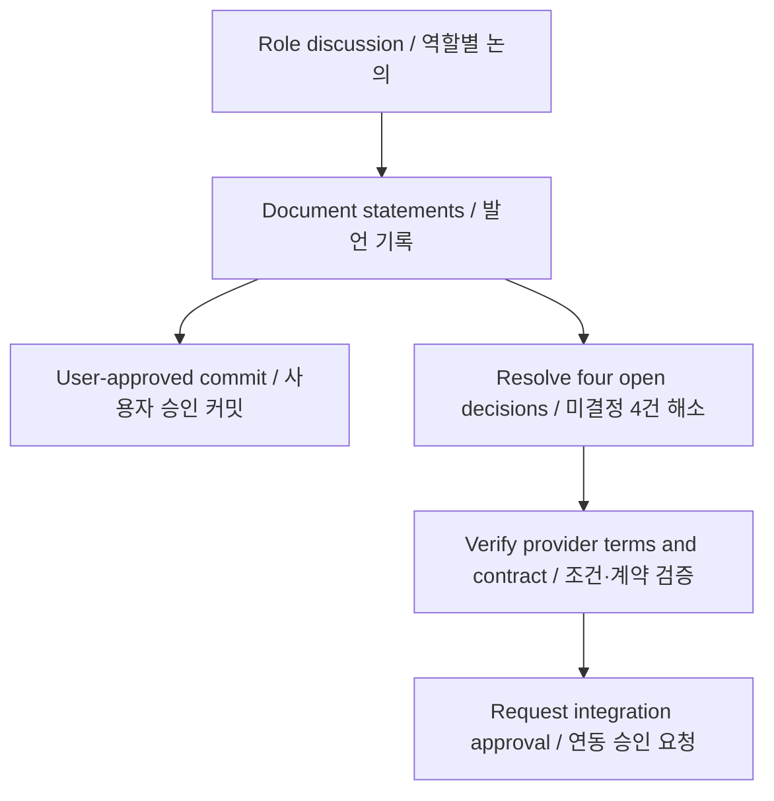

# Provider Readiness Discussion
# 제공자 연동 준비 재검토 회의

Date: 2026-11-18 (Asia/Seoul).
날짜: 2026-11-18 (한국 시각).

This record preserves the role-based simulated discussion. These are perspectives generated in one conversation, not independent agent approvals. GOF was interpreted as Goal; that interpretation remains open to correction.
이 기록은 역할별 모의 회의 발언을 보존합니다. 독립 에이전트의 승인이 아닌 하나의 대화에서 검토한 관점입니다. GOF는 Goal로 해석했으며 사용자의 정정이 가능합니다.

Agenda: Can the documentation be committed, and what is required before live integration?
의제: 문서를 커밋할 수 있는가, 실제 연동 전 무엇이 필요한가?

## Product / 제품

**Who**

Represent weather users.
날씨 사용자를 대표합니다.

**What**

Decide whether overseas support belongs in this MVP.
해외 지원의 이번 MVP 포함 여부를 결정합니다.

**Why**

Additional providers expand selection, errors, and attribution work.
제공자가 늘면 선택·오류·출처 표시 범위가 커집니다.

**How**

Validate a limited Korean area first; define overseas acceptance criteria separately.
한국의 한정된 지역부터 검증하고 해외 완료 조건을 별도로 정합니다.

**Goal**

Make supported and unsupported scope clear.
지원·미지원 범위를 명확히 합니다.

**Conviction / 소신**

A candidate provider does not mean overseas support is complete.
후보 선정은 해외 지원 완료가 아닙니다.

## Backend / 백엔드

**Who**

Own response conversion.
응답 변환을 책임집니다.

**What**

Review whether WeatherResponse can represent real data.
실제 데이터를 현재 계약이 표현할 수 있는지 검토합니다.

**Why**

Observation and forecast times have different meanings.
관측 시각과 예보 시각은 의미가 다릅니다.

**How**

Map observation, publication, forecast target, and retrieval times before changing types.
관측·발표·예보 대상·조회 시각을 매핑한 뒤 타입을 결정합니다.

**Goal**

Preserve meaning across providers.
제공자가 달라도 의미를 유지합니다.

**Conviction / 소신**

Change types when real semantics require it.
실제 의미를 담지 못하면 타입을 바꿔야 합니다.

## Data / 데이터

**Who**

Own data meaning and comparability.
데이터 의미와 비교 가능성을 책임집니다.

**What**

Distinguish observations, forecasts, and precipitation probability.
관측·예보·강수확률을 구분합니다.

**Why**

Values on one card need not describe the same time or evidence.
같은 카드의 값도 시간과 근거가 다를 수 있습니다.

**How**

Document fields, units, times, missing values, and transformations.
필드·단위·시각·결측·변환을 기록합니다.

**Goal**

Make each displayed value traceable.
표시 값을 추적 가능하게 합니다.

**Conviction / 소신**

Official forecasts must still be labeled forecasts.
공식 예보도 예보라고 표시해야 합니다.

## Frontend / 프론트엔드

**Who**

Own understandable presentation.
이해 가능한 표시를 책임집니다.

**What**

Define data-kind and freshness notices.
자료 종류와 갱신 상태 표시를 정의합니다.

**Why**

Source alone does not explain age or forecast horizon.
출처만으로 오래된 자료나 미래 예보를 구분할 수 없습니다.

**How**

Render only available metadata and explain unavailable states.
존재하는 메타데이터만 표시하고 없음 상태를 설명합니다.

**Goal**

Distinguish valid, stale, missing, and error states.
정상·오래됨·없음·오류를 구분합니다.

**Conviction / 소신**

An error response may have no observation time.
오류 응답에는 관측 시각이 없을 수 있습니다.

## Licensing / 출처·라이선스

**Who**

Own provider-use evidence.
제공자 이용 근거를 책임집니다.

**What**

Separate free access, data license, and commercial service terms.
무료 접근·데이터 라이선스·상업 서비스 조건을 분리합니다.

**Why**

A free app is not automatically non-commercial use.
무료 앱이 자동으로 비상업적 사용이 되지는 않습니다.

**How**

Record official URLs, check dates, attribution, limits, and unresolved terms.
공식 URL·확인일·표시 의무·제한·미확인 조건을 기록합니다.

**Goal**

Avoid unexpected provider replacement at launch.
출시 때 예상치 못한 제공자 교체를 줄입니다.

**Conviction / 소신**

The current record is research, not integration permission.
현재 기록은 조사 자료이며 연동 허가서는 아닙니다.

## Security / 보안

**Who**

Own credential and location handling.
인증·위치 처리를 책임집니다.

**What**

Define external location transmission and logging.
외부 위치 전송과 로그 범위를 정합니다.

**Why**

Hiding keys does not resolve location handling.
키를 숨기는 것만으로 위치 처리가 해결되지는 않습니다.

**How**

Validate manually selected representative coordinates first.
직접 선택한 대표 지역 좌표부터 검증합니다.

**Goal**

Transmit only necessary data.
필요한 데이터만 전송합니다.

**Conviction / 소신**

Treat real GPS as a separate task.
실제 GPS는 별도 작업으로 다룹니다.

## Quality / 품질

**Who**

Own evidence of conformance.
요구 충족 근거를 책임집니다.

**What**

Separate documentation approval from live integration verification.
문서 승인과 실제 연동 검증을 분리합니다.

**Why**

Mock tests do not verify external responses or quotas.
Mock 테스트는 외부 응답이나 할당량을 검증하지 않습니다.

**How**

Test realistic fixtures, missing fields, invalid responses, timeouts, and rate limits.
실제 형식 자료·결측·잘못된 응답·시간 초과·요청 제한을 테스트합니다.

**Goal**

State exactly what was verified.
검증 범위를 정확히 밝힙니다.

**Conviction / 소신**

Passing current tests is not proof of integration readiness.
기존 테스트 통과는 연동 준비 완료의 근거가 아닙니다.

## Operations / 운영·확장

**Who**

Own quotas and outage handling.
호출량·장애 대응을 책임집니다.

**What**

Clarify whether any automatic provider switching is allowed.
자동 제공자 전환 허용 여부를 명확히 합니다.

**Why**

The current rule only forbids unlabeled switching.
현재 문구는 출처 없는 전환만 금지합니다.

**How**

Propose no automatic switching initially; define cache age before caching.
초기에 자동 전환을 하지 않고 캐시 전 보관 기간을 정하자고 제안합니다.

**Goal**

Make failure behavior predictable.
실패 동작을 예측 가능하게 합니다.

**Conviction / 소신**

Complete one provider's failure handling first.
단일 제공자의 실패 처리를 먼저 완성해야 합니다.

## Observer report
## 커튼 뒤 보고

Documentation format and workspace reflection were approved, but semantic integration questions remain unresolved. This meeting does not approve live API implementation.
문서 형식과 작업 폴더 반영은 승인됐지만 실제 연동의 의미상 질문은 미결정입니다. 이번 회의는 실시간 API 구현을 승인하지 않습니다.

Open decisions: separate observation/publication/forecast times; error-response metadata; automatic switching even with attribution; overseas MVP scope.
미결정: 관측·발표·예보 시각 분리, 오류 응답 메타데이터, 출처를 표시한 자동 전환 허용 여부, 해외 MVP 범위입니다.

Next: commit the approved documentation; address the four decisions in a later meeting.
다음: 승인된 문서를 커밋하고 미결정 4건은 후속 회의에서 다룹니다.

Related record: [API source review](2026-11-18-api-source-review.md). No external factual research was added in this discussion.
관련 기록: [API 출처 검토](2026-11-18-api-source-review.md). 이번 논의에는 외부 사실 조사를 추가하지 않았습니다.
