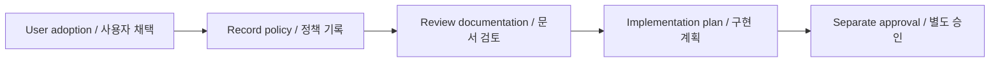

# Retry and Cache Adoption Meeting
# 재시도·캐시 정책 채택 회의

Date: 2026-11-18, Asia/Seoul. The user instructed proceeding with the decision. This record summarizes simulated role discussions; it is not independent agent approval.
날짜: 2026-11-18 한국 시각. 사용자가 결정대로 진행하도록 지시했습니다. 역할별 모의 논의를 정리한 기록이며 독립 에이전트 승인이 아닙니다.

Agenda: define what policy adoption authorizes and preserve the agreed values and limits.
의제: 정책 채택 범위·합의값·한계를 기록합니다.

## Role statements
## 역할 발언

### Tech Lead

Who: structure owner. What: adopt the MVP operating policy. Why: adoption must not silently authorize implementation. How: separate documentation and implementation approval. Goal: traceable scope. Conviction: live integration requires its own review.
Who: 구조 책임. What: MVP 정책 채택. Why: 채택으로 구현까지 묵시 승인하면 안 됩니다. How: 문서화·구현 승인을 분리합니다. Goal: 추적 가능한 범위. 소신: 실 연동은 별도 검토가 필요합니다.

### Full-stack

Who: request-flow owner. What: initial request plus two user retries. Why: count boundaries must be explicit. How: waits start after failure handling; success ends the flow. Goal: testable behavior. Conviction: countdown end never triggers automatic calls.
Who: 요청 흐름 책임. What: 최초 요청과 사용자 재시도 2회. Why: 횟수 경계가 필요합니다. How: 실패 처리 완료부터 대기하고 성공 시 종료합니다. Goal: 검증 가능한 동작. 소신: 대기 종료는 자동 호출이 아닙니다.

### SecOps

Who: usage-control owner. What: distinguish user-flow limits from backend budgets. Why: concurrency can exhaust quotas. How: establish provider budgets separately. Goal: controlled calls. Conviction: policy adoption does not establish production readiness.
Who: 호출 통제 책임. What: 사용자 흐름 제한과 서버 예산 분리. Why: 동시 요청이 할당량을 소진할 수 있습니다. How: 제공자 예산은 별도 확정합니다. Goal: 통제된 호출. 소신: 채택은 운영 준비 완료가 아닙니다.

### Researcher

Who: data meaning reviewer. What: separate TTL from freshness. Why: recently fetched data can be old. How: preserve data and retrieval times. Goal: honest provenance. Conviction: 60-second cache is not a freshness guarantee.
Who: 자료 의미 검토. What: TTL·최신성 분리. Why: 최근 조회 자료도 오래됐을 수 있습니다. How: 자료·조회 시각을 보존합니다. Goal: 정확한 출처. 소신: 60초 캐시는 최신성 보장이 아닙니다.

### Art Director

Who: display owner. What: explain waits and pending state. Why: silent disabled controls confuse users. How: countdown and clear status. Goal: understandable next action. Conviction: accessibility needs implementation review.
Who: 표시 책임. What: 대기·조회 중 안내. Why: 설명 없는 비활성 버튼은 혼란을 줍니다. How: 카운트다운·명확한 상태. Goal: 이해 가능한 행동. 소신: 접근성은 구현 검토가 필요합니다.

### Legal

Who: terms reviewer. What: gate live caching on reuse terms. Why: internal approval grants no provider rights. How: verify each provider first. Goal: accurate authorization scope. Conviction: user adoption cannot replace external terms.
Who: 조건 검토. What: 재사용 조건으로 실 캐시 제한. Why: 내부 승인으로 제공자 권한이 생기지 않습니다. How: 제공자별 확인 선행. Goal: 정확한 승인 범위. 소신: 채택은 외부 조건을 대체하지 않습니다.

### Trend Analyst

Who: future-policy reviewer. What: allow evidence-based revision. Why: initial values lack live measurements. How: report metrics and changes before approval. Goal: informed evolution. Conviction: neither silent changes nor permanent assumptions.
Who: 정책 확장 검토. What: 근거 기반 수정 허용. Why: 초기값은 실측 전입니다. How: 지표·변경을 보고하고 승인받습니다. Goal: 근거 있는 개선. 소신: 무단 변경·영구 추정 모두 피합니다.

### End User

Who: affected user perspective. What: one clear adoption statement. Why: repeated approval discussions obscure decisions. How: record values and exclusions once. Goal: move to a reviewable plan. Conviction: do not repeat adoption of adoption.
Who: 사용자 관점. What: 명확한 단일 결정문. Why: 반복 승인 회의는 결정을 흐립니다. How: 값·제외 범위를 기록합니다. Goal: 검토 가능한 다음 계획. 소신: 채택 자체를 반복 재승인하지 않습니다.

## Adopted decision and observer report

Review follow-up: the user subsequently adopted same-key retry persistence across reloads and valid no_data completion without caching or failed-retry consumption. See the [supplement adoption record](2026-11-18-retry-supplement-review.md). Identity/storage and provider-wide budgets still require specification before implementation.
검토 후속: 사용자가 이후 동일 키 재진입 제한 유지와 유효한 no_data의 흐름 종료·캐시 제외·실패 횟수 미소진을 채택했습니다. [보완안 채택 기록](2026-11-18-retry-supplement-review.md)을 참고합니다. 구현 전 식별·저장 방식과 제공자 전체 예산은 여전히 명세해야 합니다.
## 채택 결정과 관찰자 보고

Adopt automatic retries 0, user retries at most 2, waits 5/15 seconds, 60-second wait after exhaustion, and success-cache TTL 60 seconds. Provider restrictions prevail. Live caching waits for verified terms. Freshness thresholds and backend budgets remain open. Adoption covers policy documentation, not code, live integration, or deployment.
자동 재시도 0회·사용자 재시도 최대 2회·5초/15초 대기·한도 소진 후 60초·성공 캐시 TTL 60초를 채택합니다. 제공자 제한이 우선이며 실 캐시는 조건 확인 후 활성화합니다. 최신성·서버 예산은 미결정입니다. 채택은 정책 문서화 범위이며 코드·실 연동·배포는 포함하지 않습니다.

Source: this conversation; operational values are proposals adopted by the user, not external factual claims. Next: review the linked [policy](../../specs/weather-retry-cache-policy.md) and prepare an implementation plan under the existing approval workflow.
출처는 이 대화이며 운영값은 사용자 채택 설계값이지 외부 사실 주장이 아닙니다. 다음은 연결된 정책을 검토하고 기존 승인 절차에 따라 구현 계획을 준비하는 것입니다.
