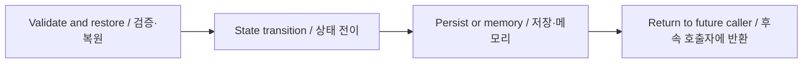

# Retry Module Implementation Meeting
# 재시도 모듈 구현 회의

Date: 2026-11-18, Asia/Seoul. User approved implementation after role discussion. This is a record of simulated roles, not independent agent approvals.
날짜: 2026-11-18 한국 시각. 역할 논의 후 사용자가 구현을 승인했습니다. 독립 에이전트 승인이 아닌 역할별 모의 기록입니다.

Tech Lead: Who — architecture owner. What — separate pure state and storage. Why — browser failure must not redefine policy. How — injected time and explicit results. Goal — independently testable modules. Conviction — state code never reads browser storage.
Tech Lead: Who 구조 책임, What 순수 상태·저장 분리, Why 저장 실패가 정책을 바꾸면 안 됨, How 시간 주입·명시적 결과, Goal 독립 검증, 소신 상태는 브라우저 저장을 읽지 않음.

Full-stack: Who flow owner; What no automatic network execution; Why restoration must not retry; How return outcomes; Goal explicit dispatch; Conviction no UI expansion.
Full-stack: Who 흐름 책임, What 자동 네트워크 실행 없음, Why 복원은 재시도가 아님, How 결과 반환, Goal 명시적 발송, 소신 화면 범위 확대 없음.

SecOps: Who validation owner; What validate untrusted storage; Why JSON success is not semantic validity; How size/version/field/count/time checks; Goal preserve valid restrictions; Conviction no silent full reset.
SecOps: Who 검증 책임, What 저장 검증, Why JSON 해석은 의미 검증이 아님, How 크기·버전·필드·횟수·시각 검증, Goal 유효 제한 보존, 소신 조용한 전체 초기화 금지.

Researcher: Who timing reviewer; What separate elapsed/restored time; Why clock changes; How injected clocks/captured timeout; Goal reproducibility; Conviction no provider guarantee claims.
Researcher: Who 시각 검토, What 경과·복원 분리, Why 시계 변경, How 시계 주입·당시 제한, Goal 재현성, 소신 제공자 보장 주장 없음.

Art Director: Who display reviewer; What return meaning, not UI prose; Why separate computation/presentation; How distinct statuses/deadlines; Goal later accessible UI; Conviction do not invent unknown recovery time.
Art Director: Who 표시 검토, What 문구 대신 상태, Why 계산·표현 분리, How 상태·시각 구분, Goal 후속 접근성, 소신 모르는 복구 시각 생성 금지.

Legal: Who retention reviewer; What minimal state; Why no activity archive; How remove completed/expired flows; Goal purpose limitation; Conviction document deletion behavior.
Legal: Who 보존 검토, What 최소 상태, Why 활동 이력 목적 아님, How 완료·만료 정리, Goal 목적 제한, 소신 삭제 동작 설명.

Trend Analyst: Who test reviewer; What boundary/failure tests; Why happy paths miss corruption; How fake times and adapters; Goal policy violation detection; Conviction evidence over test count.
Trend Analyst: Who 검증 검토, What 경계·실패 테스트, Why 정상만으로 손상 못 잡음, How 가상 시각·어댑터, Goal 정책 위반 탐지, 소신 개수보다 근거.

End User: Who user perspective; What state module completion is not feature completion; Why UI is not wired; How report scope; Goal honest progress; Conviction retain existing flow.
End User: Who 사용자, What 모듈 완료와 기능 완료 구분, Why 화면 미연결, How 범위 보고, Goal 정확한 진행, 소신 기존 흐름 유지.

Observer: approved scope is two modules and two test files plus documentation. No App/network/cache integration. Next: review measured results before commit approval.
관찰자: 승인 범위는 모듈 2개·테스트 2개·문서입니다. App·네트워크·캐시 연결은 제외하며 다음은 커밋 승인 전 실측 검토입니다.
