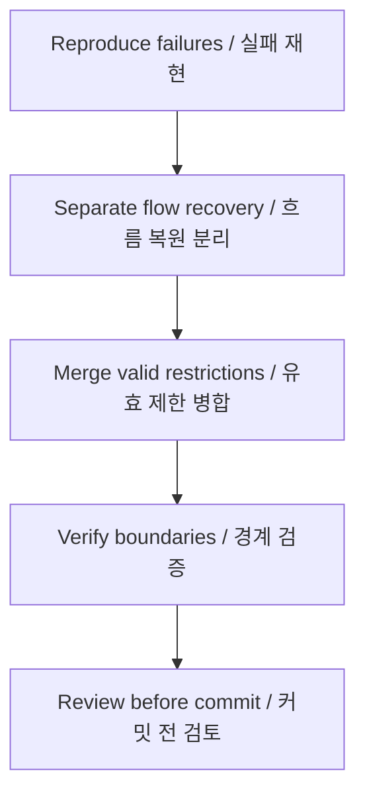

# Retry Restoration Correction Meeting
# 재시도 복원 수정 회의

Date: 2026-11-18, Asia/Seoul. The user authorized following the recommended regression-first correction plan. Role statements below summarize the preceding simulated discussion.
날짜: 2026-11-18 한국 시각. 사용자가 회귀 테스트 우선 수정 권고대로 진행하도록 지시했습니다. 아래는 앞선 역할별 모의 논의 요약입니다.

Tech Lead: Who architecture; What fix two policy violations; Why valid deadlines were lost; How regression tests then minimal correction; Goal policy alignment; Conviction no new retry policy.
Tech Lead: Who 구조, What 정책 위반 2건 수정, Why 유효 제한 손실, How 재현 후 최소 수정, Goal 정책 일치, 소신 새 재시도 정책 아님.

Full-stack: Who restore logic; What merge duplicate scopes; Why order must not change eligibility; How maximum deadline and provider merger; Goal deterministic protection; Conviction never discard the second valid deadline.
Full-stack: Who 복원, What 중복 범위 병합, Why 순서로 허용 시각 변경 금지, How 최대 시각·정책 병합, Goal 일관된 보호, 소신 두 번째 유효 시각을 버리지 않음.

SecOps: Who corruption boundary; What separate flow errors and restriction recovery; Why invalid flows must not clear valid restrictions; How retain envelope size/version gates; Goal bounded partial recovery; Conviction no unbounded parsing.
SecOps: Who 손상 경계, What 흐름 오류·제한 복원 분리, Why 흐름 오류로 제한 삭제 금지, How 전체 크기·버전 경계 유지, Goal 제한된 부분 복구, 소신 무제한 해석 금지.

Researcher: Who timing; What test actual eligibility; Why numeric assertions alone miss behavior; How block at earlier deadline, allow at maximum; Goal behavioral proof; Conviction test policy outcomes.
Researcher: Who 시각, What 실제 요청 가능 검증, Why 숫자만으로 동작 놓침, How 이전 시각 차단·최대 시각 허용, Goal 행동 근거, 소신 정책 결과 검증.

Art Director: Who future UI; What distinguish partial restore; Why errors can coexist with restrictions; How explicit issues and state; Goal consistent buttons; Conviction restore error is not immediate permission.
Art Director: Who 후속 화면, What 부분 복원 구분, Why 오류·제한 공존, How 명시적 문제·상태, Goal 버튼 일치, 소신 복원 오류는 즉시 허가 아님.

Legal: Who retention; What avoid arbitrary truncation; Why unexplained loss; How reject overflowing flow section and preserve restrictions; Goal explainable recovery; Conviction do not silently keep the first twenty.
Legal: Who 보존, What 임의 절단 방지, Why 설명 불가 손실, How 초과 흐름 영역 거부·제한 보존, Goal 설명 가능 복구, 소신 앞 20개만 남기지 않음.

Trend Analyst: Who regressions; What test reversed order, scopes and boundaries; Why one fixture is insufficient; How observe red then green; Goal recurrence prevention; Conviction demonstrate pre-fix failure.
Trend Analyst: Who 회귀, What 역순·범위·경계, Why 한 자료로 부족, How 수정 전 실패 후 통과, Goal 재발 방지, 소신 수정 전 재현 필수.

End User: Who user; What consistent waits after reload; Why lost limits change behavior; How restored eligibility; Goal predictable retry; Conviction show when lookup is possible.
End User: Who 사용자, What 재진입 대기 일치, Why 제한 손실로 동작 변경, How 복원 허용 시각, Goal 예측 가능 재시도, 소신 가능 시각 중요.

Result: two pre-fix failures reproduced; corrections and regression tests passed. No runtime UI/network integration. Next: report review verdict before commit approval.
결과: 수정 전 실패 2건 재현 후 수정·회귀 검증 통과. 화면·네트워크 연동은 없으며 다음은 커밋 승인 전 재검토 보고입니다.
