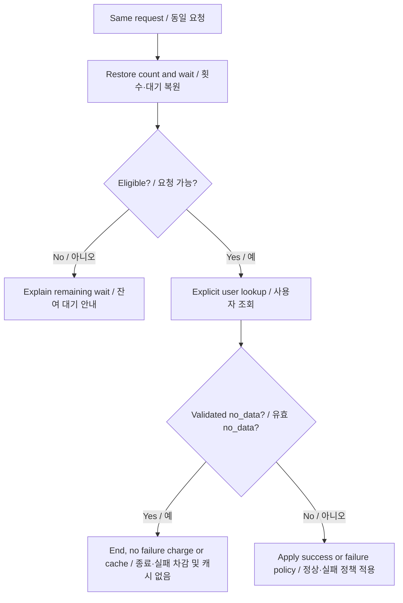

# Retry Supplement Review and Adoption
# 재시도 보완안 재검토·채택 회의

Date: 2026-11-18, Asia/Seoul. Agenda: persistence across reloads and valid no_data handling. Simulated role perspectives, not independent agent approval. The user accepted the observer recommendation and requested the next step.
날짜: 2026-11-18 한국 시각. 의제: 재진입 제한 유지·유효한 no_data 처리. 독립 에이전트 승인이 아닌 역할별 모의 관점이며 사용자가 관찰자 판단을 선택하고 다음 단계를 지시했습니다.

## Tech Lead

**Who**

Policy consistency.
정책 일관성.

**What**

Preserve same-key limits; distinguish no_data.
동일 키 제한 유지·no_data 구분.

**Why**

Reload resets undermine policy.
재진입 초기화는 정책을 무력화.

**How**

Adopt principles; specify storage later.
원칙 채택·저장은 구현 전 명세.

**Goal**

Consistent behavior.
일관된 동작.

**Conviction / 소신**

Do not imply storage is already decided.
저장 방식 확정으로 기록하지 않음.

## Full-stack

**Who**

Request-flow implementation.
요청 구현.

**What**

Define same request and validated no_data.
동일 요청·유효한 no_data 정의.

**Why**

Empty or malformed responses are not no_data.
빈 응답·파싱 오류는 no_data가 아님.

**How**

Use provider, normalized location, data kind, request conditions.
제공자·지역·자료 종류·요청 조건 키 사용.

**Goal**

Testable boundaries.
검증 가능한 경계.

**Conviction / 소신**

Timeouts must not become no_data.
시간 초과를 no_data로 숨기지 않음.

## SecOps

**Who**

Abuse and state protection.
우회·상태 보호.

**What**

Client persistence is not server rate control.
클라이언트 유지는 서버 통제가 아님.

**Why**

Client storage can be cleared.
클라이언트 저장은 삭제 가능.

**How**

Separate persistence and provider-wide control; no raw location or secrets in persistence.
상태 유지·전역 통제 분리, 원본 위치·비밀값 저장 제외.

**Goal**

Minimal state and controlled calls.
최소 상태·통제 호출.

**Conviction / 소신**

Do not claim malicious-request prevention.
악성 요청 차단으로 과장하지 않음.

## Researcher

**Who**

Data semantics.
자료 의미.

**What**

No failed allowance consumed by valid no_data.
유효 no_data는 실패 횟수 미소진.

**Why**

Missing data and failed retrieval differ.
자료 없음·조회 실패는 다름.

**How**

Preserve supported reasons without guessing.
근거 있는 사유만 보존.

**Goal**

Accurate states.
정확한 상태.

**Conviction / 소신**

No unlimited repeated lookups.
무제한 반복 조회 허용 아님.

## Art Director

**Who**

Display clarity.
표시 명확성.

**What**

Separate no-data notice and rate-limit wait.
자료 없음·요청 제한 분리.

**Why**

Failure countdown implies recovery timing.
실패 대기는 복구 기대를 줌.

**How**

Explain absence and actual allowed actions.
없음·가능 행동 설명.

**Goal**

Understandable UI.
이해 가능한 화면.

**Conviction / 소신**

Different states need different messages.
상태별 문구 필요.

## Legal

**Who**

Retention scope.
보존 범위.

**What**

Define expiry and deletion before implementation.
구현 전 만료·삭제 정의.

**Why**

Persistence does not justify permanent tracking.
유지가 영구 추적 근거 아님.

**How**

Retain only necessary limit state.
필요한 제한 상태만 보존.

**Goal**

Purpose-limited storage.
목적에 맞는 저장.

**Conviction / 소신**

No permanent activity tracking authorization.
영구 활동 추적 승인 아님.

## Trend Analyst

**Who**

Future operations.
향후 운영.

**What**

No no_data cache in MVP; revisit with evidence.
MVP no_data 캐시 제외·근거로 재검토.

**Why**

Repeated absence can waste calls.
반복 없음은 호출 낭비 가능.

**How**

Measure frequency before changing policy.
빈도 측정 후 변경.

**Goal**

Operational learning.
운영 근거 축적.

**Conviction / 소신**

Not a permanent cache ban.
영구 캐시 금지 아님.

## End User

**Who**

User experience.
사용자 경험.

**What**

Explain surviving waits after reload.
재진입 잔여 대기 설명.

**Why**

Blocked fresh screen looks broken.
새 화면 제한은 고장처럼 보임.

**How**

Show reason, remaining wait, and area selection.
이유·남은 대기·지역 선택 표시.

**Goal**

Useful next action.
유용한 다음 행동.

**Conviction / 소신**

Do not charge failures for missing data.
자료 없음에 실패 차감 반대.

## Adopted decision
## 채택 결정

Preserve retry count and next eligible time for the same request across resubmission/reload/remount. Server-wide limits are separate; identity, storage, and retention must be specified before implementation. Validated no_data ends the flow without failed-retry consumption, failure countdown, or MVP caching. New requests still follow provider limits and valid Retry-After. Previously adopted numeric values remain unchanged.
동일 요청의 재제출·새로고침·재진입에도 횟수·허용 시각을 유지합니다. 서버 전체 제한은 별도이며 구현 전 식별·저장·보존 범위를 정합니다. 검증된 no_data는 실패 횟수·실패 대기·MVP 캐시 없이 종료합니다. 새 조회는 제공자 제한·유효 Retry-After를 따릅니다. 기존 채택 숫자는 유지합니다.

Source: user adoption in this conversation. [Policy](../../specs/weather-retry-cache-policy.md). Next: documentation review, then commit approval. Implementation remains a separate approved plan.
출처: 이 대화의 사용자 채택. 다음: 문서 검토 후 커밋 승인. 구현은 별도 승인 계획을 따릅니다.
