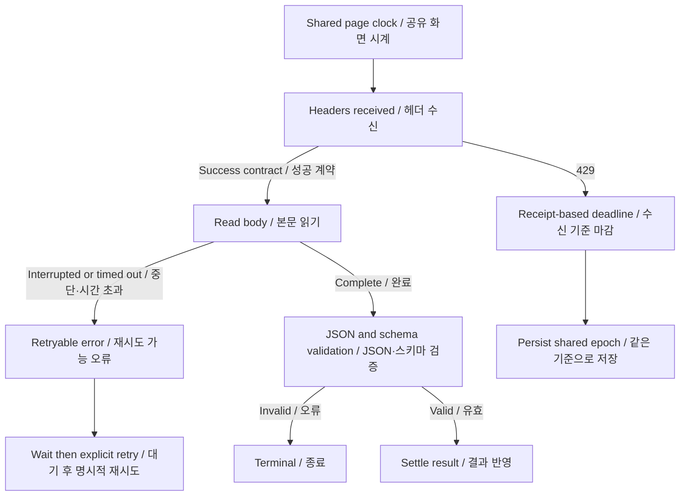

# Retry UI corrections and re-review
# 재시도 UI 보완과 재검토

The user authorized correction, regression testing and re-review of the two P2 findings from [the result review](2026-11-18-retry-ui-result-review.md). This is one assistant's role-based technical review, not independent-agent approval or user commit approval.
사용자가 [결과 검토](2026-11-18-retry-ui-result-review.md)의 P2 두 건에 대해 보완·회귀 테스트·재검토를 지시했습니다. 하나의 어시스턴트가 진행한 역할별 기술 검토이며 독립 에이전트 승인·사용자 커밋 승인이 아닙니다.

## Corrections and evidence
## 보완과 근거

1. Clock boundary: WeatherLoader accepts an optional third now callback. The coordinator passes its epoch-anchored monotonic clock through both individual and overview paths. HTTP 429 handling captures receivedAt after headers arrive. Seconds add to receivedAt; an HTTP-date is already an absolute epoch value and is compared against that same clock. No new Date.now deadline enters the coordinator from the actual HTTP adapter. Injected adapters must follow the same clock contract.
   - 시계 경계: WeatherLoader가 선택적 세 번째 now 콜백을 받습니다. 조정자는 절대 시각 기준 단조 시계를 개별·대표 목록 경로에 전달합니다. HTTP 429는 헤더 도착 뒤 receivedAt을 기록합니다. 초는 receivedAt에 더하고 HTTP-date는 절대 시각이므로 같은 시계로 비교합니다. 실제 HTTP 어댑터는 별도 Date.now 마감을 조정자에 전달하지 않습니다. 주입 어댑터도 같은 시계 계약을 지켜야 합니다.
2. Body boundary: read response.text first, classifying read failure as timeout/network and preserving an external cancellation reason. Only after reading succeeds are JSON.parse and parseWeather failures classified as invalid. The cancellation/timeout state is also checked after awaiting headers/body. Malformed JSON/schema remain terminal.
   - 본문 경계: 먼저 response.text를 읽고 실패는 timeout/network로 분류하며 외부 취소 사유를 보존합니다. 읽기 성공 뒤 JSON.parse·parseWeather 실패만 invalid로 처리합니다. 헤더·본문 대기 후에도 취소·시간 초과 상태를 확인합니다. 잘못된 JSON·스키마는 종료 오류로 유지합니다.

Before correction, the initial eight regression cases produced six failures and two passes, reproducing clock, transport, timeout and cancellation problems. The finalized suite expands this file to 11 cases: forward/backward wall changes for seconds and HTTP-date, delayed receipt for both formats, stream interruption/recovery, body timeout, explicit cancellation, malformed JSON and malformed schema.
보완 전 최초 회귀 사례 8개 중 6개 실패·2개 통과로 시계·통신·시간 초과·취소 문제를 재현했습니다. 최종 파일은 11개 사례로 확장했습니다. 초·HTTP-date 각각 벽시계 전진/후진, 두 형식의 수신 지연, 스트림 중단/복구, 본문 시간 초과, 명시적 취소, JSON 오류·스키마 오류입니다.

Measured after correction: all 83 frontend tests passed, TypeScript passed and production build passed. Chromium passed five scenarios: real Mock pipeline, reload retention, forward-clock wait, backward-clock wait and injected body-stream interruption with manual recovery after five seconds. The stream-error browser fixture does not claim a real external provider outage.
보완 후 실측: Frontend 테스트 83개·TypeScript·배포 빌드 통과. Chromium은 실제 Mock 파이프라인·재진입 보존·벽시계 전진 대기·후진 대기·주입 본문 스트림 중단 후 5초 뒤 수동 복구의 5개 시나리오가 통과했습니다. 스트림 오류 브라우저 자료는 실제 외부 제공자 장애 재현을 주장하지 않습니다.

## Role-based re-review
## 역할별 재검토

- Tech Lead — Who: architecture. What: inspect the shared clock callback. Why: imported deadlines must use the same epoch. How: trace both loader paths and 429 receipt. Goal: stable page-local waits. Position: the P2 clock finding is resolved without changing stored schema.
  - Tech Lead — 담당: 구조. 내용: 공유 시계 콜백 확인. 이유: 전달 마감값의 기준이 같아야 합니다. 방법: 두 로더 경로·429 수신 추적. 목표: 안정된 화면 내 대기. 소신: 저장 형식 변경 없이 시계 P2 해소.
- Full-stack — Who: adapter. What: inspect separate reading and validation. Why: transport failures must remain recoverable. How: stream/timeout/cancel and invalid payload cases. Goal: correct error kinds. Position: the body P2 finding is resolved without making malformed payloads retryable.
  - Full-stack — 담당: 어댑터. 내용: 읽기·검증 분리 확인. 이유: 통신 장애는 복구 가능해야 합니다. 방법: 스트림·시간 초과·취소·잘못된 본문 검증. 목표: 정확한 오류 분류. 소신: 잘못된 본문을 재시도 가능으로 바꾸지 않고 본문 P2 해소.
- SecOps — Who: restriction integrity. What: check request scope and persistence. Why: fixing clock math must not broaden or erase limits. How: retain existing restoration and scope tests plus receipt assertions. Goal: no unintended restriction weakening. Position: client storage and cross-reload clock limitations remain explicit.
  - SecOps — 담당: 제한 무결성. 내용: 요청 범위·저장 확인. 이유: 시계 보완이 제한을 확대·삭제하면 안 됩니다. 방법: 기존 복원·범위 검증 유지·수신 시각 검증. 목표: 의도하지 않은 제한 약화 방지. 소신: 클라이언트 저장·재진입 시계 한계를 명시.
- Art Director — Who: interaction. What: inspect displayed waits and retry availability. Why: user-visible controls must match actual gates. How: browser 30-second displays and five-second recovery. Goal: predictable interaction. Position: pass the reviewed fixes; keep the 80/64 input mismatch open as nonblocking.
  - Art Director — 담당: 상호작용. 내용: 대기 표시·버튼 확인. 이유: 조작과 실제 제한이 같아야 합니다. 방법: 브라우저 30초 표시·5초 복구. 목표: 예상 가능한 조작. 소신: 보완 검토 통과·80/64 입력 불일치는 비차단 미결정 유지.
- Researcher — Who: evidence. What: compare red and green outcomes. Why: a regression must detect the original defect. How: record six initial failures and final test counts. Goal: traceable claims. Position: evidence supports these local cases, not all environments.
  - Researcher — 담당: 근거. 내용: 보완 전후 결과 비교. 이유: 회귀 검증은 원래 결함을 탐지해야 합니다. 방법: 최초 실패 6건·최종 개수 기록. 목표: 추적 가능한 주장. 소신: 로컬 사례 근거이며 모든 환경의 보장은 아님.
- Trend Analyst — Who: scope. What: check no provider/cache expansion. Why: the authorized work is corrective. How: review changed files and dependencies. Goal: focused scope. Position: no new live provider or cache is needed for these fixes.
  - Trend Analyst — 담당: 범위. 내용: 제공자·캐시 확장 없음 확인. 이유: 승인 작업은 보완입니다. 방법: 변경 파일·의존성 검토. 목표: 범위 집중. 소신: 실제 제공자·캐시 추가 불필요.
- Legal — Who: provenance. What: check test-data and licensing claims. Why: local tests do not verify live terms. How: use existing dependencies and self-authored fixtures. Goal: accurate attribution. Position: no live-license approval is implied.
  - Legal — 담당: 출처. 내용: 검증 자료·라이선스 주장 확인. 이유: 로컬 검증은 실사용 조건 확인이 아닙니다. 방법: 기존 의존성·자체 자료 사용. 목표: 정확한 출처. 소신: 실제 라이선스 승인 의미 없음.
- End User — Who: recovery. What: check manual recovery after interruption. Why: a recoverable failure must preserve a usable next action. How: wait five seconds, explicitly retry, observe no-data completion. Goal: clear recovery. Position: retain no automatic retry.
  - End User — 담당: 복구. 내용: 중단 후 수동 복구 확인. 이유: 복구 가능한 장애에는 다음 조작이 있어야 합니다. 방법: 5초 대기·명시적 재시도·자료 없음 종료 확인. 목표: 명확한 복구. 소신: 자동 재시도 없음 유지.

## Curtain observer verdict
## 커튼 뒤 판정

Technical verdict: Approve for the two corrected P2 findings. No blocking finding remains in this correction review. The 80/64 input mismatch remains a nonblocking follow-up. This verdict does not authorize commit, Push, PR creation or Merge.
기술 판정: 보완한 P2 두 건에 대해 Approve. 이번 보완 재검토에 차단 항목은 남지 않았습니다. 80/64 입력 불일치는 비차단 후속 항목입니다. 이 판정은 커밋·Push·PR 생성·Merge 승인이 아닙니다.

Sources and skills: current repository contracts/source, self-authored regression fixtures, existing Vite/Vitest/Playwright; code-review and add-educational-comments. No external dataset, copied code, new dependency or new license was added. Backend code, live weather, hosted CI and deployment were not validated in this correction. Initial clock accuracy and cross-reload clock changes remain client-only limitations.
출처·스킬: 현재 저장소 계약·소스·자체 회귀 자료·기존 Vite/Vitest/Playwright·code-review·add-educational-comments. 외부 데이터·복사 코드·새 의존성·새 라이선스 없음. 이번 보완에서 Backend 소스·실제 날씨·원격 CI·배포는 검증하지 않았습니다. 초기 시계 정확성·재진입 사이 시계 변경은 클라이언트만의 한계로 남습니다.
