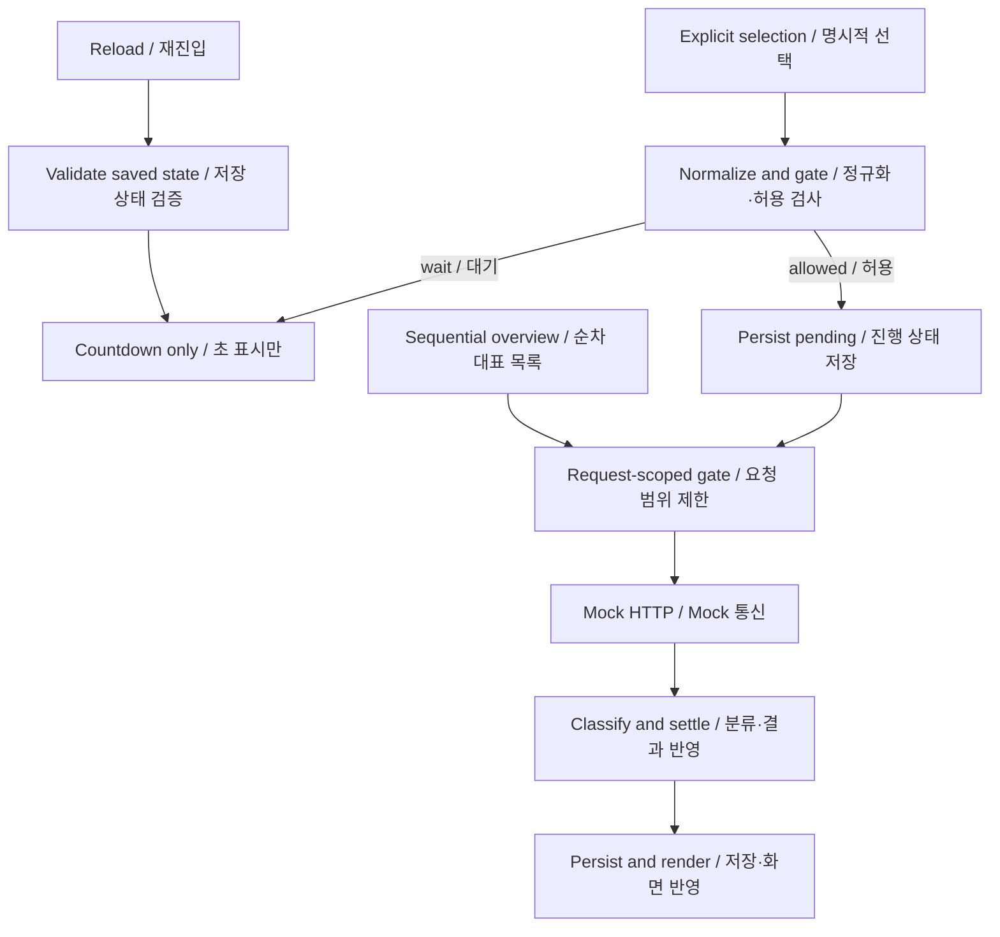

# Retry UI integration — approved implementation record
# 재시도 UI 연결 — 승인된 구현 기록

This record summarizes the approved second design meeting and implementation direction; it is not a verbatim transcript or evidence of independently executed agents.
이 기록은 승인된 2차 설계회의와 구현 방향을 정리하며 원문 발언록이나 독립 에이전트 실행 증거가 아닙니다.

## Agenda and role review
## 의제와 역할 검토

- Tech Lead — Who: architecture owner. What: one request coordinator. Why: separate UI paths must not bypass the same-area wait. How: manual entry, regional buttons and Mock location share the hook. Goal: consistent dispatch accounting. Position: preserve the tested state module.
  - Tech Lead — 담당: 구조. 내용: 요청 조정자 하나. 이유: 화면 진입점마다 같은 지역 대기를 우회하면 안 됩니다. 방법: 직접 입력·지역 버튼·Mock 위치가 훅을 공유합니다. 목표: 일관된 발송 집계. 소신: 검증된 상태 모듈을 유지합니다.
- Full-stack — Who: integration owner. What: connect storage before dispatch. Why: reload can interrupt a pending request. How: persist pending state, restore unknown results and ignore obsolete completions. Goal: no automatic individual request after reload. Position: only explicit actions dispatch.
  - Full-stack — 담당: 연동. 내용: 발송 전 저장. 이유: 새로고침이 진행 중 요청을 끊을 수 있습니다. 방법: 진행 상태 저장·결과 불명 복원·이전 응답 무시. 목표: 재진입 후 개별 자동 요청 없음. 소신: 명시적 행동만 발송합니다.
- SecOps — Who: client storage reviewer. What: validate bounded records. Why: browser records can be damaged or edited. How: existing decoder and memory fallback. Goal: preserve validated restrictions. Position: this is a convenience control, not server security.
  - SecOps — 담당: 저장 검토. 내용: 상한 있는 기록 검증. 이유: 브라우저 기록은 손상·변조될 수 있습니다. 방법: 기존 디코더·메모리 대체. 목표: 검증된 제한 보존. 소신: 서버 보안 통제로 주장하지 않습니다.
- Art Director — Who: display owner. What: visible countdown and neutral failure messages. Why: immediate retry language contradicts a disabled button. How: announce status once; keep countdown outside the live region. Goal: understandable waiting. Position: zero does not trigger a request.
  - Art Director — 담당: 표시. 내용: 대기 초와 중립 오류 안내. 이유: 즉시 재시도 문구는 비활성 버튼과 모순됩니다. 방법: 상태 알림과 실시간 낭독 밖 초 표시. 목표: 이해 가능한 대기. 소신: 0초가 요청을 실행하지 않습니다.
- Researcher — Who: evidence reviewer. What: classify HTTP failures. Why: 429 alone does not identify an upstream provider-wide restriction. How: accept valid future Retry-After only for the canonical request scope. Goal: avoid invented upstream behavior. Position: keep all sources Mock.
  - Researcher — 담당: 근거. 내용: HTTP 오류 분류. 이유: 429만으로 외부 제공자 전체 제한을 알 수 없습니다. 방법: 유효한 미래 Retry-After를 정규화 요청 범위에만 적용. 목표: 제공자 동작 추정 방지. 소신: 출처는 Mock으로 유지합니다.
- Trend Analyst — Who: extension reviewer. What: defer live providers and caching. Why: new features would obscure integration evidence. How: retain the replaceable loader boundary. Goal: focused implementation. Position: overseas expansion needs its own approval.
  - Trend Analyst — 담당: 확장 검토. 내용: 실제 제공자·캐시 후순위. 이유: 새 기능은 연동 근거를 흐립니다. 방법: 교체 가능한 로더 유지. 목표: 범위 집중. 소신: 해외 확장은 별도 승인입니다.
- Legal — Who: provenance reviewer. What: no new external dataset or dependency. Why: Mock tests cannot establish live license compliance. How: disclose unverified live terms. Goal: accurate source claims. Position: do not mark live licensing as verified.
  - Legal — 담당: 출처 검토. 내용: 새 외부 자료·의존성 없음. 이유: Mock 검증은 실제 라이선스 준수를 증명하지 않습니다. 방법: 실제 조건 미검증 명시. 목표: 정확한 출처 주장. 소신: 실시간 라이선스 확인 완료로 표시하지 않습니다.
- End User — Who: usability reviewer. What: preserve manual selection and explicit retry. Why: denial or missing data is not necessarily a retryable fault. How: no-data ends the flow; another area remains selectable. Goal: understandable recovery. Position: do not restore the last area automatically.
  - End User — 담당: 사용성. 내용: 직접 선택·명시적 재시도. 이유: 거부·자료 없음은 재시도할 장애와 다릅니다. 방법: no-data 흐름 종료·다른 지역 선택 유지. 목표: 이해 가능한 복구. 소신: 마지막 지역 자동 복원 없음.

## Curtain observer report
## 커튼 뒤 보고

Adopted implementation: individual flows use initial dispatch plus at most two retries, 5/15/60-second stage waits, and the existing adjustable 30-minute intermediate lifetime. The overview is sequential and does not charge individual retry counts. It shares restrictions and stops the batch on rate limiting. No automatic retries, cache, live data or provider fallback are introduced.
채택 구현: 개별 흐름은 최초 발송+최대 2회 재시도·단계별 5/15/60초·기존 조정 가능 중간 유효기간 30분을 사용합니다. 대표 목록은 순차 조회하고 개별 횟수를 소모하지 않습니다. 제한을 공유하며 rate limit에서 목록을 멈춥니다. 자동 재시도·캐시·실제 자료·제공자 대체는 추가하지 않습니다.

Manual identifiers are trimmed, seoul maps to 서울, controls and values over 64 UTF-16 units are rejected. Bounded identifiers are recovered from stored entries only to configure the existing decoder; they are not proof of an officially supported weather area. No selected area, coordinates or credentials are stored separately.
직접 입력 식별자는 공백 제거·seoul을 서울로 변환하며 제어문자·UTF-16 64단위 초과는 거부합니다. 제한된 저장 식별자는 기존 디코더 설정을 위해 추출하며 공식 지원 날씨 지역의 증거가 아닙니다. 선택 지역·좌표·인증정보는 별도로 저장하지 않습니다.

Evidence: local source, virtual-time tests and Chromium reload tests. Assumption: stage waits and lifetime are user-adopted defaults, not provider limits. Limitations: sessionStorage can be cleared; tab/reload wall-clock changes are not fully detectable; live APIs and hosted CI remain unverified. Next: result review, separate commit approval, Push approval, complete PR draft approval, user Merge.
근거: 로컬 소스·가상 시간 테스트·Chromium 재진입 테스트. 가정: 단계 대기·유효기간은 사용자 채택 초기값이며 제공자 제한값이 아닙니다. 한계: sessionStorage 삭제 가능·재진입 사이 시계 변경 완전 탐지 불가·실제 API와 원격 CI 미검증. 다음: 결과 검토→별도 커밋 승인→Push 승인→PR 전체 초안 승인→사용자 Merge.
