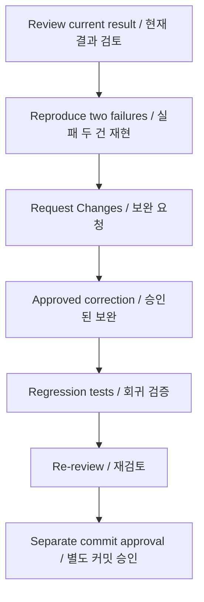

# Retry UI result review
# 재시도 UI 결과 검토 회의

This is a role-based review synthesized by one assistant, not a transcript from independently executing agents. The user requested result review; implementation fixes and commit are not performed in this stage.
하나의 어시스턴트가 역할별 관점으로 진행한 검토이며 독립 에이전트들의 발언록은 아닙니다. 사용자가 결과 검토를 요청했으며 이번 단계에는 구현 보완·커밋을 수행하지 않습니다.

## Evidence and verdict
## 근거와 판정

Verdict: Request Changes. Two reproducible correctness issues remain. Earlier evidence of 72 passing tests, type check, build and two Chromium scenarios remains valid for those covered cases; those checks did not cover the two failures below. No complete test rerun was performed during this source-unchanged review.
판정: Request Changes. 재현된 정확성 문제 2개가 남았습니다. 기존 테스트 72개·타입 검사·빌드·Chromium 2개 통과는 해당 범위의 근거로 유효하지만 아래 실패 조건은 다루지 않았습니다. 소스를 바꾸지 않은 이번 검토에서 전체 테스트를 재실행하지 않았습니다.

1. P2 — Mixed clock domains in Retry-After. The HTTP client computes retryAt using Date.now, while the coordinator compares it directly with the page's wall-anchored monotonic clock. Reproduction using the actual transpiled weatherApi and retryState functions: anchor the page clock, advance wall time by one hour, return HTTP 429 with Retry-After: 30; eligibility becomes 3,630 seconds rather than 30 seconds. A backward wall adjustment can instead discard or shorten the restriction. This occurs during a page lifetime and is distinct from the documented limitation across reload.
   - P2 — Retry-After 시계 기준 혼합. HTTP 클라이언트는 Date.now로 retryAt을 계산하고 조정자는 이를 화면의 벽시계 기준 단조 시계와 직접 비교합니다. 실제 weatherApi·retryState 함수를 변환해 재현한 결과: 화면 시계를 고정한 뒤 벽시계를 1시간 앞으로 변경하고 HTTP 429·Retry-After: 30을 반환하면 허용 시각이 30초 대신 3,630초가 됩니다. 벽시계를 뒤로 바꾸면 제한이 사라지거나 짧아질 수도 있습니다. 재진입 사이 한계와 달리 동일 화면 생존 중 발생합니다.
   - Locations: frontend/src/services/weatherApi.ts, lines 69–71; frontend/src/hooks/useWeatherRequest.ts, lines 70–76.
   - 위치: frontend/src/services/weatherApi.ts 69~71행·frontend/src/hooks/useWeatherRequest.ts 70~76행.
   - Required correction: carry response-received timing/duration explicitly and convert deadlines into the coordinator clock consistently. Preserve HTTP-date support and persisted absolute deadlines. Capture receipt time at response handling, not before dispatch. Add forward/backward wall-clock regression cases.
   - 보완: 응답 수신 기준 시각·대기 길이를 명확히 전달하고 조정자 시계로 일관되게 변환합니다. HTTP-date 지원·저장 절대 시각을 유지하고 수신 시각은 발송 전이 아닌 응답 처리 시점에 기록합니다. 벽시계 전진·후진 회귀 사례를 추가합니다.

2. P2 — Body-read transport errors become terminal invalid responses. The client catches response.json and parseWeather failures together. Reproduction with HTTP headers accepted and json() rejecting TypeError("terminated"): actual kind is invalid rather than network. The coordinator then ends the flow and hides failure retry even though the adopted policy allows network failure recovery. Body-read timeout is also caught as invalid by this boundary.
   - P2 — 본문 통신 오류가 종료 오류로 변환됩니다. 클라이언트가 response.json과 parseWeather 실패를 함께 처리합니다. 헤더 수신 후 json()이 TypeError("terminated")로 실패하는 조건에서 network 대신 invalid가 반환됩니다. 조정자는 흐름을 종료하고 실패 재시도를 숨기므로 채택된 통신 장애 복구 정책과 어긋납니다. 이 경계는 본문 읽기 시간 초과도 invalid로 처리합니다.
   - Location: frontend/src/services/weatherApi.ts, line 76.
   - 위치: frontend/src/services/weatherApi.ts 76행.
   - Required correction: distinguish external cancellation, timeout, body transport failure, JSON syntax failure and schema rejection. Only malformed JSON/schema remain invalid. Add body-interruption/timeout tests and verify invalid JSON/schema remain terminal.
   - 보완: 외부 취소·시간 초과·본문 통신 실패·JSON 문법 실패·스키마 거부를 구분합니다. 잘못된 JSON·스키마만 invalid로 유지합니다. 본문 중단·시간 초과 회귀 테스트와 JSON·스키마 종료 동작을 함께 검증합니다.

Nonblocking usability finding: AreaSelector allows 80 UTF-16 units while the hook rejects more than 64. Align the input affordance with the accepted limit in a follow-up correction.
비차단 사용성 항목: AreaSelector는 UTF-16 80단위 입력을 허용하고 훅은 64단위 초과를 거부합니다. 후속 보완에서 입력 제한을 일치시켜야 합니다.

## Role discussion
## 역할별 논의

### Tech Lead
Who: architecture reviewer. What: preserve the shared hook but correct the time boundary. Why: a monotonic clock cannot protect a deadline imported from a different clock domain. How: one documented conversion boundary with forward/backward tests. Goal: preserve the intended wait through page-local wall-clock changes. Position: passing tests cannot replace a missing boundary case.
담당: 구조 검토. 내용: 공유 훅은 유지하고 시각 경계를 보완합니다. 이유: 다른 시계 기준에서 온 마감값을 그대로 받으면 단조 시계가 보호하지 못합니다. 방법: 변환 지점을 하나로 정의하고 전진·후진을 검증합니다. 목표: 화면 생존 중 시계 변경에도 의도한 대기를 보존합니다. 소신: 누락된 경계 조건을 기존 통과 테스트로 대체할 수 없습니다.

### Full-stack
Who: implementation reviewer. What: separate transport from payload validation. Why: headers received is not the same as a complete JSON body received. How: classify reading errors before schema validation; retain explicit cancellation behavior. Goal: retry only recoverable failures. Position: do not solve this by making every invalid response retryable.
담당: 구현 검토. 내용: 통신·본문 검증을 분리합니다. 이유: 헤더 수신은 JSON 본문 수신 완료와 다릅니다. 방법: 스키마 검증 전에 읽기 오류를 분류하고 명시적 취소 동작을 유지합니다. 목표: 복구 가능한 실패만 재시도합니다. 소신: 모든 invalid를 재시도하도록 바꾸는 해결은 반대합니다.

### SecOps
Who: limit reviewer. What: correct waits that can become too short or long. Why: user-entered clock changes must not undermine the adopted page-local policy. How: keep existing storage bounds and scope isolation while fixing timing. Goal: consistent client behavior. Position: remain explicit that a client-side mechanism is not server enforcement.
담당: 제한 검토. 내용: 너무 짧거나 긴 대기를 보완합니다. 이유: 사용자 시계 변경이 채택한 화면 내 정책을 흔들면 안 됩니다. 방법: 저장 상한·범위 분리를 유지하며 시각을 고칩니다. 목표: 일관된 클라이언트 동작. 소신: 서버 통제가 아니라는 한계를 유지합니다.

### Art Director
Who: display reviewer. What: ensure displayed seconds match actual eligibility and align 64/80 input limits. Why: a clear countdown is misleading when its underlying deadline is wrong. How: test displayed wait and enabled button after clock changes. Goal: trustworthy recovery controls. Position: accurate interaction matters before visual polish.
담당: 표시 검토. 내용: 표시 초·실제 허용 시각을 맞추고 64/80 입력 제한을 일치시킵니다. 이유: 계산이 틀리면 명확한 카운트다운도 오해를 만듭니다. 방법: 시계 변경 뒤 대기 표시·버튼 허용을 검증합니다. 목표: 믿을 수 있는 복구 조작. 소신: 시각적 꾸밈보다 상호작용 정확성이 먼저입니다.

### Researcher
Who: evidence reviewer. What: separate earlier pass evidence from new counterexamples. Why: 72 passing cases do not imply all error paths were validated. How: record exact reproduction inputs and outputs using current source functions. Goal: traceable verdict. Position: report observed 3,630 seconds and invalid classification without extrapolating to live providers.
담당: 근거 검토. 내용: 기존 통과 근거와 새 반례를 구분합니다. 이유: 72개 통과가 모든 오류 경로 검증을 뜻하지 않습니다. 방법: 현재 소스 함수의 재현 입력·출력을 기록합니다. 목표: 추적 가능한 판정. 소신: 실측 3,630초·invalid 분류를 보고하고 실제 제공자로 확대 해석하지 않습니다.

### Trend Analyst
Who: scope reviewer. What: defer live weather and cache expansion. Why: expanding now would multiply uncorrected error boundaries. How: limit the next change to clock conversion, body classification and regression tests. Goal: a stable reusable boundary. Position: do not introduce another provider as a workaround.
담당: 범위 검토. 내용: 실제 날씨·캐시 확장을 미룹니다. 이유: 지금 확장하면 보완 전 오류 경계가 늘어납니다. 방법: 다음 변경은 시계 변환·본문 분류·회귀 검증으로 제한합니다. 목표: 안정된 재사용 경계. 소신: 다른 제공자를 우회책으로 추가하지 않습니다.

### Legal
Who: provenance reviewer. What: preserve Mock labeling and unverified live-license status. Why: local error reproduction provides no licensing evidence. How: record only repository code and self-authored test fixtures as review sources. Goal: accurate claims. Position: no new legal conclusion is justified by these tests.
담당: 출처 검토. 내용: Mock 표시·실제 라이선스 미확인 상태 유지. 이유: 로컬 오류 재현은 라이선스 근거가 아닙니다. 방법: 저장소 소스·자체 재현 자료만 검토 출처로 기록합니다. 목표: 정확한 주장. 소신: 이번 테스트로 새로운 법적 결론을 내리지 않습니다.

### End User
Who: recovery-flow reviewer. What: preserve a retry option after a genuine connection interruption. Why: users should not lose recovery because the connection broke after headers. How: confirm timeout/network retry after the proper wait, and no retry for truly malformed data. Goal: predictable recovery. Position: no automatic retry and no last-area restoration remain appropriate.
담당: 복구 흐름 검토. 내용: 실제 통신 중단 뒤 재시도 선택을 보존합니다. 이유: 헤더 수신 후 연결이 끊겼다는 이유로 복구 수단을 잃으면 안 됩니다. 방법: timeout/network는 대기 후 재시도·잘못된 자료는 종료를 검증합니다. 목표: 예상 가능한 복구. 소신: 자동 재시도 없음·마지막 지역 자동 복원 없음은 유지합니다.

## Curtain observer report and next gate
## 커튼 뒤 보고와 다음 단계

Preserve the shared coordinator, sequential overview, no automatic retry, no-data completion and request-scoped 429 policy. Request correction of the two P2 issues before commit approval. The 64/80 usability mismatch is a separate nonblocking improvement. No source changes or commits were made in this review.
공유 조정자·순차 대표 목록·자동 재시도 없음·자료 없음 종료·요청 범위 429 정책은 유지합니다. 커밋 승인 전에 P2 두 항목의 보완을 요청합니다. 64/80 사용성 불일치는 별도 비차단 개선입니다. 이번 검토에는 소스 수정·커밋이 없습니다.

Sources/skills: local weatherApi.ts, useWeatherRequest.ts, retryState.ts, retry policy and existing tests; code-review skill for correctness/coverage review. The reproduction transpiled current TypeScript in memory with the already installed Vite transformer. No external network, dataset, dependency or copied code was added.
출처·스킬: 로컬 weatherApi.ts·useWeatherRequest.ts·retryState.ts·재시도 정책·기존 테스트와 정확성·검증 범위 검토용 code-review 스킬입니다. 기존 Vite 변환기로 현재 TypeScript를 메모리에서 변환해 재현했습니다. 외부 네트워크·데이터·의존성·복사 코드는 추가하지 않았습니다.

## Resolution after authorized corrections
## 승인된 보완 후 해결 상태

The two P2 findings above are historical findings resolved in [the correction re-review](2026-11-18-retry-ui-corrections-review.md). The latest technical verdict is Approve for these corrections; commit approval remains separate. The nonblocking 80/64 input mismatch remains open.
위 P2 두 건은 [보완 재검토](2026-11-18-retry-ui-corrections-review.md)에서 해결한 과거 지적입니다. 최신 기술 판정은 이번 보완에 대해 Approve이며 커밋 승인은 별도입니다. 비차단 80/64 입력 불일치는 미해결로 유지합니다.
