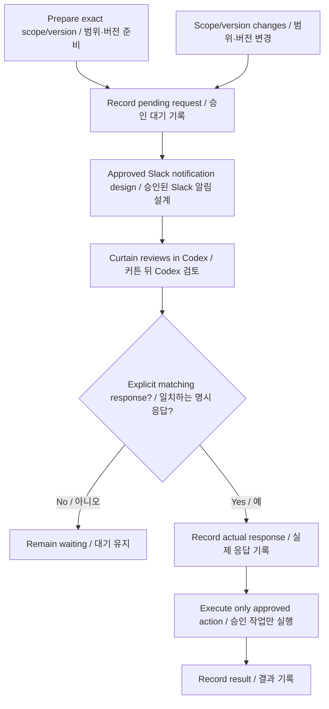

# Execution approval waiting — design discussion
# 사용자 실행 승인 대기 — 설계 회의

Date / 날짜: 2026-11-19. Report recipient / 보고 대상: Curtain / 커튼 뒤. Eight roles are analysis compiled by one assistant; no independent-agent claim or simulated Curtain response.
8역할은 한 어시스턴트가 취합한 분석이며 독립 에이전트 주장·커튼 뒤 대신 응답 없음.

## Actual instruction and scope / 실제 지시·범위

User: “별도 리뷰어 부재는 검증 보류로 기록하고, 사용자 실행 승인 대기의 종류·수신자·기록 위치 논의 진행”. Authorized: record reviewer-dependent verification as deferred, discuss and document proposals. Not authorized: change channel visibility, permissions, subscriptions, send messages or implement approval automation.
사용자 지시: 위 문장. 승인 범위: 별도 리뷰어 필요 검증 보류 기록·승인 대기 설계 토론·문서화. 채널 공개 변경·권한·구독 변경·메시지 전송·승인 자동화 구현 허가 아님.

## Facts and assumptions / 사실·가정

Fact: channel was deliberately created private and the screenshot displays its lock. Previous Issue/PR/review-comment notifications reached that same channel. No evidence of a delivery block caused by channel privacy. Separate reviewer was not found in prior collaborator query; no new query or external change in this meeting.
사실: 채널은 의도적으로 비공개 생성·스크린샷 자물쇠 표시. 같은 채널의 기존 Issue/PR/리뷰 댓글 전달 확인. 비공개가 전달 차단 원인이라는 근거 없음. 앞선 협업자 조사에서 별도 리뷰어 미발견·이번 회의 새 조회/외부 변경 없음.

Assumption for proposal: initially the current user remains the execution approver and the current Codex chat remains the response surface. This is not an adopted new policy.
제안 가정: 초기 실행 승인자는 현재 사용자·응답 위치는 현재 Codex 채팅 유지. 새 정책 채택 아님.

### Tech Lead

- Who: Tech Lead.
- What / Proposal / 제안: Use explicit action-specific approval requests / 작업별 명시 승인 요청.
- Why: Commit, Push and PR permissions differ / 커밋·Push·PR 권한 다름.
- How: One request per bounded action/version / 범위·버전별 요청.
- Goal: No permission drift / 승인 범위 유지.
- Position / 소신: Do not combine unrelated approvals / 무관 승인 묶음 금지.

### Full-stack

- Who: Full-stack.
- What / Proposal / 제안: Start with notification-only design / 알림 전용 설계부터.
- Why: Existing subscription does not emit project-specific gates / 기존 구독만으로 프로젝트 승인 대기 생성 안 됨.
- How: Define request payload before implementation / 구현 전 요청 내용 정의.
- Goal: Testable flow / 검증 가능한 흐름.
- Position / 소신: Do not treat label filtering as a trigger / 라벨 필터를 발생 트리거로 간주 금지.

### SecOps

- Who: SecOps.
- What / Proposal / 제안: Keep the channel private and recipient explicit / 비공개 유지·수신자 명시.
- Why: Privacy does not identify approver / 비공개가 승인자 식별 아님.
- How: Request to actual user, reject bot/reaction as consent / 실제 사용자 요청·봇/반응 승인 제외.
- Goal: Authorized human action / 유효 사람 승인.
- Position / 소신: No new invite or wider app permission / 새 초대·앱 권한 확대 없음.

### Art Director

- Who: Art Director.
- What / Proposal / 제안: Show action, object and required response / 작업·대상·필요 응답 표시.
- Why: Generic approval is ambiguous / 일반 승인 모호.
- How: Separate waiting from approved with text / 대기·승인 글로 구분.
- Goal: Readable pending state / 대기 식별.
- Position / 소신: The lock is privacy, not blocked delivery / 자물쇠는 비공개·전달 차단 아님.

### Researcher

- Who: Researcher.
- What / Proposal / 제안: Separate designed, configured and observed / 설계·설정·관찰 분리.
- Why: A proposal is not delivered evidence / 제안은 전달 근거 아님.
- How: Track event, request, response and action separately / 이벤트·요청·응답·실행 구분.
- Goal: Auditable state / 추적 상태.
- Position / 소신: Reviewer absence is deferred, not pass or failure / 리뷰어 부재는 보류·성공/실패 아님.

### Trend Analyst

- Who: Trend Analyst.
- What / Proposal / 제안: Avoid custom automation until payload chosen / 내용 확정 전 자동화 보류.
- Why: Reduce maintenance and duplicate alerts / 유지·중복 감소.
- How: Choose manual baseline before service / 서비스 전 수동 기준 검토.
- Goal: Proportionate operation / 적정 운영.
- Position / 소신: No new Issue just to hold approvals / 승인 저장만 위한 새 Issue 불필요.

### Legal

- Who: Legal.
- What / Proposal / 제안: Preserve exact response and scope / 실제 응답·범위 보존.
- Why: Approval proof differs from notification / 승인 증거와 알림 다름.
- How: Record origin, version, time and supersession / 원본·버전·시각·대체 기록.
- Goal: Reliable consent history / 신뢰 동의 이력.
- Position / 소신: Silence, Merge or reaction is not blanket consent / 무응답·Merge·반응은 포괄 동의 아님.

### End User

- Who: End User.
- What / Proposal / 제안: One clear place to answer initially / 초기 응답 위치 하나.
- Why: Multiple approval surfaces confuse / 여러 승인 화면 혼동.
- How: Slack points to current Codex chat / Slack에서 현재 Codex 채팅 안내.
- Goal: Simple deliberate response / 단순 명시 응답.
- Position / 소신: Do not silently execute from Slack chatter / Slack 대화만으로 자동 실행 금지.

## Accepted deferral / 승인된 검증 보류

Review requested, Approve and Request changes requiring another actual reviewer are deferred due to reviewer absence, not failed or passed. Existing COMMENTED delivery remains observed. Review this deferral when a legitimate reviewer becomes available under separately authorized access. Do not switch accounts, invite users or lower completion criteria automatically.
별도 실제 리뷰어가 필요한 리뷰 요청·Approve·Request changes 검증은 리뷰어 부재로 보류·실패/통과 아님. 기존 COMMENTED 전달 관찰 유지. 별도 승인 접근 하 유효 리뷰어 가용 시 보류 재검토. 계정 전환·사용자 초대·완료 기준 자동 완화 없음.

## Proposed kinds, recipient and records / 제안: 종류·수신자·기록

| Kind / 종류 | Object / 승인 대상 | Authority / 구분 |
|---|---|---|
| Result acceptance / 결과 수락 | Exact reported result and limitations / 보고 결과·한계 | Does not authorize commit / 커밋 허가 아님 |
| Commit / 커밋 | Reviewed files/diff snapshot / 검토 파일·diff 버전 | Does not authorize Push / Push 허가 아님 |
| Push / Push | Exact branch and commits / 브랜치·커밋 | Does not authorize PR / PR 허가 아님 |
| PR create/update / PR 생성·수정 | Complete title/body and diff / 전체 제목·본문·diff | Show and approve exact content / 정확한 내용 보고·승인 |
| External action or access / 외부 실행·접근 | Exact event, data, target and permissions / 이벤트·데이터·대상·권한 | Apply action-time confirmation rules / 실행 직전 확인 규칙 적용 |

Proposal: Slack destination is the existing private weather-conversation-app channel. Intended approver is the actual user, Curtain; channel presence or GitHub account identity alone does not prove a response author is authorized. Do not add mentions, recipients or accounts without defining the mapping.
제안: Slack 대상은 기존 비공개 weather-conversation-app. 승인자는 실제 사용자 커튼 뒤·채널 참여나 GitHub 계정만으로 응답 권한을 추정하지 않음. 매핑 확정 없이 멘션/수신자/계정 추가 없음.

Proposed response location: current Codex chat initially; Slack only notifies and points to the review context. This does not assert that an existing chat deep link, bot or webhook has been configured. Direct Slack approvals and button automation are out of this proposal's initial scope.
응답 위치 제안: 초기 현재 Codex 채팅·Slack은 검토 맥락 안내 알림만. 기존 채팅 딥링크·봇·webhook 설정 완료 주장 아님. Slack 직접 승인·버튼 자동화는 초기 제안 범위 밖.

Proposed durable record: CONVERSATION_LOG.md stores the exact human response, action scope, version and origin; owning specification/meeting records store adopted decisions, and change-report.md stores changed-file purpose/checks. Persist these through normal commit/Push/PR gates; local recording is not already published GitHub evidence. Do not copy credentials/private local paths. Supabase is not introduced at stage 1.
영구 기록 제안: CONVERSATION_LOG.md에 실제 사람 응답·작업 범위·버전·응답 원본 위치·담당 명세/회의에 채택 결정·change-report.md에 파일 목적/검증. 정상 커밋/Push/PR 승인 후 보존·로컬 기록을 GitHub 공개 완료로 주장하지 않음. 인증 정보/개인 경로 복사 금지·1단계에서 Supabase 도입 없음.

Request fields proposed: request identifier, approval kind, requester/approver, exact version (commit or reviewed diff snapshot), object/action, reason/impact, evidence location, explicit response instruction and state. Approval is consumed only for the scoped action; materially changed content returns to waiting. Silence, emoji and a different action's approval do not authorize execution. No numeric timeout or automatic approval adopted.
요청 항목 제안: 요청 식별자·승인 종류·요청자/승인자·정확한 버전(커밋 또는 검토 diff)·대상/작업·이유/영향·근거 위치·응답 안내·상태. 승인은 해당 범위 작업에만 사용·실질 변경 시 재대기. 무응답/이모지/다른 작업 승인은 실행 허가 아님. 숫자 만료·자동 승인 채택 없음.

## Conflicts and open decisions / 충돌·미결정

Convenience of responding in Slack conflicts with identity, version binding and record consistency. Recommend notification-only initially, but await adoption. Decide notification sender (manual or automation), payload, frequency, recipient mapping and stable review link before implementation. Channel privacy changes are unnecessary for the previously verified delivery path.
Slack 응답 편의와 신원/버전 연결/기록 일치가 충돌. 초기 알림 전용 권고·채택 대기. 구현 전 발송 주체(수동/자동)·본문·빈도·수신 매핑·검토 링크 확정. 기존 검증 전달 경로를 위해 공개 전환 불필요.

## Flow — proposal only / 흐름 — 제안만

## Sources and limits / 출처·한계

Sources: actual user request and screenshot, [prior reviewer investigation](2026-11-19-review-notification-planning.md), existing [workflow](../workflow.md), [roles](../roles.md) and [notification evidence](../stage1-notifications.md). No fresh external feature or legal assertion, copied assets, new code/data/dependency. New-material redistribution license not applicable. Stage 1 remains partial; design and document checks do not verify approval-waiting delivery.
출처: 실제 사용자 지시·스크린샷·앞선 리뷰 조사·기존 업무/역할/알림 근거. 새 외부 기능/법률 주장·자산 복사·코드/데이터/의존성 없음·새 자료 재배포 라이선스 해당 없음. 1단계 부분 검증 유지·설계/문서 검사로 승인 대기 전달 검증하지 않음.
