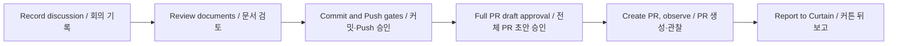

# Issue use and notification scope — meeting 2
# Issue 사용·알림 범위 — 2차 회의

Date / 날짜: 2026-11-19. These are eight analytical perspectives compiled by one assistant, not independent agents. Reports go to Curtain / 커튼 뒤, the actual user; no recipient speech or approval is invented.
8개 관점은 한 어시스턴트가 취합한 분석이며 독립 에이전트 실행이 아닙니다. 보고 대상은 실제 사용자 커튼 뒤이며 발언·승인을 만들지 않습니다.

## Agenda / 의제

Is an Issue necessary for Slack notifications, and what should be validated next?
Slack 알림에 Issue가 필요한가·다음 검증은 무엇인가?

### Tech Lead

- Who: Tech Lead.
- What / Proposal / 제안: Separate notification needs and work tracking / 알림·작업 추적 구분.
- Why: Avoid needless Issues / 불필요한 Issue 방지.
- How: Use meetings, Issues and PRs by purpose / 목적별 기록.
- Goal: Clear ownership / 책임 명확화.
- Position / 소신: Do not mandate or ban all Issues / 전면 의무·금지 반대.

### Full-stack

- Who: Full-stack.
- What / Proposal / 제안: Use the actual documentation PR / 실제 문서 PR 활용.
- Why: Existing change is available / 기존 변경 존재.
- How: Approve push/draft before creation / Push·초안 승인 후 생성.
- Goal: Real workflow validation / 실제 흐름 검증.
- Position / 소신: No extra test Issue needed / 추가 테스트 Issue 불필요.

### SecOps

- Who: SecOps.
- What / Proposal / 제안: Minimize test artifacts / 시험 기록 최소화.
- Why: Limit disclosure / 전달 제한.
- How: Trigger needed events only / 필요한 이벤트만.
- Goal: Approved scope / 승인 범위.
- Position / 소신: No access expansion for testing / 시험용 권한 확대 금지.

### Art Director

- Who: Art Director.
- What / Proposal / 제안: Show record type and state / 종류·상태 표시.
- Why: Numbers overlap in one sequence / 번호 체계 공유.
- How: Issue or PR plus number and link / 종류·번호·링크.
- Goal: Clear messages / 명확한 알림.
- Position / 소신: Number is not a project stage / 번호는 작업 단계 아님.

### Researcher

- Who: Researcher.
- What / Proposal / 제안: Keep per-event evidence / 이벤트별 근거.
- Why: Issue success does not prove PR / Issue 성공은 PR 근거 아님.
- How: Separate verification rows / 검증 행 분리.
- Goal: Accurate verdict / 정확한 판정.
- Position / 소신: Current evidence is Issue-only / 현재 근거 Issue 한정.

### Trend Analyst

- Who: Trend Analyst.
- What / Proposal / 제안: Use Issues selectively / 선택 사용.
- Why: Avoid duplicated management / 중복 관리 방지.
- How: Track long tasks and bugs / 장기 과제·버그 추적.
- Goal: Useful records / 유용한 기록.
- Position / 소신: Simple changes may need only PR / 단순 변경은 PR로 가능.

### Legal

- Who: Legal.
- What / Proposal / 제안: Define external record purpose / 외부 기록 목적.
- Why: Closed Issues persist / 종료 후 기록 유지.
- How: Create only for scoped needs / 범위 있는 필요에 생성.
- Goal: Purposeful records / 목적 있는 기록.
- Position / 소신: No repeated empty test Issues / 빈 시험 Issue 반복 금지 권고.

### End User

- Who: End User.
- What / Proposal / 제안: Avoid repeated entry / 반복 입력 방지.
- Why: Reduce tracking burden / 추적 부담 감소.
- How: Meeting for discussion, PR for changes / 논의는 회의·변경은 PR.
- Goal: Findable records / 찾기 쉬운 기록.
- Position / 소신: Keep one clear owner per topic / 주제별 기록 주체 명확화.

## Facts, conflicts and recommendation / 사실·충돌·권고

Fact: Issue create/close passed once; PR/review/Merge and user-approval-waiting are unverified. A PR notification does not require creating an Issue. The prior read-only rule was explicitly cancelled and its uncommitted edits reverted; it is not active policy.
사실: Issue 생성/종료 단일 통과·PR/리뷰/Merge/사용자 승인 대기 미검증. PR 알림을 위해 Issue 생성은 필요하지 않습니다. 앞선 조회 전용 규칙은 사용자가 취소해 미커밋 수정 복원·현행 규칙 아님.

Conflict: tracking unresolved work versus duplicate administrative records. Recommendation: neither blanket Issue prohibition nor mandatory Issues; consider unresolved tasks needing owner/completion/follow-up separately. Do not create a new Issue merely to validate PR alerts. No permanent Issue policy is adopted by this record.
충돌: 미해결 과제 추적과 중복 행정 기록. 권고: 전면 금지·의무화 모두 지양·담당/완료/추적 필요한 미결 과제 별도 판단. PR 알림 검증만을 위한 Issue 생성 불필요. 이 회의록으로 영구 Issue 정책을 채택하지 않습니다.

## Actual instructions and status / 실제 지시·상태

The user requested “나에게 동조하지 말고 3차 회의 그리고 관찰자가 아닌 커튼 뒤에게 보고해”, then “그럼 다음 도입 작업 진행”. This authorizes storing the meetings and reconciling documents. It does not authorize Push, a new PR, a new Issue or every proposed Issue-use policy.
사용자 지시: “나에게 동조하지 말고 3차 회의 그리고 관찰자가 아닌 커튼 뒤에게 보고해”, 이후 “그럼 다음 도입 작업 진행”. 회의 저장·문서 정합성 검토 진행이며 Push·새 PR·새 Issue·모든 Issue 사용 정책 채택 허가는 아닙니다.

Next: review current documents, obtain commit approval for new edits, then Push approval, full PR draft approval, create PR and observe. Merge remains user-controlled. Reviewer identity and approval-waiting representation remain open.
다음: 현재 문서 검토→새 수정 커밋 승인→Push 승인→전체 PR 초안 승인→PR 생성·관찰. Merge는 사용자 수행. 리뷰 담당자·승인 대기 표현 미결정.

[Current guide / 현행 지침](../stage1-notifications.md) · [Roles / 역할](../roles.md)

## Sources and limits / 출처·한계

Sources: actual conversation, existing office workflow and [recorded Issue evidence](../stage1-notifications.md). No external code/assets/dependency introduced. Service legal clearance and additional delivery are not claimed. Historical Issue-test approval is not permission for future events.
출처: 실제 대화·기존 운영 절차·기록된 Issue 근거. 외부 코드/자산/의존성 도입 없음. 서비스 법률 검토 완료·추가 전달 검증 주장 없음. 과거 Issue 시험 승인은 향후 이벤트 허가 아님.
