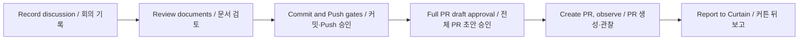

# Issue use and notification scope — meeting 3
# Issue 사용·알림 범위 — 3차 회의

Date / 날짜: 2026-11-19. These are eight analytical perspectives compiled by one assistant, not independent agents. Reports go to Curtain / 커튼 뒤, the actual user; no recipient speech or approval is invented.
8개 관점은 한 어시스턴트가 취합한 분석이며 독립 에이전트 실행이 아닙니다. 보고 대상은 실제 사용자 커튼 뒤이며 발언·승인을 만들지 않습니다.

## Agenda / 의제

Is an Issue necessary for Slack notifications, and what should be validated next?
Slack 알림에 Issue가 필요한가·다음 검증은 무엇인가?

### Tech Lead

- Who: Tech Lead.
- What / Proposal / 제안: Use task nature, not Slack, to choose Issues / Slack 아닌 과제 성격으로 선택.
- Why: Avoid inverted purpose / 목적 역전 방지.
- How: Separate unresolved tasks, changes and discussion / 미결 과제·변경·논의 구분.
- Goal: Clear records / 기록 명확화.
- Position / 소신: Neither blanket ban nor mandate / 전면 금지·의무화 모두 반대.

### Full-stack

- Who: Full-stack.
- What / Proposal / 제안: Validate actual PR after review / 검토 후 실제 PR 검증.
- Why: No extra artifact needed / 추가 시험물 불필요.
- How: Push approval, full draft approval, PR, compare / Push 승인·전체 초안 승인·PR·대조.
- Goal: Traceable events / 추적 가능한 이벤트.
- Position / 소신: Open does not prove review or merge / 생성은 리뷰·병합 근거 아님.

### SecOps

- Who: SecOps.
- What / Proposal / 제안: Keep broad permissions visible / 넓은 권한 명시.
- Why: Notification use is not read-only access / 알림 사용과 조회 권한 다름.
- How: No extra access, scoped events / 권한 확대 없이 범위 이벤트.
- Goal: Honest security account / 정확한 권한 설명.
- Position / 소신: Official is not automatically least privilege / 공식 앱도 최소 권한 보장 아님.

### Art Director

- Who: Art Director.
- What / Proposal / 제안: Put type and state before number / 번호 앞 종류·상태.
- Why: Issue and PR share numbering / 번호 공유.
- How: Show Issue/PR, status and link / 종류·상태·링크.
- Goal: Avoid chronology confusion / 시계열 혼동 방지.
- Position / 소신: Use logs and Git history for sequence / 시계열은 로그·Git 이력.

### Researcher

- Who: Researcher.
- What / Proposal / 제안: Review current documents first / 현재 문서 먼저 검토.
- Why: Historical statuses can conflict / 과거 상태 혼동.
- How: Reconcile before PR / PR 전 정합성 확인.
- Goal: Independent document quality / 문서 품질 유지.
- Position / 소신: Do not bypass review for alerts / 알림 시험 위해 검토 생략 금지.

### Trend Analyst

- Who: Trend Analyst.
- What / Proposal / 제안: Avoid premature mandatory policy / 성급한 의무 규칙 지양.
- Why: Insufficient operating evidence / 운영 근거 부족.
- How: Assess owner, completion and follow-up / 담당·완료·추적 필요 판단.
- Goal: Proportionate process / 적정 절차.
- Position / 소신: Optional use needs practical criteria / 선택 사용도 기준 필요.

### Legal

- Who: Legal.
- What / Proposal / 제안: Separate past consent from future authority / 과거 동의·향후 권한 분리.
- Why: Previous test approval is bounded / 과거 시험 승인 한정.
- How: Retain history, authorize new actions by scope / 이력 보존·새 범위 판단.
- Goal: No implied permission / 묵시 허가 방지.
- Position / 소신: Reverting a ban is not blanket approval / 금지 취소는 포괄 승인 아님.

### End User

- Who: End User.
- What / Proposal / 제안: Make the next action clear / 다음 행동 명확화.
- Why: Repeated gates obscure progress / 반복 확인 혼동.
- How: Report concrete review then separate gates / 구체 검토 후 승인 구분.
- Goal: Understandable control / 이해 가능한 통제.
- Position / 소신: Do not ask the same approval twice / 같은 범위 중복 승인 금지.

## Facts, conflicts and recommendation / 사실·충돌·권고

Fact: Issue create/close passed once; PR/review/Merge and user-approval-waiting are unverified. A PR notification does not require creating an Issue. The prior read-only rule was explicitly cancelled and its uncommitted edits reverted; it is not active policy.
사실: Issue 생성/종료 단일 통과·PR/리뷰/Merge/사용자 승인 대기 미검증. PR 알림을 위해 Issue 생성은 필요하지 않습니다. 앞선 조회 전용 규칙은 사용자가 취소해 미커밋 수정 복원·현행 규칙 아님.

Conflict: tracking unresolved work versus duplicate administrative records. Recommendation: neither blanket Issue prohibition nor mandatory Issues; consider unresolved tasks needing owner/completion/follow-up separately. Do not create a new Issue merely to validate PR alerts. No permanent Issue policy is adopted by this record.
충돌: 미해결 과제 추적과 중복 행정 기록. 권고: 전면 금지·의무화 모두 지양·담당/완료/추적 필요한 미결 과제 별도 판단. PR 알림 검증만을 위한 Issue 생성 불필요. 이 회의록으로 영구 Issue 정책을 채택하지 않습니다.

## Actual instructions and status / 실제 지시·상태

The user requested “나에게 동조하지 말고 3차 회의 그리고 관찰자가 아닌 커튼 뒤에게 보고해”, then “그럼 다음 도입 작업 진행”. This authorizes storing the meetings and reconciling documents. It does not authorize Push, a new PR, a new Issue or every proposed Issue-use policy.
사용자 지시: “나에게 동조하지 말고 3차 회의 그리고 관찰자가 아닌 커튼 뒤에게 보고해”, 이후 “그럼 다음 도입 작업 진행”. 회의 저장·문서 정합성 검토 진행이며 Push·새 PR·새 Issue·모든 Issue 사용 정책 채택 허가는 아닙니다.

Next: review current documents, obtain commit approval for new edits, then Push approval, full PR draft approval, create PR and observe. Merge remains user-controlled. Reviewer identity and approval-waiting representation remain open.
다음: 현재 문서 검토→새 수정 커밋 승인→Push 승인→전체 PR 초안 승인→PR 생성·관찰. Merge는 사용자 수행. 리뷰 담당자·승인 대기 표현 미결정.

[Current guide / 현행 지침](../stage1-notifications.md) · [Roles / 역할](../roles.md)

## Sources and limits / 출처·한계

Sources: actual conversation, existing office workflow and [recorded Issue evidence](../stage1-notifications.md). No external code/assets/dependency introduced. Service legal clearance and additional delivery are not claimed. Historical Issue-test approval is not permission for future events.
출처: 실제 대화·기존 운영 절차·기록된 Issue 근거. 외부 코드/자산/의존성 도입 없음. 서비스 법률 검토 완료·추가 전달 검증 주장 없음. 과거 Issue 시험 승인은 향후 이벤트 허가 아님.
