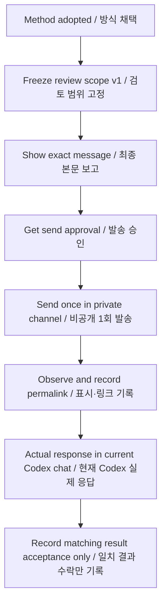

# Manual approval notification — adopted baseline
# 수동 승인 알림 — 채택 기준 회의

Date / 날짜: 2026-11-19. Recipient / 보고 대상: Curtain / 커튼 뒤. Eight roles are analysis compiled by one assistant, not separate agents. No response is invented for Curtain.
8역할은 한 어시스턴트의 취합 분석·별도 에이전트 아님. 커튼 뒤 응답을 만들지 않습니다.

## Agenda / 의제

Review the proposal and select sender, message structure and record linkage for initial execution-approval-waiting notifications.
초기 실행 승인 대기 알림의 발송 주체·본문 구조·기록 연결을 검토합니다.

### Tech Lead

- Who: Tech Lead.
- What / Proposal / 제안: Manual sending initially / 초기 수동 발송.
- Why: Approval flow unverified / 승인 흐름 미검증.
- How: Test one bounded request / 범위 요청 하나 시험.
- Goal: Small verified scope / 작은 검증 범위.
- Position / 소신: Do not automate a wrong process / 잘못된 절차 자동화 금지.

### Full-stack

- Who: Full-stack.
- What / Proposal / 제안: Use the existing private channel / 기존 비공개 채널.
- Why: Avoid new bot/webhook / 새 봇·webhook 지양.
- How: Send approved exact text once / 승인 본문 1회 발송.
- Goal: Repeatable baseline / 재현 기준.
- Position / 소신: GitHub subscription is not this trigger / GitHub 구독은 이 트리거 아님.

### SecOps

- Who: SecOps.
- What / Proposal / 제안: Keep access and recipients unchanged / 접근·수신자 유지.
- Why: No expansion needed / 확대 불필요.
- How: Exclude secrets/local paths / 비밀값·개인 경로 제외.
- Goal: Controlled disclosure / 전달 통제.
- Position / 소신: Receipt is not identity or consent / 수신은 신원·동의 아님.

### Art Director

- Who: Art Director.
- What / Proposal / 제안: Put kind/state first / 종류·상태 첫 줄.
- Why: Fast action recognition / 행동 식별.
- How: Object/version/location/response order / 대상·버전·위치·응답 순서.
- Goal: Readable request / 읽기 쉬운 요청.
- Position / 소신: Number alone is insufficient / 번호만으로 불충분.

### Researcher

- Who: Researcher.
- What / Proposal / 제안: Separate send, display, response, execution / 발송·표시·응답·실행 분리.
- Why: Send success is not full pass / 발송 성공은 전체 통과 아님.
- How: Keep per-step evidence / 단계별 근거.
- Goal: Accurate verdict / 정확 판정.
- Position / 소신: Do not claim all approval flow passed / 전체 승인 흐름 통과 주장 금지.

### Trend Analyst

- Who: Trend Analyst.
- What / Proposal / 제안: Start with result acceptance / 결과 수락부터.
- Why: Lower impact than Push/access / Push·접근보다 영향 작음.
- How: Use actual existing results / 실제 기존 결과 사용.
- Goal: Low-burden learning / 부담 낮은 학습.
- Position / 소신: No meaningless test approvals / 무의미 시험 승인 금지.

### Legal

- Who: Legal.
- What / Proposal / 제안: Retain response origin and scope / 응답 원본·범위 보존.
- Why: Notification differs from consent / 알림·동의 다름.
- How: Link exact human response and version / 실제 응답·버전 연결.
- Goal: Traceable authority / 추적 권한.
- Position / 소신: No blanket/legal approval claim / 포괄·법률 승인 주장 금지.

### End User

- Who: End User.
- What / Proposal / 제안: One response location / 응답 위치 하나.
- Why: Avoid Slack/Codex confusion / Slack·Codex 혼동 방지.
- How: Slack points to current chat / Slack에서 현재 채팅 안내.
- Goal: Simple deliberate answer / 단순 명시 응답.
- Position / 소신: Emoji/seen is not approval / 이모지·봤음은 승인 아님.

## Actual adoption and boundaries / 실제 채택·경계

User response: “회의 판단으로 채택”. Adopted: manual single-send baseline, existing private weather-conversation-app channel, actual user Curtain as recipient, current Codex chat as response location, exact response/object/version and Slack message link in the conversation log plus owning documents. No Supabase, new bot, webhook or automatic execution.
실제 응답: “회의 판단으로 채택”. 채택: 수동 1회 기준·기존 비공개 weather-conversation-app·수신자 실제 사용자 커튼 뒤·응답 현재 Codex 채팅·로그/담당 문서에 실제 응답/대상/버전/Slack 메시지 링크. Supabase·새 봇·webhook·자동 실행 없음.

The first request concerns result acceptance for the reviewer investigation and approval-waiting design, not commit/Push/PR creation. Adoption of the method is not acceptance of all investigation results or authorization to send an unreported final message.
첫 요청은 리뷰 조사·승인 대기 설계 결과 수락이며 커밋/Push/PR 생성 아님. 방식 채택은 모든 조사 결과 수락이나 미보고 최종 메시지 발송 허가가 아닙니다.

## Fixed review scope v1 / 고정 검토 범위 v1

- Reviewer investigation: existing owner/author only; independent reviewer tests deferred; COMMENTED notification observed, not APPROVED.
  리뷰 조사: 기존 소유자/작성자만 확인·독립 리뷰어 시험 보류·COMMENTED 전달 관찰·APPROVED 아님.
- Approval design: Slack manual notification only, actual response in this current Codex chat, recorded exact scope/version/origin, no action beyond that response's scope.
  승인 설계: Slack 수동 알림만·현재 Codex 채팅 실제 응답·정확 범위/버전/원본 기록·응답 범위 밖 실행 없음.
- Existing earlier discussion remains historical; this meeting records adoption of the manual baseline only.
  기존 토론은 이력·이 회의는 수동 기준만 채택 기록.
- Review documents: this adopted meeting and [review investigation](2026-11-19-review-notification-planning.md). SHA-256 fingerprints and final request text are recorded in CONVERSATION_LOG.md. If either document materially changes, invalidate this request version and re-report.
  검토 문서: 이 채택 회의·위 리뷰 조사. SHA-256 지문·최종 요청 본문은 CONVERSATION_LOG.md. 두 문서 실질 변경 시 이 요청 버전 무효화·다시 보고.

## Proposed final request / 최종 요청 제안

Request / 요청: S1-APPROVAL-20261119-01, version / 버전: v1. Sender: assistant acting in the user's existing Slack session, not a new bot. No @mention until mapping is defined. The Slack message describes the exact review scope and asks the user to return to this Codex chat; it contains no invented deep link or inaccessible local-path link.
요청 식별자·버전 위 참조. 발송자는 사용자 기존 Slack 세션을 조작하는 어시스턴트·새 봇 아님. 매핑 미정 상태 @멘션 없음. Slack 본문에 정확 검토 범위·현재 Codex 채팅 복귀 안내·가짜 딥링크/접근 불가 개인 경로 링크 없음.

Send only after the complete final text is shown and approved. Record Slack permalink after sending; receipt, reaction or silence does not authorize anything. Keep rejected, changed and accepted outcomes distinct; no automatic timeout approval.
전체 최종 본문 보고·승인 후에만 발송. 발송 후 Slack permalink 기록·수신/반응/무응답은 허가 아님. 반려/변경/수락 구분·시간 초과 자동 승인 없음.

## Conflicts and open questions / 충돌·미결정

Manual channel sending verifies a human-assisted notification baseline, not automatic approval-waiting event delivery. Sender identity mapping, stable review links and automation remain future work. A request identifier is local tracking, not a new GitHub Issue or PR.
수동 채널 발송은 사람 개입 알림 기준 검증·자동 승인 대기 이벤트 전달 아님. 발송 신원 매핑·안정 검토 링크·자동화는 후속. 요청 식별자는 로컬 추적·새 GitHub Issue/PR 아님.

## Flow / 흐름

## Sources and validation limits / 출처·검증 한계

Sources: actual user discussion and [previous approval design](2026-11-19-execution-approval-waiting-discussion.md), [review investigation](2026-11-19-review-notification-planning.md). No new external material/dependency or app permissions. New-material redistribution licensing not applicable. Document checks and hashes do not prove Slack delivery, identity automation or stage completion. No send, commit, Push or PR in this recording step.
출처: 실제 사용자 토론·위 기존 승인 설계/리뷰 조사. 새 외부 자료/의존성/앱 권한 없음·새 자료 재배포 라이선스 해당 없음. 문서 검사/해시는 Slack 전달·신원 자동화·단계 완료 근거 아님. 이번 기록 단계 발송/커밋/Push/PR 없음.
