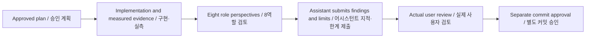

# N80 result review — submission to the user
# N80 결과 검토 — 사용자에게 제출

The user requested "사용자 결과 검토". The assistant reviews the approved plan, implementation and existing evidence and submits this report. This record contains eight role perspectives synthesized by one assistant, not independent approvals. The curtain observer is the user receiving it; no acceptance, rejection or commit approval is attributed to the user.
사용자가 "사용자 결과 검토"를 요청했습니다. 어시스턴트가 승인 계획·구현·기존 근거를 검토해 보고를 제출합니다. 하나의 어시스턴트가 정리한 8역할 관점이며 독립 승인이 아닙니다. 커튼 뒤 관찰자는 수신자인 사용자이고 사용자에게 채택·반려·커밋 승인을 부여하지 않습니다.

## Evidence and scope
## 근거와 범위

Current source was inspected again: areaInput evaluator, AreaSelector help/error/raw handoff, hook pre-transition validation, area-only config constant, boundary tests and browser scenario. This review changed documentation only. No runtime test suite was rerun: the implementation-stage results remain 112 frontend tests, typecheck, production build and six Chromium scenarios passed. Current git diff --check passed.
현재 areaInput 평가·AreaSelector 안내/오류/원문 전달·훅 전이 전 검증·지역 전용 설정 상수·경계 테스트·브라우저 사례를 재확인했습니다. 이번 검토는 문서만 변경합니다. 실행 테스트를 재실행하지 않았으며 구현 단계 근거는 Frontend 112개·타입 검사·배포 빌드·Chromium 6개 통과입니다. 현재 git diff --check 통과.

| Approved behavior / 승인 동작 | Implementation evidence / 구현 근거 | Review result / 검토 결과 |
|---|---|---|
| Raw80, canonical1–64 / 원문 80·정규 1~64 | Shared evaluator and raw79/80/81, canonical63/64/65 cases / 공유 평가·원문 79/80/81·정규 63/64/65 사례 | Matches / 일치 |
| Existing trim/seoul/control order / 기존 trim/seoul/제어 순서 | Pure-policy fixtures include outer tab/newline normalization and surviving-control rejection / 외부 탭/줄바꿈 정규화·남은 제어문자 거부 자료 | Matches / 일치 |
| No invalid dispatch/storage mutation / 오류 미발송·저장 무변경 | Real form and injected Mock location assertions / 실제 폼·주입 Mock 위치 검증 | Covered / 검증 근거 있음 |
| Preserve stored keys, counts and limits / 저장 키·횟수·제한 보존 | Legacy key restored exactly; corrupt flow retains independent restriction / 기존 키 정확 복원·손상 흐름과 독립 제한 보존 | Covered / 검증 근거 있음 |
| Field help/error and editable text / 도움말·오류·편집 원문 | aria-describedby, aria-invalid, alert and retained-value assertions / 도움말 연결·오류 상태·알림·값 유지 검증 | Covered / 검증 근거 있음 |
| Canonical-only transport / 정규 값만 전송 | Browser raw80 padded value produces canonical64 HTTP query / 브라우저 원문 80 공백 값이 정규 64 HTTP 쿼리로 전달 | Covered / 검증 근거 있음 |
| Native raw input cap / 기본 원문 입력 상한 | Chromium insertText/key input stops at 80 / Chromium 삽입·키 입력 80 제한 | Covered in Chromium / Chromium 범위 검증 |

## Eight working-role reviews
## 8개 작업 역할 검토

### Tech Lead — technical finding
### Tech Lead — 기술 검토
Who: architecture reviewer. What: confirm shared policy rather than duplicated acceptance. Why: field and hook must not drift again. How: trace both callers to evaluateAreaInput and area-only constants to config/restore. Goal: a single input contract. Position: no blocking architecture finding in this scope; backend/storage schema remain unchanged.
담당: 구조 검토. 내용: 중복 판정 대신 공유 정책 확인. 이유: 입력창·훅 기준 재분리 방지. 방법: 두 호출자의 evaluateAreaInput·설정/복원 지역 상수 추적. 목표: 입력 계약 하나. 소신: 범위 내 구조 차단 지적 없음·Backend/저장 형식 유지.

### Full-stack — implementation finding
### Full-stack — 구현 검토
Who: request-flow reviewer. What: confirm raw validation precedes key/state creation. Why: raw81 must not become an accepted trimmed request through bypassed fields. How: check raw handoff and invalid injected-location storage/call assertions. Goal: identical entry-point acceptance. Position: no required correction found; invalid input is not silently sliced or sent.
담당: 요청 흐름 검토. 내용: 키/상태 생성 전 원문 검증 확인. 이유: 입력창 우회 원문 81을 trim 뒤 유효 요청으로 바꾸면 안 됨. 방법: 원문 전달·오류 주입 위치의 저장/호출 검증 확인. 목표: 진입점 판정 일치. 소신: 필수 수정 지적 없음·오류 입력 임의 절단/전송 없음.

### SecOps — integrity finding
### SecOps — 무결성 검토
Who: retry-state reviewer. What: confirm canonical identifiers remain bounded and old keys are not rewritten. Why: identity changes can weaken existing counts or restrictions. How: examine restore-name filtering, area config validation and legacy/corrupt-flow tests. Goal: preserve retry accounting. Position: no new blocking integrity finding; this remains client-only control, not server enforcement.
담당: 재시도 상태 검토. 내용: 정규 식별자 상한·기존 키 재작성 없음 확인. 이유: 식별자 변경이 횟수/제한을 약화할 수 있음. 방법: 복원 이름 필터·지역 설정·기존 키/손상 흐름 테스트 확인. 목표: 재시도 집계 보존. 소신: 새 무결성 차단 지적 없음·서버 통제가 아닌 클라이언트 제어 한계 유지.

### Art Director — interaction finding and limit
### Art Director — 상호작용 검토·한계
Who: field-help reviewer. What: confirm both limits and rejection feedback are exposed accessibly. Why: different raw/name limits need an explanation. How: inspect field-specific IDs, described-by help/error and retained rejected text. Goal: understandable correction. Position: local mechanics are covered; real-user comprehension and every OS IME remain unverified, not approved by this review.
담당: 입력 도움말 검토. 내용: 두 상한·거부 안내 접근 가능 표시 확인. 이유: 원문/이름 상한 차이에 설명 필요. 방법: 입력별 ID·도움말/오류 연결·거부 원문 유지 확인. 목표: 이해 가능한 수정. 소신: 로컬 작동은 검증했으나 실제 사용자 이해도·모든 OS 입력기는 미검증이며 검토로 승인하지 않음.

### Researcher — evidence finding
### Researcher — 근거 검토
Who: verification reviewer. What: separate measured results from untested environments. Why: pass counts must not imply universal support. How: map each acceptance item to pure, component, injected-location, storage or browser evidence. Goal: traceable coverage. Position: 112/6 is prior implementation evidence; no new test execution is claimed in this review.
담당: 검증 검토. 내용: 실측·미검증 환경 구분. 이유: 통과 개수가 보편 지원을 뜻하면 안 됨. 방법: 각 완료 조건을 순수/컴포넌트/주입 위치/저장/브라우저 근거에 연결. 목표: 추적 가능한 검증. 소신: 112/6은 구현 단계 근거이며 이번 새 테스트 실행으로 주장하지 않음.

### Trend Analyst — scope finding
### Trend Analyst — 범위 검토
Who: scope reviewer. What: confirm no live provider, backend or dependency expansion. Why: the correction should remain reviewable with the bundled rule/meeting edits. How: inspect changed paths and unchanged dependency lockfile/backend. Goal: bounded delivery. Position: no scope blocker; future IME/user testing can be planned separately with its limits disclosed.
담당: 범위 검토. 내용: 실제 제공자·Backend·의존성 확장 없음 확인. 이유: 묶음 규칙/회의 변경과 함께 검토 가능해야 함. 방법: 변경 경로·잠금 파일/Backend 유지 확인. 목표: 한정된 전달. 소신: 범위 차단 지적 없음·입력기/사용자 검증은 한계를 밝히고 후속 계획 가능.

### Legal — disclosure finding
### Legal — 공개 검토
Who: source/license reviewer. What: confirm internal sources and self-authored fixtures are identified. Why: length/Mock tests do not establish provider-license compliance. How: retain source/license checks, no-new-external-material statement and live-term unknowns in the future PR. Goal: accurate attribution. Position: no new license determination; unverified external terms must remain unverified.
담당: 출처/라이선스 검토. 내용: 내부 출처·자체 자료 식별 확인. 이유: 길이/Mock 검증은 제공자 라이선스 준수가 아님. 방법: 최종 PR에 출처/라이선스 확인·외부 자료 추가 없음·실제 조건 미확인 유지. 목표: 정확한 표시. 소신: 새 라이선스 판정 없음·미검증 외부 조건은 미검증 유지.

### End User — observed-flow finding
### End User — 관찰 흐름 검토
Who: lookup-user perspective. What: confirm the reviewed flows preserve input and require explicit submission. Why: rejected names should remain correctable and padded valid names should work under N80. How: review browser invalid65/raw80-to-canonical64 and no edit-triggered request results. Goal: predictable recovery. Position: no blocking defect in these local scenarios; this is not feedback from a recruited human user.
담당: 조회 사용자 관점. 내용: 검토 흐름의 입력 유지·명시 제출 확인. 이유: 거부 이름은 수정 가능하고 N80 공백 포함 유효 이름은 처리돼야 함. 방법: 브라우저 오류 65·원문80→정규64·편집 자동 요청 없음 결과 확인. 목표: 예상 가능한 복구. 소신: 해당 로컬 사례 차단 결함 없음·모집한 실제 사용자 피드백으로 주장하지 않음.

## Compiled result submitted to the curtain observer
## 커튼 뒤 관찰자에게 제출하는 결과 취합

Assistant technical verdict: no blocking finding identified against the approved N80 scope. No source correction requested by this review. This is a submitted technical assessment, not user approval. The observer's actual result-review decision and separate commit approval have not been received.
어시스턴트 기술 판정: 승인 N80 범위 대비 차단 지적을 발견하지 않았습니다. 이번 검토의 소스 수정 요청 없음. 제출하는 기술 평가이며 사용자 승인이 아닙니다. 관찰자의 실제 결과 검토 결정·별도 커밋 승인은 아직 받지 않았습니다.

Remaining verification limits: system-clipboard paste, all real OS IMEs/browsers, real-user wording comprehension, live weather/terms, hosted CI and deployment. Do not expand passing test counts to these claims. Existing client-only storage and cross-reload clock limitations also remain.
남은 검증 한계: 시스템 클립보드 붙여넣기·모든 실제 OS 입력기/브라우저·실제 사용자 문구 이해도·실제 날씨/이용 조건·원격 CI·배포. 통과 개수를 이 주장으로 확대하지 않습니다. 기존 클라이언트 저장·재진입 시계 한계도 유지합니다.

Sources: local areaInput/AreaSelector/useWeatherRequest/retryState, current test sources, approved specification and implementation-stage recorded outputs. No external data, copied material, dependency or license introduced. Review skill: code-review for correctness, side effects and coverage. No runtime edit, new test run, commit, Push or PR performed.
출처: 로컬 areaInput/AreaSelector/useWeatherRequest/retryState·현재 테스트 소스·승인 명세·구현 단계 실행 기록. 외부 자료·복사 내용·의존성·라이선스 추가 없음. 검토 스킬: code-review로 정확성·부수 효과·검증 범위 확인. 실행 코드 수정·새 테스트 실행·커밋·Push·PR 없음.

## Actual observer response
## 실제 관찰자 응답

The user's actual response was "결과 수락, 커밋 승인". Record N80 result acceptance and authorization for the requested combined commit containing implementation, rules and meeting records. This is the actual response, not a simulated observer statement. Push, PR draft approval and PR creation remain separate pending stages.
사용자의 실제 응답은 "결과 수락, 커밋 승인"입니다. N80 결과 수락 및 구현·규칙·회의 기록을 포함한 요청 묶음 커밋 승인을 기록합니다. 가상 관찰자 발언이 아닌 실제 응답입니다. Push·PR 초안 승인·PR 생성은 별도 대기 단계입니다.
