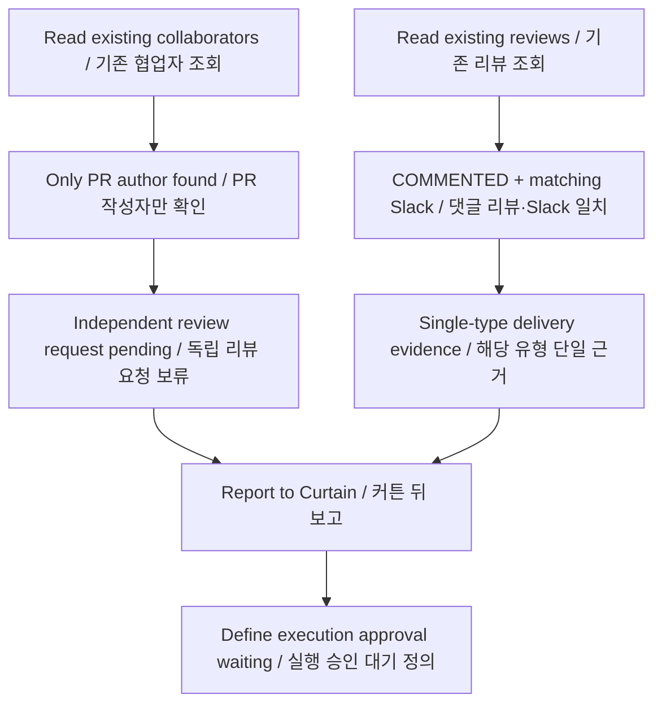

# Remaining notification verification planning
# 남은 알림 검증 계획 회의

Date / 날짜: 2026-11-19. Report recipient / 보고 대상: Curtain / 커튼 뒤. These are eight role perspectives compiled by one assistant, not independent agents. No speech or approval is invented for Curtain.
한 어시스턴트가 8개 역할 관점을 취합했으며 독립 에이전트 실행이 아닙니다. 커튼 뒤의 발언·승인을 만들어 내지 않습니다.

## Agenda / 의제

Determine valid next evidence for review requests, submitted reviews and user execution approval waiting after PR #24 merge.
PR #24 병합 후 리뷰 요청·리뷰 제출·사용자 실행 승인 대기의 다음 유효 근거를 정합니다.

### Tech Lead

- Who: Tech Lead.
- What / Proposal / 제안: Separate review request, review submission and execution approval / 리뷰 요청·제출·실행 승인 분리.
- Why: Different state transitions / 다른 상태 전이.
- How: Keep separate evidence rows / 근거 행 분리.
- Goal: Accurate completion / 정확한 완료.
- Position / 소신: PR open/Merge does not prove reviews / PR 생성·Merge는 리뷰 근거 아님.

### Full-stack

- Who: Full-stack.
- What / Proposal / 제안: Identify existing reviewer and next real PR / 기존 리뷰어·다음 실제 PR 확인.
- Why: Merged PR is not a new-request test / 병합 PR로 새 요청 시험 부적절.
- How: Inspect permissions before events / 이벤트 전 권한 조사.
- Goal: Valid events / 유효 이벤트.
- Position / 소신: No fake approval or account switching / 가짜 승인·계정 전환 금지.

### SecOps

- Who: SecOps.
- What / Proposal / 제안: Use current access only / 현행 접근만.
- Why: Avoid test-driven access expansion / 시험 목적 권한 확대 방지.
- How: Inspect existing collaborators / 기존 협업자 조회.
- Goal: Maintain access boundary / 접근 경계 유지.
- Position / 소신: No automatic invitations / 자동 초대 금지.

### Art Director

- Who: Art Director.
- What / Proposal / 제안: Distinguish code review from execution approval / 코드 리뷰·실행 승인 구분.
- Why: Different user actions / 사용자 행동 다름.
- How: Check target, type and link / 대상·종류·링크 확인.
- Goal: Clear action / 명확한 행동.
- Position / 소신: Do not call every state approval waiting / 모두 승인 대기로 부르지 않음.

### Researcher

- Who: Researcher.
- What / Proposal / 제안: Separate documented and observed support / 문서·관찰 지원 구분.
- Why: Reviews subscription is not all-event proof / reviews 구독은 전체 이벤트 근거 아님.
- How: Official sources then message comparison / 공식 출처 후 메시지 대조.
- Goal: Evidence-based verification / 근거 검증.
- Position / 소신: Reviewer feasibility is unknown until inspected / 조사 전 리뷰 가능성 미확인.

### Trend Analyst

- Who: Trend Analyst.
- What / Proposal / 제안: Add automation only for demonstrated gaps / 부족분 확인 후 자동화.
- Why: Avoid duplicate notifications / 중복 알림 방지.
- How: Assess baseline first / 기본 연동 먼저 평가.
- Goal: Low maintenance / 유지 부담 최소화.
- Position / 소신: No current basis for new Actions / 새 Actions 근거 부족.

### Legal

- Who: Legal.
- What / Proposal / 제안: Separate actual judgment and test / 실제 판단·시험 구분.
- Why: Test approvals remain recorded / 시험 승인도 기록 유지.
- How: Do not ask for meaningless Approve / 무의미한 Approve 요구 금지.
- Goal: Trustworthy review / 신뢰 가능한 리뷰.
- Position / 소신: No unreviewed approval / 미검토 승인 금지.

### End User

- Who: End User.
- What / Proposal / 제안: State what, why and where to approve / 승인 대상·이유·위치 명시.
- Why: Vague requests are hard to judge / 모호한 요청 판단 어려움.
- How: Link scope and action / 범위·행동 연결.
- Goal: Understandable control / 이해 가능한 통제.
- Position / 소신: Receipt/reactions are not approval / 수신·반응은 승인 아님.

## Recommendation, conflicts and actual authorization / 권고·충돌·실제 승인

Recommendation: inspect existing collaborators and official feature support before proposing events. Do not add collaborators, switch accounts or create a review just for a passing result. Conflict: desire for full verification versus absence of a separate actual reviewer.
권고: 이벤트 제안 전 기존 협업자·공식 지원 조사. 통과 결과만을 위한 협업자 추가·계정 전환·리뷰 생성 금지. 충돌: 전체 검증 필요와 별도 실제 리뷰어 부재.

Actual user instruction: “회의록 저장·리뷰 담당자와 지원 범위 조사 진해”. This authorizes documentation and read-only investigation, not review requests, permissions, invitations or messages.
실제 지시: “회의록 저장·리뷰 담당자와 지원 범위 조사 진해”. 문서화·읽기 전용 조사 승인·리뷰 요청/권한/초대/메시지 실행 허가 아님.

## Post-meeting findings — not simulated role decisions / 회의 후 조사 결과 — 역할의 결정 아님

- Fact: collaborator API returned only the repository owner/PR author with admin role. The repository is private. No separate human reviewer was found; owner is not a separately assigned reviewer.
  사실: 협업자 API는 저장소 소유자/PR 작성자 admin 한 명만 반환. 비공개 저장소. 별도 사람 리뷰어 미발견·소유자를 별도 리뷰 담당자로 지정하지 않음.
- Fact: PR #24 has one COMMENTED review by its author, body “확인했습니다.”, submitted 2026-11-19 00:22:58 UTC. This is not APPROVED.
  사실: PR #24에 작성자의 COMMENTED 리뷰 한 개·본문 “확인했습니다.”·제출 2026-11-19 00:22:58 UTC. APPROVED 아님.
- Observed: Slack PR thread contains matching Review comment, author/body/review link, displayed 09:22:59 KST. Existing event inspected; no new review was created.
  관찰: Slack PR 스레드에 일치하는 Review comment·작성자/본문/리뷰 링크·09:22:59 KST 표시. 기존 이벤트 조회·새 리뷰 생성 없음.
- Conclusion: COMMENTED review delivery passed once. Approval/change-request reviews, reviewer-request notifications, and user execution approval waiting remain unverified.
  결론: COMMENTED 리뷰 전달 단일 확인. 승인/변경 요청 리뷰·리뷰 요청 알림·사용자 실행 승인 대기 미검증.

## Next actions and unresolved decisions / 다음 작업·미결정

Submit findings to Curtain. Keep reviewer-request and independent approval tests pending until a legitimate existing reviewer is identified or separately approved access is arranged. No new access is proposed as an automatic next step. Define execution approval type, recipient, payload and official response record before proposing any Slack message automation.
커튼 뒤에게 조사 보고. 유효한 기존 리뷰어 확인 또는 별도 승인 접근 준비 전 리뷰 요청·독립 승인 시험 보류. 새 접근을 자동 다음 단계로 제안하지 않음. Slack 메시지 자동화 제안 전 실행 승인 종류·수신자·내용·공식 응답 기록 위치 정의.

No arbitrary timeout, full stage completion or comprehensive reliability claim follows from these observations. New result acceptance and commit/Push/PR remain separate gates.
이 관찰로 임의 시간 제한·전체 단계 완료·포괄 신뢰성을 주장하지 않습니다. 새 결과 수락·커밋/Push/PR은 별도 단계입니다.

[Current capability evidence / 현행 지원 근거](../stage1-notifications.md)

## Sources, terms and limits / 출처·조건·한계

[GitHub review](https://github.com/cosohotmas/weather-conversation-app/pull/24#pullrequestreview-5967375751), [Slack review message](https://aihumanlearninglab.slack.com/archives/C0CJJLU6SK1/p1795047779909929), repository collaborator metadata (read-only), and official references in the guide, checked 2026-11-19. No external code/assets/dataset or dependency imported. New material redistribution licensing is not applicable; service terms/retention not comprehensively audited. Collaborator results reflect available API permissions and query time, not future access or every potential account.
위 GitHub 리뷰·Slack 메시지·조회 전용 협업자 메타데이터·지침의 공식 참조·확인일 2026-11-19. 외부 코드/자산/데이터셋/의존성 도입 없음·새 자료 재배포 라이선스 해당 없음. 서비스 조건/보존 포괄 검증 아님. 협업자 결과는 조회 권한·시점 기준이며 향후 접근이나 가능한 모든 계정 의미 아님.
