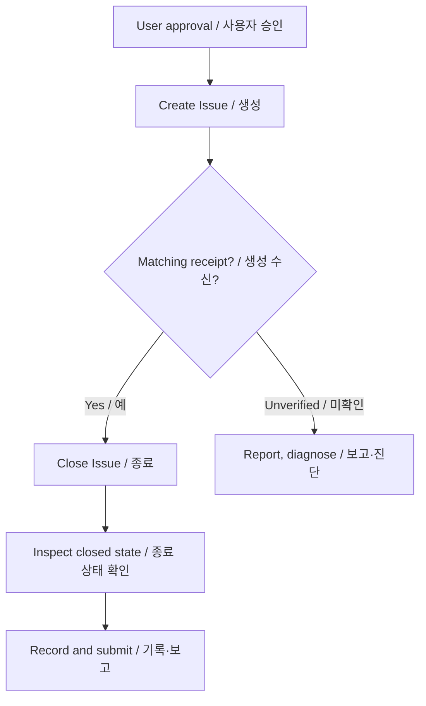

# Issue notification verification meeting
# Issue 알림 전달 검증 회의

Date / 날짜: 2026-11-19. Eight roles below are analysis compiled by one assistant, not independent agents. The curtain observer is the user receiving the report.
날짜: 2026-11-19. 아래 8역할은 한 어시스턴트가 취합한 분석이며 독립 에이전트가 아닙니다. 커튼 뒤 관찰자는 보고를 받는 사용자입니다.

## Agenda / 의제

Adopt the single-Issue create/close test and its evidence boundaries.
Issue 한 개 생성/종료 시험·근거 경계 채택.

### Tech Lead

- Who: Tech Lead.
- What / 제안: Separate create and close / 생성·종료 분리.
- Why: Avoid full-completion claims / 전체 완료 오판 방지.
- How: Record two verdicts / 두 판정 기록.
- Goal: Bounded coverage / 범위 명확화.
- Position / 소신: Success is Issue-only verification / 성공해도 Issue 부분 검증.

### Full-stack

- Who: Full-stack.
- What / 제안: Sequence one Issue / Issue 하나 순차 처리.
- Why: Trace event delivery / 전달 추적.
- How: Create, observe, then close / 생성·관찰 후 종료.
- Goal: Attributable results / 대조 가능 결과.
- Position / 소신: Do not close before create receipt / 생성 수신 전 종료 금지.

### SecOps

- Who: SecOps.
- What / 제안: Use fixed harmless body / 고정 비민감 본문.
- Why: Limit disclosure / 전달 제한.
- How: Exclude secrets and local paths / 비밀값·개인 경로 제외.
- Goal: Approved content only / 승인 내용만.
- Position / 소신: No permission expansion / 권한 확대 없음.

### Art Director

- Who: Art Director.
- What / 제안: Check number, state, link / 번호·상태·링크 확인.
- Why: Readable notifications / 알림 식별.
- How: Inspect messages and card updates / 메시지·카드 갱신 확인.
- Goal: Clear outcome / 결과 명확화.
- Position / 소신: Close may update an existing card / 종료는 기존 카드 갱신일 수 있음.

### Researcher

- Who: Researcher.
- What / 제안: Distinguish timestamps / 시각 구분.
- Why: Observation is not receipt time / 관찰과 수신은 다름.
- How: Record precision and limits / 정밀도·한계 기록.
- Goal: Honest measurement / 정확한 측정 주장.
- Position / 소신: No exact delay without precise evidence / 정밀 근거 없이 지연 단정 금지.

### Trend Analyst

- Who: Trend Analyst.
- What / 제안: First test checks function / 첫 시험은 기능 확인.
- Why: One success is not reliability / 단일 성공은 신뢰성 아님.
- How: Record duplicates and missing evidence / 중복·부족 근거 기록.
- Goal: Operational evidence / 운영 근거.
- Position / 소신: No delivery guarantee / 전달 보장 주장 금지.

### Legal

- Who: Legal.
- What / 제안: Close without deletion / 삭제 없이 종료.
- Why: Preserve history / 이력 보존.
- How: Keep title, body and results / 제목·본문·결과 유지.
- Goal: Traceable test / 추적 가능 시험.
- Position / 소신: Closing is not deleting / 종료는 삭제 아님.

### End User

- Who: End User.
- What / 제안: Separate approval and acceptance / 실행 승인·결과 수락 분리.
- Why: Avoid implied consent / 묵시 동의 방지.
- How: Submit results to actual user / 실제 사용자에게 결과 제출.
- Goal: User control / 사용자 통제.
- Position / 소신: Slack receipt is not user approval / 수신은 사용자 승인 아님.

## Adoption and facts / 채택·사실

Actual user response: “회의회의 내용 채택, 문서화·테스트 승인”. The user adopted the meeting and authorized documenting and creating/closing one test Issue. No commit, Push or PR permission is inferred.
실제 사용자 응답: “회의회의 내용 채택, 문서화·테스트 승인”. 회의 채택·문서화·테스트 Issue 한 개 생성/종료 승인입니다. 커밋·Push·PR 허가로 확대하지 않습니다.

Observed setup: private channel weather-conversation-app in AI Human Learning Lab, GitHub account cosohotmas connected, repository selected, issues/pulls/reviews subscription confirmed. Optional Slack code-channel-management scope was deselected before installation. This is setup evidence, not event delivery evidence.
관찰된 설정: AI Human Learning Lab의 비공개 weather-conversation-app·cosohotmas 계정 연결·저장소 선택·issues/pulls/reviews 구독 확인. Slack 코드 채널 관리 선택 권한은 설치 전 해제했습니다. 설정 근거이며 이벤트 전달 근거는 아닙니다.

Test title: [연동 테스트] GitHub → Slack 알림 전달 확인
Test body: 1단계 알림 검증용 Issue입니다. 생성·종료 알림의 번호·상태·원문 링크를 확인합니다. 실제 기능 작업은 없습니다.
위 제목·본문은 사용자가 승인한 고정 테스트 내용입니다.

## Decision and open questions / 결정·미결정

Create one Issue, observe matching create notification, then close and observe closed state/message. If create receipt is not observed, report the state and do not silently close. Record event/Slack timestamps separately from observation time. No arbitrary latency threshold or delivery guarantee. One run does not establish reliability; PR/reviews/user-approval-waiting remain unverified.
Issue 하나 생성→일치하는 생성 알림 확인→종료→종료 상태/메시지 확인. 생성 수신 미확인 시 보고하고 임의 종료하지 않습니다. 이벤트/Slack 시각과 관찰 시각을 구분합니다. 임의 지연 기준·전달 보장 없음. 단일 시험은 신뢰성 검증이 아니며 PR/리뷰/사용자 승인 대기는 미검증입니다.

Repeat count, latency target and approval-waiting representation remain open. Evidence and actual results belong in the [guide](../stage1-notifications.md).
반복 횟수·지연 목표·승인 대기 표현은 미결정. 실제 결과는 [지침](../stage1-notifications.md)에 기록합니다.

## Sources and terms / 출처·조건

Sources: actual user discussion, observed GitHub/Slack setup and [official notification settings](https://docs.github.com/en/integrations/how-tos/slack/customize-notifications). No external code/assets/data imported or dependency added. App installation consent was given; this is not a comprehensive legal or license audit.
출처: 실제 사용자 토론·관찰한 GitHub/Slack 설정·위 공식 알림 설정. 외부 코드/자산/데이터·새 의존성 없음. 앱 설치 동의는 받았으나 포괄적인 법률/라이선스 검증은 아닙니다.

## 2026-11-19 — User result acceptance
## 2026-11-19 — 사용자 결과 수락

Actual user response: “결과 수락”. The user accepted the single-run Issue #23 create/close notification result. This supersedes the earlier acceptance-pending snapshot; it does not accept untested PR/review/approval-waiting coverage or authorize commit, Push or PR creation.
실제 사용자 응답: “결과 수락”. Issue #23 생성/종료 알림 단일 시험 결과를 수락했습니다. 앞선 수락 대기 상태를 갱신하며 미검증 PR/리뷰/승인 대기 결과 수락이나 커밋·Push·PR 허가로 확대하지 않습니다.

Rollout stage: stage 1 partially verified. Current task: record actual acceptance. Next rollout action: plan remaining notification verification; no external actions in this step.
도입 단계: 1단계 부분 검증. 현재 작업: 실제 수락 기록. 다음 도입 작업: 나머지 알림 검증 계획·이번 단계 외부 실행 없음.
