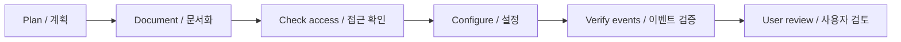

# Stage 1 notification planning — meeting 1
# 1단계 알림 계획 — 1차 회의

Date / 날짜: 2026-11-19. Status / 상태: discussion recorded; external setup and completion unverified / 토론 기록·외부 설정 및 완료 미검증.

## Participants and agenda / 참석·의제

Eight working roles are analytical perspectives compiled by one assistant, not independent agents. The curtain observer is the actual user receiving the report; no observer speech or approval is invented.
8개 작업 역할은 한 어시스턴트가 취합한 분석 관점이며 독립 에이전트 실행이 아닙니다. 커튼 뒤 관찰자는 보고를 받는 실제 사용자이며 발언·승인을 만들지 않습니다.

Agenda: official app versus custom Actions, event scope, approval waiting, permissions, evidence and recovery.
의제: 공식 앱과 별도 Actions·이벤트 범위·승인 대기·권한·근거·복구.

## Role statements — proposals / 역할별 발언 — 제안

### Tech Lead

- Who: Tech Lead.
- What: Use the official app first / 공식 앱 우선.
- Why: Reduce custom code / 별도 코드 최소화.
- How: Test one repository and channel / 저장소·채널 하나 검증.
- Goal: Small verified integration / 작은 연동 완성.
- Position / 소신: Actions is not mandatory for notifications / 알림에 Actions가 필수는 아님.

### Full-stack

- Who: Full-stack.
- What: Build an event matrix / 이벤트 표 작성.
- Why: Subscription is not delivery / 구독과 전달은 다름.
- How: Compare each source event and message / 이벤트·메시지 대조.
- Goal: Clear coverage / 전달 범위 명확화.
- Position / 소신: User approval differs from review request / 사용자 승인과 리뷰 요청 구분.

### SecOps

- Who: SecOps.
- What: Review access / 접근 검토.
- Why: Private data leaves GitHub / 비공개 정보 외부 전달.
- How: Compare app scopes and channel members / 앱 권한·채널 구성원 대조.
- Goal: Intended recipients / 의도한 수신자.
- Position / 소신: Official apps still require review / 공식 앱도 검토 필요.

### Art Director

- Who: Art Director.
- What: Check number, status and link / 번호·상태·링크 확인.
- Why: Support quick recognition / 빠른 식별.
- How: Inspect real messages / 실제 메시지 확인.
- Goal: Readable notifications / 읽기 쉬운 알림.
- Position / 소신: Evaluate defaults before custom design / 기본 표현 먼저 평가.

### Researcher

- Who: Researcher.
- What: Separate documented and tested support / 문서 지원·실측 구분.
- Why: Avoid assumptions / 추측 방지.
- How: Compare official sources and receipts / 공식 자료·수신 대조.
- Goal: Evidence / 근거 확보.
- Position / 소신: Documentation is not deployment proof / 문서는 설정 검증 아님.

### Trend Analyst

- Who: Trend Analyst.
- What: Keep alternatives / 대안 유지.
- Why: Needs may change / 요구 변화.
- How: List only unmet requirements / 부족 요구 목록화.
- Goal: Controlled expansion / 통제된 확장.
- Position / 소신: Add automation only for proven gaps / 확인된 부족분만 자동화.

### Legal

- Who: Legal.
- What: Record external disclosure / 외부 전달 기록.
- Why: Information crosses services / 서비스 간 이동.
- How: Record terms and data scope / 조건·정보 범위 기록.
- Goal: Clear responsibility / 책임 명확화.
- Position / 소신: App terms differ from weather licenses / 앱 조건과 날씨 라이선스 구분.

### End User

- Who: End User.
- What: Show the next action / 다음 행동 표시.
- Why: Noise is not usefulness / 알림 수와 효용은 다름.
- How: Inspect state and GitHub links / 상태·링크 점검.
- Goal: Do not miss reviews / 검토 누락 방지.
- Position / 소신: Receipt is not approval / 수신은 승인 아님.

## Facts, assumptions and recommendation / 사실·가정·권고

Fact: repository workflow assigns official records to GitHub and notifications to Slack. Actual Slack installation, membership and delivery are unknown. The official app is a candidate, not verified local deployment.
사실: 저장소 업무 규칙상 공식 기록은 GitHub·알림은 Slack입니다. 실제 설치·구성원·전달은 미확인입니다. 공식 앱은 후보이며 실제 배포 검증이 아닙니다.

Recommendation: try the official app for one repository/channel; assess additional Actions only after a demonstrated gap. Review requests and user approval waiting are distinct. Disagreement to resolve: narrow notification scope versus complete approval-waiting coverage.
권고: 저장소·채널 하나에 공식 앱을 우선 시험하고 확인된 부족분에만 추가 Actions를 검토합니다. 리뷰 요청과 사용자 승인 대기는 다릅니다. 좁은 알림 범위와 승인 대기 전체 전달 사이의 충돌은 해결이 필요합니다.

Open: workspace/channel, installer, accepted scopes, approval-waiting representation, observation window and latency threshold. No numeric limit or external action is adopted here.
미결정: 워크스페이스/채널·설치자·허용 권한·승인 대기 표현·관찰 기간·지연 기준. 숫자나 외부 실행을 여기서 확정하지 않습니다.

## Actual response and next actions / 실제 응답·다음 작업

The user subsequently said “다음 도입 작업 진행”. This authorizes the proposed meeting records and setup guide with verification/recovery procedures. It does not prove installation, delivery or stage completion; commit, Push and PR approvals remain separate.
사용자는 이후 “다음 도입 작업 진행”이라고 응답했습니다. 제안된 회의록·설정 지침·검증/복구 절차 문서화를 진행합니다. 설치·전달·단계 완료 근거가 아니며 커밋·Push·PR 승인은 별도입니다.

[Second meeting / 2차 회의](2026-11-19-stage1-notification-second-planning.md) · [Setup guide / 설정 지침](../stage1-notifications.md)

## Sources and limits / 출처·한계

Sources: [official setup](https://docs.github.com/en/integrations/how-tos/slack/integrate-github-with-slack), [notification settings](https://docs.github.com/en/integrations/how-tos/slack/customize-notifications), [permissions](https://docs.github.com/en/integrations/reference/slack-permissions); checked 2026-11-19. Source links support capability research, not actual delivery. No external code, data or assets copied. Service terms and permission consent remain a pre-installation check; no blanket license verification is claimed.
출처: 위 공식 설정·알림·권한 문서·확인일 2026-11-19. 기능 조사 근거이며 실제 전달 근거는 아닙니다. 외부 코드·데이터·자산 복사 없음. 서비스 조건·권한 동의는 설치 전 확인 사항이며 포괄적 라이선스 검증 완료를 주장하지 않습니다.
