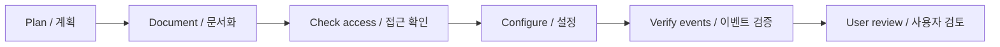

# Stage 1 notification planning — meeting 2
# 1단계 알림 계획 — 2차 회의

Date / 날짜: 2026-11-19. Status / 상태: discussion recorded; external setup and completion unverified / 토론 기록·외부 설정 및 완료 미검증.

## Participants and agenda / 참석·의제

Eight working roles are analytical perspectives compiled by one assistant, not independent agents. The curtain observer is the actual user receiving the report; no observer speech or approval is invented.
8개 작업 역할은 한 어시스턴트가 취합한 분석 관점이며 독립 에이전트 실행이 아닙니다. 커튼 뒤 관찰자는 보고를 받는 실제 사용자이며 발언·승인을 만들지 않습니다.

Agenda: official app versus custom Actions, event scope, approval waiting, permissions, evidence and recovery.
의제: 공식 앱과 별도 Actions·이벤트 범위·승인 대기·권한·근거·복구.

## Role statements — proposals / 역할별 발언 — 제안

### Tech Lead

- Who: Tech Lead.
- What: Separate basic and approval notification checks / 기본·승인 대기 검증 분리.
- Why: Avoid premature completion / 성급한 완료 방지.
- How: Mark unmet requirements / 미충족 요구 표시.
- Goal: Honest completion / 근거 있는 완료.
- Position / 소신: Basic success means partial verification / 기본 성공은 부분 검증.

### Full-stack

- Who: Full-stack.
- What: Test official app before custom code / 공식 앱 먼저 시험.
- Why: Avoid duplicates / 중복 방지.
- How: Test Issue, PR, reviews, Merge and approval waiting / Issue·PR·리뷰·Merge·승인 대기 검증.
- Goal: Traceable delivery / 추적 가능한 전달.
- Position / 소신: Do not equate review requests and user approval / 리뷰 요청·사용자 승인 동일시 금지.

### SecOps

- Who: SecOps.
- What: Check members and scopes / 구성원·권한 확인.
- Why: Private-channel status alone is insufficient / 비공개 채널만으로 불충분.
- How: Check external guests and repository access / 외부 참여·저장소 접근 확인.
- Goal: Approved disclosure / 승인 범위 전달.
- Position / 소신: Review actual permissions / 실제 권한 검토.

### Art Director

- Who: Art Director.
- What: Distinguish action-required messages / 행동 필요 알림 구분.
- Why: Make waiting visible / 대기 식별.
- How: Inspect text, number, status, target and link / 글·번호·상태·대상·링크 확인.
- Goal: Clear action / 행동 명확화.
- Position / 소신: Do not rely on color alone / 색상만으로 표현 금지.

### Researcher

- Who: Researcher.
- What: Record documented and observed results separately / 문서·실측 분리.
- Why: Environment affects delivery / 환경 영향.
- How: Record source/message links and times / 원문·메시지 링크·시각 기록.
- Goal: Reproducible verdict / 재현 가능한 판정.
- Position / 소신: Do not invent latency thresholds / 지연 기준 임의 확정 금지.

### Trend Analyst

- Who: Trend Analyst.
- What: Start with narrow subscriptions / 좁은 구독 범위.
- Why: Avoid noise / 소음 방지.
- How: Record missing and duplicate messages / 누락·중복 기록.
- Goal: Useful signal / 유용한 정보.
- Position / 소신: Custom Actions only after a proven gap / 확인된 부족분 이후 Actions.

### Legal

- Who: Legal.
- What: Minimize evidence data / 증거 정보 최소화.
- Why: Screenshots can expose private data / 캡처의 정보 노출.
- How: Keep minimal links and outcomes / 최소 링크·결과 보존.
- Goal: Auditable records / 검토 가능한 기록.
- Position / 소신: Separate checked and unknown terms / 확인·미확인 조건 구분.

### End User

- Who: End User.
- What: Link to GitHub approval context / GitHub 승인 맥락 연결.
- Why: Avoid implied consent / 묵시 승인 방지.
- How: Record actual user response separately / 실제 응답 별도 기록.
- Goal: Clear review location / 검토 위치 명확화.
- Position / 소신: No automatic approval after missed alerts / 알림 미확인 자동 승인 금지.

## Facts, assumptions and recommendation / 사실·가정·권고

Fact: repository workflow assigns official records to GitHub and notifications to Slack. Actual Slack installation, membership and delivery are unknown. The official app is a candidate, not verified local deployment.
사실: 저장소 업무 규칙상 공식 기록은 GitHub·알림은 Slack입니다. 실제 설치·구성원·전달은 미확인입니다. 공식 앱은 후보이며 실제 배포 검증이 아닙니다.

Recommendation: try the official app for one repository/channel; assess additional Actions only after a demonstrated gap. Review requests and user approval waiting are distinct. Disagreement to resolve: narrow notification scope versus complete approval-waiting coverage.
권고: 저장소·채널 하나에 공식 앱을 우선 시험하고 확인된 부족분에만 추가 Actions를 검토합니다. 리뷰 요청과 사용자 승인 대기는 다릅니다. 좁은 알림 범위와 승인 대기 전체 전달 사이의 충돌은 해결이 필요합니다.

Open: workspace/channel, installer, accepted scopes, approval-waiting representation, observation window and latency threshold. No numeric limit or external action is adopted here.
미결정: 워크스페이스/채널·설치자·허용 권한·승인 대기 표현·관찰 기간·지연 기준. 숫자나 외부 실행을 여기서 확정하지 않습니다.

## Actual response and next actions / 실제 응답·다음 작업

The user subsequently said “다음 도입 작업 진행”. This authorizes the proposed meeting records and setup guide with verification/recovery procedures. It does not prove installation, delivery or stage completion; commit, Push and PR approvals remain separate.
사용자는 이후 “다음 도입 작업 진행”이라고 응답했습니다. 제안된 회의록·설정 지침·검증/복구 절차 문서화를 진행합니다. 설치·전달·단계 완료 근거가 아니며 커밋·Push·PR 승인은 별도입니다.

[First meeting / 1차 회의](2026-11-19-stage1-notification-planning.md) · [Setup guide / 설정 지침](../stage1-notifications.md)

## Sources and limits / 출처·한계

Sources: [official setup](https://docs.github.com/en/integrations/how-tos/slack/integrate-github-with-slack), [notification settings](https://docs.github.com/en/integrations/how-tos/slack/customize-notifications), [permissions](https://docs.github.com/en/integrations/reference/slack-permissions); checked 2026-11-19. Source links support capability research, not actual delivery. No external code, data or assets copied. Service terms and permission consent remain a pre-installation check; no blanket license verification is claimed.
출처: 위 공식 설정·알림·권한 문서·확인일 2026-11-19. 기능 조사 근거이며 실제 전달 근거는 아닙니다. 외부 코드·데이터·자산 복사 없음. 서비스 조건·권한 동의는 설치 전 확인 사항이며 포괄적 라이선스 검증 완료를 주장하지 않습니다.
