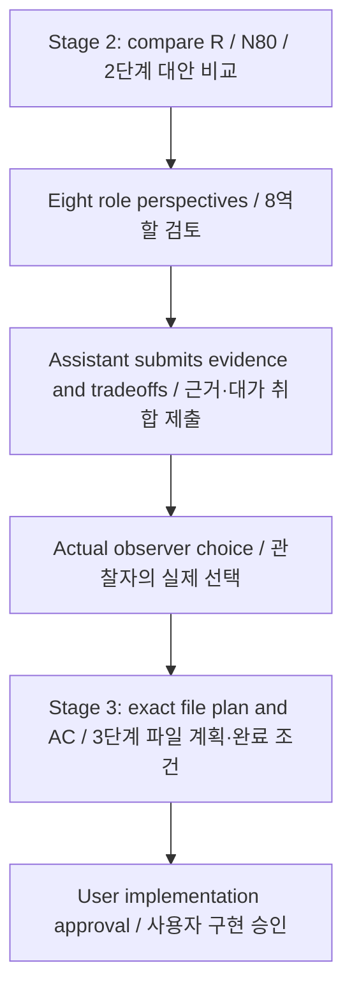

# Stage 2 meeting — select R or N80
# 2단계 회의 — R 또는 N80 선택 검토

User request: discuss the stage-2 decision before moving to implementation planning. Eight working-role perspectives are synthesized by one assistant; this is not an independently executed multi-agent meeting. The assistant compiles the report; the curtain observer is its recipient. No user decision, statement or approval is invented.
사용자 요청: 구현 계획 전에 2단계 선택을 회의합니다. 하나의 어시스턴트가 작업 역할 8개의 관점을 정리하며 독립 실행 다중 에이전트 회의가 아닙니다. 어시스턴트가 보고를 취합하고 커튼 뒤 관찰자는 수신자입니다. 사용자 결정·발언·승인을 만들지 않습니다.

## Facts, proposal boundaries and evidence
## 사실·제안 경계·근거

Current source: AreaSelector caps raw input at 80 UTF-16 units and trims before onSelect; the hook normalizes then rejects names over 64 units; storage accepts area identifiers only within 64. Backend has a separate 80-character API contract. Frontend and backend length counters are not interchangeable.
현재 소스: AreaSelector는 원문 UTF-16 80단위 상한·onSelect 전 trim, 훅은 정규화 후 이름 64단위 초과 거부, 저장은 지역 식별자 64단위 이내입니다. Backend는 별도 80자 API 계약이며 Frontend와 Backend 길이 계산은 서로 교환할 수 없습니다.

R proposal: raw cap 64, followed by existing trim/alias and normalized-name cap 64. N80 proposal: raw cap 80, followed by existing trim/alias and normalized-name cap 64. Both use UTF-16 length in the frontend, retain the existing alias, prohibit application slicing, and preserve stored keys without rewriting. Neither changes backend acceptance.
R 제안: 원문 64단위 후 기존 trim/별칭·정규 이름 64단위. N80 제안: 원문 80단위 후 기존 trim/별칭·정규 이름 64단위. 두 안 모두 Frontend UTF-16 길이·기존 별칭 유지·앱 임의 절단 금지·저장 키 재작성 없는 보존이며 Backend 수용 범위는 바꾸지 않습니다.

N80's 80 is inherited from the current input field, not measured as an optimum. Applying the raw cap to the hook introduces a new bound on direct/programmatic inputs: a raw 81-unit value that trims to 64 is rejected. Thus N80 preserves the padded inputs already usable through the field, but is not identical to every previous hook behavior.
N80의 80은 현재 입력창에서 이어받는 값이며 최적값으로 측정하지 않았습니다. 훅에 원문 상한을 적용하면 직접/프로그램 입력에 새 경계가 생깁니다. 원문 81단위가 trim 후 64가 되어도 거부합니다. 따라서 N80은 기존 입력창에서 가능한 공백 포함 입력을 보존하지만 과거 모든 훅 동작과 같지는 않습니다.

Control-order recommendation for this limited correction: retain existing post-trim canonical control checks and do not silently adopt the earlier proposed pre-trim rejection. Raw control-character rejection is a separate policy change. Neither option is a claim about provider-wide limits, valid place names or real weather.
이번 한정 보완의 제어문자 순서 권고: 기존 trim 후 정규 값 제어문자 검사를 유지하고 앞서 제안한 원문 우선 거부를 조용히 채택하지 않습니다. 원문 제어문자 거부는 별도 정책 변경입니다. 어느 안도 제공자 전체 제한·유효 지명·실제 날씨에 관한 주장이 아닙니다.

A local Node comparison evaluated candidate expressions only, not application implementation or regression tests:
로컬 Node 비교는 후보식을 계산했을 뿐 앱 구현·회귀 테스트가 아닙니다.

| Fixture / 자료 | Raw units / 원문 | Canonical units / 정규 | R candidate / R 후보 | N80 candidate / N80 후보 |
|---|---:|---:|---|---|
| 64 Korean characters / 한글 64개 | 64 | 64 | Accept / 수용 | Accept / 수용 |
| 65 Korean characters / 한글 65개 | 65 | 65 | Reject / 거부 | Reject / 거부 |
| 64 + outer spaces / 64+외부 공백 | 66 | 64 | Reject / 거부 | Accept / 수용 |
| 16 spaces + 64 / 공백 16+64 | 80 | 64 | Reject / 거부 | Accept / 수용 |
| 17 spaces + 64 / 공백 17+64 | 81 | 64 | Reject / 거부 | Reject / 거부 |
| " seoul " | 7 | 2 (서울) | Accept / 수용 | Accept / 수용 |
| Whitespace only / 공백만 | 3 | 0 | Reject / 거부 | Reject / 거부 |
| 32 supplementary characters / 보충 문자 32개 | 64 | 64 | Accept length / 길이 수용 | Accept length / 길이 수용 |
| 33 supplementary characters / 보충 문자 33개 | 66 | 66 | Reject / 거부 | Reject / 거부 |

## Eight working-role statements
## 작업 역할 8개 발언

### Tech Lead — revised proposal
### Tech Lead — 수정 제안
Who: architecture owner. What: recommend N80 as the concrete next-plan candidate while retaining R as the simpler alternative. Why: the two bounds have distinct meanings, and N80 now has a bounded raw contract rather than an unspecified input policy. How: one pure policy module shared by the field and hook, separate raw/name constants, existing storage name limit. Goal: explicit invariants and limited compatibility impact. Position: revise the earlier R preference because raw bounds are now specified; do not claim a unanimous user decision.
담당: 구조. 내용: 구체화된 N80을 다음 계획 후보로 권고하되 R을 단순 대안으로 유지. 이유: 두 상한의 의미가 다르고 N80의 원문 정책이 이제 무제한/미정이 아닌 명시적 경계이기 때문. 방법: 입력창·훅 공유 순수 정책·원문/이름 상수 분리·기존 저장 이름 상한. 목표: 명시적 불변 조건·한정된 호환성 영향. 소신: 원문 경계가 구체화되어 이전 R 선호를 수정하며 사용자 만장일치 결정으로 주장하지 않음.

### Full-stack — proposal
### Full-stack — 제안
Who: input-to-dispatch owner. What: choose N80 for implementation planning, not runtime implementation yet. Why: current field users can already enter padded valid names up to raw 80. How: validate raw 80, trim and map the existing seoul alias, validate canonical 1–64 and existing controls, then generate the key; use the same evaluator at both entry boundaries. Goal: no-dispatch on invalid values and stable normal lookups. Position: do not pretend maxLength=80 alone solves normalized-65 rejection; field guidance and shared submission validation are required.
담당: 입력~발송. 내용: 구현 자체가 아닌 구현 계획에 N80 선택 권고. 이유: 현재 입력창 사용자는 이미 원문 80 안에서 공백 포함 유효 이름을 입력할 수 있음. 방법: 원문 80 검사→trim·기존 seoul 별칭→정규 1~64·기존 제어문자 검사→키 생성·두 진입 경계에 같은 평가 사용. 목표: 오류 값 미발송·정상 조회 유지. 소신: maxLength=80만으로 정규 65 거부 문제가 해결되는 것이 아니며 안내·공유 제출 검증 필요.

### SecOps — conditional proposal
### SecOps — 조건부 제안
Who: storage and accounting reviewer. What: accept either candidate only with explicit raw limits and no key migration. Why: deleting or rewriting valid retry records would be a more serious regression than this display defect. How: bound every programmatic entry, keep raw text out of persisted state, validate stored canonical keys without re-normalizing, retain independent restrictions. Goal: maintain retry counts and deadlines. Position: N80's raw80 rule is a deliberate new hook restriction; document and test it rather than calling it behavior-neutral.
담당: 저장·집계. 내용: 명시적 원문 상한·키 이전 없음 조건에서 양쪽 후보 검토 가능. 이유: 유효 재시도 기록 삭제·재작성은 화면 결함보다 큰 회귀. 방법: 프로그램 진입도 제한·원문은 저장하지 않음·기존 정규 키는 재정규화 없이 검증·독립 제한 유지. 목표: 횟수·마감 보존. 소신: N80 원문 80은 훅의 의도적 새 제한이며 동작 변화가 없다고 하지 말고 문서화·검증해야 함.

### Art Director — usability hypothesis and proposal
### Art Director — 사용성 가설·제안
Who: editing/help-text reviewer. What: prefer N80 with guidance focused on the effective name length. Why: rejecting accidental outer spaces is avoidable, but showing two unexplained numbers would also confuse users. How: state that outer spaces are removed, explain 64-unit effective-name cap and the 80-unit input budget in nearby accessible help; preserve editable text on rejection. Goal: users can correct input without guessing. Position: test wording and composition/paste in the implementation stage; do not claim user validation now.
담당: 편집·안내. 내용: 실제 이름 길이 중심 안내를 둔 N80 선호. 이유: 실수 공백 거부를 줄일 수 있으나 설명 없는 두 숫자도 혼란. 방법: 외부 공백 제거·실제 이름 64단위·입력 예산 80단위를 접근 가능한 가까운 도움말로 설명·거부 시 원문 편집 유지. 목표: 추측 없이 입력 수정. 소신: 구현 단계 문구·조합/붙여넣기 확인이 필요하며 현재 사용자 검증 완료로 주장하지 않음.

### Researcher — fact and verification proposal
### Researcher — 사실·검증 제안
Who: evidence reviewer. What: keep the nine-row candidate comparison as acceptance-plan input. Why: R/N names alone hid the important raw81/normalized64 distinction. How: later test 63/64/65 canonical, 79/80/81 raw, outer spaces, alias, empty/control values, supplementary characters and old stored records. Goal: prove the selected semantics through components, hooks and restore paths. Position: today's Node results are candidate calculations only, not passing application tests or optimal-limit evidence.
담당: 근거. 내용: 9행 후보 비교를 완료 조건 계획의 입력으로 유지. 이유: R/N 명칭만으로 원문 81·정규 64 차이가 가려졌음. 방법: 후속 정규 63/64/65·원문 79/80/81·외부 공백·별칭·빈 값/제어문자·보충 문자·이전 저장 기록 검증. 목표: 컴포넌트·훅·복원 경로의 선택 의미 증명. 소신: 오늘 Node 결과는 후보 계산이며 앱 테스트 통과·최적 상한 근거가 아님.

### Trend Analyst — scope proposal
### Trend Analyst — 범위 제안
Who: extension and cost reviewer. What: prefer N80 within the existing frontend scope, with no new dependency or backend change. Why: it retains current field capacity without expanding canonical storage identifiers. How: keep grapheme counting, new region IDs, real geolocation and live APIs out of this correction. Goal: a small reversible change. Position: revisit limits only with a concrete product requirement; neither 64 nor 80 is universal.
담당: 확장·비용. 내용: 새 의존성·Backend 변경 없는 기존 Frontend 범위의 N80 선호. 이유: 정규 저장 식별자 확대 없이 입력창 용량 유지. 방법: 글자 묶음 계산·새 지역 ID·실제 위치·실제 API 제외. 목표: 작고 되돌릴 수 있는 변경. 소신: 실제 제품 요구가 생기면 상한 재검토·64/80 모두 보편값 아님.

### Legal — source/license proposal
### Legal — 출처·라이선스 제안
Who: disclosure reviewer. What: preserve source/license checks in the combined PR for rules and meetings. Why: these sources are local code and self-authored fixtures, not externally licensed weather data. How: cite the source paths and this record; state no new external material/dependency/license, and leave actual-provider terms unverified. Goal: accurate evidence and attribution. Position: Not applicable needs a reason; internal discussion cannot be presented as live-license approval.
담당: 공개 검토. 내용: 규칙·회의 묶음 PR에 출처·라이선스 확인 유지. 이유: 출처는 로컬 코드·자체 자료이며 외부 날씨 자료가 아님. 방법: 소스 경로·이번 기록 연결·새 외부 자료/의존성/라이선스 없음·실제 제공자 조건 미확인. 목표: 정확한 근거·표시. 소신: 해당 없음에도 근거가 필요하며 내부 논의를 실제 라이선스 승인으로 제시하지 않음.

### End User — usability hypothesis and proposal
### End User — 사용성 가설·제안
Who: manual-lookup user perspective. What: prefer N80 so accidental padding does not reject an otherwise valid 64-unit name. Why: trimming is already the visible workflow's behavior. How: preserve the typed value for editing, explain any rejection and wait for an explicit submission; no automatic shortened-name query. Goal: predictable input recovery. Position: accepting raw81 is not required by this proposal, but users should be told what counts if the 80 boundary is reached.
담당: 직접 조회 사용자 관점. 내용: 실수 공백으로 유효한 64단위 이름을 거부하지 않는 N80 선호. 이유: trim은 이미 화면 흐름의 동작. 방법: 편집할 입력값 유지·거부 이유 설명·명시적 제출 대기·잘린 이름 자동 조회 없음. 목표: 예상 가능한 입력 복구. 소신: 제안이 원문 81 허용까지 요구하지는 않으나 80 경계에 닿으면 계산 기준을 알려야 함.

## Compiled report submitted to the curtain observer
## 커튼 뒤 관찰자에게 제출하는 취합 보고

Prepared by the assistant; recipient is the user. No observer statement, adoption or approval is recorded.
작성자는 어시스턴트·수신자는 사용자입니다. 관찰자 발언·채택·승인은 기록하지 않습니다.

- Working-role recommendation for the next plan: N80, with conditional storage/accounting safeguards. This is a synthesized recommendation, not a vote by independent agents or user approval.
  - 다음 계획을 위한 작업 역할 권고: 저장·집계 보존 조건을 둔 N80. 역할 관점 취합이며 독립 에이전트 투표·사용자 승인이 아닙니다.
- Explicit tradeoff: input keeps raw80 but canonical names remain 64; arbitrary programmatic padding above raw80 is newly rejected. Backend 80 is a separate contract; matching numbers do not mean matching units.
  - 명시적 대가: 입력 원문 80·정규 이름 64이며 프로그램의 원문 80 초과 공백도 새로 거부. Backend 80은 별도 계약·같은 숫자가 같은 단위를 뜻하지 않음.
- Remaining choices: user adoption of R or N80; if N80 is adopted, confirm raw80 and preservation of the current control-check order. Shared-module paths and help wording will be submitted in stage 3, not implemented here.
  - 남은 선택: 사용자 R/N80 채택·N80 채택 시 원문 80 및 현재 제어문자 검사 순서 보존 확인. 공유 모듈 경로·안내 문구는 3단계에서 보고하며 여기서 구현하지 않음.
- No change to retry waits, persisted schema, provider selection or weather facts. Pending PR-check rules and meeting records remain one eventual commit bundle.
  - 재시도 대기·저장 형식·제공자 선택·날씨 사실 변경 없음. 대기 중인 PR 확인 규칙·회의 기록은 추후 같은 커밋 묶음 유지.

Verification: inspected current source and role rules; evaluated nine candidate fixtures in local Node; checked document fields, links and whitespace. No implementation or application test. Sources: frontend/src/components/AreaSelector.tsx, frontend/src/hooks/useWeatherRequest.ts, frontend/src/state/retryState.ts, existing meeting records and local self-authored fixtures. No external data, copied code, new dependency or license. Decision status: pending actual observer response.
검증: 현재 소스·역할 규칙 확인·로컬 Node 후보 자료 9개 계산·문서 항목/링크/공백 확인. 구현·앱 테스트 없음. 출처: frontend/src/components/AreaSelector.tsx·frontend/src/hooks/useWeatherRequest.ts·frontend/src/state/retryState.ts·기존 회의·자체 로컬 자료. 외부 데이터·복사 코드·새 의존성·라이선스 없음. 결정 상태: 실제 관찰자 응답 대기.

## Actual observer response and next stage
## 실제 관찰자 응답과 다음 단계

Actual user response: "권고 진행". Record this as adoption of the submitted N80 recommendation and authorization to prepare the stage-3 implementation plan. The adopted scope is raw80, existing trim/alias, canonical 1–64, current post-trim control checks, unchanged stored keys and backend contract. This response is not replaced with a fabricated observer speech; runtime implementation approval remains the next gate in the staged workflow.
실제 사용자 응답: "권고 진행". 제출된 N80 권고 채택 및 3단계 구현 계획 작성 진행으로 기록합니다. 채택 범위는 원문 80·기존 trim/별칭·정규 1~64·현재 trim 후 제어문자 검사·기존 저장 키/Backend 계약 유지입니다. 이 응답을 가상의 관찰자 발언으로 바꾸지 않으며 단계별 절차의 다음 경계는 실행 구현 승인입니다.

Owning contract and exact file plan: [retry state implementation specification](../../specs/weather-retry-state-implementation.md).
담당 계약·정확한 파일 계획: [재시도 상태 구현 명세](../../specs/weather-retry-state-implementation.md).
