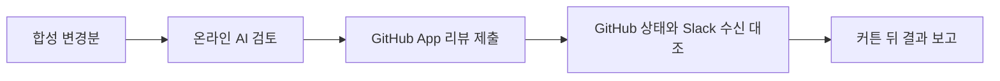

# Online AI reviewer candidate meeting
# 온라인 AI 리뷰어 후보 회의

2026-11-20 KST · Stage 1 partially verified. Recommendations pending Curtain's decision.
2026-11-20 KST · 도입 1단계 부분 검증. 권고안은 커튼 뒤 판단 대기.

## Agenda and role perspectives / 의제와 역할별 의견

Compare browser-accessible options for ongoing free use, private repository access, formal GitHub review states and Slack delivery. The roles below are analytical perspectives. Curtain receives the report.
온라인 접근, 지속 무료 사용, 비공개 저장소 접근, 공식 GitHub 리뷰 상태와 Slack 수신을 비교합니다. 아래는 역할별 분석이며 커튼 뒤는 보고를 받습니다.

| Who / 역할 | What / 무엇 | Why / 이유 | How / 방법 | Goal / 목표 | Conviction / 소신 |
|---|---|---|---|---|---|
| PM / 기획 | Define criteria / 후보 기준 정의 | Free and online matter / 무료·온라인 필수 | Compare plans and events / 요금제·이벤트 대조 | Sustainable reviewer / 지속 운영 | Separate trial from free use / 체험과 지속 무료 구분 |
| Backend / 백엔드 | Separate model and publisher / 모델과 제출 주체 분리 | Review text and state differ / 의견과 상태의 의미가 다름 | Use a scoped GitHub App / 범위 제한 앱 검토 | Both review states / 두 리뷰 상태 | Review the exact commit / 정확한 커밋 기준 |
| Frontend / 프론트엔드 | Make findings navigable / 지적 위치 안내 | Users need to inspect evidence / 근거 확인 필요 | Include file and line / 파일·줄 포함 | Clear feedback / 명확한 피드백 | Prefer actionable findings / 수정 가능한 지적 우선 |
| Data / 데이터 | Limit diff inputs / 변경분 입력 제한 | Private code calls for care / 비공개 코드 취급 | Begin with synthetic diffs / 합성 변경분부터 | Traceable inputs / 입력 추적 | Keep test fixtures synthetic / 시험 입력 합성 유지 |
| Security / 보안 | Review app and model access / 앱·모델 접근 검토 | Tokens and source have distinct exposure / 토큰·소스 노출 경로가 다름 | Scope installs and check processing terms / 설치 범위·처리 조건 확인 | Bound sharing / 공유 범위 제한 | Keep merge decision with Curtain / Merge 결정은 커튼 뒤 |
| QA / 검증 | Compare GitHub and Slack / 이벤트와 알림 대조 | API submission alone proves only GitHub state / API 성공의 근거 범위는 GitHub 상태 | Match app actor, PR and state / 앱 주체·PR·상태 대조 | End-to-end evidence / 종단 간 근거 | Track each state separately / 상태별 검증 |
| Operations / 운영 | Check hosting and budget / 호스팅·비용 확인 | Quotas may change / 무료 한도 변동 | Check usage and repeated runs / 사용량·반복 실행 확인 | Repeatable test / 재현 가능한 시험 | Start with a manual trigger / 첫 시험은 수동 실행 |
| Documentation / 문서 | Record terms and evidence / 조건과 근거 기록 | Later decisions need a source / 이후 결정에 출처 필요 | Link official docs and results / 공식 문서·결과 연결 | Auditable record / 추적 가능한 기록 | Keep unverified items visible / 미검증 항목 명시 |

## Candidates and facts / 후보와 확인 사실

1. **Gemini API free tier + custom GitHub App**. Google lists a limited free tier and product-improvement use of free inputs under its terms. Start with synthetic data. GitHub documents installation-token support for both review types with pull request write permission. Hosting cost, review-request compatibility and Slack delivery are open.
   **Gemini API 무료 한도 + 자체 GitHub App**. Google은 제한된 무료 한도와 무료 입력의 제품 개선 이용 조건을 안내합니다. 합성 데이터부터 시험합니다. GitHub는 PR 쓰기 권한의 설치 토큰으로 두 리뷰 유형을 제출하는 API를 안내합니다. 호스팅 비용·리뷰어 지정 가능 여부·Slack 수신은 미확인입니다.
2. **GitHub Copilot code review**. Free plan excludes code review. Comment is the default and approval can be available when configured. Request changes submission was not confirmed.
   **GitHub Copilot 코드 리뷰**. 무료 플랜에서는 코드 리뷰가 제공되지 않습니다. 기본은 Comment이고 설정에 따라 Approve를 제출할 수 있습니다. Request changes 제출 근거는 확인하지 못했습니다.
3. **CodeRabbit**. Its pricing advertises ongoing free reviews for public repositories. Ongoing free private-repository review and both review states were not established.
   **CodeRabbit**. 공식 요금표에서 공개 저장소의 지속 무료 리뷰를 안내합니다. 비공개 저장소의 지속 무료 리뷰와 두 상태의 제출 가능 여부는 확인하지 못했습니다.

## Recommendation and open questions / 권고와 미결정 사항

Shortlist the custom app for a synthetic test. Compare GitHub state and Slack delivery for each approved test case. Open questions include whether app reviews are notified, whether the app is selectable as a reviewer, whether hosting fits the free budget and whether private code may be processed. Report the test scope to Curtain before external execution.
자체 앱 조합을 합성 데이터 시험 우선 후보로 둡니다. 승인된 시험에서 상태별 GitHub 기록과 Slack 수신을 대조합니다. 앱 리뷰 알림 지원, 리뷰어 목록에서 앱 선택 가능 여부, 무료 호스팅 비용 범위, 비공개 코드 처리 조건은 미결정입니다. 외부 실행 전에 시험 범위를 커튼 뒤에게 보고합니다.

## Sources / 출처

- [Gemini pricing and data use](https://ai.google.dev/gemini-api/docs/pricing)
- [GitHub review API](https://docs.github.com/en/rest/pulls/reviews#create-a-review-for-a-pull-request)
- [Copilot code review availability](https://docs.github.com/en/copilot/concepts/agent-capabilities/agent-powered-workflows-and-operations/code-review)
- [Copilot review and approval](https://docs.github.com/en/copilot/how-tos/use-copilot-agents/use-code-review)
- [CodeRabbit pricing](https://www.coderabbit.ai/pricing)
