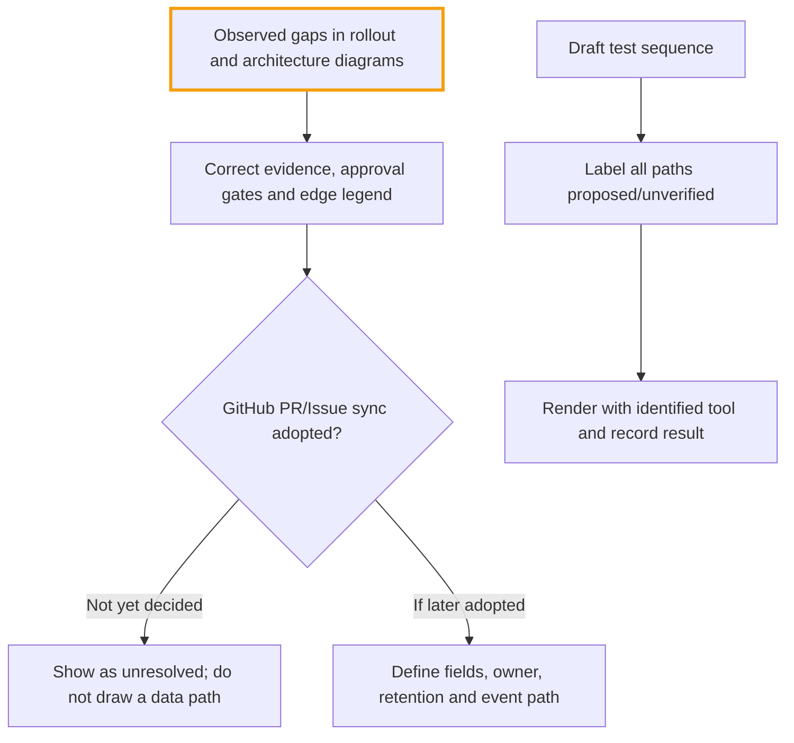

# Mermaid diagram evidence review
# Mermaid 다이어그램 근거 대조 회의

2026-11-21 KST · Rollout stage 1 remains partially verified.
2026-11-21 KST · 도입 1단계 부분 검증 상태 유지.

## Agenda / 의제

Review the five observations about rollout and architecture diagrams, task-flow overlap, and Mermaid rendering. Decide which recommendations are supported by existing adopted facts, which need further investigation, and what to submit to Curtain.
도입·아키텍처 다이어그램, 작업 흐름 중복, Mermaid 렌더링에 관한 다섯 지적을 검토합니다. 기존 채택 사실로 뒷받침되는 권고, 추가 조사가 필요한 사항, 커튼 뒤에게 제출할 판단을 구분합니다.

## Facts, assumptions, questions / 사실·가정·질문

- Fact: `docs/office/workflow.md` describes GitHub as the official record for PRs, Issues and decisions; Slack as conversation/notification; Supabase as meeting and agent state; the dashboard as a view; and LangGraph as later automation.
  사실: `docs/office/workflow.md`는 GitHub를 PR·Issue·결정의 공식 기록, Slack을 대화·알림, Supabase를 회의·에이전트 상태, 현황판을 조회 화면, LangGraph를 후속 자동화로 설명합니다.
- Fact: The workflow rollout diagram currently has four stage boxes and does not include per-stage completion evidence or human approval gates.
  사실: workflow의 도입 다이어그램은 현재 4개 단계 상자만 있고 단계별 완료 근거나 사람 승인 지점이 없습니다.
- Fact: The second diagram meeting recommends stage criteria/evidence and approval gates, and recommends labeled target architecture edges distinguished by verified/planned status.
  사실: 2차 다이어그램 회의는 단계 기준·근거·승인 지점과 검증/계획 상태를 구분한 목표 아키텍처 연결 라벨을 권고했습니다.
- Fact: The Slack→Supabase record step is defined, but no adopted statement says GitHub PR/Issue status is synchronized into Supabase or the dashboard.
  사실: Slack→Supabase 회의 기록 단계는 정의됐지만 GitHub PR/Issue 상태가 Supabase나 현황판에 동기화된다는 채택 문장은 없습니다.
- Fact: Mermaid source exists in Markdown. No renderer result or render check is recorded for the recent report diagrams.
  사실: Markdown에 Mermaid 소스가 있으나 최근 보고 다이어그램의 렌더링 결과나 렌더 확인 기록은 없습니다.
- Fact: A task workflow and a sequence diagram answer different questions only if the former describes ownership/gates and the latter describes timed messages, responses and failure branches. The current task workflow in the latest response is a simple linear checklist.
  사실: 작업 흐름은 담당/승인 지점, 시퀀스는 시간순 메시지·응답·실패 분기를 표현할 때 서로 다른 질문에 답합니다. 최근 응답의 작업 그림은 단순 선형 체크리스트입니다.
- Question: Should GitHub state be reflected in Supabase/dashboard, and if so, what approved event path and source-of-truth rule applies?
  질문: GitHub 상태를 Supabase/현황판에 반영할지, 반영한다면 어떤 승인된 이벤트 경로와 원본 기준 규칙을 적용할지?
- Question: What exact Mermaid renderer/version should be used for visual verification in this repository?
  질문: 저장소에서 시각 검증에 사용할 Mermaid 렌더러/버전은 무엇인가?

## Role discussion / 역할별 회의

The following are assistant-authored role perspectives, not independent-agent outputs. Each role is recorded in the required six-field table.
다음은 독립 에이전트 결과가 아닌 어시스턴트의 역할별 관점입니다. 각 역할을 필수 여섯 항목 표로 기록합니다.

| Who / 역할 | What / 제안 | Why / 이유 | How / 방법 | Goal / 목표 | Conviction / 소신 |
|---|---|---|---|---|---|
| Tech Lead / 기술 리드 | Patch the rollout and target architecture diagrams; keep the task flow only for ownership and approval handoffs. / 도입·목표 구조 그림 보강, 작업 흐름은 담당·승인 인계에 한정 | Prior recommendations are not visible in the current diagrams. / 기존 권고가 현재 그림에 보이지 않음 | Add concise acceptance/evidence/gate labels; separate the temporal test sequence. / 간결한 완료·근거·승인 라벨 추가, 시간 흐름은 시험 시퀀스로 분리 | Consistent, non-duplicative diagrams. / 일관되고 중복 없는 그림 | Fix supported omissions now; leave unresolved integration semantics open. / 확인된 누락은 보완하고 미결정 연동 의미는 열어둠 |
| Full-stack / 풀스택 | Create a test-specific sequence with success and failure/stop paths for model quota and bot-comment retrigger. / 모델 한도·봇 코멘트 재트리거 성공/실패·중단 경로를 포함한 시험 시퀀스 작성 | The already proposed PR→Actions→diff→Gemini→COMMENT→Slack order is actionable but not yet tested. / 제안 순서는 구체적이나 아직 시험되지 않음 | Mark every interaction as proposed/unverified until observed; include bounded stop branches without inventing retry counts. / 관찰 전 상호작용은 제안/미검증으로 표시하고 횟수 미정 재시도 값을 만들지 않음 | Reproducible test and clear failure localization. / 재현 가능한 시험·실패 지점 파악 | The sequence can be authored now, but it must not claim the integration works. / 시퀀스 작성은 가능하나 연동 성공을 주장하지 않음 |
| SecOps / 보안 | Put any not-yet-enabled Supabase/dashboard relation on a planned dashed edge and keep permissions unverified. / 미구현 Supabase·현황판 관계는 계획 점선, 권한은 미검증으로 표시 | A solid line can imply active access or a verified path. / 실선은 활성 권한·검증 경로로 오해될 수 있음 | Add an in-diagram legend for line semantics; trace actual identities and scopes before implementation. / 그림 안에 선 범례, 구현 전 실제 주체·권한 조사 | Prevent false security claims. / 보안 상태 오인 방지 | Never show candidate scopes as configured permissions. / 후보 권한을 설정 완료처럼 표시하지 않음 |
| Art Director / 아트 디렉터 | Add status/evidence labels and a visible legend; keep node text concise. / 상태·근거 라벨과 범례 추가, 노드 글자 간결화 | Existing stage boxes hide completion criteria; unlabeled solid/dashed lines are ambiguous. / 기존 단계 상자에 완료 조건이 없고 선 의미가 모호 | Use line style plus text, not color alone; include date/evidence and human gate. / 색상 외 선 모양·텍스트 병행, 날짜·근거·사람 게이트 표시 | Readable and honest visuals. / 읽기 쉽고 오해 없는 그림 | A diagram should communicate status without relying on surrounding prose. / 설명 문단 없이도 상태를 전달 |
| Researcher / 연구 | Treat screenshot/source comparison and render testing separately. / 화면·소스 비교와 렌더 시험을 분리 | A screenshot of one rendered version cannot prove the Markdown source renders identically. / 한 렌더 화면이 Markdown 소스와 일치함을 보장하지 않음 | Identify the repository-supported renderer, render the exact blocks, and record tool/version/result; until then label unverified. / 저장소 지원 렌더러 확인 후 해당 블록 렌더·도구/버전/결과 기록, 전까지 미검증 표시 | Reproducible visual evidence. / 재현 가능한 시각 근거 | Do not claim rendered verification without an actual render. / 실제 렌더 없이 렌더 확인 주장 금지 |
| Trend Analyst / 동향 분석 | Avoid a permanent fourth task-flow diagram; use the sequence diagram for timed interaction and keep numbered ownership steps alongside it. / 상시 네 번째 작업 그림은 피하고 시간 상호작용은 시퀀스, 담당 표시는 번호 절차로 유지 | A linear checklist overlaps with the sequence and lacks branch information. / 선형 체크리스트는 시퀀스와 겹치고 분기가 없음 | Remove redundant task boxes from routine status; add sequence only where event order matters. / 일반 상태의 중복 상자 축소, 이벤트 순서가 중요한 때 시퀀스 추가 | Lower maintenance and clearer purpose. / 유지 부담 감소·목적 선명 | Keep the three required report diagrams but make the detail view fit the actual task question. / 필수 세 그림은 유지하되 상세 그림은 실제 질문에 맞춤 |
| Legal / 법무 | Do not infer GitHub→Supabase data synchronization; leave it explicitly undecided pending data ownership and privacy review. / 데이터 주체·개인정보 검토 전 GitHub→Supabase 동기화를 추정하지 않고 미결정 기록 | The documented record ownership does not define copying, retention, or data fields. / 기록 주체 설명만으로 복제·보존·필드가 정해지지 않음 | Ask whether issue/PR state is in dashboard scope; if adopted, document fields, purpose, retention and source links. / PR·Issue 상태가 현황판 범위인지 확인 후 채택되면 필드·목적·보존·원본 링크 문서화 | Accurate data boundaries and obligations. / 정확한 데이터 경계·의무 | Diagram only an adopted path; show the unresolved choice as a question, not a flow. / 채택된 경로만 그리고 미결정은 경로가 아닌 질문으로 표시 |
| End User / 사용자 관점 | Show who acts at each human gate and what evidence completes a stage. / 사람 승인 담당자와 단계 완료 근거 표시 | A reader should know whether the next action belongs to the user or agent. / 다음 행동 담당이 사용자/에이전트 중 누구인지 알아야 함 | Put “user approves install/permissions/merge” and evidence labels on relevant stages; keep current action in task diagram. / 관련 단계에 사용자 설치·권한·Merge 승인과 근거 표시 | No guesswork about status or responsibility. / 상태·책임 추측 방지 | Do not label a stage complete because a document exists. / 문서 존재만으로 단계 완료 표시 금지 |

## Findings submitted to Curtain / 커튼 뒤 제출 취합

1. **Adoptable diagram corrections:** Add stage acceptance/completion criteria, human gates and dated evidence references to the existing rollout diagram. Mark Stage 1 partial and distinguish future stages as planned. This directly addresses the observed four-box diagram gap.
   **채택 가능한 그림 보완:** 기존 도입 그림에 단계 수락/완료 조건·사람 게이트·날짜 근거를 넣습니다. 1단계 부분 검증과 후속 계획 단계를 구분합니다. 현재 4상자 그림의 누락을 직접 보완합니다.
2. **Adoptable architecture correction:** Add a legend inside the target architecture: solid = verified active relation, dashed = planned/unverified. Make Supabase→dashboard dashed until stage 3 is verified. Label every edge with its operation.
   **채택 가능한 아키텍처 보완:** 목표 구조 내부에 범례를 두어 실선은 검증된 활성 관계, 점선은 계획/미검증으로 정의합니다. 3단계 검증 전 Supabase→현황판은 점선으로 표시하고 모든 연결에 동작을 적습니다.
3. **GitHub→Supabase remains unresolved:** The user observation identifies a genuine architecture ambiguity, but repository policy does not decide automatic synchronization. Do not add it as a real/planned data flow without Curtain adopting that scope. Ask whether GitHub PR/Issue status should be visible in the dashboard; record “not currently defined” meanwhile.
   **GitHub→Supabase는 미결정:** 아키텍처 모호성은 실제 지적이지만 저장소 정책은 자동 동기화를 정하지 않았습니다. 커튼 뒤가 범위를 채택하기 전에는 실제/계획 데이터 경로를 그리지 않습니다. PR·Issue 상태를 현황판에 보여줄지 질문하고 현재는 “정의되지 않음”으로 둡니다.
4. **Task flow vs sequence:** The task flow remains useful for numbered owner/verifier steps and human approval gates; the sequence is useful for actor messages, responses, error branches and stop points. Reduce linear implementation boxes in the task view or link the sequence rather than duplicate the same event order. Do not remove the required task-detail report view.
   **작업 흐름과 시퀀스 구분:** 작업 흐름은 번호별 담당/확인과 사람 승인 게이트, 시퀀스는 주체 간 메시지·응답·오류 분기·중단점을 나타냅니다. 작업 그림의 선형 구현 상자는 줄이거나 시퀀스로 연결하되 필수 작업 상세 보고 그림 자체는 제거하지 않습니다.
5. **Render verification:** The previous report correctly said rendering was not checked. Source inspection alone is not render evidence. Identify a renderer supported by the repository/app, render the exact Markdown Mermaid blocks, and record version and result before claiming success. Until then, label rendering unverified.
   **렌더 확인:** 이전 보고의 미확인 표시는 정확합니다. 소스 확인만으로 렌더 근거가 되지 않습니다. 저장소/앱 지원 렌더러를 확인하고 Markdown 블록을 렌더해 버전·결과를 기록한 뒤에만 성공을 주장합니다. 전까지 렌더는 미검증입니다.
6. **Test sequence:** It can be drafted as a proposal now from already named actors/events, with explicit “proposed/unverified” labels and branches for Gemini quota exhaustion and bot-comment retrigger. Retry counts, circuit breaker details and actual delivery are not settled/tested, so do not invent values or claim behavior verified.
   **시험 시퀀스:** 이미 언급된 주체/이벤트를 기반으로 제안/미검증 라벨을 달아 지금 초안을 만들 수 있으며 Gemini 한도 초과·봇 코멘트 재트리거 분기를 표시합니다. 재시도 횟수·차단기 동작·실제 전달은 정해지거나 시험되지 않았으므로 수치 생성이나 검증 주장은 하지 않습니다.

## Mermaid — decision path / 결정 흐름

## Decision status and next actions / 결정 상태·다음 단계

- This meeting submits recommendations; no diagram or synchronization policy is adopted until Curtain decides.
  이번 회의는 권고를 제출하며 커튼 뒤 결정 전에는 그림 보완이나 동기화 정책을 채택하지 않습니다.
- Next: Curtain reviews the six findings above. If adopted, first prepare the exact diagram edits and renderer method for review; do not push or create a PR without the separate approvals required by the workflow.
  다음: 커튼 뒤가 위 여섯 취합 사항을 검토합니다. 채택되면 정확한 그림 수정안과 렌더 방법을 검토용으로 먼저 준비합니다. 별도 workflow 승인 없이 Push/PR을 하지 않습니다.

## Sources / 출처

- `docs/office/workflow.md`
- `docs/office/README.md`
- `docs/office/meetings/2026-11-21-mermaid-diagram-needs-second-review.md`
- User-provided observations in the current conversation.
