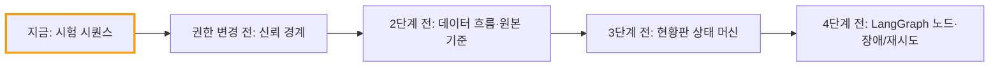

# Mermaid diagram needs — second meeting
# Mermaid 다이어그램 필요성 — 2차 회의

## Role discussion table / 역할별 회의 표

| Who / 역할 | What / 제안 | Why / 이유 | How / 방법 | Goal / 목표 | Conviction / 소신 |
|---|---|---|---|---|---|
| Tech Lead | Prioritize diagrams by rollout stage. / 도입 단계별 그림 우선순위 제안 | Avoid implementing future-stage specs early. / 후속 단계 사양의 조기 확정 방지 | Match each diagram to its owning integration gate. / 담당 연동 게이트에 배치 | Keep scope reviewable. / 검토 가능한 범위 유지 | Add only diagrams that answer a current decision or test question. / 현재 결정·시험 질문에 필요한 그림만 추가 |
| Full-stack | Add the test sequence now. / 시험 시퀀스 우선 추가 | The task flow does not show temporal handoffs. / 작업 흐름도에 시간순 전달이 없음 | Trace PR event through Actions, model, review comment and Slack. / PR 이벤트부터 Slack까지 추적 | Make handoffs and failures visible. / 전달·실패 지점 가시화 | Draw observed and unverified transitions separately. / 관찰·미검증 전이를 분리 |
| SecOps | Review trust boundaries before enabling credentials or write scopes. / 비밀값·쓰기 권한 전 신뢰 경계 검토 | PR content is untrusted and credentials carry risk. / PR 내용은 신뢰할 수 없고 비밀값은 위험을 수반 | Inventory identities, permissions, secrets and data crossing boundaries. / 주체·권한·비밀값·경계 통과 데이터를 목록화 | Minimize exposure. / 노출 최소화 | Do not present candidate permission examples as verified policy. / 후보 권한 예시를 검증된 정책처럼 쓰지 않음 |
| Art Director | Improve the three recurring diagrams with labels and status styling. / 상시 그림 세 가지의 라벨·상태 표현 보강 | Unlabeled arrows and a highlighted stage can imply more than evidence supports. / 라벨 없는 화살표·강조 단계는 근거보다 과장될 수 있음 | Label edge meaning and distinguish verified from planned in text and line style. / 연결 의미를 쓰고 텍스트·선 모양으로 검증/계획 구분 | Readable, truthful visuals. / 읽기 쉽고 사실에 맞는 시각화 | Keep visual emphasis from implying completion. / 강조 표현이 완료를 뜻하지 않게 함 |
| Researcher | Put completion criteria and evidence links on the rollout view. / 도입 그림에 완료 조건·근거 연결 | A stage label alone does not explain partial status. / 단계명만으로 부분 상태를 설명하지 못함 | Record tested event, observed result, date and unverified coverage. / 시험 이벤트·결과·날짜·미검증 범위 기록 | Auditable stage progression. / 감사 가능한 단계 진행 | Do not claim end-to-end completion without evidence for required paths. / 필수 경로 근거 없이 종단 완료를 주장하지 않음 |
| Trend Analyst | Schedule state-machine and LangGraph diagrams for their owning stages. / 상태 머신·LangGraph 그림을 해당 단계에 배치 | They describe later product behavior and orchestration. / 후속 제품 동작·오케스트레이션을 설명 | Agree states, transitions and stop/resume semantics before drawing. / 상태·전이·중단/재개 의미 합의 후 작성 | Avoid diagrams that imply undecided behavior. / 미결정 동작의 확정 표현 방지 | Defer future-stage detail until it is actionable. / 실행 시점 전 세부 그림을 미룸 |
| Legal | Include data category, destination, record owner and terms gate in the later data-flow diagram. / 후속 데이터 흐름 그림에 데이터 종류·목적지·기록 주체·이용조건 게이트 포함 | Source of truth alone omits copying and retention concerns. / 원본 기준만으로 복사·보존 문제가 드러나지 않음 | Derive fields and idempotency from adopted schemas and official terms. / 채택 스키마·공식 조건에서 필드·중복 방지 도출 | Traceable, policy-consistent data movement. / 추적 가능하고 정책에 맞는 데이터 이동 | Prepare before stage 2 after data policies are agreed. / 데이터 정책 합의 후 2단계 전에 준비 |
| End User | Extend the existing approval flow to show human gates. / 기존 승인 흐름에 사람 게이트 표시 | Users must distinguish automation from their own approval actions. / 사용자는 자동화와 직접 승인 행동을 구분해야 함 | Name the human actor and required response at each gate. / 게이트별 사람 담당자·필수 응답 명시 | Prevent accidental assumptions that AI approves or merges. / AI가 승인·병합한다고 오해하지 않게 함 | Reuse the current flow if it clearly communicates the distinction. / 구분이 명확하면 기존 흐름 재사용 |

The role-specific narrative below provides supporting detail; it does not replace this required six-column table.
아래 역할별 서술은 보충 설명이며 필수 여섯 열 표를 대체하지 않습니다.

2026-11-21 KST · Rollout stage 1 remains partially verified.
2026-11-21 KST · 도입 1단계는 부분 검증 상태입니다.

## Agenda and user input / 의제와 사용자 제안

Assess the user's proposed seven additional diagrams and improvements to the existing diagrams. Decide which views are needed now, which belong before later rollout stages, and which require underlying policy or architecture decisions first. User suggestions are meeting input; proposed permissions and states are not treated as verified configuration.
사용자가 제안한 추가 그림 7종과 기존 그림 보강점을 검토합니다. 지금 필요한 그림, 후속 단계 전에 필요한 그림, 먼저 정책·아키텍처 결정이 필요한 그림을 구분합니다. 사용자 제안은 회의 입력으로 다루며 권한·상태 예시를 확인된 설정으로 취급하지 않습니다.

## Facts, assumptions, and constraints / 사실·가정·제약

- Fact: `docs/office/workflow.md` already has a reusable approval flow.
  사실: `docs/office/workflow.md`에 재사용 승인 흐름도가 있습니다.
- Fact: Stage 1 is partially verified. The currently proposed Actions→Gemini→COMMENT→Slack test has not been implemented or run.
  사실: 1단계는 부분 검증입니다. 제안된 Actions→Gemini→COMMENT→Slack 시험은 아직 구현·실행되지 않았습니다.
- Fact: Supabase schemas, idempotency policy, dashboard states, LangGraph graph and retry/circuit-breaker behavior are not decided by these meeting inputs.
  사실: Supabase 스키마·중복 방지 정책·현황판 상태·LangGraph 그래프·재시도/차단 동작은 이번 회의 입력만으로 결정된 사항이 아닙니다.
- Assumption: diagrams should be created when a concrete decision, implementation, or review needs that view.
  가정: 그림은 구체적인 결정·구현·검토에 필요한 시점에 작성합니다.
- Constraint: diagrams must distinguish verified, proposed and unknown state. An example permission or status is not a granted permission or adopted policy.
  제약: 검증·제안·미확인 상태를 구분합니다. 권한·상태 예시는 실제 부여 권한이나 채택 정책이 아닙니다.

## Role discussion / 역할별 논의

The eight role sections are assistant-authored perspectives, not separate agent statements. Each follows Who·What·Why·How·Goal·Position.
8개 역할은 어시스턴트가 작성한 관점이며 독립 에이전트 발언이 아닙니다. 각 관점은 Who·What·Why·How·Goal·소신 순입니다.

| Who / 역할 | What / 제안 | Why / 이유 | How / 방법 | Goal / 목표 | Conviction / 소신 |
|---|---|---|---|---|---|
| Tech Lead / 기술 리드 | Stage-specific diagram set / 단계별 그림 구성 | Avoid premature scope / 성급한 범위 확장 방지 | Map each view to a gate / 그림을 단계 게이트에 연결 | Clear sequence / 순서 명확화 | Add incrementally / 필요한 때 추가 |
| Full-stack / 풀스택 | Stage 1 sequence, later data flow / 1단계 시퀀스·후속 데이터 흐름 | Current sequence is actionable / 현재 순서는 구체적 | Mark actors, inputs and failures / 주체·입력·실패 표시 | Reproducible test / 재현 시험 | Sequence now, schema later / 시퀀스 우선·스키마 후속 |
| SecOps / 보안 | Permission and trust boundary / 권한·신뢰 경계 | Prevent excessive access / 과도한 접근 방지 | Verify actual scopes and identities / 실제 권한·신원 확인 | Least privilege / 최소 권한 | Examples remain candidates / 예시는 후보 |
| Art Director / 아트 디렉터 | Labeled arrows and status styles / 화살표 라벨·상태 표현 | Avoid ambiguous diagrams / 그림 모호성 방지 | Text plus line styles / 텍스트와 선 스타일 | Readable diagrams / 읽기 쉬운 그림 | No color-only meaning / 색상만 사용 금지 |
| Researcher / 연구 | Stage criteria and evidence / 단계 기준·근거 | Keep claims auditable / 주장 추적 가능 | Date and link observations / 관찰 날짜·링크 | Evidence-based progress / 근거 기반 진행 | No unverified completion / 미검증 완료 금지 |
| Trend Analyst / 동향 분석 | State machine and LangGraph views later / 후속 상태 머신·LangGraph 그림 | Behavior is undecided / 동작 미결정 | Agree transitions before drawing / 전이 합의 후 작성 | Avoid false specification / 허위 명세 방지 | Schedule by stage / 단계별 작성 |
| Legal / 법무 | Data/source-of-truth flow / 데이터·원본 기준 흐름 | Clarify disclosure and records / 제공·기록 명확화 | Derive fields from approved schemas / 승인 스키마 기반 | Traceable data handling / 데이터 추적성 | Before stage 2 / 2단계 전 |
| End User / 사용자 관점 | Human gates and automatic actions / 사람 승인과 자동 동작 | Make user actions clear / 사용자 행동 명확화 | Extend existing approval flow / 기존 승인도 확장 | No mistaken approval / 승인 오인 방지 | Reuse before duplicating / 복제보다 재사용 |

This table is the required field-by-field record; following paragraphs provide supporting detail.
위 표가 항목별 필수 기록이며 아래 문단은 보충 설명입니다.

### Tech Lead

- Who: Owns diagram scope and sequencing.
- What: Keep three recurring report views. Add a test sequence now, a trust/permission view before enabling workflow permissions, and later views at the stage gates where they become actionable.
- Why: A diagram is valuable when it resolves a concrete implementation or review question.
- How: Map each proposed diagram to its owning document and decision gate.
- Goal: Avoid both missing operational detail and premature specification.
- Position: Add diagrams incrementally; do not make all seven recurring report requirements.

기술 리드 — 그림 범위와 순서를 맡습니다. 상시 보고 세 그림은 유지하고, 시험 시퀀스는 지금, 권한·신뢰 경계는 워크플로 권한을 켜기 전, 나머지는 해당 단계의 설계 질문이 구체화될 때 작성하자는 소신입니다.

### Full-stack

- Who: Owns event and component behavior.
- What: Prioritize the test sequence PR→workflow→diff→Gemini→COMMENT→Slack. Later add data flow with event schema and idempotency when Slack→Supabase is designed.
- Why: Current test execution order is concrete; future schema and duplicate-event behavior are still open.
- How: Show actor, input/output, success/failure point and evidence for the test. Do not invent future schema fields.
- Goal: Make the first test reproducible and later data storage implementable.
- Position: Sequence now; data-flow details in stage 2 design.

풀스택 — 이벤트와 컴포넌트 동작 담당. 현재는 PR→워크플로→diff→Gemini→COMMENT→Slack 시험 시퀀스를 우선하고, 이벤트 스키마·중복 방지는 Slack→Supabase 설계 때 구체화하자는 소신입니다.

### SecOps

- Who: Owns security boundary review.
- What: Create a focused permission/trust diagram before granting workflow write permission or storing Gemini credentials. Include Slack app scopes and Supabase keys only when those integrations are actually in scope.
- Why: `GITHUB_TOKEN` permissions, repository secrets, Slack scopes, and Supabase keys have different identities and risks. Dashboard read-only behavior is not yet established.
- How: Inventory actual required permissions, identify token issuer/consumer, trust boundaries, and human approval. Mark unknowns explicitly.
- Goal: Least privilege and reviewable access boundaries.
- Position: User examples such as `pull-requests: write`, service key/anon key, and read-only dashboard are candidate labels to verify, not settled values.

보안 — 보안 경계 검토 담당. 워크플로 쓰기 권한이나 Gemini 자격 증명을 설정하기 전에 실제 필요한 권한을 조사한 그림을 작성하고, Slack·Supabase는 해당 연동이 범위에 들어올 때 포함합니다. `pull-requests: write`, service/anon key, 현황판 읽기 전용은 확정값이 아니라 확인할 후보라는 소신입니다.

### Art Director

- Who: Keeps the diagrams legible.
- What: Improve the architecture arrows with verb labels and distinguish current/verified from planned/unverified.
- Why: An unlabeled arrow can mean data, control, notification or dependency.
- How: Use labeled edges and a textual legend plus line style. Do not rely on color alone.
- Goal: The reader can interpret relationships without guessing.
- Position: Add the completion criteria and approval gates to the rollout map, but keep each node concise.

아트 디렉터 — 가독성 담당. 아키텍처 화살표에 기록·알림·읽기·제어 등 동작을 라벨링하고, 현재/검증과 계획/미검증을 선 모양과 글자로 구분합니다. 도입 지도에는 완료 조건·승인 지점을 짧게 표시하자는 소신입니다.

### Researcher

- Who: Ensures diagrams describe evidence rather than aspiration.
- What: Put per-stage completion criteria and links to observed evidence on the rollout diagram.
- Why: A highlighted stage alone does not explain why it is partial.
- How: State the event tested, observed result, date and unverified coverage.
- Goal: Auditable stage progression.
- Position: Do not mark end-to-end completion until all required event paths have evidence.

연구 — 근거에 맞는 표현을 책임집니다. 도입 지도에 단계별 완료 조건과 관찰 근거 링크를 넣고 시험 이벤트·결과·날짜·미검증 범위를 표시합니다. 필수 이벤트 경로 근거 전에는 종단 완료로 표시하지 말자는 소신입니다.

### Trend Analyst

- Who: Considers future system evolution.
- What: Place dashboard state machine before stage 3 implementation and LangGraph node graph before stage 4 implementation.
- Why: These diagrams describe product behavior and automation control flow, not current notification test setup.
- How: First agree state names/transitions and LangGraph stop/resume/human approval semantics, then diagram them.
- Goal: Avoid diagrams that pretend unsettled behavior is decided.
- Position: Schedule them at their owning stages, not now.

동향 분석 — 후속 시스템 변화를 봅니다. 현황판 상태 머신은 3단계 구현 전에, LangGraph 노드 그래프는 4단계 구현 전에 상태·전이·중단/재개·사람 승인 의미를 먼저 결정한 뒤 작성해야 합니다. 지금 미정 동작을 확정처럼 그리지 말자는 소신입니다.

### Legal

- Who: Checks data disclosure and service conditions.
- What: Data-flow/source-of-truth view should show data categories, destination, retention/recording owner, and terms gate when the actual integrations are selected.
- Why: A source-of-truth diagram alone does not explain what data is copied or how duplicate events are handled.
- How: Derive fields and idempotency key from approved schemas and provider docs, not assumptions.
- Goal: Traceable and policy-consistent data movement.
- Position: Prepare before stage 2, after storage and event policies are agreed.

법무 — 데이터 제공과 이용 조건 담당. 데이터 종류·목적지·보존/기록 주체·이용조건 게이트를 실제 연동 선택 후 표시합니다. 스키마와 중복 방지 키는 합의된 계약과 공식 문서에서 도출하고 2단계 전에 준비하자는 소신입니다.

### End User

- Who: Checks whether people understand when they must act.
- What: Add a human approval gate diagram or annotate the existing approval flow to distinguish automatic COMMENT/notification from human permission, Approve, and Merge.
- Why: Users need to see which actions happen automatically and which require their decision.
- How: Name the human actor at each gate and state the required response.
- Goal: No accidental expectation that an agent's comment approves or merges.
- Position: Reuse and extend the existing approval diagram instead of creating a duplicate if it can express the distinction clearly.

사용자 관점 — 사람의 실행 지점을 이해하는지 봅니다. 자동 COMMENT/알림과 사람의 설치·권한 승인·Approve·Merge를 구분하고 각 게이트의 담당자와 필요한 응답을 표시합니다. 기존 승인 그림으로 구분을 표현할 수 있으면 복제 대신 확장하자는 소신입니다.

## Priority proposal to Curtain / 커튼 뒤 우선순위 제안

### Now — current stage 1 test / 지금 — 현 1단계 시험

1. Test sequence diagram for PR event→Actions→diff acquisition→Gemini request→COMMENT submission→Slack observation. Explicitly label each unverified transition and stop/failure point.
   PR 이벤트→Actions→diff 수집→Gemini 요청→COMMENT 제출→Slack 관찰 시험 시퀀스. 미검증 전이와 중단/실패 지점을 표시합니다.
2. Permission/trust-boundary view before enabling any workflow write permission or adding a secret. Verify exact scopes and consumers first. Do not assume the proposed scope is sufficient or the zero-cost guarantee is technically enforced.
   워크플로 쓰기 권한이나 secret을 설정하기 전 권한/신뢰 경계를 조사합니다. 실제 범위와 사용 주체를 먼저 확인하며 제안 권한의 충분성이나 비용 0원 보장을 전제하지 않습니다.
3. Add stage completion criteria, approval gates and evidence references to the rollout diagram. Label architecture edges by operation and distinguish verified from planned.
   도입 지도에 완료 조건·승인 게이트·근거를 추가하고 아키텍처 연결에 동작 라벨을 달아 검증/계획을 구분합니다.

### Before stages 2–3 / 2~3단계 전

4. Data-flow and source-of-truth view: agree events, schema, record owner, duplicate delivery/idempotency handling and error policy before drawing concrete fields/keys.
   데이터 흐름·원본 기준 그림: 구체 필드/키를 그리기 전에 이벤트·스키마·기록 주체·중복/idempotency 처리·오류 정책을 합의합니다.
5. Dashboard state machine: adopt agent states and allowed transitions before stage 3 implementation.
   현황판 상태 머신: 3단계 구현 전에 에이전트 상태와 허용 전이를 채택합니다.

### Before stage 4 / 4단계 전

6. LangGraph node graph including branches, checkpoints and human approval/interrupt-resume behavior.
   분기·체크포인트·사람 승인 및 중단/재개의미를 포함한 LangGraph 노드 그래프.
7. Failure/retry diagram covering quota exhaustion, Slack outage, duplicate/self-trigger loops and bounded stop/circuit-breaker behavior. Define retry and cost policies before asserting a circuit breaker or zero-cost guarantee.
   한도 초과·Slack 장애·중복/자기 트리거 루프·제한된 중지/차단 동작을 다루는 장애/재시도 그림. 차단기나 비용 0원 보장을 주장하기 전에 재시도·비용 정책을 정의합니다.

## Existing diagram improvements / 기존 그림 보강

- Rollout map: show each stage's acceptance/completion condition, approval gate and evidence link so partial status has a visible reason.
  도입 지도: 단계별 수락/완료 조건·승인 지점·근거 링크를 넣어 부분 상태의 이유를 보이게 합니다.
- Target architecture: label arrows (event, record, notification, read, control); use textual state plus line style for verified/planned. Do not imply unverified LangGraph→Supabase behavior.
  목표 아키텍처: 화살표에 이벤트·기록·알림·읽기·제어를 표시하고 검증/계획은 텍스트와 선 스타일로 구분합니다. 미검증 LangGraph→Supabase 동작을 암시하지 않습니다.
- Current task flow: number actors, verification owner and human approval gates; use sequence view for temporal messages.
  현재 작업 흐름: 번호·실행자·확인자·사람 승인 게이트를 표시하고 시간순 메시지는 시퀀스 그림으로 보완합니다.
- Human approval: extend the existing workflow approval diagram if it can clearly distinguish automation from human decisions; avoid a duplicate diagram.
  사람 승인: 자동화와 사람 결정을 분명히 나눌 수 있다면 기존 workflow 승인 그림을 확장하고 중복 그림은 피합니다.

## Mermaid — proposed diagram set / 제안 다이어그램 구성

## Findings and open questions / 취합 결과와 미결정

- Finding: all seven proposals are potentially useful, but they are not all needed now. Prioritize test sequence and least-privilege/trust-boundary review for stage 1. Schedule data flow/idempotency before stage 2–3, state machine before stage 3, and LangGraph/failure diagrams before stage 4.
  취합 결과: 제안 7종은 유용할 수 있으나 지금 모두 필요한 것은 아닙니다. 1단계에는 시험 시퀀스와 최소 권한/신뢰 경계 검토를 우선합니다. 2~3단계 전에 데이터 흐름/idempotency, 3단계 전에 상태 머신, 4단계 전에 LangGraph/장애 그림을 준비합니다.
- Finding: improve the rollout diagram with completion criteria/evidence/approval gates and the architecture with labeled, status-coded edges.
  취합 결과: 도입 지도에는 완료 조건·근거·승인 게이트, 아키텍처에는 라벨과 상태가 있는 연결을 추가합니다.
- Adoption: pending Curtain. No files or standing diagram rules were changed by this meeting record.
  채택: 커튼 뒤 판단 대기입니다. 회의록 외 파일 변경이나 상시 그림 규칙 변경은 아직 하지 않았습니다.
- Open: whether human approval is a separate diagram or an extension of the existing workflow approval flow.
  미결정: 사람 승인 그림을 별도로 만들지 기존 workflow 승인 흐름을 확장할지 정해야 합니다.
- Open: exact GitHub, Gemini, Slack and Supabase permissions, schemas, state transitions, retry limits and cost-enforcement mechanisms require separate verification/adoption.
  미결정: GitHub·Gemini·Slack·Supabase의 정확한 권한·스키마·상태 전이·재시도 제한·비용 차단 방법은 별도 확인·채택이 필요합니다.

## Next actions / 다음 단계

1. Assistant submits the findings and prioritization to Curtain.
   어시스턴트가 취합 결과와 우선순위를 커튼 뒤에게 제출합니다.
2. Curtain adopts, revises or rejects each proposed addition and improvement.
   커튼 뒤가 추가 그림과 보강안을 항목별로 채택·수정·반려합니다.
3. After adoption, update the owning docs and create only the approved diagrams at their stage gates.
   채택 후 담당 문서를 갱신하고 각 단계 게이트에서 승인된 그림만 작성합니다.

## Sources / 출처

- User-provided proposal in the current conversation.
- `docs/office/workflow.md`
- `docs/office/README.md`
- `docs/office/roles.md`
- `docs/office/stage1-notifications.md`
