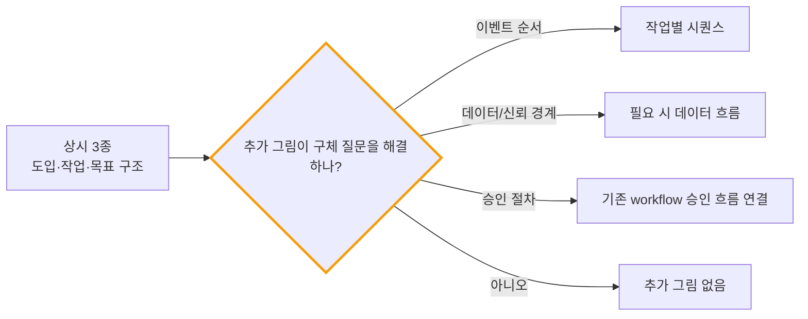

# Mermaid diagram needs meeting
# Mermaid 다이어그램 필요성 회의

2026-11-21 KST · Rollout stage 1 remains partially verified.
2026-11-21 KST · 도입 1단계는 부분 검증 상태입니다.

## Agenda / 의제

Determine whether the three recurring report diagrams are sufficient, or whether the project needs additional diagrams. Review possible additions such as an integration sequence diagram, system data-flow diagram, or decision flow. Also identify improvements to the three existing diagrams. These are role-based recommendations submitted to Curtain, not adopted policy.
작업 보고의 상시 다이어그램 세 가지로 충분한지, 연동 시퀀스·시스템 데이터 흐름·의사결정 흐름 같은 추가 그림이 필요한지 검토합니다. 기존 세 그림의 보강점도 논의합니다. 역할별 권고를 커튼 뒤에게 제출하며, 채택 전까지 규칙으로 간주하지 않습니다.

## Facts and assumptions / 사실과 가정

- Fact: `docs/office/workflow.md` already contains a reusable approval-flow diagram.
  사실: `docs/office/workflow.md`에 재사용 가능한 승인 흐름도가 이미 있습니다.
- Fact: reports require rollout status, evidence, current task and next action. Current-node highlighting is required for the rollout map.
  사실: 보고에는 도입 상태·근거·현재 작업·다음 행동이 필요하며, 도입 지도에서 현재 위치를 강조합니다.
- Assumption: the rollout map, task detail and target architecture answer different questions and should remain distinct.
  가정: 도입 지도·작업 상세·목표 아키텍처는 서로 다른 질문에 답하므로 구분해야 합니다.
- Open: whether a task sequence diagram should appear in every update or only at planning and result review.
  미결정: 작업 시퀀스 그림을 모든 진행 보고에 넣을지 계획·결과 검토 때만 넣을지 정해야 합니다.

## Role discussion / 역할별 논의

Each item follows Who·What·Why·How·Goal·Position. These are the assistant's role-based analyses, not separate agents' statements.
각 항목은 Who·What·Why·How·Goal·소신 순입니다. 독립 에이전트의 발언이 아닌 어시스턴트의 역할별 분석입니다.

### Tech Lead

- Who: Owns the information structure.
- What: Keep the three recurring diagrams and clarify each purpose. Add focused views only when a concrete question requires them.
- Why: Repeating or combining diagrams obscures their purpose.
- How: Rollout map for adoption stage, task flow for ownership and gates, architecture for system responsibility and direction.
- Goal: Readers can locate status, next action and destination quickly.
- Position: Do not make every possible diagram a mandatory report artifact.

기술 리드 — 정보 구조 담당. 세 상시 그림의 목적을 명확히 하고 구체적 질문이 있을 때만 초점을 좁힌 추가 그림을 둡니다. 모든 그림을 매번 의무화하면 보고가 비대해진다는 소신입니다.

### Full-stack

- Who: Checks implementation sequence and interfaces.
- What: An integration sequence diagram may help the current GitHub Actions→Slack test.
- Why: The trigger, workflow, model request, GitHub review and Slack notification happen in ordered steps.
- How: Show actors and messages, marking unverified transitions.
- Goal: Make the test and failure point understandable.
- Position: Add it to the task plan/result, not as a permanent fourth diagram.

풀스택 — 구현 순서와 인터페이스 담당. 현재 Actions→Slack 시험은 트리거·워크플로·모델 호출·GitHub 리뷰·Slack 알림 순서를 보이는 시퀀스가 유용합니다. 계획·결과 기록에 한정하고 상시 네 번째 그림으로 만들지 말자는 소신입니다.

### SecOps

- Who: Reviews trust and permission boundaries.
- What: Add trust-boundary annotations when a flow handles PR content, secrets or app tokens.
- Why: A diagram can imply untrusted text has execution authority or an AI can approve/merge.
- How: Label identity, permission scope, human approval and untrusted data.
- Goal: Make authority boundaries visible.
- Position: Security annotations belong in relevant task/architecture views, not every overview.

보안 — 신뢰·권한 경계 담당. PR 내용·시크릿·앱 토큰을 다룰 때 신원·권한 범위·사람 승인·비신뢰 입력을 표시합니다. AI나 입력에 Merge 권한이 있는 듯 보이지 않게 관련 그림에만 주석을 두자는 소신입니다.

### Art Director

- Who: Protects visual readability.
- What: Improve the three diagrams with short labels, status text and consistent semantics.
- Why: Dense repeated diagrams are hard to scan, especially on narrow screens.
- How: Use color plus explicit text, few nodes and legends only when needed.
- Goal: Readable and accessible at a glance.
- Position: Never rely on color alone; avoid a fourth diagram in routine updates.

아트 디렉터 — 시각적 가독성 담당. 짧은 라벨·상태 텍스트·일관된 의미를 사용하고 색상만으로 상태를 전달하지 않습니다. 일반 보고에 네 번째 그림을 추가하지 말자는 소신입니다.

### Researcher

- Who: Checks claims against evidence.
- What: Distinguish verified, in-progress, planned and unknown edges.
- Why: Target architecture may be mistaken for deployed behavior.
- How: Add dated evidence links to the active stage and mark future links as planned.
- Goal: Visual claims remain auditable.
- Position: Status and evidence are more important than adding more diagram types.

연구 — 주장과 근거 대조 담당. 검증·진행·계획·미확인 연결을 구분하고 현행 단계의 날짜별 근거를 연결합니다. 새 그림 종류보다 상태와 근거 표기가 우선이라는 소신입니다.

### Trend Analyst

- Who: Considers future extensibility.
- What: Consider a system data-flow view if architecture alone hides data categories or provider boundaries.
- Why: Data movement and component responsibilities are related but distinct views.
- How: Add it to architecture documentation only if readers need that view.
- Goal: Explain expansion without cluttering every report.
- Position: Make it conditional, not mandatory.

동향 분석 — 확장성 담당. 아키텍처만으로 데이터 종류와 제공자 경계가 보이지 않을 때 데이터 흐름 관점을 고려합니다. 아키텍처 문서에서 필요할 때만 추가하고 매 보고 의무로 만들지 말자는 소신입니다.

### Legal

- Who: Checks implied consent and external disclosure.
- What: Mark data leaving the project and terms/approval gates when relevant.
- Why: Architecture can imply that private code is routinely sent to external models.
- How: Label the data category and unresolved service conditions.
- Goal: Avoid unsupported privacy or licensing implications.
- Position: Add an explicit data-flow diagram only when the architecture view is insufficient.

법무 — 동의와 외부 제공 표시 담당. 프로젝트 밖으로 나가는 데이터와 이용조건·승인 게이트를 관련 그림에 표시합니다. 아키텍처만으로 외부 모델 전송 조건이 모호할 때만 별도 데이터 흐름도를 추가하자는 소신입니다.

### End User

- Who: Checks what Curtain needs to understand or do next.
- What: Keep the current node, next actor and user decision visible beside task detail.
- Why: Highlight alone does not identify who acts next.
- How: Pair numbered ownership/verifier steps with the detail diagram.
- Goal: Curtain can tell whether action is theirs.
- Position: The three recurring diagrams plus numbered handoff are enough for routine reports.

사용자 관점 — 커튼 뒤의 이해와 다음 행동 담당. 강조만으로 담당자가 보이지 않을 수 있으니 번호별 실행자·확인자 보고를 작업 그림과 함께 둡니다. 일반 보고는 세 그림과 인계 번호면 충분하다는 소신입니다.

## Recommendation to Curtain / 커튼 뒤 제출 권고

1. Keep the three recurring diagrams: full rollout, current task detail, target architecture.
   전체 도입 흐름·현재 작업 상세·목표 아키텍처 세 그림을 상시 사용합니다.
2. Improve them with explicit status, evidence, owners/approval gates, system boundaries and clear data/control direction where relevant. Label target architecture as a target state.
   관련 그림에 상태·근거·담당자/승인 게이트·시스템 경계·데이터/제어 방향을 표시하고 아키텍처는 목표 상태라고 명시합니다.
3. Add a task-specific sequence diagram for integrations where actor/event order matters. For the current test, this could show PR trigger→Action→model request→COMMENT review→Slack notification. Mark unverified links.
   주체와 이벤트 순서가 중요한 연동 작업에만 시퀀스를 추가합니다. 이번 시험은 PR 트리거→Action→모델 호출→COMMENT 리뷰→Slack 알림을 표시하고 미검증 연결을 표시할 수 있습니다.
4. Add a separate system data-flow view only if the target architecture cannot clearly show data classes and external/trust boundaries.
   목표 아키텍처에서 데이터 종류와 외부/신뢰 경계가 충분히 보이지 않을 때만 별도 데이터 흐름도를 둡니다.
5. Reuse/link the existing approval-flow diagram in `workflow.md`; add a separate decision diagram only for genuinely new branching logic.
   `workflow.md`의 승인 흐름 그림을 재사용·연결하고 실제로 새로운 분기가 생길 때만 별도 결정도를 만듭니다.

## Mermaid / 회의 개념도

## Finding, open question and next steps / 취합 결과·미결정·다음 단계

- Meeting finding: the existing three are sufficient as recurring report diagrams. A task-specific sequence diagram is useful for the current integration test. A data-flow diagram is conditional on architecture ambiguity. Reuse the existing approval diagram.
  회의 취합 결과: 상시 보고는 기존 세 그림으로 충분합니다. 현재 연동 시험에는 작업별 시퀀스가 유용하고, 데이터 흐름도는 아키텍처에서 경계가 모호할 때 추가합니다. 기존 승인도는 재사용합니다.
- Adoption: pending Curtain. This meeting did not change any standing rule.
  채택: 커튼 뒤 판단 대기입니다. 이번 회의에서 상시 규칙을 변경하지 않았습니다.
- Open: whether the task-specific sequence belongs in every progress update or only planning and result reports.
  미결정: 작업별 시퀀스를 모든 진행 보고에 포함할지 계획·결과 보고에만 포함할지 정해야 합니다.
- Next: Curtain reviews the recommendation. After adoption, update instructions/report format and render-check examples.
  다음: 커튼 뒤가 권고를 검토합니다. 채택되면 지침·보고 형식을 수정하고 예시 렌더링을 확인합니다.

## Sources / 출처

- `docs/office/workflow.md`
- `docs/office/README.md`
- `docs/office/roles.md`
- `AGENTS.md`
