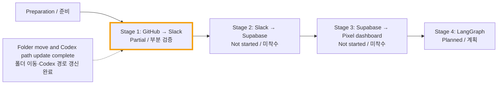
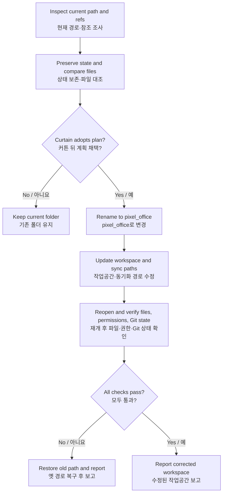
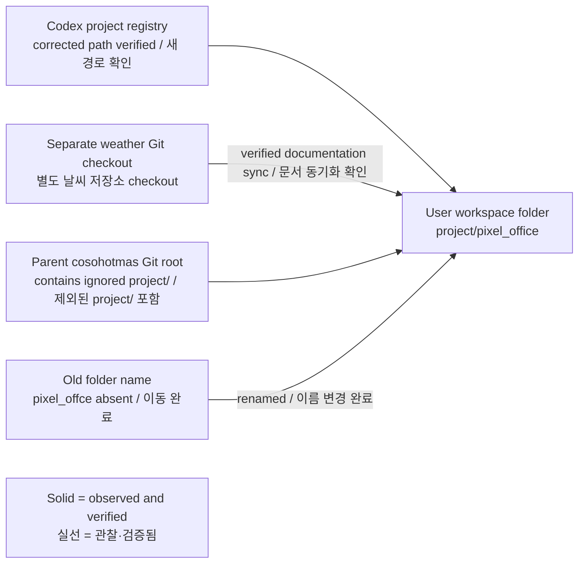

# 2026-11-21 `pixel_offce` → `pixel_office` folder-name review
# 2026-11-21 `pixel_offce` → `pixel_office` 폴더명 검토 회의

## Purpose and scope / 목적과 범위

Review the spelling correction and its likely side effects before any rename. No folder was renamed in this meeting.
폴더명을 바꾸기 전에 철자 수정과 예상 부작용을 검토합니다. 이번 회의에서는 폴더를 변경하지 않았습니다.

## Facts observed / 확인한 사실

- The configured workspace directory is named `project/pixel_offce`; the sibling `project/pixel_office` does not exist.
  설정된 작업공간 폴더는 `project/pixel_offce`이며 형제 경로 `project/pixel_office`는 없습니다.
- The parent Git root is the `cosohotmas` repository, and its `.gitignore` ignores `project/`. The `pixel_offce` directory is therefore not tracked by that parent repository; a directory rename there would not appear as a normal tracked Git rename.
  상위 Git 루트는 `cosohotmas` 저장소이고 `.gitignore`가 `project/`를 제외합니다. 따라서 `pixel_offce`는 상위 저장소에서 추적되지 않으며 폴더명 변경이 일반적인 Git rename으로 기록되지 않습니다.
- The active weather-service Git checkout is separate, on `codex/next-rollout-step`, with remote `cosohotmas/weather-conversation-app`. The user-facing directory is used as a workspace mirror for documentation.
  현재 날씨 서비스 Git checkout은 별도 임시 작업공간에 있으며 `codex/next-rollout-step` 브랜치 및 `cosohotmas/weather-conversation-app` 원격을 사용합니다. 사용자 화면 폴더는 문서 작업 사본으로 사용됩니다.
- The parent repository currently has an unrelated staged PDF and is one commit ahead of `origin/main`. Any rename operation must avoid touching that staged file or changing the parent repository state.
  상위 저장소에는 이번 작업과 무관한 PDF가 stage되어 있고 `origin/main`보다 커밋 1개 앞서 있습니다. 폴더 변경은 이 파일과 상위 저장소 상태를 건드리지 않아야 합니다.
- Repository instructions do not require the misspelled name. The name itself appears to be a spelling error; that judgment is an inference from `pixel_office` being the intended word and the user's correction request.
  저장소 규칙은 현재 오타 이름을 요구하지 않습니다. `pixel_office`가 의도한 영어 단어이고 사용자가 수정을 원한다는 점에서 오타로 판단하지만, 이는 추론입니다.

## Role-based discussion / 역할별 회의

| Who | What · 제안 | Why · 이유 | How · 방법 | Goal · 목표 | Conviction · 소신 |
|---|---|---|---|---|---|
| Tech Lead | Correct the typo, but only through a staged, verified workspace migration. 오타를 바로잡되 단계별 검증을 거쳐 작업공간을 이전합니다. | The directory is ignored by its parent Git repository and is also the configured workspace path. 상위 Git 저장소에서 제외된 폴더이면서 설정된 작업공간 경로입니다. | Inventory file identity, references, mirror sync target, and open-workspace configuration before moving it. 이동 전에 파일 동일성·경로 참조·문서 동기화 대상·열린 작업공간 설정을 조사합니다. | A corrected name without losing work or breaking the active workspace. 작업 손실이나 활성 작업공간 단절 없는 이름 수정입니다. | A direct filesystem rename is not enough to complete the migration. 파일시스템에서 이름만 바꾸는 것으로 이전이 끝나지 않습니다. |
| Full-stack | Keep the weather Git checkout and the user-facing workspace mirror distinction explicit. 날씨 Git checkout과 사용자 작업공간 사본을 구분합니다. | Their Git roots and purposes differ. 두 경로의 Git 루트와 역할이 다릅니다. | Confirm which path is the source of truth for edits and where approved files are mirrored after a rename. 수정 원본과 승인된 파일을 새 위치로 동기화할 대상을 확인합니다. | Predictable editing and synchronization. 예측 가능한 편집·동기화입니다. | Do not assume renaming the mirror renames or relocates the weather repository. 사본의 이름 변경이 날씨 저장소까지 이동시킨다고 가정하지 않습니다. |
| SecOps | Preserve the parent repository's staged PDF and current Git state. 상위 저장소의 stage된 PDF와 현재 Git 상태를 보존합니다. | Unrelated staged work must not be changed as collateral. 무관한 stage 작업이 부수적으로 바뀌면 안 됩니다. | Avoid broad `git add`, cleanup, or move commands at the parent root; inspect before/after status if a migration is later approved. 상위 루트에서 광범위한 `git add`·정리·이동을 피하고, 이후 이전이 승인되면 전후 상태를 확인합니다. | No accidental parent-repository mutation. 상위 저장소의 우발적 변경 방지입니다. | The ignored directory is not disposable just because Git ignores it. Git에서 제외된다고 해서 폴더를 버려도 되는 것은 아닙니다. |
| Art Director | Use `pixel_office` consistently in future user-facing labels after migration. 이전 후 사용자에게 보이는 이름을 `pixel_office`로 통일합니다. | The current spelling looks accidental and reduces clarity. 현재 표기는 오타로 보여 혼란을 줍니다. | Update links and path labels only after the destination is verified and the workspace has reopened correctly. 대상 경로와 작업공간 재개를 확인한 뒤 링크·경로 표시를 수정합니다. | One clear project name across the interface and docs. 화면과 문서에서 일관된 프로젝트 이름입니다. | Do not publish links to a destination that has not been verified. 확인하지 않은 경로를 안내 링크로 배포하지 않습니다. |
| Researcher | Search bounded project configuration and documentation references before moving. 이동 전에 프로젝트 설정과 문서 경로 참조를 범위 제한해 검색합니다. | A rename may leave stale paths in editor settings, scripts, tasks, shortcuts, or sync instructions. 이름 변경 후 편집기 설정·스크립트·작업·바로가기·동기화 지침에 옛 경로가 남을 수 있습니다. | Report each found reference and mark user-level application state that cannot be inspected as unknown. 발견한 참조를 보고하고 확인할 수 없는 사용자 앱 상태는 미확인으로 둡니다. | A complete, bounded impact list. 범위가 명확한 영향 목록입니다. | A project-only search cannot prove no reference exists anywhere on the computer. 프로젝트 내부 검색만으로 컴퓨터 전체에 참조가 없다고 증명할 수 없습니다. |
| Trend Analyst | Recommend a one-time coordinated rename after explicit adoption of the migration plan. 이전 계획을 명시적으로 채택한 뒤 한 번에 조정하여 변경할 것을 권고합니다. | Keeping a typo has ongoing friction, while an uncoordinated rename risks stale paths. 오타는 계속 혼란을 주지만 조정 없는 변경은 옛 경로 문제를 만듭니다. | Sequence: snapshot and compare, rename, update references/sync target, reopen workspace, verify repository and files, then report. 순서: 상태 보존·비교 → 이름 변경 → 참조·동기화 대상 수정 → 작업공간 재개 → 저장소·파일 검증 → 결과 보고입니다. | Minimal disruption with a clean final path. 중단을 최소화한 올바른 최종 경로입니다. | The correction is worthwhile; the operation should be reversible and checked. 수정할 가치는 있지만 되돌릴 수 있고 검증 가능한 방식이어야 합니다. |
| Legal | Avoid deleting the old path or overwriting an existing destination without a verified backup and identity check. 검증된 백업·동일성 확인 없이 옛 경로를 삭제하거나 기존 대상을 덮어쓰지 않습니다. | File loss or mistaken replacement is the main irreversible risk. 파일 손실이나 잘못된 덮어쓰기가 주요 비가역 위험입니다. | Confirm destination absence, compare file counts/checksums as appropriate, preserve recovery path until successful reopen. 대상 경로가 없는지 확인하고 필요하면 파일 수·체크섬을 대조하며 정상 재개 전까지 복구 경로를 보존합니다. | Recoverable, auditable change. 복구 가능하고 추적 가능한 변경입니다. | Do not treat an ignored directory as unimportant user data. ignore 폴더도 중요한 사용자 자료일 수 있습니다. |
| End User | Present the typo correction as a proposed convenience improvement and explain what the user may need to reopen. 오타 수정 제안과 사용자가 다시 열어야 할 수 있는 항목을 쉽게 설명합니다. | The user may have editor tabs, terminals, or shortcuts tied to the old location. 편집기 탭·터미널·바로가기가 옛 경로에 연결돼 있을 수 있습니다. | After an approved move, ask the user to reopen the corrected workspace if the application still points to the old path. 승인된 이전 뒤에도 앱이 옛 경로를 가리키면 새 작업공간을 다시 열도록 안내합니다. | The project opens normally under the corrected name. 수정된 이름으로 프로젝트를 정상적으로 엽니다. | A name correction should not silently disrupt the user's current session. 이름 수정이 현재 사용자 세션을 예고 없이 끊으면 안 됩니다. |

## Side effects and token impact / 부작용과 토큰 영향

- **Likely path effects:** Codex or editor workspace registration may keep the old absolute path; open terminals and file watchers may fail to resolve it after a move; scripts, shortcuts, sync routines, and links may become stale. Some running processes may continue using an already-open directory handle, while new path-based operations fail. These are possible impacts, not all confirmed in this environment.
  **예상 경로 영향:** Codex·편집기 작업공간 등록이 옛 절대 경로를 유지할 수 있고, 열린 터미널·파일 감시기가 이동 후 경로를 찾지 못할 수 있으며, 스크립트·바로가기·동기화·링크가 오래된 경로를 가리킬 수 있습니다. 이미 열린 디렉터리 핸들을 가진 프로세스는 계속 동작할 수도 있지만 새 경로 기반 작업은 실패할 수 있습니다. 모두 환경에서 확인된 문제는 아니며 가능한 영향입니다.
- **Git effects:** Because the parent repository ignores `project/`, the rename itself is not recorded there as a tracked rename. The separate weather-service checkout stays where it is unless deliberately moved. Its documentation mirror destination would need updating.
  **Git 영향:** 상위 저장소가 `project/`를 제외하므로 폴더명 변경은 추적되는 rename으로 기록되지 않습니다. 별도 날씨 저장소는 의도적으로 옮기지 않는 한 현 위치에 남고, 문서 동기화 대상은 갱신해야 합니다.
- **User data effects:** The destination does not currently exist. A rename should preserve contents, but active file handles, open tabs, permissions, symlinks, and app-level recent-workspace records need verification; none should be assumed safe without checking.
  **사용자 자료 영향:** 새 대상 경로는 현재 없습니다. 이름 변경은 내용을 보존해야 하지만 열린 파일 핸들·탭·권한·심볼릭 링크·앱의 최근 작업공간 기록을 확인해야 하며 검사 없이 안전하다고 단정할 수 없습니다.
- **Token/cost effects:** The rename itself does not inherently call an AI model or create an API charge. This investigation and any later path/reference audit consume model tokens; the amount cannot be stated exactly from the available evidence. Any separate hosted automation or API call would have its own cost, but none is part of this proposed rename.
  **토큰·비용 영향:** 폴더명 변경 자체가 AI 모델 호출이나 API 과금을 자동으로 만들지는 않습니다. 이번 조사와 추후 경로 검색에는 모델 토큰이 들며, 현재 근거로 정확한 양을 산출할 수 없습니다. 별도 호스팅 자동화나 API 호출에는 비용이 생길 수 있지만 이번 이름 변경 제안에는 포함되지 않습니다.

## Recommendation and decision status / 권고와 결정 상태

**Recommendation:** Correct the spelling to `pixel_office`, but only as a coordinated, reversible workspace migration. Before execution, inventory bounded references and mirror behavior, preserve current state, then rename and verify the workspace opens and documentation sync targets correctly. Keep the old path recoverable until verification succeeds.
**권고:** `pixel_office`로 철자를 수정하되 작업공간을 조정해 이전하는 방식으로 진행합니다. 실행 전 범위를 정해 경로 참조와 사본 동작을 조사하고 현재 상태를 보존한 뒤 이름을 바꾸며 작업공간 재개와 문서 동기화 대상을 확인합니다. 검증을 마칠 때까지 옛 경로를 복구 가능하게 둡니다.

**Decision:** Curtain adopted the recommendation. The folder move and Codex project-path refresh are both confirmed complete.
**결정:** 커튼 뒤가 권고를 채택했습니다. 폴더 이동과 Codex 프로젝트 경로 갱신이 모두 완료된 것을 확인했습니다.

## Execution result / 실행 결과

Moved `project/pixel_offce` to `project/pixel_office` with a no-overwrite move after confirming the destination was absent. The previous path is absent and the corrected path exists. A pre-move manifest contained 132 entries, including 108 files; every file SHA-256 and relative path matched after the move. No symlinks or files larger than 10 MB were found. The parent repository status is unchanged: `project/` is ignored, its unrelated PDF remains staged, and `main` remains one commit ahead. The separate weather-service Git checkout remains in place.
대상 경로가 없는 것을 확인하고 덮어쓰지 않는 방식으로 `project/pixel_offce`를 `project/pixel_office`로 옮겼습니다. 이전 경로는 없고 새 경로는 존재합니다. 이동 전 목록은 파일 108개를 포함한 132개 항목이며 이동 후 상대 경로와 모든 파일 SHA-256이 일치했습니다. 심볼릭 링크와 10MB 초과 파일은 없었습니다. 상위 저장소 상태는 그대로입니다. `project/`는 제외되고 무관한 PDF는 계속 stage 상태이며 `main`은 원격보다 1개 앞서 있습니다. 별도 날씨 서비스 Git checkout은 이동하지 않았습니다.

After the user reopened/updated the project, the supplied screenshots showed the `pixel_office` project and source-folder names. A read-only Codex project listing returned label `pixel_office` and the corrected path; it no longer returned the stale `pixel_offce` entry.
사용자가 프로젝트를 새 경로로 다시 열거나 갱신한 뒤 제공한 화면에서 프로젝트와 소스 폴더가 `pixel_office`로 표시됐습니다. 읽기 전용 Codex 프로젝트 목록도 이름 `pixel_office`와 새 경로를 반환했고 옛 `pixel_offce` 항목은 더 이상 반환하지 않았습니다.

## Mermaid views / Mermaid 시각화

### Overall rollout / 전체 도입 흐름

### Proposed rename sequence / 제안된 이름 변경 순서

### Workspace and repository relationship / 작업공간과 저장소 관계

## Next actions / 다음 작업

1. **Assistant:** Record the user's project-path update confirmation and leave the unrelated staged PDF untouched.
   **어시스턴트:** 사용자의 프로젝트 경로 갱신 확인을 기록하고 무관한 stage PDF는 그대로 둡니다.
2. **Curtain (user):** No additional path action is pending; continue work from the corrected project entry.
   **커튼 뒤(사용자):** 추가 경로 작업은 남지 않았으며 수정된 프로젝트 항목에서 작업을 이어갑니다.

## Sources and verification / 출처·검증

- Repository `AGENTS.md`: source comments require simple English followed by Korean translation; the meeting-record section specifies location/content but no English-only rule.
  저장소 `AGENTS.md`: 소스 주석은 쉬운 영어 뒤에 한국어 번역을 요구하며, 회의록 항목은 저장 위치·내용을 정할 뿐 영어 전용 규칙은 없습니다.
- Direct filesystem and Git observations: active checkout branch/remote; existing and absent folder names; parent root, ignore rule, staged PDF, and ahead status.
  파일시스템·Git 직접 확인: 활성 checkout 브랜치·원격, 폴더 존재 여부, 상위 루트·ignore 규칙·stage PDF·ahead 상태입니다.
- Project configuration search was bounded to named project configuration/documentation locations. It does not establish that no old path exists in all user-level app state or the whole computer.
  프로젝트 설정·문서 검색은 지정된 위치로 제한했습니다. 사용자 앱 상태 전체나 컴퓨터 어디에도 옛 경로가 없음을 입증하지 않습니다.
- No external material, code, dependency, or data was added. Mermaid rendering and application tests were not run. No folder operation or external configuration change was performed.
  외부 자료·코드·의존성·데이터를 추가하지 않았습니다. Mermaid 렌더링·앱 테스트는 하지 않았고 폴더 작업·외부 설정 변경도 수행하지 않았습니다.
