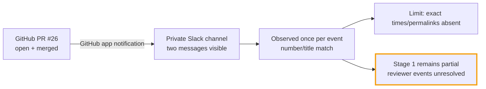

# PR #26 Slack 알림 근거 검토 회의

## 목적

사용자가 제공한 Slack 화면을 docs/office/stage1-notifications.md의 도입 1단계 이벤트 근거와 대조하고, 다음 확인 작업을 보고합니다. 이 기록은 회의 역할별 분석이며 독립 AI 에이전트가 실제로 발언했다는 뜻이 아닙니다. 커튼 뒤(사용자)는 별도 발언자로 만들지 않습니다.

## 근거·범위

- **관찰 사실:** 사용자 첨부 화면에 비공개 weather-conversation-app Slack 채널과 GitHub 앱 메시지 두 건이 보입니다.
- **관찰 사실:** 한 메시지는 PR #26 “docs: improve Mermaid workflow diagrams and reporting”가 cosohotmas에 의해 열렸다고 표시하고, 다른 메시지는 같은 PR이 병합됐다고 표시합니다.
- **관찰 사실:** 저장소·번호·제목은 PR #26의 확인된 병합 정보와 일치합니다.
- **한계:** 화면에는 두 메시지의 정확한 시각과 개별 Slack permalink가 모두 표시되지 않습니다. 전송 지연·정확한 순서 간격·알림 신뢰도를 수치화하지 않습니다.
- **한계:** 알림 수신은 코드 리뷰나 승인 리뷰가 아닙니다. 별도 리뷰어에 의존하는 이벤트는 계속 보류/미검증입니다.

## 역할별 회의

| Who | What · 제안 | Why · 이유 | How · 방법 | Goal · 목표 | 소신 · Conviction |
|---|---|---|---|---|---|
| Tech Lead | PR-open과 PR-merged 전달을 각각 1회 관찰로 기록 | 이벤트 전달과 전체 단계 완료를 구분해야 함 | PR 번호·제목·저장소 일치 및 스크린샷 한계를 기록 | 1단계 상태를 근거에 맞게 유지 | 이 근거만으로 1단계 전체 완료로 올리면 안 됨 |
| Full-stack | 기존 GitHub→Slack 구독 경로의 PR 알림 근거를 보강 | PR 생성·Merge는 서로 다른 이벤트 | 기존 PR #24 기록과 PR #26 스크린샷을 나란히 보존 | 반복된 이벤트 유형의 실제 수신 기록 | 설정 구현이나 안정성 시험을 했다고 표현하지 않음 |
| SecOps | 비공개 채널의 기존 수신 상태만 기록 | 화면은 권한 범위 변경 근거가 아님 | 잠금 표시와 화면에 보이는 채널만 서술 | 민감 정보·권한을 추정하지 않음 | 채널 공개 범위 변경이나 앱 권한 조정은 필요 근거가 없음 |
| Art Director | 가시 정보와 숨은 정보를 분리 | 읽기 쉬운 기록이 과도한 정밀도를 암시하지 않아야 함 | 번호·제목·열림/병합 문구를 쓰고 누락된 permalink·시각은 명시 | 누구나 근거 범위를 이해 | UI에 안 보이는 타임스탬프를 추정하지 않음 |
| Researcher | 사용자 제공 화면을 1차 관찰 근거로 표시 | Slack API/메시지 링크로 독립 재확인한 것이 아님 | 출처를 현재 대화의 사용자 첨부 화면으로 기록 | 증거 출처와 검증 한계 추적 | 스크린샷 이상으로 전달 지연이나 반복 신뢰성을 주장하지 않음 |
| Trend Analyst | 남은 이벤트 매트릭스 확인을 우선 제안 | 이미 관찰된 이벤트 반복보다 누락 이벤트가 다음 의사결정에 중요 | 리뷰 요청·승인 대기·독립 리뷰의 보류 사유를 갱신 | 1단계 완료 조건을 투명하게 유지 | 다음 작업은 미검증 공백 중심으로 정해야 함 |
| Legal | 화면 근거를 내부 기록에 최소한으로 설명 | 화면에 채널·계정 정보가 포함될 수 있음 | 스크린샷 파일 복제 없이 필요한 사실과 출처만 기록 | 불필요한 식별 정보 복제 방지 | 새 외부 자료가 없으므로 라이선스 근거를 꾸며내지 않음 |
| End User | 실제 채널에 PR 알림이 나타난 점을 확인 | 사용자는 GitHub 원본으로 연결되는 알림을 기대 | 두 메시지의 번호·상태·제목 일치만 확인 | PR 생성과 병합 소식을 Slack에서 알아볼 수 있음 | 알림을 받았다는 사실과 리뷰·승인은 명확히 구분해야 함 |

## 취합 결과

- **합치:** PR #26의 생성 및 병합 알림을 각각 단일 관찰로 기록합니다.
- **합치:** 화면에 보이지 않는 시각·링크·정확한 지연은 미확인으로 둡니다.
- **합치:** Issue 생성/종료 기존 수락 기록과 합쳐도 별도 리뷰 요청·독립 리뷰가 검증된 것은 아닙니다.
- **권고:** stage1-notifications.md의 현재 이벤트 상태를 갱신하고, 다음에는 남은 알림 범위와 현실적인 리뷰어 부재 처리 기준을 사용자에게 보고합니다. 새 Issue나 외부 Slack 메시지는 필요하지 않습니다.
- **미결정:** 별도 리뷰어를 구할 수 있을 때 어떤 리뷰 이벤트를 시험할지, 수동 실행 승인 알림을 필수 운영 이벤트로 둘지 여부.
- **상태:** 이 취합은 관찰 사실 기록과 권고입니다. 사용자 대신 정책을 채택하지 않습니다. 도입 1단계는 부분 검증입니다.

## 다음 작업

1. 어시스턴트: 첨부 화면의 관찰 범위와 남은 검증 공백을 커튼 뒤에게 보고합니다.
2. 커튼 뒤(사용자): 기록 결과를 검토하고 남은 1단계 범위와 우선순위를 결정합니다.
3. 어시스턴트: 채택된 범위만 후속 계획으로 작성합니다. 새 외부 시험이나 설정 변경은 별도 승인 전 실행하지 않습니다.

