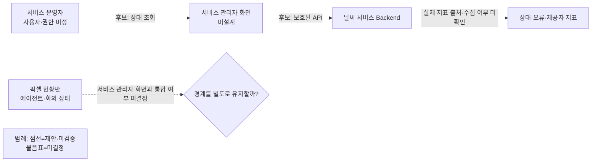

# 서비스 관리자 대시보드 브레인스토밍 회의

## 회의 목적

날씨 서비스 운영자가 사용할 서비스 관리자 대시보드의 목적과 초기 범위를 검토합니다. 기존 픽셀 현황판(에이전트·회의·지식 상태 시각화)과 무엇이 다른지, 어떤 데이터와 권한이 필요한지 논의합니다.

이 표는 저장소의 여덟 역할을 사용한 어시스턴트의 분석입니다. 각 역할이 독립된 실제 에이전트로 실행되거나 발언했다는 뜻은 아닙니다. 커튼 뒤는 보고를 받는 사용자이며 역할 표의 발언자로 만들지 않습니다.

## 확인한 사실

- PRD와 기획서에는 날씨 사용자 흐름, API 연동, 위치정보와 사용자 화면이 정의돼 있습니다.
- 조사한 문서에는 서비스 관리자 대시보드의 사용자, 기능, 데이터, 권한 또는 화면 범위가 아직 정의돼 있지 않습니다.
- 사무실 README의 픽셀 현황판은 에이전트 상태와 지식 연결을 보여주는 내부 관찰 화면으로 설명됩니다. 이는 날씨 서비스 관리자 기능과 목적이 다를 수 있습니다.
- 프로젝트 도입 단계는 GitHub→Slack 1단계 부분 검증입니다. 관리자 대시보드 논의는 구현이나 도입 단계 완료를 뜻하지 않습니다.

## 역할별 회의

| Who | What · 제안 | Why · 이유 | How · 방법 | Goal · 목표 | 소신 · Conviction |
|---|---|---|---|---|---|
| Tech Lead | 서비스 운영 대시보드와 픽셀 현황판을 별도 제품 경계로 우선 검토 | 두 화면은 대상 사용자와 데이터 목적이 다를 수 있음 | 각 화면의 사용자·원본 데이터·권한·운영 책임을 먼저 정의 | 중복 기능과 잘못된 시스템 경계 방지 | 날씨 서비스 운영 기능을 에이전트 현황판에 억지로 넣지 않음 |
| Full-stack | 초기 후보는 보호된 읽기 전용 운영 화면으로 좁힘 | 편집 기능은 서버 권한·감사·복구 요구를 추가 | API 상태, 제공자 마지막 성공 시각, 오류 요약 등 실제 수집 가능한 지표부터 목록화 | 운영자가 장애 징후를 안전하게 확인 | 요구사항과 데이터 경로가 확정되기 전 관리자 쓰기 API를 만들지 않음 |
| SecOps | 관리자 인증·역할·최소 권한을 화면보다 먼저 설계 | 관리자 화면은 위치·사용량·제공자 설정 같은 민감 데이터에 닿을 수 있음 | 서버 측 권한 확인, 민감 필드 최소 노출, 변경 작업에는 감사 기록 검토 | 허가된 운영자만 필요한 정보에 접근 | 프론트엔드 화면 숨김만으로 관리자 보안을 주장하지 않음 |
| Art Director | 내부 운영자용 정보 구조를 사용자 날씨 화면 및 픽셀 현황판과 시각적으로 구분 | 대상과 행동 목표가 다른 화면이 혼동될 수 있음 | 상태 요약, 경고, 상세 근거를 계층화하고 용어를 운영자 관점으로 검토 | 장애 상태와 조치 필요성을 빠르게 파악 | 대시보드라는 이름만으로 정보 우선순위를 정하지 않음 |
| Researcher | 실제 운영 질문과 사용할 수 있는 원본 지표를 조사한 뒤 화면 항목을 정함 | 현재 PRD에는 관리자 지표나 데이터 출처가 없음 | 백엔드 로그·모니터링·제공자 응답에서 확보 가능한 필드를 대조 | 화면 숫자가 근거 있는 값이 되도록 함 | 수집되지 않는 지표를 대시보드에 있다고 가정하지 않음 |
| Trend Analyst | MVP에서 전체 운영 플랫폼으로 범위가 커지는 것을 경계 | 사용자 관리·결제·실시간 로그·설정 편집은 서로 다른 제품 범위 | 운영자 작업 사례를 기준으로 필수/후속 후보를 분리 | 현재 날씨 MVP와 맞는 최소 범위 유지 | 후보 기능을 한 번에 관리자 포털로 묶지 않음 |
| Legal | 위치정보·사용자 식별정보 노출 여부와 보존 목적을 확인 | 운영 편의를 위해 개인정보를 과도하게 복제할 수 있음 | 집계 지표를 우선 검토하고 개인 단위 조회는 필요성과 권한·보존 기준을 따로 정의 | 목적에 맞는 최소 데이터 사용 | 대시보드 요구만으로 위치 이력 열람을 정당화하지 않음 |
| End User | 관리자 역할을 실제 사람과 업무로 구체화 | 서비스 운영자, 고객지원, 개발자는 필요한 화면과 권한이 다를 수 있음 | 대표 업무를 장애 확인·데이터 품질 확인·문의 대응 등으로 적고 우선순위화 | 사용자가 필요한 문제를 해결할 수 있는 화면 | 관리자의 역할과 하루 업무를 모른 채 메뉴를 설계하지 않음 |

## 쟁점과 브레인스토밍 결과

### 목적 후보

| 후보 | 초기 검토 | 미확인 사항 |
|---|---|---|
| 서비스 가용성·API 상태 확인 | 우선 후보 | 상태 정의, 지표 출처, 갱신 주기 |
| 기상 제공자 상태·마지막 성공 시각 | 우선 후보 | 제공자별 수집 가능 필드와 장애 판정 |
| 오류·요청량·응답 시간 요약 | 우선 후보 | 로그/메트릭 보유 여부와 집계 기간 |
| 사용자 계정·권한 관리 | 후속 후보 | 계정 체계, 역할, 승인 및 감사 흐름 |
| 사용자 위치·질문 내역 조회 | 보류 후보 | 운영 필요성, 동의, 최소화, 보존, 접근 감사 |
| 제공자·서비스 설정 변경 | 후속 후보 | 변경 위험, 검토·확인·롤백 방식 |
| 픽셀 에이전트·회의 현황 | 별도 목적 후보 | 픽셀 현황판의 현재 설계와 합칠 근거가 없음 |

### 잠정 권고

1. “서비스 관리자 대시보드”를 픽셀 현황판과 분리해 목적과 사용자를 정의합니다.
2. 첫 후보는 근거가 있는 서비스 상태·오류·제공자 상태를 보여주는 읽기 전용 화면으로 둡니다.
3. 사용자 개인 정보 열람이나 운영 설정 변경은 별도 필요성·권한·감사·복구 설계 전까지 포함하지 않습니다.
4. 화면에 넣을 지표, 갱신 주기, 경고 기준, 실제 데이터 원본은 아직 결정하지 않습니다.

이 항목은 회의 권고이며 사용자의 최종 채택 전에는 제품 요구사항이나 구현 승인으로 간주하지 않습니다.

## 커튼 뒤의 진행 순서 결정

실제 사용자 결정: “대쉬보드는 픽셀 현황판이 완성된 뒤 진행하는걸로”.

채택된 범위: 날씨 서비스 관리자 대시보드 작업은 픽셀 현황판 완성 이후에 시작합니다. 이 결정은 순서만 정합니다. 픽셀 현황판 완료의 세부 수락 기준, 서비스 관리자 대시보드 기능 범위, 두 화면을 분리할지 통합할지는 미결정입니다. 서비스 관리자 대시보드 구현은 후속 설계 회의와 범위 결정 전까지 시작하지 않습니다.

영향: 위의 즉시 착수 순서는 사용자 결정으로 대체됐습니다. 기존 역할별 의견은 검토 근거로 남기되, 잠정 읽기 전용 화면 권고를 채택 정책으로 취급하지 않습니다. 운영 연동 도입 단계는 변경되지 않습니다.

## 사용자 결정이 필요한 질문

1. 주 사용자: 1인 운영자, 개발자, 고객지원 담당자 중 누구인가?
2. 핵심 업무: 장애 확인, 제공자 데이터 품질 확인, 사용자 문의 대응 중 무엇이 우선인가?
3. 첫 버전: 읽기 전용 상태 화면부터 시작하는가?
4. 개인정보: 위치·질문 내역을 관리자에게 노출할 필요가 있는가? 필요하다면 어떤 권한·보존·감사 기준이 필요한가?
5. 픽셀 현황판과 별도 웹 화면으로 둘지, 같은 제품의 별도 영역으로 둘지?
6. 운영 지표가 현재 백엔드·호스팅에서 수집되고 있는가?

## 파일·승인 상태

- 커튼 뒤가 픽셀 현황판 완성 후 관리자 대시보드를 진행하도록 순서를 채택했습니다.
- 기능 범위·완료 기준·화면 통합 여부는 미결정이며 PRD, 아키텍처, 화면은 수정하지 않았습니다.
- 구현, 외부 설정, 데이터 수집, 커밋, Push, PR은 승인되지 않았습니다.

## Mermaid — 경계 후보

## 다음 작업

1. 어시스턴트: 역할별 취합 결과와 미결정 질문을 커튼 뒤에게 보고합니다.
2. 커튼 뒤(사용자): 목적·대상 사용자·초기 범위에 관한 권고를 채택하거나 수정합니다.
3. 어시스턴트: 채택된 범위에 한해 파일별 변경 계획을 보고합니다. 구현은 별도 승인 전 시작하지 않습니다.
