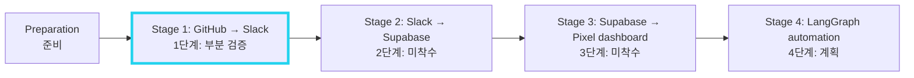
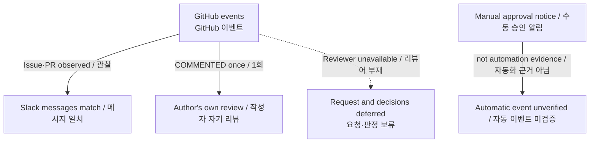
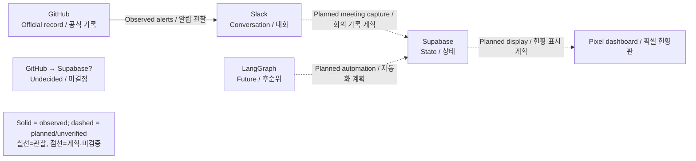

# 2026-11-21 Stage 1 event coverage and completion criteria meeting
# 2026-11-21 1단계 이벤트 범위·완료 조건 회의

## Meeting purpose / 회의 목적

Organize remaining Stage 1 events, evidence, and candidate completion criteria by role. This is a recommendation to Curtain, not a decision made on the user's behalf.
남은 1단계 이벤트·근거·완료 조건 후보를 역할별로 정리합니다. 커튼 뒤에게 제출하는 권고이며 사용자를 대신한 결정이 아닙니다.

## Participants / 참석 역할

The Assistant facilitated and recorded this review. The eight roles below are analysis perspectives, not eight independently present agents. Curtain is the actual user and report recipient; Curtain's views are not simulated in the role table.
어시스턴트가 검토를 진행하고 기록했습니다. 아래 여덟 역할은 분석 관점이며 실제로 참석한 독립 에이전트 여덟 명이 아닙니다. 커튼 뒤는 실제 사용자이자 보고 수신자이며 역할 표에 커튼 뒤의 발언을 만들어 넣지 않았습니다.

## Agenda / 의제

1. List Stage 1 GitHub event types and their Slack evidence.
   1단계 GitHub 이벤트 종류와 Slack 근거를 정리합니다.
2. Separate observed facts, assumptions, deferred tests, and unknown behavior.
   관찰 사실·가정·보류된 시험·미확인 동작을 구분합니다.
3. Recommend a completion threshold and identify the next owner.
   완료 근거 기준을 권고하고 다음 담당자를 정합니다.

## Facts and assumptions / 사실과 가정

**Facts:** Issue #23 create/close and PR #24 open/merge are recorded as successful observations. PR #26 opened/merged Slack messages are visible in the user's screenshot. One `COMMENTED` event was authored by the PR author. No separate reviewer is currently available for reviewer-request or independent-decision tests.
**사실:** Issue #23 생성·종료와 PR #24 생성·병합은 성공 관찰로 기록되어 있습니다. 사용자가 제공한 화면에는 PR #26 생성·병합 Slack 메시지가 보입니다. `COMMENTED` 한 건은 PR 작성자가 작성했습니다. 리뷰 요청이나 독립 판정 시험을 할 별도 리뷰어는 현재 없습니다.

**Assumption for this recommendation:** A delivery can count as evidence for its own event only when the GitHub event and Slack message can be matched; one match does not establish long-term reliability. This is a proposed evidence rule, not an adopted project policy.
**이번 권고의 가정:** GitHub 이벤트와 Slack 메시지를 서로 대조할 수 있을 때 해당 이벤트의 전달 근거로 셉니다. 한 번의 일치는 장기 신뢰성을 입증하지 않습니다. 이는 제안된 근거 규칙이며 채택된 프로젝트 정책은 아닙니다.

## Decision status / 결정 상태

On 2026-11-22, Curtain adopted the recommendation in this meeting. The mandatory baseline events are Issue opened, Issue closed, PR opened, and PR merged. Reviewer-request delivery and independent `APPROVE` / `REQUEST_CHANGES` remain deferred until a separate legitimate reviewer is available. Manual user-approval notifications are tracked separately from automated GitHub events.
2026-11-22 커튼 뒤가 이 회의의 권고를 채택했습니다. 필수 기본 이벤트는 Issue 생성, Issue 종료, PR 생성, PR 병합입니다. 리뷰 요청 전달과 독립 `APPROVE` / `REQUEST_CHANGES`는 정당한 별도 리뷰어를 확보할 때까지 보류합니다. 사용자 수동 승인 알림은 자동 GitHub 이벤트와 별도로 기록합니다.

For each mandatory event, record a matching GitHub source item/event and Slack message, including repository, item number/title, status, source link, event time and timezone, Slack permalink and displayed time, duplicate count, and verdict. One matched observation is the evidence threshold for recording delivery of that row; it does not establish latency, repeat reliability, or full service reliability. No latency or repeat-count target is adopted. Stage 1 remains partial until all four rows have matching evidence and Curtain accepts the result.
필수 이벤트마다 저장소·항목 번호/제목·상태·원본 링크·이벤트 시각과 시간대·Slack permalink와 표시 시각·중복 개수·판정을 포함해 GitHub 원본 이벤트와 Slack 메시지를 대조 기록합니다. 한 번의 일치 관찰은 해당 행의 전달을 기록하는 근거 기준일 뿐 지연 시간·반복 신뢰성·서비스 전체 신뢰성을 입증하지 않습니다. 지연 시간이나 반복 횟수 목표는 채택하지 않았습니다. 네 행 모두 대조 근거가 있고 커튼 뒤가 결과를 수락할 때까지 1단계는 부분 검증입니다.

## Rollout status / 도입 단계

- **Stage:** Stage 1, GitHub PR·Issue → Slack; partially verified.
  **단계:** GitHub PR·Issue → Slack 1단계, 부분 검증입니다.
- **Evidence:** Issue #23 create/close and PR #24 open/merge are recorded in the guide. The user's screenshot adds one observed Slack message each for PR #26 opened and merged. PR #24 `COMMENTED` delivery was observed once; the reviewer was the PR author.
  **근거:** Issue #23 생성·종료와 PR #24 생성·병합은 가이드에 기록되어 있습니다. 사용자 화면에서 PR #26 생성·병합 Slack 메시지를 각각 한 번 확인했습니다. PR #24의 `COMMENTED` 전달도 한 번 관찰했으며 리뷰 작성자는 PR 작성자 본인입니다.
- **Unverified:** Review-request delivery and independent `APPROVE` / `REQUEST_CHANGES` remain deferred because no separate reviewer is available. Automated approval-waiting notification, device push, read status, latency/SLA, and repeat reliability are unverified.
  **미검증:** 별도 리뷰어가 없어 리뷰 요청 전달과 독립 `APPROVE` / `REQUEST_CHANGES`는 보류입니다. 자동 승인 대기 알림·기기 푸시·읽음·지연/SLA·반복 신뢰성도 미검증입니다.
- **Next rollout action:** Prepare the event-by-event test plan. Curtain reviews the plan before any external test; external execution needs separate explicit approval.
  **다음 도입 작업:** 이벤트별 시험 계획을 작성합니다. 외부 시험 전 커튼 뒤가 계획을 검토하며, 외부 실행은 별도의 명시적 승인을 받아야 합니다.

## Event and evidence inventory / 이벤트·근거 목록

| Event / 이벤트 | Status / 상태 | Evidence and limit / 근거와 한계 |
|---|---|---|
| Issue opened / created Issue 생성 | Mandatory; one accepted observation exists 필수·수락된 1회 관찰 있음 | Issue #23 and Slack creation message match; one observation does not prove reliability. Issue #23과 Slack 생성 알림이 일치합니다. 1회 관찰로 신뢰성이 입증되지는 않습니다. |
| Issue closed Issue 종료 | Mandatory; one accepted observation exists 필수·수락된 1회 관찰 있음 | Issue #23 closure thread matches the closed Issue. Issue #23 종료 스레드가 실제 종료 상태와 일치합니다. |
| PR opened PR 생성 | Mandatory; PR #24 record plus PR #26 screenshot/read-only evidence 필수·PR #24 기록과 PR #26 화면/읽기 전용 근거 | Repository, number, and title match. PR #26 screenshot alone lacks exact timestamp and permalink; read-only channel record supplies the permalink and displayed time. 저장소·번호·제목이 일치합니다. PR #26 화면만으로는 정확한 시각과 permalink가 없지만 읽기 전용 채널 기록에 permalink와 표시 시각이 있습니다. |
| PR merged PR 병합 | Mandatory; PR #24 record plus PR #26 screenshot/read-only evidence 필수·PR #24 기록과 PR #26 화면/읽기 전용 근거 | Merge state/message match; no latency or reliability claim. 병합 상태와 메시지가 일치합니다. 지연·신뢰성 수치는 주장하지 않습니다. |
| Review comment (`COMMENTED`) 리뷰 댓글 | Observed once 1회 관찰 | PR #24 review and Slack message match; author reviewed own PR, so this is not independent review or approval. PR #24 리뷰와 Slack 메시지가 일치하지만 작성자의 자기 PR 댓글이며 독립 리뷰·승인이 아닙니다. |
| Review requested 리뷰 요청 | Deferred / unverified 보류·미검증 | No separate reviewer is available; channel delivery is unverified. 별도 리뷰어가 없어 채널 전달을 확인하지 못했습니다. |
| `APPROVE` decision `APPROVE` 판정 | Deferred / unverified 보류·미검증 | Requires a legitimate separate reviewer; none was submitted or inferred. 정당한 별도 리뷰어가 필요하며 제출·추정하지 않았습니다. |
| `REQUEST_CHANGES` decision `REQUEST_CHANGES` 판정 | Deferred / unverified 보류·미검증 | Requires a legitimate separate reviewer; none was submitted or inferred. 정당한 별도 리뷰어가 필요하며 제출·추정하지 않았습니다. |
| User execution-approval waiting 사용자 실행 승인 대기 | Manual baseline accepted; automation unverified 수동 기준 수락·자동화 미검증 | Manual notification and Codex response are recorded separately; they do not prove automatic delivery. 수동 알림과 Codex 응답은 별도로 기록되어 있으며 자동 전달의 증거가 아닙니다. |
| Device push / read / latency / repeat reliability 기기 푸시·읽음·지연·반복 신뢰성 | Unverified 미검증 | Existing records establish none of these measurements; no numeric thresholds are invented. 기존 기록으로는 어느 항목도 측정되지 않았으며 숫자 기준을 임의로 만들지 않습니다. |

## Role-based discussion / 역할별 회의

| Who | What · 제안 | Why · 이유 | How · 방법 | Goal · 목표 | Conviction · 소신 |
|---|---|---|---|---|---|
| Tech Lead | Keep Stage 1 partial until required events and evidence are adopted. 필수 이벤트와 근거를 채택할 때까지 1단계를 부분 상태로 둡니다. | Event observations do not equal end-to-end completion. 이벤트 관찰은 종단 완료와 다릅니다. | Separate observed, accepted, deferred, and unverified; keep `COMMENTED` separate from approval. 관찰·수락·보류·미검증을 나누고 `COMMENTED`와 승인을 구분합니다. | Evidence-based completion decision. 근거에 따른 완료 판정입니다. | One screenshot or delivery cannot prove the whole integration or reliability. 화면 한 장이나 전달 한 번으로 전체 연동·신뢰성을 입증할 수 없습니다. |
| Full-stack | Track each GitHub event and Slack counterpart separately. GitHub 이벤트와 Slack 대응 메시지를 각각 기록합니다. | Issue, PR, comment, request, and decision are distinct events. Issue·PR·댓글·요청·판정은 서로 다른 이벤트입니다. | Match number, status, title, repository and visible link; note missing evidence. 번호·상태·제목·저장소·보이는 링크를 대조하고 근거 누락을 씁니다. | Reproducible event-to-message evidence. 재현 가능한 이벤트-메시지 근거입니다. | An existing comment is not a new test or a submitted review request. 기존 댓글은 신규 시험이나 리뷰 요청 제출이 아닙니다. |
| SecOps | Keep current channel and permissions unchanged. 현재 채널과 권한을 그대로 둡니다. | This review does not authorize installation, invitations, or broader access. 이번 검토는 설치·초대·권한 확대를 승인하지 않습니다. | Use existing records; seek separate authorization before access changes or external tests. 기존 기록을 사용하고 권한 변경·외부 시험은 별도 승인을 받습니다. | Least-change handling of access. 접근 범위를 최소 변경합니다. | Reviewer absence is not permission to bypass review protections. 리뷰어 부재가 보호 절차 우회를 허가하지 않습니다. |
| Art Director | Label states as observed once, accepted, deferred, or unverified. 상태를 1회 관찰·수락·보류·미검증으로 표시합니다. | “Done” can make partial coverage look complete. ‘완료’ 표시는 부분 검증을 전체 완료처럼 보이게 할 수 있습니다. | Put the state next to each event and its evidence limit. 이벤트별 상태와 근거 한계를 나란히 표시합니다. | Clear status reporting. 명확한 상태 보고입니다. | Do not mark unresolved coverage as complete. 미해결 범위를 완료로 표시하지 않습니다. |
| Researcher | Cite the owning guide, GitHub/Slack records, or user's screenshot. 담당 가이드·GitHub/Slack 기록·사용자 화면을 출처로 표시합니다. | Claim precision depends on evidence provenance. 주장의 정밀도는 근거 출처에 달려 있습니다. | Use exact links when available; state that PR #26 time/permalink are absent. 가능하면 정확한 링크를 쓰고 PR #26 시각·permalink 누락을 밝힙니다. | Traceable claims with clear limits. 한계가 분명하고 추적 가능한 주장입니다. | Do not infer latency, SLA, or repeat reliability. 지연·SLA·반복 신뢰성을 추정하지 않습니다. |
| Trend Analyst | Ask whether reviewer-dependent events are required now or deferred. 리뷰어 의존 이벤트를 지금 필수로 할지 보류할지 묻습니다. | This scope choice determines whether reviewer absence blocks Stage 1. 범위 결정에 따라 리뷰어 부재가 1단계를 막는지가 달라집니다. | Present the coverage benefit and the need for a legitimate reviewer to Curtain. 검토 범위의 이점과 정당한 리뷰어 필요성을 커튼 뒤에게 제시합니다. | Feasible, explicit acceptance scope. 실행 가능하고 명시적인 수락 범위입니다. | Industry practice must not silently set this project's criteria. 업계 관행이 이 프로젝트의 기준을 대신 정하면 안 됩니다. |
| Legal | Keep only necessary evidence and do not duplicate screenshot identities. 필요한 근거만 남기고 화면의 식별 정보를 복제하지 않습니다. | Screenshots may contain identifying details; no external material is added. 화면에는 식별 정보가 있을 수 있고 외부 자료는 추가되지 않습니다. | Link to records; mark new-material license review not applicable. 기록을 링크하고 신규 자료 라이선스 검토는 해당 없음으로 표시합니다. | Minimize unnecessary personal/license claims. 불필요한 개인정보·라이선스 주장을 줄입니다. | Do not claim legal verification that did not occur. 실제로 하지 않은 법률 검증을 주장하지 않습니다. |
| End User | Define completion by whether the intended recipient gets a usable alert. 수신자가 실제로 활용할 알림을 받는지를 완료 기준 후보로 둡니다. | The message should identify the GitHub item and its status. 메시지는 GitHub 항목과 상태를 식별해야 합니다. | Match channel message to source; label manual approval notices separately. 채널 메시지를 원본과 대조하고 수동 승인 알림은 별도 표시합니다. | User can find and follow the event in Slack. 사용자가 Slack에서 이벤트를 확인하고 원본을 따라갈 수 있습니다. | Receiving an alert is not approving, reviewing, or reading it. 알림 수신은 승인·리뷰·읽음과 다릅니다. |

## Combined findings submitted to Curtain / 커튼 뒤에게 제출하는 취합 결과

1. **Observed:** Issue create/close, PR open/merge, and one author-created `COMMENTED` event have evidence; PR #26 adds one screenshot observation each for open and merge.
   **관찰:** Issue 생성·종료, PR 생성·병합, 작성자의 `COMMENTED` 1회 근거가 있습니다. PR #26 화면에서 생성·병합 메시지를 각각 한 번 더 관찰했습니다.
2. **Deferred:** Review request and independent `APPROVE` / `REQUEST_CHANGES` remain deferred because a separate reviewer is unavailable. This is not pass, failure, waiver, or completion.
   **보류:** 별도 리뷰어가 없어 리뷰 요청과 독립 `APPROVE` / `REQUEST_CHANGES`는 보류입니다. 통과·실패·면제·완료를 뜻하지 않습니다.
3. **Not established:** Automated approval notification, device push, read status, exact latency, and repeat reliability.
   **미확인:** 자동 승인 알림·기기 푸시·읽음·정확한 지연·반복 신뢰성입니다.
4. **Adopted recommendation:** The required rows are Issue opened/closed and PR opened/merged. Match each GitHub event to Slack evidence; keep manual and automated paths distinct. Do not invent numeric latency or repetition thresholds.
   **권고 채택:** 필수 행은 Issue 생성/종료와 PR 생성/병합입니다. GitHub 이벤트마다 Slack 근거를 대조하고 수동·자동 흐름을 구분합니다. 지연·반복 횟수 기준을 임의로 정하지 않습니다.
5. **Decision status:** Adopted by Curtain on 2026-11-22; Stage 1 remains partially verified.
   **결정 상태:** 2026-11-22 커튼 뒤가 채택했으며 1단계는 부분 검증 상태입니다.

## Mermaid views / Mermaid 시각화

### Overall rollout / 전체 도입 흐름

### Stage 1 evidence flow / 1단계 근거 흐름

### Target architecture status / 목표 아키텍처 상태

## Open questions / 미결정 질문

- The mandatory four-event baseline, reviewer-dependent deferral, manual-notice separation, and no numeric latency/repeat target were resolved by Curtain's adoption on 2026-11-22.
  필수 네 이벤트, 리뷰어 의존 이벤트 보류, 수동 알림 분리, 숫자 지연/반복 기준 미설정은 2026-11-22 커튼 뒤의 채택으로 결정됐습니다.
- The event-by-event test plan and resulting evidence reconciliation remain open.
  이벤트별 시험 계획과 그에 따른 근거 대조는 아직 남아 있습니다.

## Next actions / 다음 작업

1. **Curtain adopted the recommendation on 2026-11-22.** The Assistant records the decision in the guide, workflow, README, and conversation log.
   **커튼 뒤가 2026-11-22 권고를 채택했습니다.** 어시스턴트가 지침·workflow·README·대화 로그에 기록합니다.
2. **Assistant:** Prepare a test plan for the four mandatory events and identify evidence fields and test boundaries.
   **어시스턴트:** 필수 네 이벤트의 시험 계획을 작성하고 근거 필드와 시험 경계를 명시합니다.
3. **Curtain:** Review the test plan. Any external test requires separate explicit execution approval.
   **커튼 뒤:** 시험 계획을 검토합니다. 외부 시험에는 별도의 명시적 실행 승인이 필요합니다.

## Sources and verification / 출처·검증

- [Stage 1 notification guide](../stage1-notifications.md): Issue #23, PR #24, and reviewer investigation.
  [1단계 알림 가이드](../stage1-notifications.md): Issue #23·PR #24·리뷰어 조사 기록입니다.
- [PR #26 evidence review](./2026-11-21-pr26-slack-evidence-review.md): screenshot evidence and limitations.
  [PR #26 근거 검토](./2026-11-21-pr26-slack-evidence-review.md): 화면 근거와 한계입니다.
- User-provided screenshot in this conversation shows PR #26 opened and merged notifications.
  현재 대화의 사용자 제공 화면에 PR #26 생성·병합 알림이 보입니다.
- No external material, code, dependency, or data was added. License review for new material is not applicable. Mermaid rendering and application tests were not run. No external test, permission change, commit, Push, or PR was performed.
  외부 자료·코드·의존성·데이터는 추가하지 않았습니다. 신규 자료 라이선스 검토는 해당 없음입니다. Mermaid 렌더링·앱 테스트는 하지 않았고 외부 시험·권한 변경·커밋·Push·PR도 진행하지 않았습니다.
