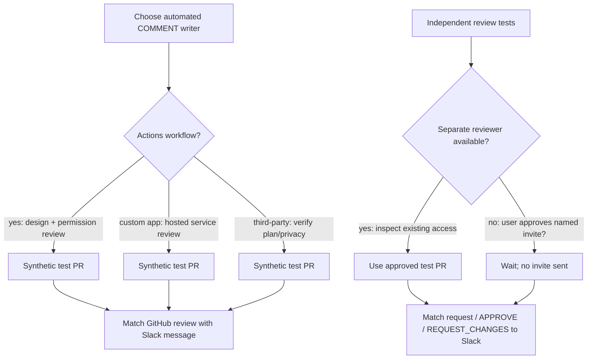

# 2026-11-22 Review automation and independent reviewer meeting
# 2026-11-22 리뷰 자동화와 독립 리뷰어 회의

## Purpose / 목적

Discuss who or what should write the required automated `COMMENT` review and how to obtain a reviewer who is separate from the pull request author for `APPROVE` and `REQUEST_CHANGES` tests.
필수 자동 `COMMENT` 리뷰를 어떤 자동화가 작성할지, `APPROVE`와 `REQUEST_CHANGES` 시험에서 PR 작성자와 다른 리뷰어를 어떻게 확보할지 논의합니다.

## Participants / 참석자

The Assistant organized the evidence and proposals. The role names below are analysis perspectives, not separate agents. Curtain is the actual decision maker. No decision or personal view is attributed to Curtain unless Curtain states it.
어시스턴트가 근거와 제안을 정리했습니다. 아래 역할명은 분석 관점이며 별도 에이전트가 아닙니다. 커튼 뒤가 실제 결정자입니다. 커튼 뒤가 직접 말하지 않은 결정이나 개인 의견을 대신 기록하지 않습니다.

## Agenda / 의제

1. Compare realistic sources for an automated `COMMENT` review.
   자동 `COMMENT` 리뷰를 작성할 현실적인 주체를 비교합니다.
2. Identify a safe way to obtain an independent reviewer.
   독립 리뷰어를 안전하게 확보하는 방법을 찾습니다.
3. Separate recommendations from decisions and identify required approvals.
   권고와 결정을 구분하고 필요한 승인을 정리합니다.

## Facts / 사실

- The tracked `.github/workflows/quality-check.yml` runs on `push`, `pull_request`, and manual dispatch. It has `contents: read`; it does not listen for review events or submit reviews.
  추적 중인 `.github/workflows/quality-check.yml`은 `push`, `pull_request`, 수동 실행에서 동작합니다. 권한은 `contents: read`이며 리뷰 이벤트를 듣거나 리뷰를 제출하지 않습니다.
- The 2026-11-20 candidate review shortlisted Gemini API plus a custom GitHub App for a synthetic-data test. It left hosting cost, app selection as a reviewer, review-request compatibility, Slack delivery, and private-code processing terms open. That was a shortlist, not an adopted design.
  2026-11-20 후보 검토는 합성 데이터 시험용으로 Gemini API와 자체 GitHub App 조합을 우선 후보로 두었습니다. 호스팅 비용·앱을 리뷰어로 지정할 수 있는지·리뷰 요청 호환성·Slack 전달·비공개 코드 처리 조건은 미결정이었습니다. 이는 후보 목록이며 채택된 설계가 아닙니다.
- The prior read-only collaborator check recorded only `cosohotmas`, who was also the PR author and repository admin. It found no separate reviewer at that time. No new access check was performed for this meeting.
  이전 조회 전용 협업자 확인에는 PR 작성자이자 저장소 관리자인 `cosohotmas`만 기록되어 있고 당시 별도 리뷰어는 발견되지 않았습니다. 이번 회의에서 접근 목록을 새로 조회하지 않았습니다.
- Curtain adopted all four review-related notifications as mandatory tests. Adoption does not implement the automation or supply a reviewer.
  커튼 뒤는 리뷰 관련 네 알림을 필수 시험으로 채택했습니다. 채택만으로 자동화가 구현되거나 리뷰어가 생기지는 않습니다.

## Role-based discussion / 역할별 논의

| Who | What · 제안 | Why · 이유 | How · 방법 | Goal · 목표 | Conviction · 소신 |
|---|---|---|---|---|---|
| Tech Lead | Keep the review writer separate from the quality-check workflow until its role and permissions are designed. 역할과 권한을 설계할 때까지 리뷰 작성기를 품질 검사 workflow와 분리합니다. | The existing workflow only checks code and docs; it does not submit reviews. 기존 workflow는 코드·문서를 검사할 뿐 리뷰를 제출하지 않습니다. | Compare a purpose-built Actions workflow with a hosted GitHub App before implementation. 구현 전에 전용 Actions workflow와 호스팅 GitHub App을 비교합니다. | A review path that can be tested end to end. 종단 간 시험 가능한 리뷰 경로입니다. | A green CI result must not be mistaken for a review or Slack notification. 초록 CI 결과를 리뷰나 Slack 알림으로 오해하면 안 됩니다. |
| Full-stack | Keep test PRs separate from production changes and use synthetic diffs first. 시험 PR을 실제 변경과 분리하고 먼저 합성 diff를 사용합니다. | Model input and review submission create different risks. 모델 입력과 리뷰 제출에는 서로 다른 위험이 있습니다. | Trigger manually for the first test, restrict the target repository/PR, and prevent bot self-trigger loops. 첫 시험은 수동 실행하고 저장소/PR 대상을 제한하며 봇 재실행 루프를 막습니다. | Predictable, bounded test behavior. 예측 가능하고 범위가 제한된 시험 동작입니다. | Never let a bot review its own generated commit as an independent approval. 봇이 만든 커밋을 봇 스스로 독립 승인하게 하지 않습니다. |
| SecOps | Compare token scope, model data handling, and secret storage before selecting the writer. 작성 주체를 정하기 전에 토큰 범위·모델 데이터 처리·비밀값 저장을 비교합니다. | A private repository diff and write-capable token may leave GitHub or alter review state. 비공개 저장소 diff와 쓰기 토큰은 GitHub 밖으로 나가거나 리뷰 상태를 바꿀 수 있습니다. | Use least privilege, synthetic data, hosted secrets, and an explicit review of provider terms. 최소 권한·합성 데이터·호스팅 비밀 저장소·제공자 조건 확인을 적용합니다. | No surprise disclosure or broad write access. 예상하지 못한 정보 공개나 광범위한 쓰기 권한 방지입니다. | Do not add an app, secret, collaborator, or permission without separate approval. 별도 승인 없이 앱·비밀값·협업자·권한을 추가하지 않습니다. |
| QA | Treat `COMMENT`, review request, `APPROVE`, and `REQUEST_CHANGES` as four distinct events. `COMMENT`, 리뷰 요청, `APPROVE`, `REQUEST_CHANGES`를 서로 다른 네 이벤트로 다룹니다. | One Slack message cannot prove every event type. Slack 메시지 하나가 모든 이벤트 종류를 입증하지 않습니다. | Match each GitHub event, actor/reviewer, PR and source link with its own Slack message permalink and result. GitHub 이벤트·작성자/리뷰어·PR·원본 링크를 각각 Slack permalink·결과와 대조합니다. | One evidence row per required event. 필수 이벤트마다 근거 행 하나입니다. | Missing evidence stays unverified; do not infer it from CI checks. 근거가 없으면 미검증으로 두고 CI 검사에서 추정하지 않습니다. |
| Operations | Compare online hosting and ongoing cost for each automation option. 자동화 선택지마다 온라인 호스팅과 지속 비용을 비교합니다. | A local process cannot meet the online-first project rule; free trials may expire. 로컬 실행은 온라인 기반 원칙을 충족하지 않으며 무료 체험은 끝날 수 있습니다. | Verify hosted runtime, quotas, recurring cost and failure handling before adopting a provider. 제공자를 채택하기 전에 호스팅 실행 환경·한도·반복 비용·실패 처리를 확인합니다. | A sustainable online test path. 지속 가능한 온라인 시험 경로입니다. | “Free today” is not proof of a free ongoing service. “오늘 무료”가 계속 무료라는 증거는 아닙니다. |
| Researcher | Reuse the 2026-11-20 candidate findings as a starting point, then verify current official details before selection. 2026-11-20 후보 조사 결과를 출발점으로 삼고 선택 전에 공식 최신 정보를 확인합니다. | Pricing, plan features and data terms may change. 요금·요금제 기능·데이터 조건은 바뀔 수 있습니다. | Check official pricing, review API support, reviewer assignment, Slack event behavior and model data terms. 공식 요금·리뷰 API·리뷰어 지정·Slack 이벤트 동작·모델 데이터 조건을 확인합니다. | Evidence-backed option comparison. 근거에 따른 선택지 비교입니다. | Do not present an old shortlist as a current verified recommendation. 과거 후보를 현재 검증된 권고처럼 제시하지 않습니다. |
| Curtain / 커튼 뒤 | **Decision pending:** choose the automation direction and reviewer-acquisition route. **결정 대기:** 자동화 방향과 리뷰어 확보 방식을 선택합니다. | Not stated by Curtain. 커튼 뒤가 이유를 따로 밝히지 않았습니다. | Not stated by Curtain. 커튼 뒤가 방법을 따로 밝히지 않았습니다. | Not stated by Curtain. 커튼 뒤가 목표를 따로 밝히지 않았습니다. | Not stated by Curtain. 커튼 뒤가 소신을 따로 밝히지 않았습니다. |

## Options and recommendation / 선택지와 권고

### Automated `COMMENT` writer / 자동 `COMMENT` 작성 주체

1. **GitHub Actions workflow:** runs in GitHub-hosted infrastructure and lives with the repository. It needs a designed trigger, narrowly scoped PR-write permission, secret handling, safe treatment of untrusted PR diffs, and a loop guard. The existing quality workflow does none of this.
   **GitHub Actions workflow:** GitHub 호스팅 환경에서 실행되고 저장소 안에서 관리됩니다. 실행 조건·최소 PR 쓰기 권한·비밀값 처리·신뢰하지 않는 PR diff 보호·재실행 방지 설계가 필요합니다. 기존 품질 검사 workflow에는 이 기능이 없습니다.
2. **Custom GitHub App plus hosted service:** was shortlisted earlier for a synthetic-data test. It needs an online host, app installation and permissions, token management, provider-cost/data-term review, and proof that Slack receives each review type.
   **자체 GitHub App과 호스팅 서비스:** 이전에 합성 데이터 시험 후보로 선정됐습니다. 온라인 호스트·앱 설치와 권한·토큰 관리·제공자 비용/데이터 조건 검토·각 리뷰 종류의 Slack 수신 증거가 필요합니다.
3. **Existing third-party reviewer app:** may be considered only after confirming current private-repository support, all required review states, cost and data processing. The earlier candidate review did not establish those requirements.
   **기존 외부 리뷰 앱:** 비공개 저장소 지원·필수 리뷰 상태 전체·비용·데이터 처리를 확인한 뒤에만 검토할 수 있습니다. 이전 후보 조사는 이 요건을 확인하지 못했습니다.

**Recommendation:** Do not choose a provider or build yet. First compare options against online operation, continuing cost, private-code handling, minimum permissions, and support for all required review events. If a technical trial is later approved, use synthetic diffs and a test PR. This recommendation is not Curtain's decision.
**권고:** 아직 제공자를 선택하거나 구현하지 않습니다. 온라인 운영·지속 비용·비공개 코드 처리·최소 권한·필수 리뷰 이벤트 전체 지원을 기준으로 먼저 비교합니다. 나중에 기술 시험을 승인받으면 합성 diff와 시험 PR을 사용합니다. 이 권고는 커튼 뒤의 결정이 아닙니다.

### Independent reviewer / 독립 리뷰어

1. **Existing trusted collaborator:** ask Curtain to identify a real person who is not the PR author; then inspect that person's existing repository access read-only.
   **기존 신뢰 협업자:** 커튼 뒤가 PR 작성자가 아닌 실제 사람을 지정한 뒤 해당 사람의 기존 저장소 권한을 읽기 전용으로 확인합니다.
2. **New collaborator:** if no suitable person already has access, Curtain identifies and approves the person and access scope before an invitation. Do not send an invitation or change permissions as part of this meeting.
   **새 협업자:** 적합한 기존 권한자가 없으면 커튼 뒤가 대상자와 접근 범위를 정하고 초대 전에 승인합니다. 이 회의에서는 초대나 권한 변경을 하지 않습니다.
3. **No reviewer available:** leave review-request and independent decision cases required but unverified. Do not substitute the PR author or an automated bot for an independent human decision.
   **리뷰어 없음:** 리뷰 요청과 독립 판정 시험은 필수·미검증으로 둡니다. PR 작성자나 자동 봇을 독립된 사람의 판정으로 대신하지 않습니다.

**Recommendation:** Prefer an already trusted, eligible human collaborator if one exists. If not, Curtain decides whether to approve inviting a specific person with the minimum needed access. Until then, the four review-related tests remain blocked/unverified; no waiver is proposed.
**권고:** 적격한 신뢰 협업자가 이미 있다면 그 사람을 우선합니다. 없다면 커튼 뒤가 특정 인물의 최소 접근 권한 초대를 승인할지 결정합니다. 그때까지 리뷰 관련 네 시험은 차단/미검증 상태이며 면제를 제안하지 않습니다.

## Mermaid decision flow / Mermaid 결정 흐름

## Decisions and open questions / 결정과 미결정 질문

- **Decision:** none. This meeting records recommendations only. The prior 2026-11-20 shortlist remains a candidate, not an adopted implementation.
  **결정:** 없습니다. 이 회의는 권고만 기록합니다. 2026-11-20 후보 목록은 채택된 구현이 아니라 후보입니다.
- Which `COMMENT` writer should be evaluated: GitHub Actions, custom GitHub App plus hosted service, or a verified third-party app?
  자동 `COMMENT` 작성 주체로 GitHub Actions, 자체 GitHub App과 호스팅 서비스, 검증된 외부 앱 중 무엇을 평가할까요?
- Must the writer meet a continuing zero-cost limit, and is synthetic-only processing required until data terms are accepted?
  지속 비용 0원을 필수로 할까요? 데이터 조건을 확인할 때까지 합성 데이터만 처리해야 할까요?
- Does Curtain have a trusted separate reviewer already, or should a specific new collaborator be considered? What minimum access is acceptable?
  커튼 뒤에게 이미 신뢰하는 별도 리뷰어가 있나요, 아니면 새 협업자를 검토할까요? 허용 가능한 최소 권한은 무엇인가요?
- Is the intended reviewer a human collaborator for independent decisions, while automation is limited to `COMMENT`? This boundary should be explicit.
  자동화는 `COMMENT`만 작성하고 독립 판정은 실제 사람 협업자가 맡는 것이 의도인가요? 이 경계를 명시해야 합니다.

## Sources / 출처

- Current repository workflow: [`.github/workflows/quality-check.yml`](../../../.github/workflows/quality-check.yml). It is the source for the current trigger and permission facts.
  현재 저장소 workflow: [`.github/workflows/quality-check.yml`](../../../.github/workflows/quality-check.yml). 현재 실행 조건·권한 사실의 출처입니다.
- Prior candidate comparison: [2026-11-20 online AI reviewer candidates](2026-11-20-online-ai-reviewer-candidates.md). Its shortlist is historical and needs current revalidation before adoption.
  기존 후보 비교: [2026-11-20 온라인 AI 리뷰어 후보](2026-11-20-online-ai-reviewer-candidates.md). 후보 목록은 과거 자료이며 채택 전에 최신 재확인이 필요합니다.
- Prior access and review facts: [2026-11-19 review notification planning](2026-11-19-review-notification-planning.md). The collaborator result is historical, not a current access query.
  기존 접근·리뷰 사실: [2026-11-19 리뷰 알림 계획](2026-11-19-review-notification-planning.md). 협업자 조회는 과거 결과이며 현재 권한 조회가 아닙니다.
- Previously linked official references: [Gemini pricing/data terms](https://ai.google.dev/gemini-api/docs/pricing), [GitHub review API](https://docs.github.com/en/rest/pulls/reviews#create-a-review-for-a-pull-request), and the official GitHub/Copilot and CodeRabbit pages listed in the prior candidate meeting. Recheck current details before selecting a provider.
  이전 회의에 연결된 공식 자료: [Gemini 요금/데이터 조건](https://ai.google.dev/gemini-api/docs/pricing), [GitHub 리뷰 API](https://docs.github.com/en/rest/pulls/reviews#create-a-review-for-a-pull-request), 이전 후보 회의의 GitHub/Copilot 및 CodeRabbit 공식 페이지. 제공자를 고르기 전에 최신 내용을 다시 확인합니다.

## Next actions / 다음 작업

1. Curtain adopts, revises or rejects the recommendations and answers the open questions.
   커튼 뒤가 권고를 채택·수정·반려하고 미결정 질문에 답합니다.
2. Assistant updates the owning Stage 1 guide and workflow with the decision. Provider and reviewer details stay marked open until decided.
   어시스턴트가 결정을 담당 1단계 지침과 workflow에 반영합니다. 제공자와 리뷰어 정보는 결정 전까지 미결정으로 둡니다.
3. Any app installation, collaborator invitation, permission change, live PR test, or Slack message requires separate explicit authorization.
   앱 설치·협업자 초대·권한 변경·실제 PR 시험·Slack 메시지는 각각 별도 명시적 승인이 필요합니다.

## Rollout status / 도입 단계

Stage 1, GitHub → Slack, remains partially verified. No automated review writer is implemented in the tracked workflow. No separate reviewer was found in the historical access check. Next: Curtain decides the automation direction and reviewer route; no implementation or access change is authorized by this discussion.
1단계 GitHub → Slack은 부분 검증입니다. 추적 중인 workflow에는 자동 리뷰 작성기가 없습니다. 과거 권한 확인에서 별도 리뷰어를 찾지 못했습니다. 다음은 커튼 뒤가 자동화 방향과 리뷰어 확보 방식을 결정하는 것입니다. 이 논의만으로 구현이나 접근 권한 변경을 승인하지 않습니다.
