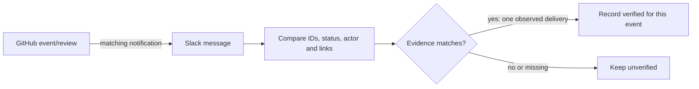

# 2026-11-22 Review notification scope adoption
# 2026-11-22 리뷰 알림 범위 채택

## Purpose / 목적

Record Curtain's selection to include automated review comments and review-request/decision notifications in the mandatory Stage 1 test scope.
자동 리뷰 코멘트와 리뷰 요청·판정 알림을 1단계 필수 시험 범위에 포함한다는 커튼 뒤의 선택을 기록합니다.

## Participants and role fields / 참석자와 역할 항목

Curtain is the actual user and decision maker. The Assistant records the decision and updates the owning documents. No unspoken opinion is attributed to Curtain.
커튼 뒤는 실제 사용자이자 결정자입니다. 어시스턴트는 결정을 기록하고 담당 문서를 갱신합니다. 커튼 뒤가 말하지 않은 의견은 덧붙이지 않습니다.

| Who | What | Why | How | Goal | Conviction (소신) |
|---|---|---|---|---|---|
| Curtain / 커튼 뒤 | **Decision:** Include automated review comments, review requests, approvals, and change requests in required tests. **결정:** 자동 리뷰 코멘트, 리뷰 요청, 승인, 수정 요청을 필수 시험에 포함합니다. | Not stated by Curtain. 커튼 뒤가 이유를 따로 밝히지 않았습니다. | Not stated by Curtain. 커튼 뒤가 방법을 따로 밝히지 않았습니다. | Not stated by Curtain. 커튼 뒤가 목표를 따로 밝히지 않았습니다. | Not stated by Curtain. 커튼 뒤가 소신을 따로 밝히지 않았습니다. |
| Assistant / 어시스턴트 | Update the Stage 1 guide, workflow, meeting record, and change log to reflect the adopted scope. 채택된 범위를 반영해 1단계 지침·workflow·회의록·변경 로그를 갱신합니다. | Existing documents deferred some events, which conflicts with the new selection. 기존 문서는 일부 이벤트를 보류해 새 선택과 맞지 않습니다. | List each event separately and mark absent evidence as unverified. 이벤트를 각각 나열하고 근거가 없으면 미검증으로 표시합니다. | Make the required tests and remaining evidence gaps clear. 필수 시험과 남은 근거 공백을 명확히 합니다. | Never claim a test passed without matching GitHub and Slack evidence. GitHub와 Slack 근거를 대조하지 않고 시험 통과를 주장하지 않습니다. |

## Adopted scope / 채택 범위

The required events are: Issue opened, Issue closed, PR opened, PR merged, an Actions-submitted `COMMENT` review, review requested, an independent `APPROVE` review, and an independent `REQUEST_CHANGES` review. A normal review comment from the PR author does not by itself prove that Actions submitted a `COMMENT` review or that an independent reviewer made a decision.
필수 이벤트는 Issue 생성, Issue 종료, PR 생성, PR 병합, Actions가 제출한 `COMMENT` 리뷰, 리뷰 요청, 독립 리뷰어의 `APPROVE` 리뷰, 독립 리뷰어의 `REQUEST_CHANGES` 리뷰입니다. PR 작성자의 일반 리뷰 코멘트만으로는 Actions가 `COMMENT` 리뷰를 제출했거나 독립 리뷰어가 판정했다고 입증되지 않습니다.

Each event needs a matching GitHub source and Slack message. Record the repository, item number/title, event or review status, actor/reviewer, source link, event time/timezone, Slack permalink/display time, duplicate count, and verdict. Missing evidence stays unverified. A single match proves one observed delivery only, not reliability or delivery speed. Independent review tests require a legitimate separate reviewer; this decision does not authorize creating one or changing access.
각 이벤트는 GitHub 원본과 Slack 메시지를 대조해야 합니다. 저장소·항목 번호/제목·이벤트 또는 리뷰 상태·작성자/리뷰어·원본 링크·이벤트 시각/시간대·Slack permalink/표시 시각·중복 수·판정을 기록합니다. 근거가 없으면 미검증으로 둡니다. 한 번의 일치는 전달 한 건만 입증하며 신뢰성이나 속도를 증명하지 않습니다. 독립 리뷰 시험에는 정당한 별도 리뷰어가 필요합니다. 이 결정은 리뷰어를 새로 만들거나 접근 권한을 바꾸도록 승인하지 않습니다.

## Decision and next actions / 결정과 다음 작업

**Decision:** Curtain explicitly selected the expanded mandatory scope in the current conversation on 2026-11-22. The earlier four-event baseline is superseded for current planning; its dated record remains as history.
**결정:** 커튼 뒤가 2026-11-22 현재 대화에서 확장된 필수 범위를 명시적으로 선택했습니다. 이전 네 이벤트 기준은 현재 계획에서 대체되며, 날짜가 있는 과거 기록은 이력으로 보존합니다.

1. Assistant updates the owning guide and rollout workflow with all eight rows.
   어시스턴트가 담당 지침과 도입 workflow에 여덟 항목을 모두 반영했습니다.
2. Assistant prepares a per-event test/evidence plan and inspects the tracked workflow; no external event is triggered.
   어시스턴트가 이벤트별 시험·근거 계획을 작성하고 추적 중인 workflow를 확인했습니다. 외부 이벤트는 발생시키지 않았습니다.
3. Assistant checks the plan's scope, matching evidence, and side effects. The plan is ready for user review, but live execution is still unapproved.
   어시스턴트가 계획의 범위·근거 대조·외부 영향 여부를 확인했습니다. 계획은 사용자 검토에 올릴 수 있지만 실제 실행은 아직 승인되지 않았습니다.
4. Curtain decides whether to authorize live tests. A separate explicit approval is required because tests can create GitHub activity, send Slack messages, or involve another reviewer.
   커튼 뒤가 실제 시험 실행을 승인할지 결정합니다. 시험은 GitHub 활동을 만들거나 Slack 메시지를 보내고 다른 리뷰어를 참여시킬 수 있어 별도의 명시적 승인이 필요합니다.

## Rollout status / 도입 단계

Stage 1, GitHub → Slack, remains partially verified. The adopted scope has eight event rows; review-related rows still need evidence, and independent decisions need a separate reviewer. The tracked repository workflow does not submit review comments, so that test needs a separate implementation or approved source. The plan was reviewed for readiness; live testing remains unapproved. Next actor: Curtain decides whether to authorize execution.
1단계 GitHub → Slack은 부분 검증 상태입니다. 채택된 범위는 여덟 이벤트이며 리뷰 관련 항목은 아직 근거가 필요하고 독립 판정에는 별도 리뷰어가 필요합니다. 저장소 workflow는 리뷰 코멘트를 제출하지 않으므로 별도 구현이나 승인된 제출 주체가 필요합니다. 계획의 실행 준비 상태는 점검했지만 실제 시험은 승인되지 않았습니다. 다음 담당자는 커튼 뒤이며 실행을 승인할지 결정합니다.
