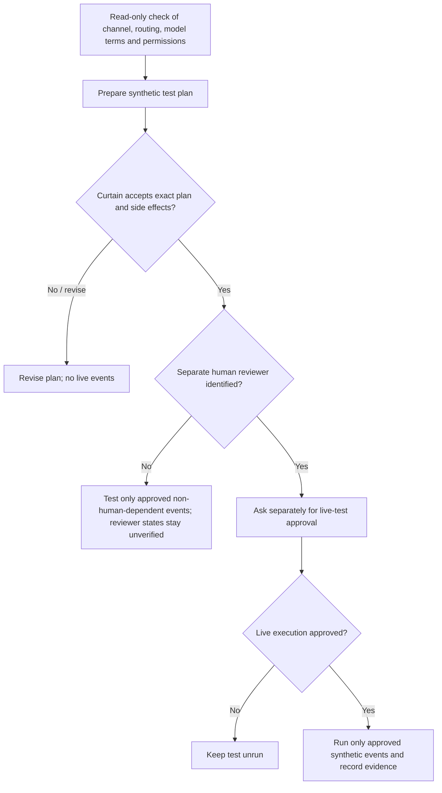

# 2026-11-23 Particle-1 review and Slack test plan meeting
# 2026-11-23 Particle-1 리뷰와 Slack 시험 계획 회의

## Purpose / 목적

Prepare an easy-to-check plan for a possible Stage 1 GitHub-to-Slack integration test, then leave the live-test decision until the plan and side effects are reviewed.
1단계 GitHub→Slack 실제 연동 시험을 할 경우를 위한 쉬운 시험 계획을 만들고, 계획과 변경 영향을 확인한 뒤 실제 시험 여부를 결정하도록 합니다.

## Participants / 참석자

The role names are analysis perspectives, not separate people or quoted statements. Curtain is the actual user and decision maker. This record reflects Curtain's proposal to use Particle-1 and the pictured channel; it does not invent further personal opinions.
역할명은 분석 관점이며 별도 참석자나 실제 발언 인용이 아닙니다. 커튼 뒤가 실제 사용자이자 결정자입니다. 이 회의록은 Particle-1과 화면에 나온 채널을 사용하자는 커튼 뒤의 제안을 반영하며 다른 개인 의견을 만들어 쓰지 않습니다.

| Who | What | Why | How | Goal | Conviction (소신) |
|---|---|---|---|---|---|
| Curtain / 커튼 뒤 | Proposed Particle-1 and the pictured `#weather-conversation-app` as the reviewer candidate and test destination. 리뷰 후보로 Particle-1, 시험 장소로 화면의 `#weather-conversation-app`을 제안했습니다. | Wants to settle the remaining test plan and then decide about execution. 남은 시험 계획을 정리한 뒤 실행 여부를 결정하려 합니다. | Review the concrete event list and its effects before deciding. 구체적인 이벤트 목록과 영향을 확인한 뒤 결정합니다. | Know exactly what the test would do. 시험이 무엇을 하는지 정확히 파악합니다. | Final live-test decision is not stated yet. 실제 시험 최종 결정은 아직 나오지 않았습니다. |
| Tech Lead / 기술 책임 | Treat Particle-1 as the automated review model candidate, not automatically as a human independent reviewer. Particle-1은 자동 리뷰 모델 후보로 다루며 사람 독립 리뷰어로 자동 간주하지 않습니다. | The adopted Stage 1 criteria distinguish automated `COMMENT` from independent reviewer decisions. 채택된 1단계 기준은 자동 `COMMENT`와 독립 리뷰어 판정을 구분합니다. | Verify the exact GitHub review object and actor for each event. 이벤트마다 실제 GitHub 리뷰 객체와 작성 주체를 확인합니다. | Keep the test result aligned with the adopted definition. 시험 결과를 채택된 정의에 맞춥니다. | A model-generated comment alone cannot prove a human `APPROVE` or `REQUEST_CHANGES`. 모델 댓글만으로 사람의 `APPROVE`나 `REQUEST_CHANGES`를 입증할 수 없습니다. |
| Full-stack / 풀스택 | Separate model output, GitHub review submission and Slack delivery into three checkpoints. 모델 응답·GitHub 리뷰 제출·Slack 전달을 세 확인 지점으로 나눕니다. | Each can succeed or fail independently. 각 단계는 서로 따로 성공하거나 실패할 수 있습니다. | Record the model name/version, GitHub event/state and Slack permalink. 모델명/버전·GitHub 이벤트/상태·Slack permalink를 기록합니다. | Locate failures without guessing. 추측하지 않고 실패 지점을 찾습니다. | Do not call ordinary PR conversation text a submitted review. 일반 PR 대화 댓글을 제출된 리뷰라고 부르지 않습니다. |
| QA / 품질 확인 | Use a separate checklist row for every required event. 필수 이벤트마다 별도 확인 행을 씁니다. | One message cannot prove several event types. 메시지 하나로 여러 이벤트 유형을 입증할 수 없습니다. | Match GitHub source, event, actor, time, Slack message, duplicate count and result. GitHub 원본·이벤트·작성자·시각·Slack 메시지·중복 횟수·결과를 대조합니다. | Produce evidence that can be independently rechecked. 다시 확인할 수 있는 근거를 남깁니다. | Missing evidence remains unverified. 근거가 없으면 미검증으로 둡니다. |
| SecOps / 보안 담당 | Limit the model input to synthetic code and confirm provider data handling before sending it. 모델 입력을 합성 코드로 제한하고 전송 전에 제공자 데이터 처리를 확인합니다. | A free token price does not decide privacy or retention terms. 토큰 가격이 무료여도 개인정보·보존 조건이 해결되는 것은 아닙니다. | Use a bounded test diff, minimum GitHub permissions, and a stop condition for unexpected access or cost. 범위가 작은 시험 diff와 최소 GitHub 권한을 쓰고 예상 밖 접근·비용 발생 시 중단합니다. | Avoid private-code exposure and surprise charges. 비공개 코드 유출과 예상 못한 비용을 막습니다. | No real private diff or paid service before a separate review and approval. 별도 검토·승인 전에는 실제 비공개 diff나 유료 서비스를 쓰지 않습니다. |
| Operations / 운영 담당 | Confirm that the chosen Slack channel receives the intended GitHub app events. 선택한 Slack 채널이 의도한 GitHub 앱 이벤트를 받는지 확인합니다. | A visible past message does not prove every subscription or event route. 과거 메시지가 보인다고 모든 구독·이벤트 경로가 입증되지는 않습니다. | Check current routing read-only before any event is generated. 이벤트를 만들기 전에 현재 전달 설정을 읽기 전용으로 확인합니다. | Send test messages only to the intended place. 시험 메시지가 의도한 곳에만 가도록 합니다. | Do not change channel/app settings without separate approval. 별도 승인 없이 채널/앱 설정을 바꾸지 않습니다. |
| Release / 배포 담당 | Keep a synthetic test isolated from `main`. 합성 시험을 `main`에서 격리합니다. | A merge is a repository change and should not be an incidental test step. 병합은 저장소 변경이므로 시험 중 우연히 발생하면 안 됩니다. | Use a disposable test branch/PR only after its effects are approved; never merge to `main` for this test. 영향을 승인받은 뒤 폐기 가능한 시험 브랜치/PR을 쓰며 이 시험을 위해 `main`에 병합하지 않습니다. | Preserve the live project state. 실제 프로젝트 상태를 보호합니다. | Any push, PR, merge, review or issue creation is an external side effect requiring explicit go-ahead. push·PR·merge·리뷰·Issue 생성은 명시적 실행 승인 전에는 하지 않습니다. |
| Repository Admin / 저장소 관리자 | Confirm whether Particle-1 can submit the exact required GitHub `COMMENT` review and whether its bot identity can be assigned as reviewer. Particle-1이 필요한 GitHub `COMMENT` 리뷰를 제출할 수 있는지, 봇 계정을 리뷰어로 지정할 수 있는지 확인합니다. | The model name alone does not establish GitHub integration capability. 모델명만으로 GitHub 연동 기능이 확인되는 것은 아닙니다. | Inspect the selected connector, its permissions, actor identity and review API behavior. 선택한 연결 도구·권한·작성자 식별·리뷰 API 동작을 확인합니다. | Avoid conflating an AI service with a GitHub actor or a human reviewer. AI 서비스와 GitHub 작성자 및 사람 리뷰어를 혼동하지 않습니다. | Keep unsupported states explicitly unverified. 지원 여부가 확인되지 않은 상태는 미검증으로 둡니다. |

## Facts / 사실

- Curtain selected Particle-1 for further synthetic model evaluation in the earlier meeting. That selection did not prove GitHub review submission or Slack delivery.
  앞선 회의에서 커튼 뒤는 합성 모델 평가용으로 Particle-1을 선택했습니다. 그 선택은 GitHub 리뷰 제출이나 Slack 전달을 입증하지 않습니다.
- The screenshot shows the private Slack channel `#weather-conversation-app` and GitHub app messages for PR activity. It is reasonable to use this as the proposed destination, but it does not prove all eight event routes work there.
  화면에는 비공개 Slack 채널 `#weather-conversation-app`과 PR 활동에 대한 GitHub 앱 메시지가 보입니다. 이를 수신 장소 후보로 삼을 수 있지만 여덟 이벤트 경로가 모두 작동한다고 입증하지는 않습니다.
- The adopted Stage 1 event set is Issue opened/closed, PR opened/merged, Actions-submitted review `COMMENT`, review requested, independent `APPROVE`, and independent `REQUEST_CHANGES`.
  채택된 1단계 이벤트는 Issue 생성/종료, PR 생성/병합, Actions 제출 리뷰 `COMMENT`, 리뷰 요청, 독립 `APPROVE`, 독립 `REQUEST_CHANGES`입니다.
- Repository evidence reviewed earlier says the tracked quality-check workflow does not submit a review. Whether another installed tool can create the required review remains unverified.
  앞서 확인한 저장소 근거에 따르면 현재 추적된 품질 검사 workflow는 리뷰를 제출하지 않습니다. 설치된 다른 도구가 필요한 리뷰를 만들 수 있는지는 미검증입니다.
- Under the currently adopted wording, independent `APPROVE` and `REQUEST_CHANGES` require a legitimate reviewer distinct from the PR author. Particle-1 is an AI model, not a human; it cannot satisfy that human-independent-review requirement unless Curtain explicitly changes the criterion.
  현재 채택된 표현에서 독립 `APPROVE`와 `REQUEST_CHANGES`는 PR 작성자와 다른 정당한 리뷰어가 필요합니다. Particle-1은 AI 모델이지 사람이 아니므로, 커튼 뒤가 기준을 명시적으로 바꾸지 않는 한 사람 독립 리뷰 요건을 충족하지 않습니다.
- No GitHub issue, branch, PR, review, Slack message, app setting or permission has been created or changed for this meeting.
  이번 회의에서 GitHub Issue·브랜치·PR·리뷰·Slack 메시지·앱 설정·권한을 만들거나 바꾸지 않았습니다.

## Proposed test plan / 제안 시험 계획

The steps below describe a possible test only. Each GitHub action and resulting Slack message changes external state. Do not execute them until Curtain reviews the exact list and separately approves live execution.
아래 단계는 가능한 시험을 설명할 뿐입니다. 각 GitHub 동작과 그에 따른 Slack 메시지는 외부 상태를 바꿉니다. 커튼 뒤가 정확한 목록을 검토하고 실제 실행을 별도 승인하기 전에는 수행하지 않습니다.

| Step | What would happen in simple words | What to compare in GitHub and Slack | State |
|---|---|---|---|
| 1. Read-only check / 읽기 전용 확인 | Confirm the repository, the `#weather-conversation-app` destination, current event routing, Particle-1 provider terms/free limits, and available permissions. 저장소·`#weather-conversation-app` 수신 위치·현재 이벤트 전달·Particle-1 제공자 조건/무료 한도·필요 권한을 확인합니다. | Confirm the exact channel and app; make no settings change and send no event. 정확한 채널과 앱을 확인하되 설정 변경이나 이벤트 전송은 하지 않습니다. | Not done / 미실시 |
| 2. Prepare synthetic change / 합성 변경 준비 | Prepare a tiny harmless test change and a disposable test branch/PR plan. 해가 없는 아주 작은 시험 변경과 폐기 가능한 시험 브랜치/PR 계획을 준비합니다. | Ensure the diff contains no private code, secrets or location data; specify cleanup and do not target `main` for merging. diff에 비공개 코드·비밀값·위치 정보가 없는지 확인하고 정리 방법을 정하며 `main` 병합을 목표로 하지 않습니다. | Not done / 미실시 |
| 3. Test basic notifications / 기본 알림 시험 | If approved, create/close a test Issue and open a synthetic PR. 승인되면 시험 Issue를 생성/종료하고 합성 PR을 엽니다. | For each action, match the GitHub item number/title/state to one Slack message; record timestamps, permalink and duplicates. 각 동작마다 GitHub 항목 번호/제목/상태와 Slack 메시지 하나를 대조하고 시각·permalink·중복을 기록합니다. | Not run / 미실행 |
| 4. Test Particle-1 review COMMENT / Particle-1 리뷰 COMMENT 시험 | If a supported and approved connector exists, ask Particle-1 to review only the synthetic diff. 지원되고 승인된 연결 방식이 있으면 Particle-1이 합성 diff만 리뷰하게 합니다. | Verify GitHub shows a submitted review with state `COMMENT` and the expected actor; then locate the matching Slack alert in the selected channel. A plain PR conversation comment does not count. GitHub에 상태 `COMMENT`인 제출 리뷰와 예상 작성자가 표시되는지 확인한 뒤 선택 채널에서 대응 Slack 알림을 찾습니다. 일반 PR 대화 댓글은 해당하지 않습니다. | Capability unverified / 기능 미검증 |
| 5. Test review request / 리뷰 요청 시험 | Request a review only from an eligible, identified reviewer or supported bot account. 자격과 신원이 확인된 리뷰어 또는 지원되는 봇 계정에만 리뷰를 요청합니다. | Match the GitHub requested-reviewer record to its separate Slack message and actor. GitHub의 리뷰 요청 기록을 별도 Slack 메시지 및 작성자와 대조합니다. | Reviewer identity unresolved / 리뷰어 신원 미결정 |
| 6. Test independent decisions / 독립 판정 시험 | A person other than the PR author submits `APPROVE`, then `REQUEST_CHANGES`, if that person is identified and agrees. 별도로 지정된 사람이 동의한 경우 PR 작성자와 다른 사람이 `APPROVE`, 이어서 `REQUEST_CHANGES`를 제출합니다. | Verify each GitHub review state and reviewer identity separately, then match each Slack message. Particle-1 alone cannot stand in for the human under the current rule. GitHub 리뷰 상태와 리뷰어 신원을 각각 확인하고 각 Slack 메시지와 대조합니다. 현재 규칙에서 Particle-1만으로 사람 리뷰어를 대신할 수 없습니다. | Blocked on human / 사람 리뷰어 대기 |
| 7. Test merge notification / 병합 알림 시험 | Only if still needed and separately approved, merge a synthetic PR into an isolated non-main test branch; do not merge into `main`. 필요하고 별도 승인된 경우에만 합성 PR을 격리된 비-main 시험 브랜치에 병합합니다. | Confirm the target branch and merge state in GitHub, then match the Slack message. If no safe isolated base exists, leave this event untested. GitHub에서 대상 브랜치와 병합 상태를 확인한 뒤 Slack 메시지를 대조합니다. 안전한 격리 대상이 없으면 이 이벤트는 미시험으로 둡니다. | Not run / 미실행 |
| 8. Report and decide / 보고 후 결정 | Summarize pass/fail/unverified per event and ask whether the evidence is accepted. 이벤트별 통과/실패/미검증을 정리하고 근거를 수락할지 확인합니다. | A successful event proves only that observed delivery once; it does not prove repeat reliability or complete Stage 1. 이벤트 한 번의 성공은 관찰된 전달만 입증하며 반복 신뢰성이나 1단계 전체 완료를 뜻하지 않습니다. | After approved run / 승인된 실행 후 |

## Recommendation / 권고

Accept Particle-1 as the **automated review model candidate** and `#weather-conversation-app` as the **proposed test destination**, subject to read-only confirmation of current routing. Do not label Particle-1 an independent human reviewer. Keep the independent `APPROVE` and `REQUEST_CHANGES` tests blocked until a separate human reviewer is identified, unless Curtain explicitly revises the adopted Stage 1 rule. First review the exact test plan and side effects; only then decide whether to authorize any live test.
Particle-1은 **자동 리뷰 모델 후보**, `#weather-conversation-app`은 현재 전달 경로를 읽기 전용으로 확인한다는 조건으로 **시험 수신 장소**로 정리할 것을 권고합니다. Particle-1을 사람 독립 리뷰어라고 부르지 않습니다. 별도 사람 리뷰어가 정해질 때까지 독립 `APPROVE`와 `REQUEST_CHANGES` 시험은 보류하며, 커튼 뒤가 채택된 1단계 규칙을 명시적으로 바꾸는 경우는 예외입니다. 먼저 정확한 시험 계획과 영향을 확인하고, 그 다음 실제 시험 허가 여부를 결정합니다.

## Decision / 결정

Curtain approved the test on 2026-11-23. The read-only preflight found that `gh` has no valid GitHub authentication in this environment; both configured accounts report invalid tokens and GitHub API reads fail. The workspace `.env` contains an `OPENROUTER_API_KEY` entry, but its value was not read or printed. No GitHub or Slack event was created, and no model call was made. Execution is blocked until GitHub access is restored and the read-only preflight can confirm the repository/channel route. The human-independent-review requirement remains distinct: Particle-1 is an AI model and cannot by itself satisfy the current human reviewer rule for `APPROVE` and `REQUEST_CHANGES`.
커튼 뒤가 2026-11-23 시험을 승인했습니다. 읽기 전용 사전 확인에서 이 환경의 `gh`에 유효한 GitHub 인증이 없는 것을 확인했습니다. 설정된 두 계정 모두 토큰이 유효하지 않다고 보고했고 GitHub API 조회도 실패했습니다. 작업공간 `.env`에 `OPENROUTER_API_KEY` 항목이 있는 것은 확인했지만 값은 읽거나 출력하지 않았습니다. GitHub·Slack 이벤트를 만들지 않았고 모델 호출도 하지 않았습니다. GitHub 접근을 복구하고 읽기 전용 사전 확인으로 저장소/채널 전달 경로를 확인할 때까지 실행은 막혀 있습니다. 사람 독립 리뷰 요건은 별개입니다. Particle-1은 AI 모델이므로 현재 규칙의 `APPROVE`·`REQUEST_CHANGES` 사람 리뷰어를 혼자 대신할 수 없습니다.

## Mermaid decision flow / Mermaid 결정 흐름

## Sources / 출처

- Curtain's current instruction and the attached Slack screenshot showing `#weather-conversation-app` and GitHub app PR notifications.
  커튼 뒤의 현재 지시와 `#weather-conversation-app` 및 GitHub 앱 PR 알림이 보이는 첨부 Slack 화면입니다.
- [Stage 1 event scope and completion rules](../workflow.md) and [review automation meeting](2026-11-23-review-automation-and-independent-reviewer-meeting.md).
  [1단계 이벤트 범위·완료 규칙](../workflow.md)과 [리뷰 자동화 회의록](2026-11-23-review-automation-and-independent-reviewer-meeting.md)입니다.

## Rollout status / 도입 단계

Stage 1 remains partially verified and unchanged. Curtain approved the test, but live execution is blocked by invalid GitHub CLI authentication; no GitHub/Slack events or model calls occurred. Next rollout action: restore GitHub CLI access, repeat read-only preflight, then run only the approved synthetic events that do not require an unavailable human reviewer.
1단계는 부분 검증 상태이며 변경 없습니다. 커튼 뒤가 시험을 승인했지만 GitHub CLI 인증이 유효하지 않아 실제 실행이 막혀 있습니다. GitHub/Slack 이벤트나 모델 호출은 없었습니다. 다음 도입 작업은 GitHub CLI 접근을 복구하고 읽기 전용 사전 확인을 다시 한 뒤, 확보할 수 없는 사람 리뷰어가 필요하지 않은 승인된 합성 이벤트만 실행하는 것입니다.
