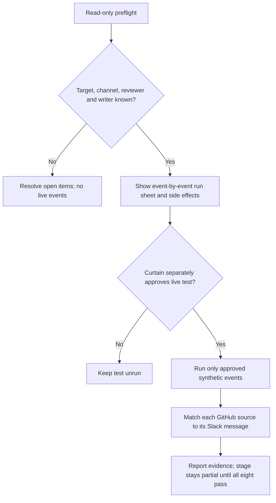

# 2026-11-23 Stage 1 live integration test go/no-go meeting
# 2026-11-23 1단계 실제 연동 시험 진행 여부 회의

## Purpose / 목적

Decide whether to prepare and run a bounded live test for the partially verified GitHub-to-Slack rollout, and separate ordinary notification tests from the unimplemented AI review path.
부분 검증된 GitHub→Slack 도입에 범위 제한 실제 시험을 준비·실행할지 검토하고, 일반 알림 시험과 아직 구현되지 않은 AI 리뷰 경로를 구분합니다.

## Participants and role fields / 참석자와 역할 항목

The role labels below are analysis perspectives, not separate people or quoted statements. Curtain is the actual user and decision maker. No personal opinion is attributed to Curtain beyond the request to discuss whether to proceed.
아래 역할명은 분석 관점이며 별도 참석자나 실제 발언 인용이 아닙니다. 커튼 뒤가 실제 사용자이자 결정자입니다. 진행 여부 회의를 요청했다는 사실 외에 커튼 뒤의 의견을 만들어 기록하지 않습니다.

| Who | What | Why | How | Goal | Conviction (소신) |
|---|---|---|---|---|---|
| Curtain / 커튼 뒤 | Asked for a meeting about the next live integration test. 다음 실제 연동 시험에 관한 회의를 요청했습니다. | Reason not stated. 이유는 따로 밝히지 않았습니다. | Decision pending. 결정 대기입니다. | Decide whether to proceed. 진행 여부를 정합니다. | Not stated. 별도로 밝히지 않았습니다. |
| Tech Lead / 기술 책임 | Recommend a read-only preflight, then a small staged pilot after separate approval. 읽기 전용 사전 점검 후 별도 승인으로 작은 단계별 시험을 권고합니다. | Existing evidence covers some events, while the full eight-event scope is not complete. 기존 근거는 일부 이벤트에 한정되고 필수 여덟 이벤트 전체는 완료되지 않았습니다. | Check test target, event owner, reviewer, channel and evidence fields before creating test records. 시험 대상·이벤트 담당자·리뷰어·채널·근거 항목을 확인한 뒤 시험 기록을 만듭니다. | Avoid mistaking a partial pass for Stage 1 completion. 일부 통과를 1단계 완료로 오해하지 않습니다. | Test one event at a time and preserve a clear stop point. 이벤트를 하나씩 시험하고 명확한 중단 지점을 둡니다. |
| Full-stack / 풀스택 | Separate native GitHub notification testing from Hermes model integration. GitHub 기본 알림 시험과 Hermes 모델 연동을 분리합니다. | Hermes's documented `gh pr comment` creates a PR conversation comment, not the required Actions-submitted review state `COMMENT`. Hermes의 문서화된 `gh pr comment`는 PR 대화 댓글이며 필수 Actions 제출 리뷰 상태 `COMMENT`가 아닙니다. | Test ordinary events first; do not count an AI conversation comment as the Actions review event. 기본 이벤트부터 시험하고 AI 대화 댓글을 Actions 리뷰 이벤트로 세지 않습니다. | Identify which system produced each message. 각 메시지를 어느 시스템이 만들었는지 구분합니다. | Keep the chosen Particle-1 model as a synthetic-evaluation choice only until a compatible writer is selected. 호환되는 리뷰 작성 방식을 정할 때까지 Particle-1은 합성 평가용 모델 선택으로만 둡니다. |
| QA / 품질 확인 | Use one evidence row for each required event. 필수 이벤트마다 근거 행을 하나씩 씁니다. | One Slack message cannot prove multiple unrelated GitHub actions. Slack 메시지 하나가 서로 다른 GitHub 작업 여러 개를 입증할 수 없습니다. | Match repository/item, event/status, actor, source URL, timestamp, Slack permalink, duplicates and verdict. 저장소·항목·이벤트/상태·작성자·원본 URL·시각·Slack permalink·중복·판정을 대조합니다. | Evidence that another person can independently check. 다른 사람도 다시 확인할 수 있는 근거입니다. | Missing, failed or partial evidence stays unverified. 근거가 없거나 실패·부분이면 미검증으로 둡니다. |
| SecOps / 보안 담당 | Keep model input synthetic and restrict webhook/GitHub credentials to the minimum needed. 모델 입력은 합성 데이터로 제한하고 webhook/GitHub 자격 증명은 필요한 최소 범위로 둡니다. | Public webhook payloads contain user-controlled text; the Hermes guide warns about prompt injection. 공개 webhook 본문에는 사용자가 작성한 문장이 들어가며 Hermes 문서는 prompt injection 위험을 경고합니다. | Validate webhook signatures; use a sandboxed listener; never expose or paste tokens; stop on unexpected requests or cost. webhook 서명을 검증하고 listener를 격리하며 토큰을 노출·붙여넣지 않고 예상 밖 요청·비용이 생기면 중단합니다. | No private source disclosure or unintended write access. 비공개 소스 유출과 의도하지 않은 쓰기 권한을 방지합니다. | Do not place a write-capable bot on real PRs before the behavior is constrained. 동작 범위를 제한하기 전에 실제 PR에 쓰기 가능한 봇을 연결하지 않습니다. |
| Operations / 운영 담당 | Prefer a short, manually watched window for any approved pilot. 승인된 시험은 짧은 시간 동안 수동으로 관찰하는 방식을 권고합니다. | A temporary free tunnel and local gateway stop when closed; they are not a free always-on service. 임시 무료 터널과 로컬 gateway는 종료하면 멈추므로 무료 상시 서비스가 아닙니다. | Start only after owner, costs, stop procedure and cleanup are written down. 담당자·비용·중단 절차·정리 방법을 적은 뒤 시작합니다. | A test that can be stopped and cleaned up easily. 쉽게 멈추고 정리할 수 있는 시험입니다. | Close the tunnel and remove test webhook/config after an approved session. 승인된 시험 뒤 터널을 닫고 시험 webhook/설정을 제거합니다. |
| Release / 배포 담당 | Do not merge a synthetic PR to `main` as part of notification testing. 알림 시험을 위해 합성 PR을 `main`에 병합하지 않습니다. | Merge changes the primary branch and is not needed to verify a PR-open event. 병합은 기본 브랜치를 바꾸며 PR 생성 알림 확인에는 필요하지 않습니다. | Use a disposable test target if a merge event must be checked; require separate approval for any push, PR or merge. 병합 이벤트 확인이 필요하면 폐기 가능한 시험 대상을 쓰고 push·PR·merge는 각각 별도 승인을 받습니다. | Preserve the production branch while collecting evidence. 근거를 모으면서 기본 브랜치를 보호합니다. | A test PR must remain clearly synthetic and isolated. 시험 PR은 합성·격리 상태가 분명해야 합니다. |
| Repository Admin / 저장소 관리자 | Verify the GitHub app/webhook configuration and channel before a live event is sent. 실제 이벤트를 보내기 전에 GitHub 앱/webhook 설정과 채널을 확인합니다. | Prior observation does not prove all current subscriptions, scopes or routing. 과거 관찰만으로 현재 구독·권한·전달 경로 전체를 입증할 수 없습니다. | Use read-only inspection first; apply no setting change until Curtain separately approves it. 먼저 읽기 전용으로 확인하고 커튼 뒤가 별도 승인하기 전에는 설정을 바꾸지 않습니다. | Know exactly which channel and app receive the test. 어느 앱이 어느 채널로 시험을 보내는지 명확히 합니다. | Do not infer external setup from repository files or screenshots alone. 저장소 파일이나 화면 캡처만으로 외부 설정을 추정하지 않습니다. |

## Facts / 사실

- The adopted Stage 1 scope has eight events: Issue opened/closed, PR opened/merged, Actions-submitted review `COMMENT`, review requested, independent `APPROVE`, and independent `REQUEST_CHANGES`. Each needs its own GitHub-to-Slack evidence row.
  채택된 1단계 범위는 Issue 생성/종료, PR 생성/병합, Actions 제출 리뷰 `COMMENT`, 리뷰 요청, 독립 `APPROVE`, 독립 `REQUEST_CHANGES`의 여덟 이벤트입니다. 각각 GitHub→Slack 근거 행이 필요합니다.
- Existing observations include PR-open/merge notification delivery at least once. This does not establish all eight events, repeat reliability, or a service-level target.
  기존 관찰에는 PR 생성/병합 알림이 각각 최소 한 번 전달된 근거가 있습니다. 이는 여덟 이벤트 전체·반복 신뢰성·서비스 목표치를 입증하지 않습니다.
- The tracked `.github/workflows/quality-check.yml` does not submit a review. Hermes's documented webhook posts a PR conversation comment and does not by itself satisfy the Actions-submitted review `COMMENT` requirement.
  추적 중인 `.github/workflows/quality-check.yml`은 리뷰를 제출하지 않습니다. Hermes의 문서화된 webhook은 PR 대화 댓글을 올리며 그 자체로 Actions 제출 리뷰 `COMMENT` 요건을 충족하지 않습니다.
- Particle-1 was selected for further synthetic evaluation. Three small synthetic cases found the planted defects with Particle-1; ERNIE responses were partly unavailable. This is not a broad quality or integration result.
  Particle-1은 추가 합성 평가용으로 선택됐습니다. 작은 합성 사례 세 개에서 Particle-1은 의도된 결함을 찾았고 ERNIE 응답 일부는 평가할 수 없었습니다. 이는 광범위한 품질 평가나 연동 결과가 아닙니다.
- A separate reviewer is needed for independent review request, approval and change-request cases. No person has been selected in this meeting.
  독립 리뷰 요청·승인·수정 요청 사례에는 별도 리뷰어가 필요합니다. 이번 회의에서 사람을 지정하지 않았습니다.
- No live test, GitHub record, Slack message, app/webhook setting, permission or merge has been created or changed in this meeting.
  이번 회의에서 실제 시험·GitHub 기록·Slack 메시지·앱/webhook 설정·권한·병합을 만들거나 변경하지 않았습니다.

## Assumptions / 가정

- A harmless synthetic change can be prepared for an isolated test target. The exact repository/target, reviewer, and Slack destination still need confirmation.
  격리된 시험 대상에 무해한 합성 변경을 준비할 수 있다고 가정합니다. 정확한 저장소/대상·리뷰어·Slack 수신 위치는 확인이 필요합니다.
- The user wants to decide readiness and boundaries now, while any actual external action remains a later approval gate.
  지금은 준비 상태와 범위를 정하고 외부 실제 작업은 이후 승인 단계로 남기려는 것으로 가정합니다.

## Recommendation / 권고

Recommend **GO for read-only preflight and test preparation; NO-GO for live execution until separately approved**. First verify the intended repository and Slack destination, inspect current app/webhook configuration read-only, identify an independent reviewer, and settle the `COMMENT` writer. Then present a complete event-by-event run sheet and exact GitHub/Slack side effects for Curtain to approve. Run only the approved events, collect permalinks and timestamps, do not merge into `main`, and stop if the free quota, unexpected access or unplanned model behavior appears. Treat Hermes/Particle-1 model commentary and the required Actions review `COMMENT` as different paths unless implementation proves they are the same event.
**읽기 전용 사전 점검과 시험 준비는 진행하고, 별도 승인 전 실제 실행은 보류**할 것을 권고합니다. 먼저 대상 저장소·Slack 수신 위치를 확인하고 현재 앱/webhook 설정을 읽기 전용으로 살펴보며 독립 리뷰어를 정하고 `COMMENT` 작성 주체를 선택합니다. 이어 이벤트별 실행표와 예상 GitHub/Slack 영향을 커튼 뒤에게 보여 승인받습니다. 승인한 이벤트만 실행하고 permalink·시각을 모으며 `main`에는 병합하지 않습니다. 무료 한도 초과·예상 밖 접근·계획하지 않은 모델 동작이 나타나면 중단합니다. 구현으로 같은 이벤트임이 입증되기 전까지 Hermes/Particle-1의 대화 댓글과 필수 Actions 리뷰 `COMMENT`는 다른 경로로 취급합니다.

## Mermaid proposed flow / Mermaid 제안 흐름

## Decision and next actions / 결정 및 다음 작업

**Decision pending:** Curtain has not yet approved this recommendation or any live test.
**결정 대기:** 커튼 뒤는 이 권고나 실제 시험을 아직 승인하지 않았습니다.

1. Assistant presents this recommendation and the open items for Curtain to adopt, revise or reject.
   어시스턴트가 이 권고와 미결정 항목을 제시하고 커튼 뒤가 채택·수정·반려합니다.
2. If adopted, Assistant prepares a read-only preflight list and a concrete event run sheet; no external action is implied.
   채택되면 어시스턴트가 읽기 전용 사전 점검표와 구체적인 이벤트 실행표를 준비하며 외부 작업은 실행하지 않습니다.
3. Curtain separately approves any GitHub record creation, webhook/app change, push, PR, review request, merge, or Slack message before that action occurs.
   GitHub 기록 생성·webhook/앱 변경·push·PR·리뷰 요청·merge·Slack 메시지는 실행 전에 커튼 뒤가 각각 별도로 승인합니다.

## Rollout status / 도입 단계

Stage 1 remains partially verified and unchanged. This is a go/no-go recommendation, not a live-test approval or evidence of a new integration. Next rollout action is to decide whether to adopt read-only preflight and request a separate approval for any live test.
1단계는 부분 검증 상태이며 변경 없습니다. 이 문서는 진행 여부 권고이지 실제 시험 승인이나 새 연동 근거가 아닙니다. 다음 도입 작업은 읽기 전용 사전 점검 권고를 채택할지 정하고 실제 시험은 별도 승인받는 것입니다.
