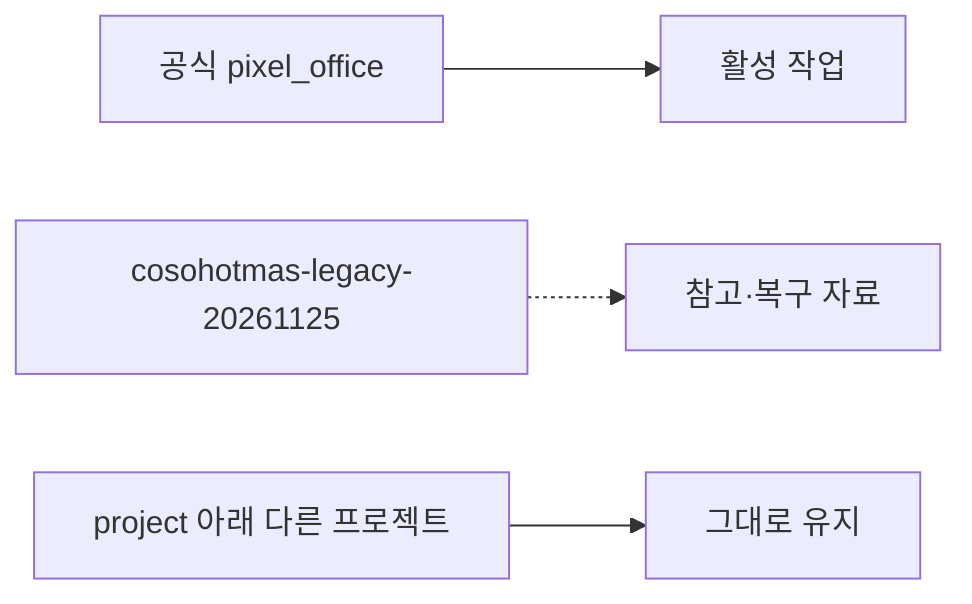

# Official Path and Git Connection Meeting
# 공식 경로·Git 연결 회의

Date: 2026-11-25
날짜: 2026-11-25

## Purpose
## 목적

This meeting records the move from the parent repository to the official project path.
이 회의는 상위 저장소에서 공식 프로젝트 경로로 작업 기준을 옮긴 과정을 기록한다.

Fact: The official working path is `/Users/aspirinirony/project/cosohotmas/project/pixel_office`.
사실: 공식 작업 경로는 `/Users/aspirinirony/project/cosohotmas/project/pixel_office`이다.

Fact: The parent repository was preserved as `/Users/aspirinirony/project/cosohotmas-legacy-20261125`.
사실: 상위 저장소는 `/Users/aspirinirony/project/cosohotmas-legacy-20261125`로 보관됐다.

Fact: Other projects under `project/` were not moved or deleted.
사실: `project/` 아래 다른 프로젝트는 이동하거나 삭제하지 않았다.

## Role discussion
## 역할별 논의

| Who | What | Why | How | Goal | Conviction (소신) |
|---|---|---|---|---|---|
| Tech Lead | Proposal: use the official nested path for all future work. / 제안: 앞으로 모든 작업은 공식 하위 경로에서 수행한다. | The parent repository mixed project history and unrelated work. / 상위 저장소에 프로젝트 이력과 무관한 작업이 섞여 있었다. | Keep the official path on a GitHub-tracking branch. / 공식 경로를 GitHub 추적 branch로 유지한다. | Make ownership and review boundaries clear. / 소유 범위와 검토 경계를 명확히 한다. | Do not work from the parent copy again. / 상위 복사본에서 다시 작업하지 않는다. |
| Full-stack | Fact: the official path contains the application and workflow files. / 사실: 공식 경로에 애플리케이션과 workflow 파일이 있다. | These files are the active project source. / 이 파일들이 활성 프로젝트 소스다. | Verify remote, branch, commit, and status locally. / 원격·브랜치·커밋·상태를 로컬에서 확인한다. | Prevent edits in the wrong checkout. / 잘못된 checkout에서 수정하는 일을 막는다. | A path check must precede implementation. / 구현 전에 경로를 확인해야 한다. |
| SecOps | Proposal: retain legacy and backup paths until their contents are no longer needed. / 제안: 내용이 더 이상 필요 없을 때까지 legacy·백업 경로를 보존한다. | They may contain `.env` or recovery data. / `.env`나 복구 자료가 있을 수 있다. | Exclude secrets from commits and keep archives separate. / 커밋에서 비밀값을 제외하고 보관본을 분리한다. | Prevent accidental loss or leakage. / 실수로 인한 손실·유출을 막는다. | Do not delete an archive without a specific review. / 구체적 검토 없이 보관본을 삭제하지 않는다. |
| Art Director | Proposal: show official and legacy locations as separate nodes. / 제안: 공식 경로와 legacy 위치를 별도 노드로 표시한다. | Users must distinguish active work from reference material. / 사용자는 활성 작업과 참고 자료를 구분해야 한다. | Use solid or dashed edges according to evidence. / 근거에 따라 실선·점선을 사용한다. | Make path status readable. / 경로 상태를 읽기 쉽게 한다. | A diagram must not imply legacy is active. / legacy가 활성 상태라고 그림이 암시하면 안 된다. |
| Researcher | Fact: the official path is connected to `https://github.com/cosohotmas/pixel_office.git`. / 사실: 공식 경로는 해당 GitHub 원격에 연결됐다. | Remote evidence establishes the repository identity. / 원격 근거가 저장소 정체성을 확인한다. | Check `git remote`, branch, and commit. / `git remote`·브랜치·커밋을 확인한다. | Preserve an auditable source path. / 추적 가능한 소스 경로를 보존한다. | Local path names alone are not enough. / 로컬 경로 이름만으로는 충분하지 않다. |
| Trend Analyst | Proposal: keep the parent project directory for unrelated projects. / 제안: 무관한 프로젝트가 있는 상위 project 디렉터리는 유지한다. | Moving all projects would broaden the change. / 모든 프로젝트를 옮기면 변경 범위가 커진다. | Move only the old repository root into legacy storage. / 기존 저장소 루트만 legacy 보관소로 옮긴다. | Limit migration risk. / 이전 위험을 제한한다. | Scope must follow project boundaries. / 범위는 프로젝트 경계를 따라야 한다. |
| Legal | Fact: the move did not add external code or assets. / 사실: 이동 과정에서 외부 코드·자산을 추가하지 않았다. | No new license review was needed for the move. / 이동 자체에는 새 라이선스 검토가 필요하지 않았다. | Record source and archive locations. / 출처와 보관 위치를 기록한다. | Keep provenance clear. / 출처를 명확히 한다. | Archiving is not redistribution. / 보관은 재배포가 아니다. |
| End User | Proposal: report one official path in future instructions. / 제안: 앞으로 안내에는 공식 경로 하나만 제시한다. | Multiple paths caused repeated confusion. / 여러 경로가 반복적인 혼란을 만들었다. | Put the path in the office README and reports. / 사무실 README와 보고서에 경로를 적는다. | Make the next action obvious. / 다음 행동을 분명하게 한다. | The user should never guess which folder is active. / 사용자가 활성 폴더를 추측하게 해서는 안 된다. |
| Curtain | User decision: official path adopted; legacy storage approved. / 사용자 결정: 공식 경로 채택·legacy 보관 승인. | The user explicitly confirmed the official path and approved legacy archiving. / 사용자가 공식 경로를 명시하고 legacy 보관을 승인했다. | Continue work only in the official path. / 공식 경로에서만 계속 작업한다. | Keep the project organized and recoverable. / 프로젝트를 정리하고 복구 가능하게 유지한다. | The official path is the active source. / 공식 경로가 활성 소스다. |

## Decision and limits
## 결정과 한계

Decision: Future `pixel_office` work uses only `/Users/aspirinirony/project/cosohotmas/project/pixel_office`.
결정: 앞으로 `pixel_office` 작업은 `/Users/aspirinirony/project/cosohotmas/project/pixel_office`만 사용한다.

Decision: The parent repository is legacy reference material, not an active work location.
결정: 상위 저장소는 legacy 참고 자료이며 활성 작업 위치가 아니다.

Question: Any future deletion of legacy or backup material requires a separate exact-path review.
질문: 향후 legacy·백업 자료를 삭제하려면 정확한 경로에 대한 별도 검토가 필요하다.

## Verification note
## 검증 기록

The official remote, branch, commit, and worktree state were checked locally. External service configuration remains unverified.
공식 원격·브랜치·커밋·worktree 상태를 로컬에서 확인했다. 외부 서비스 설정은 미검증이다.
