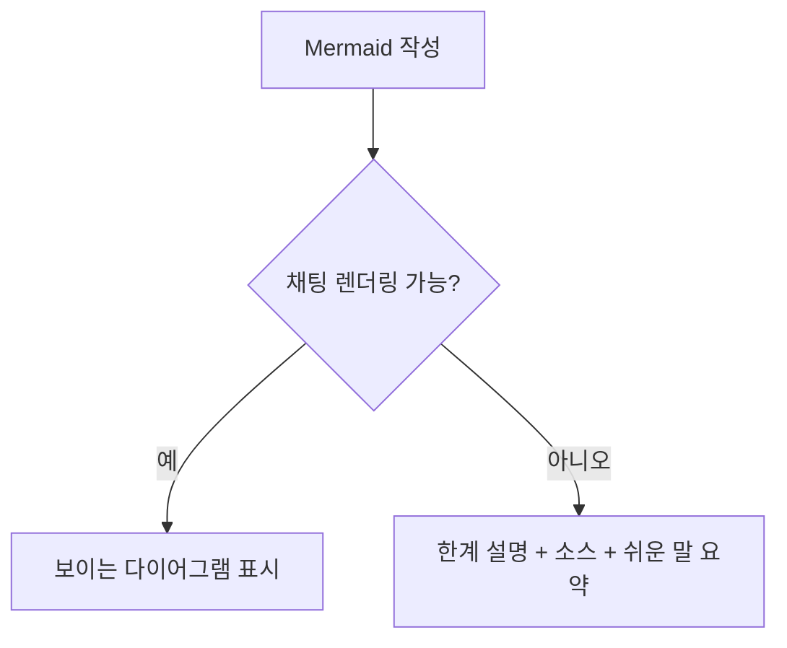

# Mermaid Chat Rendering Rule Meeting
# Mermaid 채팅 렌더링 규칙 회의

Date: 2026-11-26
날짜: 2026-11-26

## Purpose
## 목적

This meeting records the user's request to show Mermaid as a diagram in the chat window instead of source code alone.
이 회의는 Mermaid를 소스 코드만이 아니라 채팅창의 다이어그램으로 보여달라는 사용자의 요청을 기록한다.

## Role discussion
## 역할별 논의

| Who | What | Why | How | Goal | Conviction (소신) |
|---|---|---|---|---|---|
| Tech Lead | Proposal: make rendered Mermaid a reporting rule. / 제안: 렌더링된 Mermaid를 보고 규칙으로 만든다. | Source-only output does not meet the requested presentation. / 소스만 출력하면 요청한 표시 방식에 맞지 않는다. | Update the central and agent guidance files. / 중앙 지침과 에이전트 지침을 갱신한다. | Make reports visually useful. / 보고서를 시각적으로 유용하게 만든다. | A diagram rule must define the fallback when rendering fails. / 다이어그램 규칙은 렌더링 실패 시 대체 방식도 정해야 한다. |
| Full-stack | Proposal: keep Mermaid source available for reproducibility. / 제안: 재현성을 위해 Mermaid 소스는 유지한다. | Rendered output alone is harder to edit or inspect. / 렌더링 결과만 있으면 수정·검사가 어렵다. | Show the diagram first, then source only when needed. / 먼저 그림을 보여주고 필요할 때만 소스를 보여준다. | Preserve both usability and reproducibility. / 사용성과 재현성을 함께 보존한다. | Source and rendered view serve different purposes. / 소스와 렌더링 화면은 목적이 다르다. |
| SecOps | Proposal: do not add external renderer credentials or services. / 제안: 외부 렌더러 자격증명·서비스를 추가하지 않는다. | Rendering should not create secret exposure. / 렌더링이 비밀 노출을 만들면 안 된다. | Use the chat renderer when available and disclose limitations. / 가능한 경우 채팅 렌더러를 사용하고 한계를 밝힌다. | Keep presentation safe. / 표시를 안전하게 유지한다. | A visual improvement must not broaden access. / 시각 개선이 접근 범위를 넓히면 안 된다. |
| Art Director | Proposal: distinguish a visible diagram from a code block. / 제안: 보이는 다이어그램과 코드 블록을 구분한다. | The user specifically identified the presentation problem. / 사용자가 표시 문제를 명확히 지적했다. | Add a plain-language summary when rendering is unavailable. / 렌더링이 불가능하면 쉬운 말의 요약을 추가한다. | Improve comprehension. / 이해도를 높인다. | Code alone is not a diagram presentation. / 코드만으로는 다이어그램 표시가 아니다. |
| Researcher | Fact: the screenshot showed Mermaid source in a code panel. / 사실: 캡처에는 코드 패널의 Mermaid 소스가 보였다. | This is direct evidence of the presentation issue. / 이는 표시 문제의 직접 근거다. | Record the rule and its evidence limit. / 규칙과 근거의 한계를 기록한다. | Keep the decision traceable. / 결정을 추적 가능하게 한다. | Do not claim renderer behavior beyond observed screens. / 관찰한 화면을 넘어 렌더러 동작을 주장하지 않는다. |
| Trend Analyst | Proposal: prefer native chat rendering before adding tools. / 제안: 도구를 추가하기 전에 기본 채팅 렌더링을 우선한다. | Extra renderers increase dependencies. / 추가 렌더러는 의존성을 늘린다. | Keep local CLI installation out of scope. / 로컬 CLI 설치는 범위에서 제외한다. | Minimize maintenance. / 유지보수를 줄인다. | Presentation rules should not become infrastructure work. / 표시 규칙이 인프라 작업으로 커지면 안 된다. |
| Legal | Fact: no external material was added by this rule. / 사실: 이 규칙으로 외부 자료를 추가하지 않았다. | No new license or attribution issue was introduced. / 새 라이선스·출처 표시 문제를 만들지 않았다. | Keep source and rendering guidance repository-owned. / 소스와 표시 지침을 저장소 내부에서 관리한다. | Preserve documentation provenance. / 문서 출처를 보존한다. | A formatting rule is not a license grant. / 형식 규칙은 라이선스 허가가 아니다. |
| End User | User request: show the diagram, not only its code. / 사용자 요청: 코드만이 아니라 다이어그램을 보여준다. | The current display was confusing. / 현재 표시 방식이 혼란스러웠다. | Render visibly or explain the limitation and provide a summary. / 보이게 렌더링하거나 한계를 설명하고 요약을 제공한다. | Understand the workflow at a glance. / workflow를 한눈에 이해한다. | The result should look like a diagram to the reader. / 결과는 독자에게 다이어그램처럼 보여야 한다. |
| Curtain | User decision: add the chat rendering rule and approve the documentation commit. / 사용자 결정: 채팅 렌더링 규칙 추가와 문서 커밋을 승인했다. | The user explicitly accepted the result and approved commit. / 사용자가 결과를 수락하고 커밋을 승인했다. | Push was separately approved afterward. / 이후 Push는 별도로 승인됐다. | Make future reports render correctly. / 앞으로 보고서가 올바르게 렌더링되게 한다. | The rule is adopted in the repository guidance. / 저장소 지침에 규칙을 채택한다. |

## Decision
## 결정

Decision: Mermaid in chat reports must be rendered as a visible diagram; source-only display is insufficient.
결정: 채팅 보고서의 Mermaid는 보이는 다이어그램으로 렌더링해야 하며 소스만 표시하는 것은 부족하다.

Decision: If rendering is unavailable, disclose the limitation and provide source plus a plain-language visual summary.
결정: 렌더링이 불가능하면 그 한계를 밝히고 소스와 쉬운 말의 시각적 요약을 함께 제공한다.

## Verification note
## 검증 기록

The rule was added to `AGENTS.md`, `CLAUDE.md`, `CLINE.md`, `docs/office/workflow.md`, and `docs/office/README.md`, then committed as `16c2405` and pushed to the approved feature branch. No external renderer or service was configured.
이 규칙은 `AGENTS.md`, `CLAUDE.md`, `CLINE.md`, `docs/office/workflow.md`, `docs/office/README.md`에 추가됐고 `16c2405`로 커밋한 뒤 승인된 feature branch에 Push됐다. 외부 렌더러나 서비스는 설정하지 않았다.
