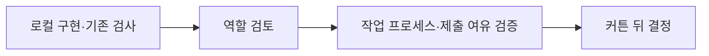

# Role review of the local model budget
# 모델 호출 상한 로컬 결과 역할 회의

Agenda: Review the local diagnostics and the 120-second, four-attempt model budget. Decide what evidence to gather before publishing.
의제: 로컬 진단 로그와 모델 호출 120초·4회 상한을 검토합니다. 공개 전에 확보할 근거를 논의합니다.

Participants: Codex considered the roles below. Curtain requested the meeting and owns the final decision.
참석 역할: Codex가 아래 역할의 관점에서 검토했습니다. 커튼 뒤가 회의를 요청했으며 최종 결정을 맡습니다.

| Who / 역할 | What / 의견 | Why / 이유 | How / 방법 | Goal / 목표 | Conviction / 소신 |
|---|---|---|---|---|---|
| Facilitator / 진행자 | Proposal: Review readiness before publishing. / 제안: 공개 준비 상태를 먼저 검토합니다. | Prior approval covered local implementation. / 이전 승인은 로컬 구현에 적용됐습니다. | Present evidence, open issues, and a proposed next step. / 근거, 미결 사항, 다음 단계 제안을 제시합니다. | Give Curtain a clear decision. / 커튼 뒤의 결정을 돕습니다. | Keep approval with Curtain. / 승인은 커튼 뒤가 맡습니다. |
| Planner / 기획 | Proposal: Keep the ordered model fallback. / 제안: 모델 전환 순서를 유지합니다. | The fifth through seventh candidates are outside the four-attempt budget. / 다섯 번째부터 일곱 번째 후보는 4회 예산 밖에 있습니다. | Explain this trade-off and measure abstentions during later operating checks. / 이 제약을 명시하고 이후 운영 검증에서 판단 보류를 관찰합니다. | Bound effort without hiding the loss of fallback coverage. / 호출 노력을 제한하고 폴백 범위 축소를 드러냅니다. | Adjust limits using evidence. / 근거에 따라 상한을 조정합니다. |
| Developer / 개발 | Fact: The parent process can time out a model worker. / 사실: 부모 프로세스가 모델 작업 프로세스를 시간 초과로 종료할 수 있습니다. | Response reads can outlast a socket timeout when data keeps arriving. / 데이터가 계속 도착하면 응답 읽기가 소켓 타임아웃보다 오래 걸릴 수 있습니다. | Proposal: Test the actual worker entry point with a mocked OpenRouter response. / 제안: OpenRouter 응답을 모의로 제공해 실제 작업 프로세스 진입점을 검증합니다. | Check result transport and timeout handling together. / 결과 전달과 시간 초과 처리를 함께 검증합니다. | Keep model limits scoped to production review unless test scope changes. / 테스트 범위가 바뀌기 전에는 모델 상한을 운영 리뷰에 적용합니다. |
| Independent reviewer / 독립 리뷰 | Finding: The timeout test used a stand-in child. / 발견: 시간 초과 검증은 대체 자식 프로세스를 사용했습니다. | It verifies cancellation. The real worker's result and diagnostic streams still need a joint test. / 종료는 확인했습니다. 실제 작업 프로세스의 결과와 진단 출력은 함께 검증해야 합니다. | Proposal: Check one valid result, one model error, and one timeout using the worker path. / 제안: 작업 프로세스 경로에서 정상 결과, 모델 오류, 시간 초과를 각각 확인합니다. | Catch integration regressions before Push. / Push 전에 연결 경로의 회귀를 찾습니다. | A test should cover the boundary the change added. / 변경이 추가한 경계를 테스트에서 확인해야 합니다. |
| Security reviewer / 보안 | Fact: The worker environment omits GITHUB_TOKEN. The model key and review input travel over stdin. / 사실: 작업 프로세스 환경에서 GITHUB_TOKEN을 제외합니다. 모델 키와 리뷰 입력은 표준 입력으로 전달합니다. | Unexpected child errors could reach Actions logs through stderr. / 자식 프로세스의 예상 밖 오류가 표준 오류를 통해 Actions 로그에 남을 수 있습니다. | Proposal: Capture worker diagnostics in tests and look for mock secrets, raw responses, and diff text. / 제안: 작업 프로세스 진단 출력을 수집해 모의 비밀값, 응답 원문, diff가 등장하는지 검사합니다. | Keep logs limited to diagnostics. / 로그에 진단 정보만 남깁니다. | Check error paths as well as successful runs. / 성공과 오류 경로를 함께 확인합니다. |
| CI operator / 운영 | Finding: The workflow has a five-minute job timeout. The model budget covers only the model phase. / 발견: 워크플로 작업 제한은 5분입니다. 모델 예산은 모델 단계에만 적용됩니다. | Checkout, setup, and GitHub API reads and submission also use job time. / 체크아웃, 준비, GitHub API 조회와 제출도 작업 시간을 사용합니다. | Proposal: Test slow GitHub calls with mocks and report the remaining margin. / 제안: 느린 GitHub 호출을 모의로 확인하고 남는 시간을 보고합니다. | Preserve a chance to submit one COMMENT for an unchanged SHA. / SHA가 같을 때 COMMENT 한 건을 제출할 시간을 확보합니다. | Report model timeout and submission failure separately. / 모델 시간 초과와 제출 실패를 구분합니다. |
| Recorder / 서기 | Record evidence, proposals, and open decisions. / 근거, 제안, 미결 결정을 기록합니다. | Local checks and live integration establish different facts. / 로컬 검사와 실연동으로 확인하는 사실이 다릅니다. | Keep the record in the existing meetings directory. / 기존 회의록 디렉터리에 기록합니다. | Make the handoff traceable. / 인수인계를 추적할 수 있게 합니다. | Record Curtain's decision only after it is given. / 커튼 뒤가 실제로 내린 결정만 기록합니다. |
| Curtain / 커튼 뒤 | Fact: Requested the role meeting. / 사실: 역할 회의를 요청했습니다. | Open: Adoption and publication have yet to be decided. / 미결: 채택과 공개 결정이 남았습니다. | Review the evidence before making that decision. / 결정 전에 근거를 검토합니다. | Decision authority rests with Curtain. / 결정 권한은 커튼 뒤에게 있습니다. | No personal stance was stated for this meeting. / 이번 회의에 관한 개인 의견은 제시되지 않았습니다. |

Verified in this meeting: The local source and workflow show the above call path and time limits. The local diff passed git diff --check. The previous implementation report recorded six tests including timeout, fallback, and SHA handling. A live run remains unverified for this change.
이번 회의에서 확인: 로컬 소스와 워크플로로 위 호출 경로와 제한을 확인했습니다. 로컬 diff는 git diff --check를 통과했습니다. 이전 구현 보고에는 시간 초과·폴백·SHA 처리를 포함한 테스트 6건이 기록됐습니다. 이 변경의 실호출은 미검증입니다.

Prior decision: Curtain approved implementing the 120-second, four-attempt limit locally. Meeting proposal: verify the worker entry point and GitHub submission margin before requesting Push approval. The meeting result is awaiting adoption.
기존 결정: 커튼 뒤가 120초·4회 상한의 로컬 구현을 승인했습니다. 회의 제안: Push 승인을 요청하기 전에 작업 프로세스 진입점과 GitHub 제출 여유를 검증합니다. 회의 결과는 채택 대기 상태입니다.

Open questions: How much job time remains after slow GitHub calls? Does the actual worker keep mock secrets and raw content out of diagnostics during failure? Revisit the limits after there is operating evidence.
미결 질문: GitHub 호출이 느릴 때 작업 시간이 얼마나 남나요? 실제 작업 프로세스는 실패 시 모의 비밀값과 원문을 진단 출력에서 제외하나요? 운영 근거가 생기면 상한을 재검토합니다.

Next action: Codex can run local checks using mocks. Curtain decides on adoption and any external publication. Office rollout remains at GitHub to Slack partially verified. The next rollout check concerns real Issue notifications.
다음 작업: Codex는 모의 응답으로 로컬 검증을 진행할 수 있습니다. 채택과 외부 반영은 커튼 뒤가 결정합니다. 사무실 도입은 GitHub → Slack 부분 검증 단계이며 다음 도입 검증은 실제 Issue 알림입니다.

Sources: [Review script](../../../scripts/particle_review.py), [Actions workflow](../../../.github/workflows/particle-review.yml), and [office workflow](../workflow.md).
출처: [리뷰 스크립트](../../../scripts/particle_review.py), [Actions 워크플로](../../../.github/workflows/particle-review.yml), [사무실 운영 흐름](../workflow.md).

