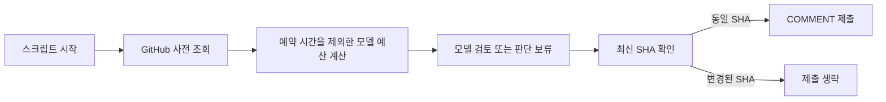

# Decision meeting on time for review submission
# 리뷰 제출 시간 확보 결정 회의

Agenda: Decide whether to follow up on the local model budget by reserving time for GitHub review submission.
의제: GitHub 리뷰 제출 시간을 확보하는 후속 변경을 진행할지 결정합니다.

Participants: Codex represented the roles below. Curtain requested the meeting and owns the adoption decision.
참석: Codex가 아래 역할의 관점에서 검토했습니다. 커튼 뒤가 회의를 요청했으며 채택을 결정합니다.

Facts: The Actions job allows five minutes. The local model phase allows 120 seconds and up to four attempts. The previous simulation assumed five GitHub operations at 29 seconds each and a full model budget. Setup at 15 seconds left 20 seconds, and setup at 35 seconds left zero. These are simulated results.
사실: Actions 작업 제한은 5분입니다. 로컬 모델 단계에는 120초·최대 4회 제한이 있습니다. 이전 모의 검증은 GitHub 작업 5건에 각각 29초가 걸리고 모델 예산을 전부 쓴다고 가정했습니다. 준비가 15초면 20초가 남았고, 35초면 여유가 0초였습니다. 이는 모의 결과입니다.

| Who / 역할 | What / 의견 | Why / 이유 | How / 방법 | Goal / 목표 | Conviction / 소신 |
|---|---|---|---|---|---|
| Facilitator / 진행자 | Proposal: Make a small follow-up. / 제안: 작은 후속 변경을 진행합니다. | A slow run can use all available submission time. / 느린 실행에서는 제출 시간이 소진될 수 있습니다. | Compare leaving the code as is, extending the job, and reserving submission time. / 현행 유지, 작업 제한 연장, 제출 시간 예약을 비교합니다. | Give Curtain a clear choice. / 커튼 뒤가 판단할 수 있게 합니다. | Adoption belongs to Curtain. / 채택은 커튼 뒤가 결정합니다. |
| Planner / 기획 | Proposal: Keep the 120-second and four-attempt ceilings. / 제안: 120초·4회 상한을 유지합니다. | Fast runs still benefit from model fallback. / 빠른 실행에서는 모델 전환이 여전히 유효합니다. | Reduce the model budget only when earlier work uses more time. / 앞 단계에서 시간이 많이 들 때 모델 예산을 줄입니다. | Bound cost and preserve fallback when time allows. / 비용을 제한하고 시간이 허용되면 모델 전환을 활용합니다. | Keep this within review reliability work. / 리뷰 안정화 범위에서 진행합니다. |
| Developer / 개발 | Proposal: Use a monotonic script deadline with a submission reserve. / 제안: 단조 시계로 스크립트 마감을 계산하고 제출 시간을 예약합니다. | The script can measure the time its own preparation used. / 스크립트는 자체 준비에 든 시간을 측정할 수 있습니다. | Trial values: 240 seconds from script start and a 70-second reserve. Use the smaller of 120 seconds and the time left before the reserve. / 시험값은 스크립트 시작부터 240초와 제출 예약 70초입니다. 120초와 예약 구간 전까지 남은 시간 중 작은 값을 사용합니다. | Move to submission promptly when model time runs out. / 모델 시간이 소진되면 곧바로 제출 단계로 넘어갑니다. | Check the budget before each attempt. / 각 시도 전에 남은 예산을 확인합니다. |
| Independent reviewer / 독립 리뷰 | Proposal: Verify the transitions with a fake clock. / 제안: 모의 시계로 단계 전환을 검증합니다. | Actual network timing varies. / 실제 네트워크 시간은 변동됩니다. | Check fast preparation, slow preparation, zero model time, changed SHA, and failed submission. / 빠른 준비, 느린 준비, 모델 예산 0초, SHA 변경, 제출 실패를 확인합니다. | Confirm one COMMENT on the eligible path and zero on a changed SHA. / 제출 가능한 경로는 COMMENT 한 건, SHA가 바뀌면 0건인지 확인합니다. | Keep failure evidence visible. / 실패 근거를 볼 수 있게 남깁니다. |
| CI operator / 운영 | Finding: A script deadline begins after checkout and setup. / 발견: 스크립트 마감 계산은 체크아웃과 준비 이후 시작합니다. | The job can still end first when setup is slow or GitHub reads take longer. / 준비가 느리거나 GitHub 응답 읽기가 길면 작업이 먼저 종료될 수 있습니다. | Check actual setup and submission timings during a later approved run. / 이후 승인된 실행에서 실제 준비·제출 시간을 확인합니다. | Report real margin before claiming reliability. / 안정성을 판단하기 전에 실제 여유를 확인합니다. | Treat the reserve as a planning value. / 예약 시간은 계획값으로 사용합니다. |
| Recorder / 서기 | Record the proposal and evidence. / 제안과 근거를 기록합니다. | The simulation and the operating result need separate evidence. / 모의 결과와 운영 결과는 각각 근거가 필요합니다. | Link the prior meeting and mark adoption as pending. / 이전 회의록을 연결하고 채택 대기로 기록합니다. | Preserve the decision trail. / 결정 이력을 남깁니다. | Record only decisions actually given. / 실제로 내려진 결정만 기록합니다. |
| Curtain / 커튼 뒤 | Fact: Requested a decision meeting. / 사실: 결정 회의를 요청했습니다. | Open: Whether to adopt the proposal. / 미결: 제안 채택 여부입니다. | Review the trade-offs and make the decision. / 장단점을 보고 결정합니다. | Retain implementation and publication authority. / 구현과 외부 반영의 결정권을 유지합니다. | No position on adoption has been stated. / 채택에 대한 의견은 아직 제시되지 않았습니다. |

Options: Leaving the current code keeps the observed risk. Extending the job gives all operations more time and also raises maximum job duration. A script-level reserve reduces model time when preparation runs long. The meeting recommends the reserve.
선택지: 현행 유지 시 관찰된 위험이 남습니다. 작업 제한을 늘리면 모든 단계에 여유가 생기고 최대 실행 시간도 늘어납니다. 스크립트에서 시간을 예약하면 준비가 길어질 때 모델 시간이 줄어듭니다. 회의는 제출 시간 예약안을 권고합니다.

Open questions: Is the proposed reduction in fallback time acceptable? How much time do setup and both final GitHub calls take in a live run?
미결 질문: 폴백에 쓸 시간이 줄어드는 것을 받아들일 수 있나요? 실제 실행의 준비와 마지막 GitHub 호출 두 건에는 시간이 얼마나 걸리나요?

Decision and next action: Curtain adopted the reserve and approved local implementation. Codex will verify it with mocked calls. GitHub to Slack remains partially verified. The next rollout check is for actual Issue notifications.
결정 및 다음 작업: 커튼 뒤가 제출 시간 예약안을 채택하고 로컬 구현을 승인했습니다. Codex는 모의 호출로 검증합니다. GitHub → Slack은 부분 검증 상태이며 다음 도입 작업은 실제 Issue 알림 확인입니다.

Evidence: [Previous role review](2026-11-27-local-review-budget.md), [review script](../../../scripts/particle_review.py), [Actions workflow](../../../.github/workflows/particle-review.yml).
근거: [이전 역할 회의](2026-11-27-local-review-budget.md), [리뷰 스크립트](../../../scripts/particle_review.py), [Actions 워크플로](../../../.github/workflows/particle-review.yml).

