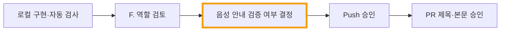

# Weather retry next-step review
# 날씨 재시도 다음 단계 역할 회의

Agenda: Review the local weather retry changes and decide what to verify before requesting Push approval.
의제: 날씨 재시도 로컬 변경을 검토하고 Push 승인 요청 전에 확인할 항목을 정합니다.

Participants: Codex considered the roles below. Curtain requested the meeting and has the final decision.
참석: Codex가 아래 역할의 관점에서 검토했습니다. 커튼 뒤는 회의를 요청했으며 최종 결정을 맡습니다.

| Who / 역할 | What / 의견 | Why / 이유 | How / 방법 | Goal / 목표 | Conviction / 소신 |
|---|---|---|---|---|---|
| Facilitator / 진행자 | Proposal: Finish F-stage review first. / 제안: F단계 결과 검토를 먼저 마칩니다. | Local checks already cover the main flow. / 주요 흐름은 로컬 검사로 확인했습니다. | Review the remaining accessibility evidence and present the Push scope. / 남은 접근성 근거와 Push 범위를 정리합니다. | Give Curtain a clear decision. / 커튼 뒤가 판단할 근거를 제공합니다. | Human approval governs publication. / 원격 반영은 사람이 승인합니다. |
| Planner / 기획 | Keep the scope on failure copy and same-area manual retry. / 실패 문구와 같은 지역 수동 재시도에 집중합니다. | The Spec uses the existing retry policy. / Spec은 기존 재시도 정책을 사용합니다. | Compare the diff with the four acceptance criteria. / diff를 완료 기준 네 항목과 대조합니다. | Keep the change suitable for one PR. / PR 하나에 담을 수 있는 범위를 유지합니다. | Broader weather changes need their own plan. / 더 넓은 날씨 기능 변경은 별도 기획이 필요합니다. |
| UX and accessibility / UX·접근성 | Proposal: Check one VoiceOver recovery flow. / 제안: VoiceOver로 복구 흐름 한 건을 확인합니다. | DOM tests confirm markup. Spoken output needs a separate check. / DOM 검사는 마크업을 확인합니다. 음성 안내는 별도 확인이 필요합니다. | Trigger a mock failure, listen during the countdown and at readiness, then activate retry by keyboard. / 모의 실패 후 초읽기와 재시도 가능 시점의 음성 안내를 듣고 키보드로 재시도합니다. | Confirm readiness is announced without repeated countdown speech. / 초마다 반복 낭독 없이 재시도 가능 상태가 안내되는지 확인합니다. | Record actual speech only when heard. / 직접 들은 내용만 음성 검증 근거로 기록합니다. |
| Developer / 개발 | Fact: The change uses the existing error kinds and retry action. / 사실: 기존 오류 분류와 재시도 동작을 재사용합니다. | The presentation changes fit the approved scope. / 표시 변경은 승인 범위에 맞습니다. | Keep the Spec, tests, and code together in the same review. / Spec과 테스트, 코드를 함께 검토합니다. | Keep the current behavior testable. / 현재 동작을 재현할 수 있게 합니다. | Preserve existing retry timing and request limits. / 기존 대기 시간과 요청 제한을 지킵니다. |
| Independent reviewer / 독립 리뷰 | Proposal: Include the remaining uncertainty in the PR. / 제안: 남은 검증 한계를 PR에 명시합니다. | Automated checks support an implementation review. / 자동 검사는 구현 검토의 근거가 됩니다. | Cite 114 frontend tests, 6 Chromium scenarios, type checking, and build. Mark speech as pending until checked. / 프런트엔드 114건, Chromium 6건, 타입 검사, 빌드를 근거로 들고 음성 확인은 검증 전까지 대기로 표시합니다. | Make the review evidence traceable. / 검토 근거를 추적할 수 있게 합니다. | A green suite does not establish user comprehension. / 테스트 통과만으로 사용자의 이해도가 입증되지는 않습니다. |
| Operations and recorder / 운영·서기 | Proposal: Use one PR after approval and record the result. / 제안: 승인 후 PR 하나를 사용하고 결과를 기록합니다. | The work has immediate code and documentation changes. / 지금 반영할 코드와 문서 변경이 있습니다. | Show the complete PR title and body before requesting creation approval. / 생성 승인 전에 PR 제목과 본문 전체를 제시합니다. | Keep the GitHub and Slack evidence distinct and linked. / GitHub와 Slack의 근거를 구분해 연결합니다. | Record only actual decisions. / 실제로 내려진 결정만 기록합니다. |
| Curtain / 커튼 뒤 | Fact: Requested the role review. / 사실: 역할 회의를 요청했습니다. | Open: Choice of further verification before Push. / 미결: Push 전 추가 검증 여부입니다. | Review the proposal and decide on the next action. / 제안과 근거를 보고 다음 작업을 결정합니다. | Retain control over publication. / 원격 반영 결정권을 유지합니다. | No new preference on VoiceOver has been stated. / VoiceOver 확인에 관한 새 선호는 제시되지 않았습니다. |

Evidence: The previous implementation run passed 114 frontend tests, six Chromium scenarios, type checking, and build. This meeting checked the local diff and whitespace. Actual screen reader speech, user comprehension, and PRD metrics remain unverified.
근거: 앞선 구현 검증에서 프런트엔드 테스트 114건, Chromium 시나리오 6건, 타입 검사, 빌드가 통과했습니다. 이번 회의에서는 로컬 diff와 공백 오류를 확인했습니다. 실제 스크린리더 음성, 사용자 이해도, PRD 지표는 미검증입니다.

Options: Check VoiceOver before Push, or request Push approval with spoken behavior clearly marked as unverified. The meeting recommends checking VoiceOver first if available, since the readiness announcement is an explicit acceptance criterion.
선택지: Push 전에 VoiceOver를 확인하거나, 음성 동작을 미검증으로 명시해 Push 승인을 요청합니다. 재시도 가능 알림이 명시된 완료 기준이므로, 가능하면 VoiceOver부터 확인하는 쪽을 권고합니다.

Decision and next steps: Awaiting Curtain's adoption. After local review, obtain Push approval, then approval of the full PR title and body before creating it. The office rollout remains at GitHub to Slack partially verified. The next rollout check is to match actual Issue open and close events with Slack.
결정 및 다음 작업: 커튼 뒤의 채택을 기다립니다. 로컬 검토 후 Push 승인을 받고, PR 제목과 본문 전체를 승인받은 뒤 생성합니다. 사무실 도입은 GitHub → Slack 부분 검증 상태입니다. 다음 도입 검증은 실제 Issue 열기·닫기 이벤트와 Slack 알림의 대조입니다.

## Follow-up verification / 후속 검증

Curtain approved the pre-Push VoiceOver check and reported that VoiceOver stayed quiet during the countdown and read the retry-ready message for 음성검증서울 after 15 seconds. The screenshot shows the mock weather result for the same area. The screenshot alone does not establish how the retry button was activated.
커튼 뒤가 Push 전 VoiceOver 확인을 승인했습니다. 초읽기가 매초 낭독되지 않았으며 15초 뒤 음성검증서울의 재시도 가능 문구가 들렸다고 보고했습니다. 캡처에는 같은 지역의 모의 날씨 결과가 표시됩니다. 버튼 조작 방식은 캡처만으로 확인하지 못했습니다.

The manual speech check is complete for this VoiceOver scenario. Curtain's Push decision is pending.
이 VoiceOver 시나리오의 수동 음성 확인을 완료했습니다. Push 여부는 커튼 뒤의 결정 대기 상태입니다.

Sources: [Weather Spec](../../specs/current-weather.md), [retry UI](../../../frontend/src/app/App.tsx), [UI tests](../../../frontend/src/tests/App.test.tsx), and [browser tests](../../../frontend/e2e/weather.spec.ts).
출처: [날씨 Spec](../../specs/current-weather.md), [재시도 UI](../../../frontend/src/app/App.tsx), [UI 테스트](../../../frontend/src/tests/App.test.tsx), [브라우저 테스트](../../../frontend/e2e/weather.spec.ts).

