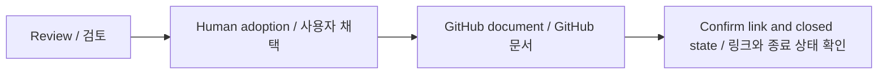

# Stage 2 decision link meeting / 2단계 결정 문서 연결 회의

Agenda: Choose the GitHub document to link when closing the Stage 2 test meeting.
의제: 2단계 시험 회의를 종료할 때 연결할 GitHub 문서를 정합니다.

Participants: Codex reviewed the agenda from the roles below. Curtain requested the review and will make the decision.
참석: Codex가 아래 역할 관점으로 의제를 검토했습니다. 커튼 뒤는 회의를 요청했고 채택 여부를 결정합니다.

## Facts / 확인된 사실

- One actual Slack reply reached Supabase with its permalink. The database function rejected the same message and a synthetic message from another thread.
  실제 Slack 답글 한 건과 원문 링크가 Supabase에 저장됐습니다. 저장 함수는 같은 메시지와 다른 스레드의 합성 메시지를 제외했습니다.
- [Office workflow](../workflow.md) requires a GitHub document for the final decision. The deployed schema requires a repository file URL when the meeting is closed.
  [운영 흐름](../workflow.md)은 최종 결정을 GitHub 문서에 기록하도록 합니다. 적용된 스키마는 회의 종료 시 저장소 파일 URL을 요구합니다.

## Role opinions / 역할별 의견

| Who / 역할 | What / 무엇 | Why / 이유 | How / 방법 | Goal / 목표 | Conviction / 소신 |
|---|---|---|---|---|---|
| Facilitator / 진행자 | Proposal: one decision record 제안: 결정 문서 한 건 | One place to review 검토 위치 한 곳 | Record the scope and human decision 범위와 사람의 결정 기록 | Clear approval 명확한 승인 | Wait for Curtain's decision 커튼 뒤 결정을 기다림 |
| Documentation / 문서 관리자 | Proposal: use `docs/office/decisions/` 제안: 전용 결정 문서 폴더 사용 | Workflow already owns this decision 운영 흐름이 담당하는 결정 | Link the record from the Stage 2 section 2단계 절에서 기록으로 연결 | Traceable history 추적 가능한 이력 | Keep the decision brief 결정은 짧게 기록 |
| GitHub / GitHub 관리자 | Proposal: use a commit permalink 제안: 커밋 고정 링크 사용 | The approved version remains identifiable 승인한 버전을 식별 가능 | Verify the merged file opens before linking 연결 전 병합된 파일 열기 확인 | Stable source link 안정적인 원본 링크 | Use the reviewed version 검토받은 버전을 사용 |
| Security / 보안 | Proposal: record results and counts 제안: 결과와 건수 기록 | Slack test channel is private Slack 시험 채널은 비공개 | Omit message text, private Slack links and credentials from the GitHub document GitHub 문서에서 발언 본문·비공개 링크·인증값 생략 | Limit disclosure 공개 범위 제한 | Keep detailed evidence in the restricted system 상세 증거는 제한된 시스템에 보관 |
| QA / 검증 | Proposal: check status and link together 제안: 상태와 링크를 함께 확인 | Closure needs both fields 종료에는 두 값이 필요 | Read back `closed` and open the recorded file 종료 상태를 조회하고 기록된 파일 열기 | End-to-end evidence 종단 검증 근거 | Report exactly what was exercised 실행한 범위만 보고 |
| Recorder / 서기 | Proposal: record remaining checks 제안: 남은 검증 항목 기록 | Readers need the test boundaries 독자에게 시험 범위가 필요 | Note that deduplication was tested at the DB function 중복 제외는 DB 함수에서 확인했다고 명시 | Accurate handoff 정확한 인계 | Keep observations and decisions explicit 관찰과 결정을 명확히 기록 |

## Recommendation and open decisions / 권고 및 미결정

Recommend drafting `docs/office/decisions/2026-11-28-stage2-meeting-storage.md` and linking it from the Stage 2 section of the workflow. Include scope, approved environment, observed results, remaining checks, and the human decision once received.
`docs/office/decisions/2026-11-28-stage2-meeting-storage.md` 초안을 작성하고 운영 흐름의 2단계 절에서 연결하는 안을 권고합니다. 범위, 승인된 환경, 검증 결과, 남은 검증과 실제 사람의 결정을 기록합니다.

Adopted on November 28, 2026 (KST): Curtain approved the decision document plan and local draft. See the [decision record](../decisions/2026-11-28-stage2-meeting-storage.md). Publication and the closure check are pending.
2026년 11월 28일(한국 시각) 채택: 커튼 뒤가 결정 문서안과 로컬 초안 작성을 승인했습니다. [결정 문서](../decisions/2026-11-28-stage2-meeting-storage.md)를 참고하세요. 게시와 종료 검증은 대기 중입니다.

