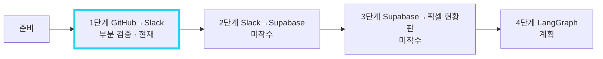
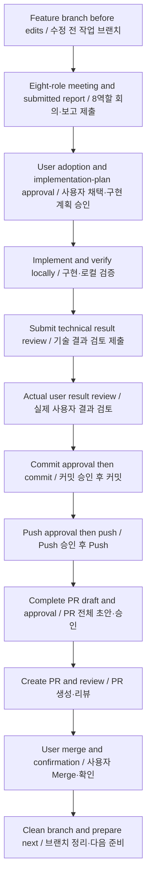
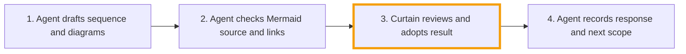
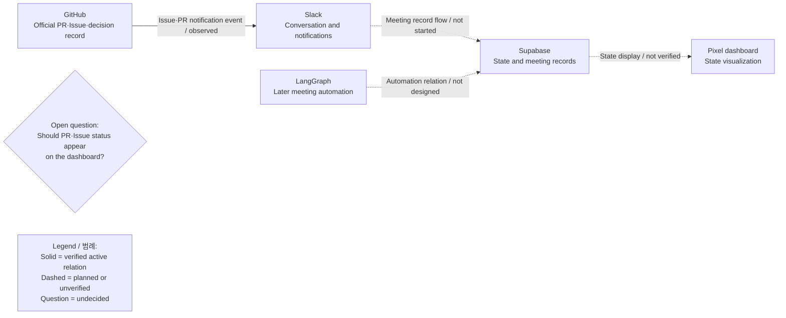

# Pixel Office 업무 운영 규칙

## 단계별 도입 규칙

## Mermaid 선 표현 원칙

### Chat rendering rule / 채팅창 렌더링 규칙

In the chat window, Mermaid must be rendered as a visible diagram. A fenced `mermaid` source block by itself is not a displayed diagram. If the chat renderer is unavailable, disclose the limitation, keep the Mermaid source available, and add a plain-language description of the visual relationships.
채팅창에서는 Mermaid를 보이는 다이어그램으로 렌더링해야 합니다. `mermaid` fenced 소스 블록만 보여주는 것은 다이어그램 표시가 아닙니다. 채팅 렌더러를 사용할 수 없으면 그 한계를 밝히고 Mermaid 소스를 제공하며 시각적 관계를 쉬운 말로 설명합니다.

Use solid arrows only for relations with observed, end-to-end evidence. Use dashed arrows for planned or unverified relations. Show undecided relations as an explicit question, not as an approved plan. Include a legend in every target-architecture diagram and label each edge with its actual operation. A documented intention is not proof of an active integration.
관찰된 종단 근거가 있는 관계만 실선으로 표시합니다. 계획 또는 미검증 관계는 점선으로 표시하고, 미결정 관계는 승인된 계획선이 아니라 명시적 질문으로 나타냅니다. 목표 아키텍처 그림에는 범례를 넣고 각 연결에 실제 동작을 표기합니다. 문서에 적힌 의도는 활성 연동의 증거가 아닙니다.

### 1단계 — GitHub PR·Issue → Slack 알림

GitHub의 PR과 Issue가 공식 기록입니다. Slack은 새 작업, 리뷰 요청, 승인 대기 알림을 받는 공간입니다. 2026-11-22 커튼 뒤가 채택한 필수 이벤트는 Issue 생성·종료, PR 생성·병합, 자동 `COMMENT` 리뷰 알림, 리뷰 요청 알림, 독립 `APPROVE` 알림, 독립 `REQUEST_CHANGES` 알림입니다. 이 이벤트들은 각각 실제 GitHub 원본과 Slack 메시지를 대조해야 합니다. 별도 Actions→Gemini→COMMENT 리뷰 경로는 구현·종단 검증 전까지 미검증입니다. 사용자 실행 승인 알림은 수동 흐름으로 자동 GitHub 이벤트와 분리합니다.

완료 조건: 필수 여덟 이벤트 각각에 대해 GitHub 저장소·항목 번호/제목·이벤트/상태·원본 링크를 Slack 메시지와 대조하고, 이벤트 시각/시간대·Slack permalink/표시 시각·중복 수·판정을 기록합니다. 자동 `COMMENT` 리뷰는 Actions가 제출한 리뷰인지 GitHub 원본에서 확인합니다. 독립 리뷰 요청·`APPROVE`·`REQUEST_CHANGES`는 별도 리뷰어가 실제로 발생시킨 결과만 근거로 인정합니다. 각 이벤트 한 번의 일치는 그 이벤트 전달 근거일 뿐 반복·지연·전체 신뢰성을 증명하지 않습니다. 숫자 지연/SLA/반복 횟수 기준은 채택되지 않았습니다. 여덟 행 모두 근거가 있고 커튼 뒤가 결과를 수락한 뒤에만 1단계 완료를 검토합니다.

결정 기록: [1단계 이벤트 범위·완료 조건 회의](meetings/2026-11-21-stage1-events-and-completion-criteria-review.md) 및 [필수 리뷰 알림 범위 채택 기록](meetings/2026-11-22-review-notification-scope-adoption.md). 자동 리뷰 작성 주체·독립 리뷰어 확보 논의는 [미결정 회의록](meetings/2026-11-23-review-automation-and-independent-reviewer-meeting.md)을 참조하며, 실제 연동 시험 여부는 [진행 여부 회의 초안](meetings/2026-11-23-stage1-live-integration-test-go-no-go.md)에 기록했습니다. 시험 이벤트 계획과 Particle-1/수신 채널 제안은 [시험 계획 회의 초안](meetings/2026-11-23-particle-review-test-plan-meeting.md)에 기록했습니다. Particle-1은 자동 리뷰 모델 후보이며 사람 독립 리뷰어로 간주되지 않습니다. 실제 시험은 승인됐으나 GitHub CLI 인증 문제로 실행이 막혀 있습니다.

The local review script uses a 240-second planning budget with 70 seconds reserved for GitHub submission. [Decision record](meetings/2026-11-27-review-submission-time-decision.md).
로컬 리뷰 스크립트는 240초 계획 예산 중 70초를 GitHub 제출에 남깁니다. [결정 기록](meetings/2026-11-27-review-submission-time-decision.md).

### 2단계 — Slack 회의 → Supabase 회의 기록

Slack 회의에서 나온 발언과 상태를 Supabase에 저장합니다. 단, 최종 결정은 GitHub 문서에 기록합니다. Slack→Supabase 자동 기록은 착수·검증 전까지 계획으로 표시합니다.

완료 조건: 채택한 회의 기록 흐름으로 Slack 발언·상태가 Supabase에 재현 가능하게 기록되고, 최종 결정이 GitHub 문서에 연결됨을 확인합니다. 저장 범위·스키마·중복 처리 정책은 구현 전에 별도 채택합니다.

### 3단계 — Supabase 상태 → 픽셀 현황판 실시간 표시

Supabase의 에이전트·회의·지식 지도 상태를 현황판에 표시합니다. 현황판은 상태를 보여줄 뿐 결정의 원본이 아닙니다. 이 단계 설계에서 GitHub PR·Issue 상태를 현황판에 표시할 필요가 있는지 결정합니다. 그 전까지 GitHub→Supabase 동기화는 미결정이며 계획된 연동으로 그리지 않습니다.

순서 결정: 날씨 서비스 관리자 대시보드 작업은 픽셀 현황판이 완성된 뒤 시작합니다. 이 순서는 착수 시점을 정할 뿐 픽셀 현황판의 구체 완료 체크리스트, 관리자 화면 범위, 두 대시보드의 통합 여부를 확정하지 않습니다. 다음 설계 회의 전까지 관리자 대시보드 구현은 시작하지 않습니다.
Sequencing decision: work on the weather-service admin dashboard starts after the Pixel dashboard is complete. This sets the order only; it does not define the Pixel dashboard's detailed completion checklist, admin-screen scope, or whether the dashboards should be integrated. Do not begin admin-dashboard implementation before a later design meeting.

완료 조건: 채택한 Supabase 상태만 현황판에 표시되고 상태·접근 정책 및 최신성 기준을 확인합니다. GitHub PR·Issue 동기화는 필요하다고 별도 채택한 경우에만 범위·필드·보존·이벤트 경로를 정의합니다.

### 4단계 — LangGraph가 회의 진행과 기록 자동화

반복되는 회의 흐름과 기록 형식이 확인된 뒤 LangGraph를 도입합니다. 자동화가 사람의 승인 절차를 생략해서는 안 됩니다.

완료 조건: 채택된 반복 회의 흐름과 기록을 자동화하되 사람 승인 지점이 보존되고, 중단·오류·재개 동작을 검증합니다.

## 온라인 운영과 예약 실행 원칙

The project is online-first. Production scheduled work must not depend on a user's computer, local crontab, or a local Codex automation session being available. Select a scheduler that runs in the chosen hosted environment when the task, hosting platform, authentication, failure handling and cost requirements are known. The scheduler/provider is not selected by this principle. Codex's local scheduled automation may help with personal development tasks, but it is not evidence of an always-online project service. No schedule was created or enabled by adopting this principle.
프로젝트는 온라인 기반입니다. 운영 예약 작업은 사용자의 컴퓨터, 로컬 crontab 또는 로컬 Codex 자동화 세션의 가동 여부에 의존하지 않아야 합니다. 작업 목적·호스팅 플랫폼·인증·오류 처리·비용 요구사항을 확인한 뒤 선택한 호스팅 환경에서 실행되는 스케줄러를 정합니다. 이 원칙만으로 스케줄러/제공자를 선택하지 않습니다. Codex 로컬 예약 자동화는 개인 개발 작업에 쓸 수 있지만, 항상 온라인인 프로젝트 서비스의 근거는 아닙니다. 이 원칙 채택으로 예약 작업을 만들거나 활성화하지 않았습니다.

Decision record: [Online-first scheduling meeting / 온라인 기반 예약 실행 회의](meetings/2026-11-21-online-scheduling-runtime-meeting.md).
결정 기록: [온라인 기반 예약 실행 회의](meetings/2026-11-21-online-scheduling-runtime-meeting.md).

### Required rollout status in every task report
### 매 작업 보고의 도입 단계 표시

At task start, meaningful progress updates and final reporting, include the four fields below. Use the four integration stages above, not a feature-development milestone. Preparatory feature work may leave the rollout stage unchanged.
작업 시작·의미 있는 중간 진행·최종 보고에 아래 네 항목을 포함합니다. 기능 개발 단계가 아닌 위 운영 연동 4단계를 사용합니다. 기반 기능 작업을 해도 도입 단계는 그대로일 수 있습니다.

```text
Rollout stage / 도입 단계: 준비(1단계 착수 전) 또는 현재 도입 단계·상태
Evidence / 근거: 확인한 연동 결과 또는 미검증 항목
Current task / 현재 작업: 회의·계획·구현·검증·승인 대기 등
Next rollout action / 다음 도입 작업: 운영 연동에서 다음에 진행할 일
```

Distinguish not started, in progress, implemented-but-unverified and verified complete. A stage advances only after its end-to-end integration has verified evidence. Do not infer completion from a document, feature test, commit or PR; do not infer external service configuration from local code. Explicitly report unchanged stages. The next-action field is a report, not execution permission.
미착수·진행 중·구현/미검증·검증 완료를 구분합니다. 해당 연동의 전체 작동을 검증한 근거가 있어야 단계를 올립니다. 문서·기능 테스트·커밋·PR만으로 완료를 추정하거나 로컬 코드로 외부 서비스 설정을 확인했다고 하지 않습니다. 단계가 그대로면 명시합니다. 다음 작업 항목은 보고이며 실행 허가는 아닙니다.

### Overall rollout Mermaid / 전체 도입 흐름 Mermaid

Use a bright cyan border (`#22d3ee`) to highlight the current rollout stage in the overall flow. Use amber (`#f59e0b`) for the current task step in the separate task-detail flow. Cyan marks the key rollout stage; it does not mean error, completion, or approval. Update the highlighted node when the rollout stage changes.
전체 도입 흐름에서는 밝은 청록색 테두리(`#22d3ee`)로 현재 도입 단계를 강조합니다. 별도의 세부 작업 흐름에서는 현재 작업 단계에 주황색(`#f59e0b`)을 사용합니다. 청록색은 핵심 도입 단계 표시이며 오류·완료·승인을 뜻하지 않습니다. 도입 단계가 바뀌면 강조 노드도 함께 바꿉니다.



## 일반 업무 흐름

### 단계별 실행자·확인자 보고 규칙

Use the same fixed Markdown table in every task-start, progress, and final report, with exactly these columns: `순서`, `커튼 뒤가 할 일`, `제가 할 일`. Put steps in execution order and put the state (완료/현재/대기) beside each step number. In both owner columns, explain the exact action in beginner-friendly language, or write `없음(이 단계에서는 불필요)`. Include who verifies the result and what evidence the verification establishes. After the table, state who acts next. Curtain handles only actions requiring the user's login, access, judgment, or approval; the Assistant continues all other authorized work.
모든 작업 시작·진행·최종 보고에서 아래와 같은 고정 Markdown 표를 사용하며 열은 정확히 `순서`, `커튼 뒤가 할 일`, `제가 할 일`로 합니다. 단계를 실행 순서로 쓰고 번호 옆에 완료·현재·대기 상태를 표시합니다. 두 담당 칸에는 초보자도 이해할 쉬운 말로 정확한 행동을 적고, 할 일이 없으면 `없음(이 단계에서는 불필요)`이라고 씁니다. 결과 확인자와 확인으로 입증되는 근거를 포함합니다. 표 아래에 다음 실행자를 씁니다. 로그인·접근 권한·판단·승인이 필요한 일만 커튼 뒤가 맡고 나머지 허가된 작업은 어시스턴트가 계속합니다.

```markdown
| 순서 | 커튼 뒤가 할 일 | 제가 할 일 |
|---|---|---|
| 1. 완료 | 확인: 무엇을 확인했는지 | 실행: 무엇을 했는지; 근거: 무엇으로 확인했는지 |
| 2. 현재 | 실행 또는 검토할 일, 없으면 `없음(이 단계에서는 불필요)` | 실행 또는 확인할 일 |
| 3. 대기 | 사용자 승인·접근 등 필요한 일 | 승인 후 이어서 할 일 |
```

다음 실행자: `커튼 뒤` 또는 `어시스턴트`로 명시합니다.

### Beginner guidance for user-operated websites / 사용자가 직접 조작하는 웹 안내

When Curtain must use a website or app, guide only the current stage in detail. Start with the goal and the official page link; give numbered clicks or entries using the visible control labels; state cost, privacy, access, and security cautions before the user acts. Preview later stages with `다음 진행 예정`, but do not ask the user to do them before the current stage is confirmed. End with the exact completion phrase and ask for a screenshot with secrets and personal details hidden if the screen differs. Never ask for passwords, one-time codes, API keys, tokens, or recovery codes in chat. Do not claim completion until the result is observed.
커튼 뒤가 웹사이트나 앱을 직접 조작해야 하면 현재 단계만 자세히 안내합니다. 목표와 공식 페이지 링크를 먼저 주고, 화면의 버튼 이름을 사용해 클릭·입력 순서를 번호로 씁니다. 사용자가 실행하기 전에 비용·개인정보·접근 권한·보안 주의점을 설명합니다. 뒤 단계는 `다음 진행 예정`으로 미리 보여주되 현재 단계가 확인되기 전에 실행하라고 하지 않습니다. 끝에는 완료 후 보낼 정확한 문구를 제시하고 화면이 다를 때는 비밀값·개인정보를 가린 화면 캡처를 요청합니다. 비밀번호·일회용 코드·API 키·토큰·복구 코드를 채팅으로 요청하지 않습니다. 실제 결과를 보기 전에는 완료라고 하지 않습니다.

This reporting format does not authorize external changes, publication, commits, pushes, Pull Requests, or merges.
이 보고 형식은 외부 변경·공개·커밋·Push·Pull Request·Merge를 허가하지 않습니다.

```text
새 작업 브랜치 생성(수정 전)
→ 회의
→ 8개 작업 역할의 Who·What·Why·How·Goal·소신
→ 어시스턴트의 사실·합의·충돌·미결정 취합
→ 커튼 뒤(사용자)에게 보고 제출
→ 사용자 검토·채택·승인
→ 파일별 변경 목적·작동·검증 계획 보고
→ 사용자 구현 승인
→ 문서 또는 코드 수정
→ 로컬 확인
→ 결과 검토 보고 제출
→ 사용자 결과 검토
→ 커밋 승인
→ 커밋
→ push 허가
→ push
→ PR 제목·본문 전체 보고
→ PR 초안·생성 승인
→ PR 생성
→ Approve
→ 사용자 merge
→ 사용자 merge confirmed
→ 브랜치 정리
→ 새 작업 브랜치 생성
```

Curtain receives reports and supplies the actual decision. The assistant must not invent Curtain's speech or treat its own recommendation as approval. See [roles.md](roles.md).
커튼 뒤는 보고를 받고 실제 결정을 전달합니다. 어시스턴트는 커튼 뒤 발언을 만들어 내거나 자신의 권고를 승인으로 취급하지 않습니다. [roles.md](roles.md)를 참조합니다.

An assistant's technical review is not user result acceptance, commit approval or PR approval. A completed local check does not imply that the change is committed, pushed, merged or deployed.
어시스턴트의 기술 검토는 사용자 결과 수락·커밋 승인·PR 승인이 아닙니다. 로컬 확인 완료만으로 커밋·Push·Merge·배포된 것으로 표시하지 않습니다.

### Approval flow visualization
### 승인 흐름 시각화

This is the reusable process, not a claim that every step is complete. Date-specific progress belongs in CONVERSATION_LOG.md and the submitted status report.
아래는 재사용할 절차이며 모든 단계 완료 주장이 아닙니다. 날짜별 진행 상태는 CONVERSATION_LOG.md와 제출 보고에 기록합니다.



### Current-task view and test sequence
### 현재 작업 그림과 시험 시퀀스

The current-task view identifies owners, verifiers and human approval gates. It does not repeat event-by-event integration behavior. For the stage-1 AI review test, use the following task-specific sequence. Every proposed or unobserved interaction remains explicitly unverified; this diagram is not evidence that the workflow exists or has run.
현재 작업 그림은 담당자·확인자·사람 승인 지점을 나타내며 이벤트별 연동 동작을 반복하지 않습니다. 1단계 AI 리뷰 시험에는 다음 작업별 시퀀스를 사용합니다. 제안되었거나 관찰되지 않은 상호작용은 미검증으로 표시하며, 이 다이어그램은 워크플로 구현·실행 근거가 아닙니다.

```mermaid
sequenceDiagram
  participant U as Human author / 사용자
  participant GH as GitHub PR
  participant A as Actions proposed / 제안·미검증
  participant M as Gemini proposed / 제안·미검증
  participant C as GitHub COMMENT
  participant S as Slack
  U->>GH: Open test PR with synthetic code / 합성 코드 시험 PR 생성
  GH-->>A: pull_request event / 미검증
  A->>GH: Read diff / 권한·실행 미검증
  A->>M: Send bounded diff / 미구현
  alt Quota exhausted / 한도 초과·응답 미검증
    M-->>A: Limit or error / 응답 동작 미검증
    A-->>GH: Stop without review; report failure / 제안된 중단·보고
  else Model returns review text / 모델 응답·미검증
    M-->>A: Review text / 미검증
    A->>GH: Submit COMMENT only / 미구현
    GH-->>A: Bot comment may retrigger workflow / 재트리거 미검증
    A-->>A: Ignore bot actor; stop recursion / 제안된 차단
    GH-->>S: Review notification / 해당 이벤트 전달 미검증
  end
```

The recurring task-detail view stays concise and records the current owner, verifier and approval handoff. It does not repeat the integration messages shown in the sequence above.
상시 작업 상세 그림은 간결하게 유지하며 현재 담당자·확인자·승인 인계를 기록합니다. 위 시퀀스의 연동 메시지를 반복하지 않습니다.



### Target architecture and line legend
### 목표 아키텍처와 선 범례

Solid arrows mean verified active relations only. Dashed arrows mean planned or unverified relations. An undecided relation is shown as a question, not as a planned edge. “Documented” alone does not mean the relation is active or verified.
실선은 검증된 활성 관계만 뜻합니다. 점선은 계획 또는 미검증 관계입니다. 미결정 관계는 계획선이 아닌 질문으로 표시합니다. 문서에 적혀 있다는 사실만으로 활성·검증 관계가 되지 않습니다.



## Pull Request 필수 내용

```text
What: 무엇을 수정했는가?
How: 어떻게 수정했는가?
Why: 왜 수정했는가?

Sources checked and disclosed: Yes / No
Implemented and checked locally: Yes / No
Approved: Yes / No

## Checks / 확인 사항

- [ ] Data sources explicitly cited: source names and links or a repository record.
      자료 출처 명시: 출처 이름·링크 또는 저장소 내 기록.
- [ ] Licenses stated: license names, links and required attribution or a repository record.
      라이선스 표기: 라이선스 이름·링크·필수 출처 표시 또는 저장소 내 기록.
```

Use the evidence, unchecked-item and Not applicable rules in [AGENTS.md](../../AGENTS.md). Check the two items separately in the full PR draft before requesting approval.
근거·미확인 미체크·해당 없음 처리는 [AGENTS.md](../../AGENTS.md)를 따릅니다. 승인 요청 전 전체 PR 초안에서 두 항목을 각각 확인합니다.

## 기록 원칙

- GitHub 문서: 사실·결정·출처·라이선스
- Slack: 대화·질문·알림
- Supabase: 상태·회의 이벤트·지식 연결
- 현황판: 현재 상태와 연결 관계
- LangGraph: 승인된 자동화 실행 흐름

## Stage 1 execution reference / 1단계 실행 참조

Use [stage1-notifications.md](stage1-notifications.md) for permission review, proposed subscriptions, event evidence and recovery. Read the [second meeting](meetings/2026-11-19-stage1-notification-second-planning.md) for unresolved decisions. Documentation authorization does not establish setup or delivery completion.
권한 검토·구독 후보·이벤트 근거·복구는 [1단계 지침](stage1-notifications.md)을 따릅니다. 미결정 사항은 [2차 회의](meetings/2026-11-19-stage1-notification-second-planning.md)를 확인합니다. 문서화 승인은 설정·전달 완료가 아닙니다.

Every task-start, meaningful progress, and final report must show three Mermaid diagrams: (1) the full office rollout, (2) the current task's detailed workflow with its current node highlighted, and (3) the target product architecture. Include rollout stage, evidence, task state, and next action. Keep diagrams faithful to verified status and do not hard-code a permanent current node in reusable diagrams.
매 작업 시작·의미 있는 진행·최종 보고에 Mermaid 3개를 표시합니다. (1) 전체 사무실 도입 흐름, (2) 현재 위치를 강조한 세부 작업 흐름, (3) 목표 제품 아키텍처입니다. 도입 단계·근거·작업 상태·다음 작업도 포함합니다. 검증 상태를 정확히 반영하고 재사용 다이어그램에는 현재 노드를 영구 고정하지 않습니다.
