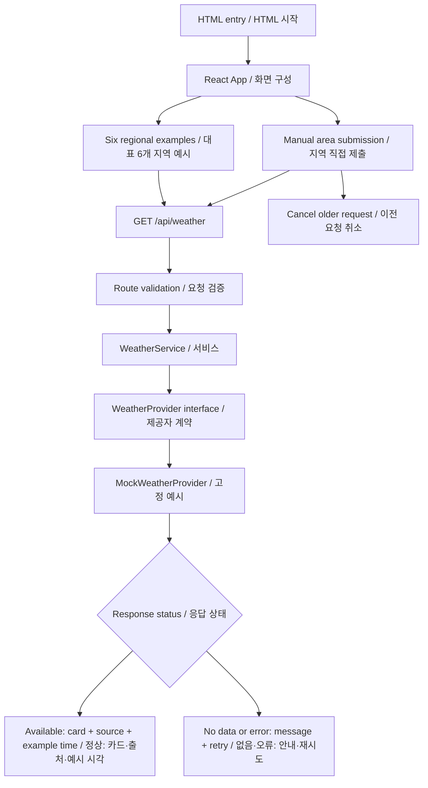
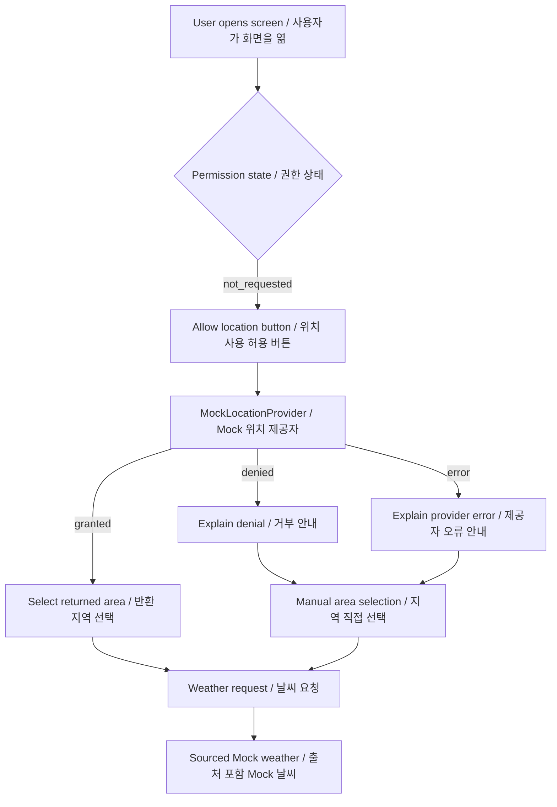

# Current Weather Foundation Specification
# 현재 날씨 기반 기능 Spec

> Provider boundary: see [`weather-api-contract.md`](./weather-api-contract.md).
>
> 제공자 경계는 [`weather-api-contract.md`](./weather-api-contract.md)를 참고합니다.

## Why
<!-- This feature shows verified current weather before the user asks a question. -->
<!-- 이 기능은 사용자가 질문하기 전에 확인된 현재 날씨를 보여줍니다. -->

- The service needs one simple, factual starting point.
  - 서비스는 단순하고 사실에 기반한 시작점이 필요합니다.
- The first screen must communicate the weather condition without forcing an interpretation.
  - 첫 화면은 해석을 강요하지 않고 날씨 상태를 전달해야 합니다.

## Goal
<!-- The goal is to show the current weather for a selected area with its evidence. -->
<!-- 목표는 선택한 지역의 현재 날씨와 근거를 함께 보여주는 것입니다. -->

- Show the selected area's current condition, observation time, source, and data status.
  - 선택한 지역의 현재 상태, 기준 시각, 출처, 데이터 상태를 보여줍니다.
- Keep facts, assumptions, and limitations separate.
  - 사실·가설·한계를 분리합니다.

## What
<!-- These are the MVP requirements. -->
<!-- 다음은 MVP 요구사항입니다. -->

- Accept the current location when the user grants permission.
  - 사용자가 권한을 허용하면 현재 위치를 사용합니다.
- Offer manual area selection when permission is denied.
  - 권한을 거부하면 지역을 직접 선택할 수 있게 합니다.
- Display a weather condition such as rain, snow, or clear weather.
  - 비·눈·맑음과 같은 날씨 상태를 표시합니다.
- Display temperature, precipitation probability when available, reference time, and source.
  - 가능한 경우 기온·강수확률·기준 시각·출처를 표시합니다.
- Display loading, unavailable-data, and error states.
  - 로딩·데이터 없음·오류 상태를 표시합니다.
- Use text, icon, and color together so the condition is not communicated by color alone.
  - 색상만으로 전달하지 않도록 텍스트·아이콘·색상을 함께 사용합니다.

## How
<!-- The flow starts with area selection and ends with a sourced weather view. -->
<!-- 흐름은 지역 선택으로 시작해 출처가 표시된 날씨 화면으로 끝납니다. -->

1. The screen starts with a permission request or manual area selection.
   - 화면은 위치 권한 요청 또는 지역 직접 선택으로 시작합니다.
2. The weather provider receives the selected area.
   - 날씨 제공자는 선택된 지역을 받습니다.
3. A mock provider supplies stable local test data during the MVP design stage.
   - MVP 설계 단계에서는 Mock 제공자가 안정적인 로컬 테스트 데이터를 제공합니다.
4. The view renders the condition, measurements, reference time, source, and status.
   - 화면은 상태·측정값·기준 시각·출처·데이터 상태를 렌더링합니다.
5. The interface labels interpretation as interpretation and does not present it as an observed fact.
   - 화면은 해석을 해석으로 표시하고 관측 사실처럼 제시하지 않습니다.

## Acceptance Criteria
<!-- Each criterion can be checked without connecting to a live weather service. -->
<!-- 각 기준은 실제 날씨 서비스에 연결하지 않고 확인할 수 있습니다. -->

- Given a selected area, when mock data is available, then the condition and reference time are visible.
  - 지역이 선택되고 Mock 데이터가 있으면 날씨 상태와 기준 시각이 보여야 합니다.
- Given denied location permission, when the screen loads, then manual area selection remains available.
  - 위치 권한을 거부해도 지역 직접 선택이 가능해야 합니다.
- Given missing weather data, when the view renders, then it shows an unavailable-data message.
  - 날씨 데이터가 없으면 데이터 없음 메시지를 보여야 합니다.
- Given a provider error, when the view renders, then it shows an error state without inventing weather facts.
  - 제공자 오류가 나면 날씨 사실을 만들어내지 않고 오류 상태를 보여야 합니다.
- Given any weather condition, when it is displayed, then text and an accessible label identify the condition.
  - 어떤 날씨 상태든 텍스트와 접근성 레이블로 상태를 식별할 수 있어야 합니다.
- Given a rendered weather result, when the user inspects it, then source and reference time are visible.
  - 날씨 결과를 보면 출처와 기준 시각을 확인할 수 있어야 합니다.

## Facts, Assumptions, and Limits
<!-- This section prevents unsupported weather claims. -->
<!-- 이 절은 근거 없는 날씨 주장을 막습니다. -->

### Facts
- The display may report only values supplied by the selected weather provider.
  - 화면은 선택한 날씨 제공자가 준 값만 표시할 수 있습니다.

### Assumptions
- The weather provider can return an area, condition, timestamp, and source label.
  - 날씨 제공자가 지역·상태·시각·출처 레이블을 반환한다고 가정합니다.

### Limits
- The MVP does not claim road conditions, wheelchair accessibility, or personal safety.
  - MVP는 도로 상태·휠체어 접근성·개인 안전을 주장하지 않습니다.
- Live API behavior and location retention are open decisions until verified.
  - 실제 API 동작과 위치 보관 여부는 확인 전까지 미결정 사항입니다.

## Sources and Licenses
<!-- Source details must be verified before live integration. -->
<!-- 실제 연동 전에 출처 세부사항을 확인해야 합니다. -->

- Planned weather source: Korea Meteorological Administration, `https://www.weather.go.kr/`.
  - 예정 날씨 출처: 기상청, `https://www.weather.go.kr/`.
- KMA copyright and use conditions: `https://www.weather.go.kr/kma/guide/copyright.jsp`.
  - 기상청 저작권 및 이용 조건: `https://www.weather.go.kr/kma/guide/copyright.jsp`.
- Live endpoint, request limits, and redistribution conditions remain to be verified.
  - 실제 엔드포인트·요청 제한·재배포 조건은 추가 확인이 필요합니다.

## Approved implementation stage: Mock HTTP wiring
## 승인된 구현 단계: Mock HTTP 연결

- This stage implements a subset of the product brief and PRD, not the full product acceptance criteria.
  - 이번 단계는 기획서·PRD의 일부를 구현하며 전체 제품 완료 조건을 충족하는 단계는 아닙니다.
- Show fixed, self-authored examples for Seoul, Busan, Daejeon, Gwangju, Gangneung, and Jeju. This is a representative list, not complete national coverage.
  - 서울·부산·대전·광주·강릉·제주의 자체 제작 고정 예시를 표시합니다. 전국 전체가 아닌 대표 목록입니다.
- Actual geolocation and coordinate conversion remain future work. Tests inject denied permission and verify manual lookup remains usable.
  - 실제 위치 탐지·좌표 변환은 후속 작업입니다. 테스트에서 권한 거부를 주입하고 수동 조회가 가능한지 검증합니다.
- Never label mock values as verified current observations or use request time as observation time.
  - Mock 값을 확인된 현재 관측값으로 표시하거나 요청 시각을 관측 시각으로 사용하지 않습니다.

### Contract and state ownership
### 계약과 상태 담당

| Owner / 담당 | States and rules / 상태와 규칙 |
|---|---|
| Browser / 브라우저 | Permission: not_requested or denied (injected in tests). / 권한: 미요청 또는 거부(테스트 주입). |
| UI / 화면 | idle → loading → result or error. Permission denial does not block lookup. / 초기 → 로딩 → 결과 또는 오류. 위치 거부는 조회를 막지 않습니다. |
| API / 서버 | GET /api/weather?area=...; available and no_data use HTTP 200; provider_error uses 503. / 정상·데이터 없음은 HTTP 200, 제공자 오류는 503입니다. |
| Schema / 형식 | available requires condition and timezone-aware example time; unavailable responses require a message and null weather fields. / 정상은 상태·시간대 포함 예시 시각이 필요하며 실패는 설명과 비어 있는 날씨 필드를 사용합니다. |
| Client / 클라이언트 | Validate JSON, cancel obsolete requests, and time out after 10 seconds. / JSON 검증·이전 요청 취소·10초 시간 제한을 적용합니다. |

### Execution pipeline
### 실행 파이프라인

### Approved file plan
### 승인된 파일 계획

| File / 파일 | Action / 작업 | Purpose and output / 목적과 결과 |
|---|---|---|
| `backend/app/schemas/weather.py` | Edit / 수정 | Validate successful and unavailable responses without invented facts. 정상·실패 응답을 검증하고 만들어낸 날씨 값을 막습니다. |
| `backend/app/providers/base.py` | Edit / 수정 | Define the interchangeable provider interface. 교체 가능한 제공자 인터페이스를 정의합니다. |
| `backend/app/providers/mock_weather.py` | Edit / 수정 | Return fixed examples or no-data for unsupported areas. 고정 예시 또는 미지원 지역의 데이터 없음을 반환합니다. |
| `backend/app/services/weather_service.py` | Edit / 수정 | Normalize input and translate provider outages into safe responses. 입력을 정리하고 제공자 장애를 안전한 응답으로 변환합니다. |
| `backend/app/routes/weather.py` | Edit / 수정 | Bind HTTP validation, dependency injection, and 503 responses. HTTP 검증·의존성 주입·503 응답을 연결합니다. |
| `backend/requirements.txt` | Edit / 수정 | Pin directly used Python tools and server dependencies. 직접 사용하는 Python 도구와 서버 의존성 버전을 고정합니다. |
| `backend/tests/test_mock_provider.py` | Edit / 수정 | Verify fixed time, missing data, and schema invariants. 고정 시각·데이터 없음·응답 형식 제약을 검증합니다. |
| `backend/tests/test_weather_service.py` | Edit / 수정 | Test normalization, injected providers, and sanitized outages. 입력 정리·제공자 주입·안전한 장애 처리를 검증합니다. |
| `backend/tests/test_weather_route.py` | Edit / 수정 | Check HTTP success, validation errors, and provider outages. HTTP 성공·입력 오류·제공자 장애를 검증합니다. |
| `frontend/package.json` | Edit / 수정 | Define runtime dependencies and development, testing, and build commands. 실행 의존성과 개발·테스트·빌드 명령을 정의합니다. |
| `frontend/package-lock.json` | Create / 생성 | Record the dependency tree for reproducible npm ci installs. npm ci로 재현할 수 있도록 의존성 트리를 기록합니다. |
| `frontend/index.html` | Create / 생성 | Provide the HTML root and load the module entry. HTML 루트를 제공하고 모듈 진입점을 불러옵니다. |
| `frontend/src/main.tsx` | Create / 생성 | Mount React and render App. React를 연결하고 App을 표시합니다. |
| `frontend/tsconfig.json` | Create / 생성 | Check application, configuration, and test types. 앱·설정·테스트의 타입을 검사합니다. |
| `frontend/vite.config.ts` | Create / 생성 | Configure JSX, the API proxy, and component tests. JSX·API 프록시·컴포넌트 테스트를 설정합니다. |
| `frontend/src/types/weather.ts` | Edit / 수정 | Define status-specific frontend API types. 상태별 Frontend API 타입을 정의합니다. |
| `frontend/src/state/weatherState.ts` | Edit / 수정 | Separate request states from location permission. 요청 상태와 위치 권한을 분리합니다. |
| `frontend/src/services/weatherApi.ts` | Edit / 수정 | Encode requests, enforce timeout/cancellation, and validate JSON. 요청 인코딩·시간 제한·취소·JSON 검증을 수행합니다. |
| `frontend/src/app/App.tsx` | Edit / 수정 | Load representative regions and coordinate selection, retries, and stale-request handling. 대표 지역 조회·지역 선택·재시도·이전 요청 처리를 조정합니다. |
| `frontend/src/components/AreaSelector.tsx` | Edit / 수정 | Submit a nonempty area without requesting on every keystroke. 글자마다 요청하지 않고 비어 있지 않은 지역을 제출합니다. |
| `frontend/src/components/WeatherStatus.tsx` | Edit / 수정 | Announce loading, unavailable data, and errors accessibly. 로딩·데이터 없음·오류를 접근성 안내로 전달합니다. |
| `frontend/src/components/WeatherCard.tsx` | Edit / 수정 | Render successful examples with readable condition labels. 성공 예시를 읽을 수 있는 날씨 상태와 함께 표시합니다. |
| `frontend/src/components/SourceNotice.tsx` | Edit / 수정 | Explain mock provenance and the fixed example timestamp. Mock 출처와 고정된 예시 기준 시각을 설명합니다. |
| `frontend/src/tests/weather-flow.test.ts` | Edit / 수정 | Test the HTTP adapter and reject invalid response bodies. HTTP 어댑터를 테스트하고 잘못된 응답을 거부합니다. |
| `frontend/src/tests/App.test.tsx` | Create / 생성 | Test denial fallback, manual lookup, missing data, retries, and races. 위치 거부 대체 흐름·수동 조회·데이터 없음·재시도·요청 경합을 테스트합니다. |
| `frontend/playwright.config.ts` | Create / 생성 | Start and stop both servers for repeatable browser tests. 반복 가능한 브라우저 검증을 위해 두 서버를 시작하고 종료합니다. |
| `frontend/e2e/weather.spec.ts` | Create / 생성 | Verify Chromium uses the real Vite-to-FastAPI pipeline. Chromium이 실제 Vite→FastAPI 파이프라인을 사용하는지 검증합니다. |
| `.github/workflows/quality-check.yml` | Edit / 수정 | Add application checks while retaining existing repository checks. 기존 저장소 검사를 유지하면서 앱 검증을 추가합니다. |
| `.gitignore` | Edit / 수정 | Exclude environments, secrets, and generated test artifacts. 환경·비밀값·생성된 테스트 산출물을 제외합니다. |
| `docs/specs/current-weather.md` | Edit / 수정 | Record approved scope, contracts, Mermaid flow, file plan, and acceptance criteria. 승인 범위·계약·Mermaid 흐름·파일 계획·완료 조건을 기록합니다. |
| `README.md` | Edit / 수정 | Explain actual startup, structure, implemented behavior, and remaining work. 실제 실행법·구조·구현 동작·남은 작업을 설명합니다. |
| `docs/office/change-report.md` | Edit / 수정 | Report every changed file, behavior, sources, and measured verification. 변경 파일별 동작·출처·실측 검증을 보고합니다. |
| `CONVERSATION_LOG.md` | Edit / 수정 | Record approved work, measured results, limitations, and the next approval stage. 승인 작업·실측 결과·한계·다음 승인 단계를 기록합니다. |

- No files are deleted. JSON cannot contain comments; package and compiler configuration purposes are explained here and in the change report.
  - 파일 삭제는 없습니다. JSON에는 주석을 넣을 수 없으므로 패키지·컴파일러 설정의 목적은 이 문서와 변경 보고서에 설명합니다.
- Execution starts at index.html, loads main.tsx, mounts App, fetches examples, validates the API response, and renders states and sourced examples.
  - index.html → main.tsx → App → 예시 조회 → API 응답 검증 → 상태·출처 포함 예시 표시 순서로 실행됩니다.

### Stage acceptance criteria
### 단계 완료 조건

1. Both servers start using the README commands and the browser reaches the real local API through the proxy.
   - README 명령으로 두 서버가 시작되고 브라우저가 프록시를 통해 실제 로컬 API에 도달합니다.
2. Manual selection works with denied permission; unsupported areas show no-data without invented facts.
   - 권한 거부 상태에서도 수동 선택이 작동하고 미지원 지역은 가짜 값 없이 데이터 없음을 표시합니다.
3. Failed requests offer retry, and older responses cannot replace the latest selection.
   - 실패한 요청은 재시도를 제공하고 이전 응답이 최신 지역 결과를 덮어쓰지 않습니다.
4. Python checks, HTTP tests, frontend types, component tests, production build, and Chromium integration pass.
   - Python 검사·HTTP 테스트·Frontend 타입·컴포넌트 테스트·배포용 빌드·Chromium 통합 검증을 통과합니다.
5. Every changed file has an English explanation followed by Korean translation in the change report.
   - 모든 변경 파일에 대해 변경 보고서에 영어 설명 다음 한글 번역을 기록합니다.

## Approved next stage: Mock location permission flow
## 승인된 다음 단계: Mock 위치 권한 흐름

The next stage models permission state without sending coordinates or calling a real geolocation service.
다음 단계는 좌표를 전송하거나 실제 위치 서비스를 호출하지 않고 위치 권한 상태를 모델링합니다.

### Location contract
### 위치 계약

- Facts: The Mock provider returns only `granted`, `denied`, or `error`; a granted result contains an example area.
  - 사실: Mock 제공자는 `granted`·`denied`·`error`만 반환하며 허용 결과에는 예시 지역이 포함됩니다.
- Assumption: A future browser provider can implement the same interface.
  - 가설: 향후 브라우저 제공자가 같은 인터페이스를 구현할 수 있습니다.
- Limits: No coordinates leave the browser, no real GPS is used, and no location is stored.
  - 한계: 좌표는 브라우저 밖으로 나가지 않고 실제 GPS를 사용하지 않으며 위치를 저장하지 않습니다.
- Manual selection remains available after denial or provider error, and the permission request is not repeated automatically.
  - 거부 또는 제공자 오류 뒤에도 직접 지역 선택이 가능하며 권한 요청을 자동 반복하지 않습니다.
