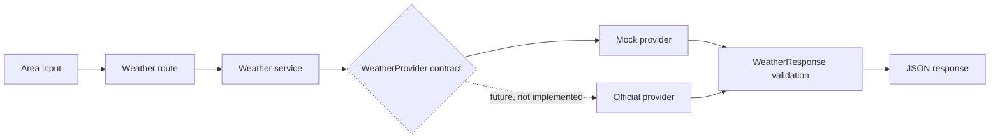

# Weather Provider API Contract
# 날씨 제공자 API 계약

Adopted error-display requirements: [provider policy](weather-provider-policy.md). Keep unavailable weather values and weather timestamps absent; do not substitute error time. Failure timestamp fields remain undecided; no runtime schema change in this documentation update.
채택된 오류 표시 요구사항은 [제공자 정책](weather-provider-policy.md)을 따릅니다. 실패 시 날씨 값·자료 시각을 비우고 오류 시각으로 대체하지 않습니다. 실패 시각 필드는 미결정이며 이번 문서 갱신에 실행 스키마 변경은 없습니다.

<!-- This document defines the stable boundary between the application and any weather provider. -->
<!-- 이 문서는 애플리케이션과 모든 날씨 제공자 사이의 안정적인 경계를 정의합니다. -->

## Why
<!-- Keep provider-specific authentication and response formats out of the UI. -->
<!-- 제공자별 인증과 응답 형식이 화면으로 퍼지지 않게 합니다. -->

The application uses one internal `WeatherResponse` shape. Mock data and a future official provider must satisfy the same shape.

애플리케이션은 하나의 내부 `WeatherResponse` 형식을 사용합니다. Mock 데이터와 향후 공식 제공자는 같은 형식을 만족해야 합니다.

## Contract

| Field | Meaning | Rule |
|---|---|---|
| `area` | Requested area | Non-empty normalized name |
| `status` | Data state | `available`, `no_data`, or `provider_error` |
| `source` | Data source label | Must identify the provider; current code is Mock-only |
| `condition` | Weather condition | Required only for `available` |
| `temperature` | Celsius temperature | Optional; never invented for failures |
| `precipitation_probability` | Percentage | Integer from 0 to 100 when supplied |
| `observed_at` | Observation time | Timezone-aware and required for `available` |
| `message` | Human-readable explanation | Required for unavailable states |

## Data flow

<!-- The route receives input, the service selects a provider, validation protects the response, and the UI receives JSON. -->
<!-- Route가 입력을 받고 서비스가 제공자를 선택하며 검증이 응답을 보호한 뒤 화면이 JSON을 받습니다. -->

## Known facts, assumptions, and limits

- Fact: The current implementation uses a deterministic Mock provider.
- 사실: 현재 구현은 결정적인 Mock 제공자를 사용합니다.
- Assumption: An official provider can be adapted to the same internal response.
- 가정: 공식 제공자는 같은 내부 응답 형식으로 변환할 수 있다고 가정합니다.
- Unknown: Official endpoint, authentication, coordinate conversion, refresh interval, and redistribution terms.
- 미결정: 공식 endpoint, 인증, 좌표 변환, 갱신 주기, 재배포 조건입니다.
- Limit: This contract does not claim road conditions, accessibility, safety advice, or live weather behavior.
- 한계: 이 계약은 도로 상태·접근성·안전 조언·실시간 날씨 동작을 주장하지 않습니다.

## Source and license gate

<!-- Do not connect a live provider until the official source and license are verified. -->
<!-- 공식 출처와 라이선스를 확인하기 전에는 실시간 제공자를 연결하지 않습니다. -->

- Source to verify: Korea Meteorological Administration official weather data documentation.
- 확인할 출처: 기상청 공식 날씨 데이터 문서입니다.
- License to verify: Dataset-specific terms and Korean Open Government License applicability.
- 확인할 라이선스: 데이터셋별 이용 조건과 공공누리 적용 여부입니다.
- Current status: Not verified for live integration; Mock-only behavior remains intentional.
- 현재 상태: 실시간 연동 조건은 확인되지 않았으며 Mock 전용 동작을 유지합니다.

## Provider policy
## 제공자 정책

<!-- Region policy selects a provider; it never merges unlabeled provider values. -->
<!-- 지역 정책이 제공자를 선택하며 출처 없는 Provider 값 병합은 하지 않습니다. -->

See [`weather-provider-policy.md`](./weather-provider-policy.md) for regional selection, fallback, and licensing rules.

지역별 선택·대체·라이선스 규칙은 [`weather-provider-policy.md`](./weather-provider-policy.md)를 참고합니다.
