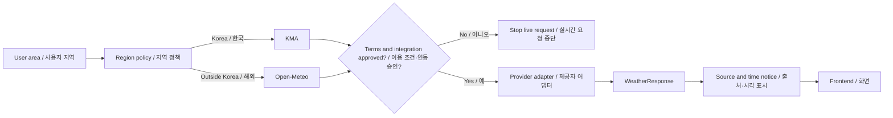

# Weather Provider Policy
# 날씨 제공자 정책

Adopted retry/cache design: [MVP policy](weather-retry-cache-policy.md). This does not resolve automatic provider switching or authorize live caching before terms verification.
채택된 재시도·캐시 설계는 [MVP 정책](weather-retry-cache-policy.md)을 따릅니다. 자동 제공자 전환은 별도 미결정이며 조건 확인 전 실 캐시를 승인하지 않습니다.

## Adopted error display principles
## 채택된 오류 표시 원칙

Decision record: [error display meeting](../office/meetings/2026-11-18-error-display-principles.md).
결정 기록: [오류 표시 회의록](../office/meetings/2026-11-18-error-display-principles.md).

Failures contain no invented measurements or weather timestamps. Failure time cannot replace data time. Known provider identity describes the attempted lookup, not missing data provenance. Use reviewed explanations and retry; do not blame a provider without established cause. Failure-time fields, caches, and automatic switching remain unresolved. These are adopted requirements, not a claim of completed implementation.
실패 시 측정값·자료 시각을 만들지 않고 실패 시각으로 자료 시각을 대체하지 않습니다. 확인된 제공자 이름은 조회 대상이며 없는 자료 출처가 아닙니다. 검토된 설명·재시도를 제공하고 확인 전 제공자 책임으로 단정하지 않습니다. 실패 시각 필드·캐시·자동 전환은 미결정입니다. 채택 요구사항이며 구현 완료 주장은 아닙니다.

<!-- This policy chooses providers by region without hiding source differences. -->
<!-- 이 정책은 출처 차이를 숨기지 않고 지역별 제공자를 선택합니다. -->

Decision record: [`2026-11-18 API source review`](../office/meetings/2026-11-18-api-source-review.md).

결정 기록: [`2026-11-18 API 출처 검토 회의록`](../office/meetings/2026-11-18-api-source-review.md).

## Operating principles
## 운영 원칙

1. Korea uses the Korea Meteorological Administration API as the default provider.
   - 한국 지역은 기상청 API를 기본 제공자로 사용합니다.
2. Overseas areas use Open-Meteo only as a separately identified candidate provider.
   - 해외 지역은 Open-Meteo를 별도 식별되는 후보 제공자로 사용합니다.
3. A provider failure never silently combines values from another provider.
   - 제공자 장애 시 다른 제공자의 값을 조용히 섞지 않습니다.
4. A successful response containing weather data displays its provider source and available data-reference time. Failures follow the adopted error-display rules above. Automatic provider switching remains undecided.
   - 날씨 자료가 있는 성공 응답은 제공자 출처와 존재하는 자료 기준 시각을 표시합니다. 실패 응답은 위의 채택된 오류 표시 원칙을 따릅니다. 자동 제공자 전환은 미결정입니다.
5. License terms and request limits are recorded per provider.
   - 라이선스 조건과 요청 제한은 제공자별로 기록합니다.
6. Every provider is normalized into `WeatherResponse` before frontend delivery.
   - 모든 제공자는 Frontend에 전달하기 전에 `WeatherResponse`로 변환합니다.
7. Live integration requires a fresh official-terms and commercial-use review.
   - 실제 연동 전에는 공식 이용 조건과 상업적 사용 가능성을 다시 검토합니다.

## Provider matrix
## 제공자 비교

| Region / 지역 | Provider / 제공자 | Role / 역할 | License status / 라이선스 상태 | Runtime status / 실행 상태 |
|---|---|---|---|---|
| Korea / 한국 | KMA / 기상청 | Default source / 기본 출처 | Record dataset terms / 데이터셋 조건 기록 필요 | Mock only / Mock 전용 |
| Outside Korea / 해외 | Open-Meteo | Expansion candidate / 확장 후보 | Review service terms and data attribution separately / 서비스 조건과 데이터 출처표시를 별도로 검토 | Not integrated / 미연동 |
| United States / 미국 | NOAA/NWS | Future candidate / 향후 후보 | Review terms and limits / 조건·제한 검토 필요 | Not integrated / 미연동 |

## Provider selection flow
## 제공자 선택 흐름

## Non-goals
## 범위 제외

- No live provider implementation is included in this policy change.
  - 이번 정책 변경에는 실시간 Provider 구현을 포함하지 않습니다.
- No provider values are merged into a synthetic consensus value.
  - 여러 Provider 값을 합쳐 가상의 합의 값을 만들지 않습니다.
- No commercial-use permission is inferred from a free endpoint.
  - 무료 endpoint라는 이유만으로 상업적 사용을 허용한다고 추정하지 않습니다.
