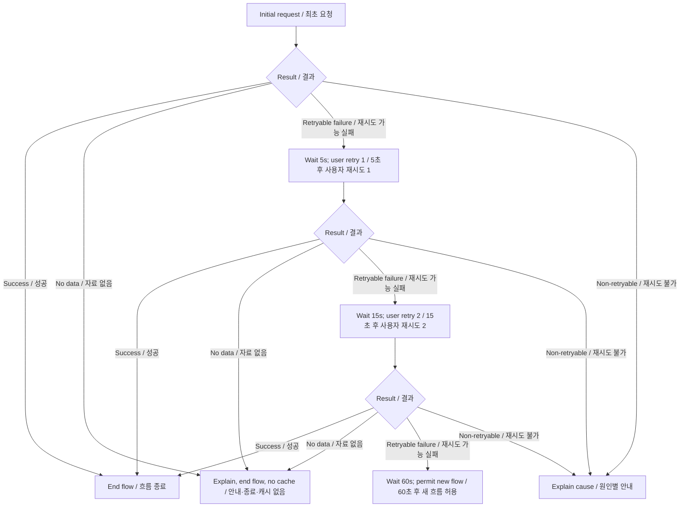

# MVP Retry and Cache Policy
# MVP 재시도·캐시 정책

Restoration and cancellation supplement: [retry state design](weather-retry-state-design.md). Dispatched retries remain spent after cancellation; cancellation itself is not a failed outcome.
복원·취소 보완: [재시도 상태 설계](weather-retry-state-design.md). 발송한 재시도는 취소 후에도 사용 횟수를 유지하며 취소 자체는 실패 결과가 아닙니다.

Status: adopted by the user on 2026-11-18. These are initial service design values, not provider guarantees. Adoption authorizes documentation; implementation, live integration, and deployment require their respective approval stages.
상태: 2026-11-18 사용자 채택. 제공자 보장값이 아닌 초기 서비스 설계값입니다. 채택 범위는 문서화이며 구현·실 연동·배포는 각 승인 단계를 따릅니다.

Decision record: [adoption meeting](../office/meetings/2026-11-18-retry-cache-adoption.md).
결정 기록: [정책 채택 회의록](../office/meetings/2026-11-18-retry-cache-adoption.md).

## Adopted values
## 채택값

| Item / 항목 | Policy / 정책 |
|---|---|
| Automatic retry / 자동 재시도 | 0 |
| User retries / 사용자 재시도 | At most 2 after initial request / 최초 요청 이후 최대 2회 |
| First retry / 첫 재시도 | 5 seconds after failure handling completes / 실패 처리 완료 후 5초 |
| Second retry / 두 번째 재시도 | 15 seconds after previous failure handling completes / 직전 실패 처리 완료 후 15초 |
| Exhausted flow / 한도 소진 | New flow allowed 60 seconds after final failure handling completes / 마지막 실패 처리 완료 후 60초 뒤 새 흐름 허용 |
| Successful-response TTL / 성공 캐시 TTL | 60 seconds from successful upstream retrieval and storage / 외부 조회 성공 후 저장 시점부터 60초 |
| Error cache / 오류 캐시 | Disabled / 사용하지 않음 |
| Expired cache / 만료 캐시 | Do not serve as fallback; remove and retrieve again / 대체 표시하지 않고 제거·재조회 |

## Request semantics
## 요청 의미

A flow covers one provider, normalized area/grid, data kind, and request conditions. Success ends the flow. Waiting never triggers an automatic request. Prevent duplicate submissions while a request is pending. Cancelled requests do not count as failed retries, but upstream calls already made still count toward usage. Region changes or reopening the screen must not bypass server-wide limits.
한 흐름은 동일 제공자·정규화 지역 또는 격자·자료 종류·요청 조건을 대상으로 합니다. 성공하면 종료합니다. 대기 종료는 자동 호출을 일으키지 않습니다. 요청 중 중복 제출을 막습니다. 취소 요청은 재시도 실패 횟수에서 제외하지만 이미 발생한 외부 호출은 사용량에 집계합니다. 지역 변경·화면 재진입으로 서버 전체 제한을 우회하지 않습니다.

Retry candidates are connection failure, timeout, and retryable temporary server failure. Input, authentication, and authorization errors must not repeat the same request. For rate limits, honor a valid Retry-After and the local wait using the later eligible time. Exact status classification and invalid/missing Retry-After handling must be specified before implementation.
재시도 후보는 연결 실패·시간 초과·재시도 가능한 일시적 서버 오류입니다. 입력·인증·권한 오류는 동일 요청을 반복하지 않습니다. 요청 제한에는 유효한 Retry-After와 자체 대기 중 더 늦은 시각을 적용합니다. 정확한 상태 분류와 Retry-After 누락·오류 처리는 구현 전에 명세해야 합니다.

## Cache semantics and display
## 캐시 의미와 표시

Cache keys distinguish provider, normalized area/grid, data kind, and all response-affecting request conditions. Reads never renew TTL. Preserve original data timestamps and upstream retrieval time. Cache age is not weather freshness. Display data source and relevant weather time; show waiting, pending, and exhausted states clearly. Countdown completion only enables user action.
캐시 키는 제공자·정규화 지역 또는 격자·자료 종류·응답에 영향을 주는 모든 요청 조건을 구분합니다. 읽기로 TTL을 연장하지 않습니다. 원본 자료 시각과 외부 조회 시각을 보존합니다. 캐시 나이는 날씨 최신성이 아닙니다. 출처·관련 자료 시각과 대기·조회 중·한도 소진 상태를 명확히 표시합니다. 카운트다운 종료는 사용자 행동만 허용합니다.

Live-provider caching stays disabled until storage/reuse terms are verified. Server-wide request budgets and weather freshness thresholds remain undecided. Provider switching remains a separate policy decision. Mock tests may validate the policy after implementation approval.
실 제공자 캐시는 저장·재사용 조건 확인 전 비활성화합니다. 서버 전체 호출 예산·자료 최신성 기준은 미결정입니다. 제공자 전환은 별도 정책 결정입니다. 구현 승인 후 Mock 테스트로 정책을 검증할 수 있습니다.

## Adopted review supplements
## 채택된 검토 보완

For the same flow key, resubmitting the area, remounting the screen, or refreshing must preserve the retry count and next eligible time, including the exhausted 60-second wait. UI lifecycle must not reset these limits. The enforcement scope and storage mechanism remain implementation decisions: define the client/session identity and retention before implementation approval. This is not a claim that cross-device enforcement already exists. Changing region creates a different flow but never bypasses provider-wide restrictions.
동일 흐름 키에서는 지역 재제출·화면 재진입·새로고침에도 재시도 횟수와 다음 허용 시각을 유지하며 한도 소진 후 60초 대기도 유지합니다. 화면 생명주기로 제한을 초기화하지 않습니다. 적용 범위·저장 방식은 구현 결정이며 구현 승인 전 클라이언트·세션 식별과 보존 범위를 정의해야 합니다. 기기 간 제한 구현 완료 주장은 아닙니다. 지역 변경은 별도 흐름이지만 제공자 전체 제한을 우회하지 않습니다.

A valid no_data response ends the flow without consuming a failed-retry allowance. Show the no-data explanation and area selection; do not run the 5/15/60-second failure sequence. Do not cache no_data in the MVP: only available weather responses receive the 60-second TTL. A new explicit lookup remains subject to provider-wide rate limits and any active Retry-After; no_data does not promise unrestricted immediate requests. The user adopted these supplements on 2026-11-18. They do not redefine the adopted numeric values; implementation still requires its approved plan.
유효한 no_data 응답은 실패 재시도 횟수를 소진하지 않고 흐름을 종료합니다. 자료 없음·지역 선택을 안내하며 실패용 5초·15초·60초 순서를 적용하지 않습니다. MVP에서 no_data는 캐시하지 않고 available 날씨 응답에만 60초 TTL을 적용합니다. 새 명시적 조회도 제공자 전체 제한과 유효한 Retry-After를 따르며 무제한 즉시 요청을 보장하지 않습니다. 사용자가 2026-11-18 이 보완을 채택했습니다. 채택 숫자는 유지하며 구현은 승인된 계획을 따라야 합니다.

The diagram shows local minimum waits. A valid longer provider wait overrides them. Future validation must cover countdown boundaries, cancellation, duplicate submissions, rate limits, cache expiry, and provenance preservation.
흐름도는 자체 최소 대기입니다. 유효한 더 긴 제공자 대기가 우선합니다. 향후 검증은 대기 경계·취소·중복 제출·요청 제한·캐시 만료·출처 보존을 포함해야 합니다.

Supplement decision: [review meeting](../office/meetings/2026-11-18-retry-supplement-review.md).
보완 결정: [재검토 회의록](../office/meetings/2026-11-18-retry-supplement-review.md).
