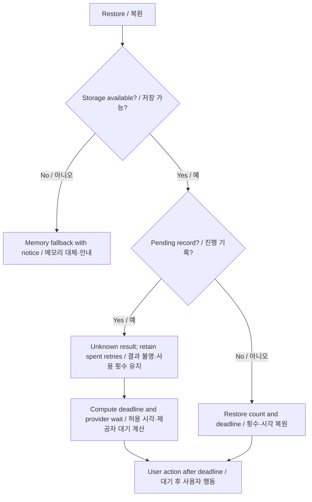

# Retry State Design
# 재시도 상태 설계

## Adopted lifetime assumption
## 채택한 유효기간 가정

The intermediate-flow lifetime is configurable, initially 30 minutes. Evidence classification: user-adopted initial assumption; not an official API rule or measured optimum. Unknown-result expiry and corrupt-record recovery were subsequently adopted in the [implementation specification](weather-retry-state-implementation.md).
중간 흐름 유효기간은 조정 가능한 초기값 30분입니다. 근거 분류는 사용자 채택 초기 가정이며 공식 API 규칙·실측 최적값이 아닙니다. 결과 불명 만료 기준·손상 복구는 후속 채택된 [구현 명세](weather-retry-state-implementation.md)를 따릅니다.

Status: the user directed staged progression with the recommended design on 2026-11-18. This documents the design; implementation remains subject to a concrete implementation plan and approval.
상태: 2026-11-18 사용자가 권장 설계로 단계별 진행을 지시했습니다. 설계를 문서화하며 구현은 구체적인 계획·승인 후 진행합니다.

## Scope and persistence
## 범위와 상태 유지

Start with same-tab reload/remount persistence using sessionStorage, with in-memory state as the fallback when storage fails. Explain that reload persistence is unavailable in fallback mode. Cross-tab/device consistency and abuse prevention are not guaranteed by this client state; backend request control remains separate. Do not persist credentials or raw coordinates.
sessionStorage로 같은 탭의 새로고침·재진입 상태를 유지하며 저장 실패 시 메모리 상태로 대체합니다. 대체 모드에서는 재진입 유지가 불가능함을 안내합니다. 이 클라이언트 상태는 탭·기기 간 일관성이나 남용 방지를 보장하지 않으며 서버 호출 통제는 별도입니다. 인증정보·원본 좌표를 저장하지 않습니다.

## Cancellation and attempt accounting
## 취소와 시도 집계

Before dispatch, cancellation consumes no attempt. After retry dispatch, cancellation is not classified as a failed result, but the retry remains spent. This supplements the prior cancellation rule; it does not restore a dispatched retry. Initial dispatch is not one of the two retries. Preserve active provider restrictions across cancellation and restoration.
발송 전 취소는 시도를 소모하지 않습니다. 재시도 발송 후 취소는 실패 결과로 분류하지 않지만 사용한 재시도 횟수는 유지합니다. 기존 취소 규칙의 보완이며 발송한 재시도를 복구하지 않습니다. 최초 발송은 재시도 2회에 포함하지 않습니다. 취소·복원 시 유효한 제공자 제한을 보존합니다.

## Unknown-result restoration
## 결과 불명 복원

Evidence: frontend/src/services/weatherApi.ts currently sets AbortSignal.timeout(10000). This is a client request timeout, not proof that server or upstream work stops at ten seconds.
근거: 현재 frontend/src/services/weatherApi.ts는 AbortSignal.timeout(10000)을 사용합니다. 클라이언트 제한이며 서버·외부 처리가 10초에 중단됨을 증명하지 않습니다.

| Interrupted dispatch / 중단 발송 | Earliest local eligibility / 자체 최소 허용 시각 |
|---|---|
| Initial / 최초 | dispatched_at + 10s + 5s / 발송 시각 + 10초 + 5초 |
| Retry 1 / 재시도 1 | dispatched_at + 10s + 15s / 발송 시각 + 10초 + 15초 |
| Retry 2 / 재시도 2 | dispatched_at + 10s + 60s / 발송 시각 + 10초 + 60초 |

This conservative rule applies to restored unknown results, not normal failures, whose waits still start after failure handling completes. Use the later of local eligibility and a known valid provider wait. When elapsed, permit explicit user action; never auto-dispatch. Display unknown result, not provider failure or no_data. Request-timeout changes require this formula to be reviewed together.
이 보수적 규칙은 복원된 결과 불명에만 적용하며 일반 실패 대기는 기존처럼 실패 처리 완료부터 계산합니다. 자체 허용 시각과 확인된 유효 제공자 대기 중 더 늦은 것을 적용합니다. 경과 후 사용자 조회만 허용하며 자동 발송하지 않습니다. 제공자 실패·no_data가 아닌 결과 불명을 표시합니다. 요청 제한 변경 시 이 계산식도 함께 검토합니다.

## Before implementation
## 구현 전 결정

Specify storage version/schema, request-key normalization, deletion/retention of abandoned flows, malformed records, storage denial, clock changes, and the boundary used to record dispatch. Validate with fake clocks and simulated storage, cancellation, reload, no_data, and provider waits. No runtime changes are claimed here.
저장 버전·형식·키 정규화·중단 흐름 보존 및 삭제·손상 기록·저장 거부·시계 변경·발송 기록 경계를 명세해야 합니다. 가상 시계·저장·취소·새로고침·no_data·제공자 대기로 검증합니다. 실행 변경 완료를 주장하지 않습니다.

Decision meeting: [retry state review](../office/meetings/2026-11-18-retry-state-design.md). Parent policy: [retry/cache](weather-retry-cache-policy.md).
결정 회의와 상위 정책은 위 링크를 따릅니다.
